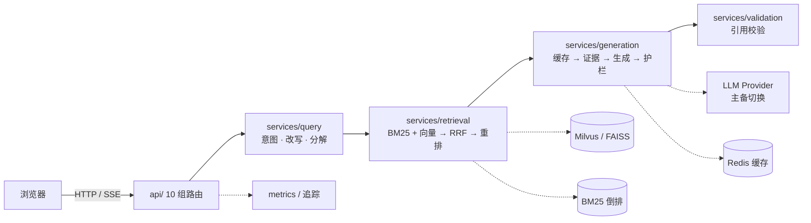

# Kquery

[](./LICENSE)
[](./backend/pyproject.toml)
[](./frontend/package.json)
[](./tests)

**面向企业文档库的混合检索 RAG 问答系统。** 把 PDF / Word / PPT / Excel / Markdown / 图片入库，提供带原文引用的问答、快问、会话存档、图谱视图与检索诊断。

它的重点不是"接一个大模型"，而是三件更难的事：**召回得准**（向量 + BM25 混合召回 + RRF 融合 + 重排）、**答得可查**（每个结论都能回到分块）、**跑得住**（异步入库、请求截止时间、依赖降级、全链路指标）。

## 核心能力

| 能力 | 说明 |
| --- | --- |
| 多格式入库 | 50+ 种扩展名的解析分派，异步任务 + 进度查询 + 失败原因定位 |
| 混合检索 | BM25 与向量双路召回，RRF 融合后重排；检索参数可在运行时调整并即时生效 |
| 查询理解 | 意图识别、查询改写、多跳分解，改写与原话同时召回、以原话重排 |
| 自检与迭代 | CRAG 多轮证据自评：证据不足时改写查询再召回，而不是硬答 |
| 可追溯回答 | 证据编号 + 引用校验，无依据内容降级标注 |
| Agentic 问答 | LangGraph 状态机（Plan / Tool / Reflect / Replan），带 checkpoint 可恢复 |
| 多模型通道 | 生成 / 向量 / 重排三条通道独立配置，支持主备降级与成本台账 |
| 可观测 | Prometheus 指标、阶段耗时、trace 级成本、检索诊断面板 |
| 前端 | React + TypeScript 管理台与问答界面，流式增量渲染 |

## 架构



`backend/app` 分四层：`api/`（协议适配）→ `services/`（能力域）→ `domain/`（模型与仓储接口）→ `core/`（配置、错误、指标底座），`assembly/` 负责把服务、路由、生命周期接起来。详见 [wiki/01-架构总览](./wiki/01-架构总览.md)。

## 快速开始

### Docker Compose（推荐）

```bash
cp backend/.env.example backend/.env     # 填入模型 API Key（敏感字段见文件标注）
cd deploy/docker
docker compose up -d --build
```

- 前端：<http://127.0.0.1:8090>
- 后端：<http://127.0.0.1:8100>（`/openapi.json`、`/metrics`）
- 首次启动 `init` 容器建表后会退出，属正常现象

### 本地开发

```bash
# 后端
cd backend && uv sync && cp .env.example .env
uv run uvicorn app.main:app --reload --port 8100

# 前端
cd frontend && npm install && npm run dev
```

只想起向量库：`cd deploy/milvus && docker compose up -d`。

### 一个请求

```bash
# 入库
curl -s -F "file=@manual.pdf" http://127.0.0.1:8100/knowledge/upload
curl -s http://127.0.0.1:8100/knowledge/tasks/<task_id>

# 流式问答（SSE：evidence → answer → done）
curl -N -X POST http://127.0.0.1:8100/ask/stream \
  -H 'Content-Type: application/json' \
  -d '{"question":"退换货时效是多久？"}'
```

## 项目结构

```
├── backend/            FastAPI 服务：解析 / 检索 / 生成 / Agent / 图谱
├── frontend/           React + TypeScript 单页应用
├── tests/              全部测试：unit / integration / format / contract / security / e2e（含 ui、scripts）/ frontend
├── deploy/             部署资产：docker（compose + Dockerfile）、nginx、k8s、milvus、告警规则
├── scripts/            运维（备份、演练、容量、压测）、评测、文档工具
├── wiki/               技术文档：架构、检索链路、接口、部署、测试、配置
```

约定：**测试只放 `tests/`**，**部署文件只放 `deploy/`**，**运维脚本放 `scripts/`**（需要真实服务的验证脚本放 `tests/e2e/scripts/`）。

## 测试与评测

```bash
# 后端 2042 例：测试连真实 Milvus 服务（不再用内嵌 Lite），先起依赖
cd deploy/docker && docker compose up -d etcd milvus && cd -
KQUERY_MILVUS_URI=http://localhost:19531 uv run --project backend python -m pytest

# 前端 109 例
cd frontend && npm install && npm test
```

测试不会污染业务集合：所有用例共用一个 `kquery_test` 集合，每个用例开始前清空、整个会话结束后删除。

检索/生成逻辑的改动请附评测集前后对比（`tests/data/eval/baseline.json` 口径），通过标准与运行方式见 [wiki/05-测试与评测](./wiki/05-测试与评测.md)。

## 配置

- 唯一真相源是 `backend/app/core/config.py` 的 `Settings`；`backend/.env.example` 由脚本自动生成，**不要手改**。
- 生成 / 向量 / 重排三条通道独立配置，无凭据时自动回落 mock，方便本地跑通。
- 有三处阈值（CRAG 两个阈值、参数化兜底阈值、降级慢阈值）**必须按自有语料重新标定**，默认值只适用于本项目语料。细节见 [wiki/06-配置参考](./wiki/06-配置参考.md)。

## 部署

Docker Compose、裸机、Kubernetes（含灰度）三种方式与故障排查见 [wiki/04-部署与运维](./wiki/04-部署与运维.md)。

> **安全提示**：本仓库**不含应用层认证**（无登录、无 ACL、无角色门禁），所有请求身份固定为 `default/local`。公网部署前必须在网关或反向代理层加鉴权，并关闭 `APP_ENV=prod` 下的交互式文档。

## 文档

| 文档 | 内容 |
| --- | --- |
| [wiki/](./wiki/README.md) | 架构、检索链路、接口参考、部署运维、测试评测、配置 |
| [CONTRIBUTING.md](./CONTRIBUTING.md) | 开发环境、代码规范、提交与 PR 要求 |

## 贡献

欢迎提交 Issue 与 PR。提交前请完成 [wiki/05-测试与评测 §6](./wiki/05-测试与评测.md) 的检查清单。

## License

[Apache-2.0](./LICENSE)
