# KQuery Pro — 企业级智能销售助手平台 UML 图表文档

> **最后更新**: 2026-07-19  
> **项目版本**: v3.0.0  
> **架构体系**: 七层分层架构

本文档包含 KQuery Pro 企业级智能销售助手平台的完整 UML 图，使用 Mermaid 语法编写，全面反映七层架构设计。

---

## 1. 系统架构图

展示 KQuery Pro 的七层架构：多端交互层、API 网关层、会话管理层、业务服务层、核心决策层、连接集成层、数据持久层。

```mermaid
graph TB
    subgraph Layer1["① 多端交互层"]
        WeChat["微信小程序<br/>销售助手"]
        WebApp["Web 管理后台<br/>(Vue/React)"]
        MobileApp["移动 APP<br/>销售端"]
        VoiceSDK["语音转文字 SDK<br/>(ASR 集成)"]
    end

    subgraph Layer2["② API 网关层 (FastAPI)"]
        Auth_API["/api/v1/auth/*<br/>JWT 鉴权"]
        RateLimit_API["限流中间件<br/>Redis 滑动窗口"]
        Session_API["/api/v1/agent/session/*<br/>会话路由"]
        RAG_API["/api/v1/kquery/*<br/>知识检索"]
        Agent_API["/api/v1/agent/*<br/>Agent 调度"]
        Graph_API["/api/v1/graph/*<br/>知识图谱"]
        GraphRAG_API["/api/v1/graphrag/*<br/>GraphRAG 检索"]
        Ext_API["/api/v1/notes|mindmap|web-search|speech|memory|tasks|skills|knowledge-bases/*<br/>拓展能力"]
        Health["/health<br/>健康检查"]
    end

    subgraph Layer3["③ 会话管理层"]
        RedisCache["Redis 分布式缓存<br/>会话缓存 + 结果缓存"]
        StateMachine["对话状态机<br/>状态流转管理"]
        SessionStore["会话存储<br/>上下文持久化"]
        LockManager["分布式锁<br/>并发控制"]
    end

    subgraph Layer4["④ 业务服务层"]
        subgraph IntentServices["意图识别服务"]
            IntentModel["意图识别模型<br/>(NLU/分类)"]
            SlotFilling["槽位填充<br/>参数提取"]
            MultiTurn["多轮对话管理"]
        end

        subgraph RAGEngine["RAG 检索引擎"]
            Retriever["retriever.py<br/>(向量+HyDE+RRF+重排)"]
            Embedding["embedding.py<br/>文本向量化"]
            Chunking["chunking.py<br/>文档分块"]
            BM25["BM25 关键词检索"]
            Reranker["reranker.py<br/>重排序"]
        end

        subgraph ScriptLib["销售话术模板库"]
            ScriptTemplate["话术模板管理"]
            SceneMapping["场景-话术映射"]
            DynamicScript["动态话术生成"]
        end

        subgraph KnowledgeGraph["知识图谱服务"]
            GraphBuilder["graph_builder.py<br/>图谱构建"]
            EntityExtraction["entity_extraction.py<br/>实体抽取"]
            RelationExtraction["relation_extraction.py<br/>关系抽取"]
            GraphQuery["graph_query.py<br/>图谱查询"]
            CommunityEngine["community_engine.py<br/>社区发现(Leiden)"]
        end
    end

    subgraph Layer5["⑤ 核心决策层"]
        AgentScheduler["Agent 流程调度算法<br/>多 Agent 编排"]
        BizRuleEngine["业务规则引擎<br/>销售策略规则"]
        WorkflowEngine["工作流引擎<br/>销售流程编排"]
        DecisionEvaluator["决策评估器<br/>效果反馈优化"]
    end

    subgraph Layer6["⑥ 连接集成层"]
        CRM_Connector["CRM 系统 API<br/>客户数据同步"]
        OrderSDK["订单系统对接 SDK<br/>下单/查询"]
        ExternalAIService["外部 AI 服务<br/>通义千问/文心"]
        WebhookAdapter["Webhook 适配器<br/>事件通知"]
    end

    subgraph Layer7["⑦ 数据持久层"]
        SQLite["SQLite 业务数据库<br/>用户/订单/配置"]
        Milvus["Milvus 向量知识库<br/>文本向量"]
        Neo4j["Neo4j 图数据库<br/>知识图谱"]
        FileStorage["文件存储<br/>(文档/图片/音频)"]
    end

    Layer1 --> Layer2
    Layer2 --> Layer3
    Layer3 --> Layer4
    Layer4 --> Layer5
    Layer5 --> Layer6
    Layer6 --> Layer7
```

---

## 2. 用例图

展示用户与 KQuery Pro 企业级智能销售助手平台的核心交互场景。

```mermaid
graph LR
    actor SalesPerson["销售员"]
    actor Manager["销售经理"]
    actor Admin["系统管理员"]

    subgraph Auth["认证与授权"]
        UC1["登录/注册"]
        UC2["JWT 身份验证"]
        UC3["角色权限校验"]
    end

    subgraph Session["会话管理"]
        UC4["发起对话"]
        UC5["多轮连续对话"]
        UC6["查看对话历史"]
        UC7["切换客户场景"]
    end

    subgraph Intent["意图识别"]
        UC8["客户意图分析"]
        UC9["销售阶段判断"]
        UC10["参数自动提取"]
    end

    subgraph RAG["知识检索"]
        UC11["销售话术查询"]
        UC12["产品知识检索"]
        UC13["竞品对比查询"]
        UC14["行业资讯检索"]
    end

    subgraph Agent["智能决策"]
        UC15["销售策略推荐"]
        UC16["下一步行动建议"]
        UC17["异议处理方案"]
        UC18["跟单提醒"]
    end

    subgraph CRM["客户管理"]
        UC19["客户信息查询"]
        UC20["订单状态查询"]
        UC21["客户画像分析"]
        UC22["销售记录同步"]
    end

    subgraph AdminPanel["系统管理"]
        UC23["话术模板管理"]
        UC24["知识库维护"]
        UC25["规则配置"]
        UC26["数据统计报表"]
    end

    SalesPerson --> UC1 & UC2 & UC3
    SalesPerson --> UC4 & UC5 & UC6 & UC7
    SalesPerson --> UC8 & UC9 & UC10
    SalesPerson --> UC11 & UC12 & UC13 & UC14
    SalesPerson --> UC15 & UC16 & UC17 & UC18
    SalesPerson --> UC19 & UC20 & UC21 & UC22

    Manager --> UC15 & UC16 & UC17
    Manager --> UC23 & UC24 & UC25 & UC26

    Admin --> UC23 & UC24 & UC25 & UC26
    Admin --> UC1 & UC2 & UC3
```

---

## 3. 流程图

展示销售助手从接收用户语音到生成销售建议的完整处理流程。

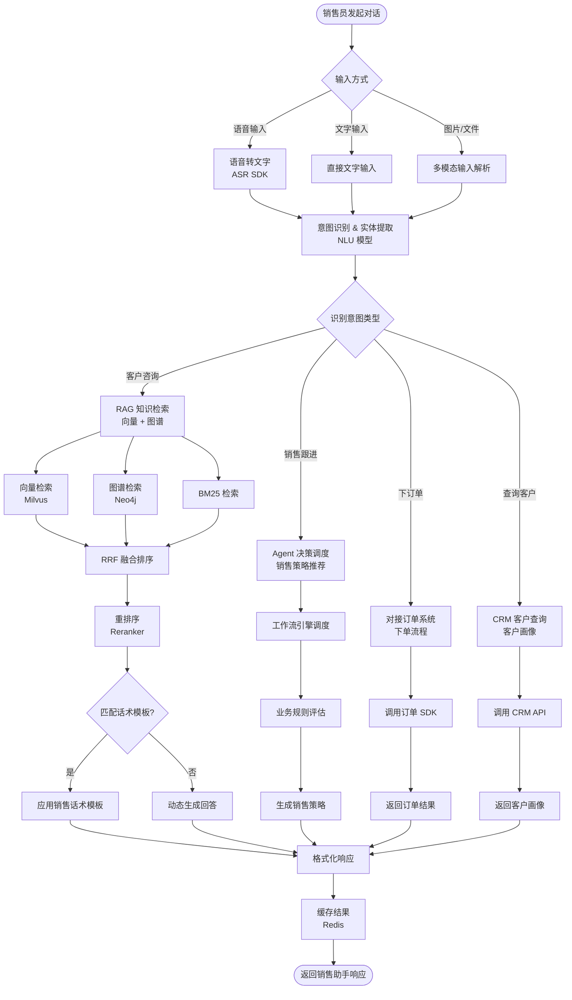

---

## 4. 活动图

展示 Agent 智能决策与多引擎协作的完整活动流程。

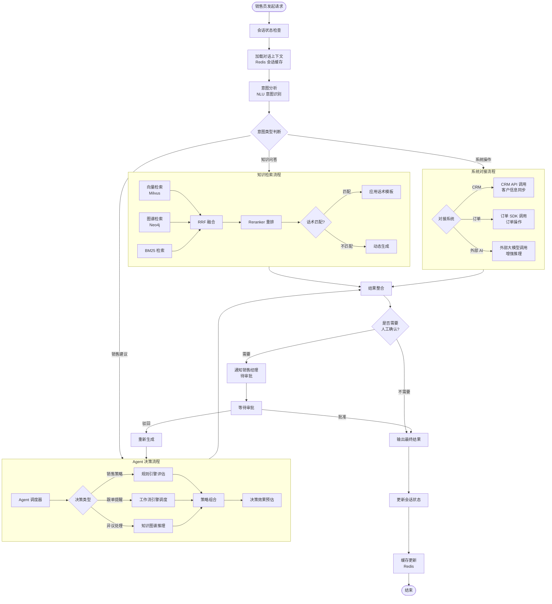

---

## 5. 时序图

展示销售员从发起语音查询到获取销售建议的完整端到端交互流程。

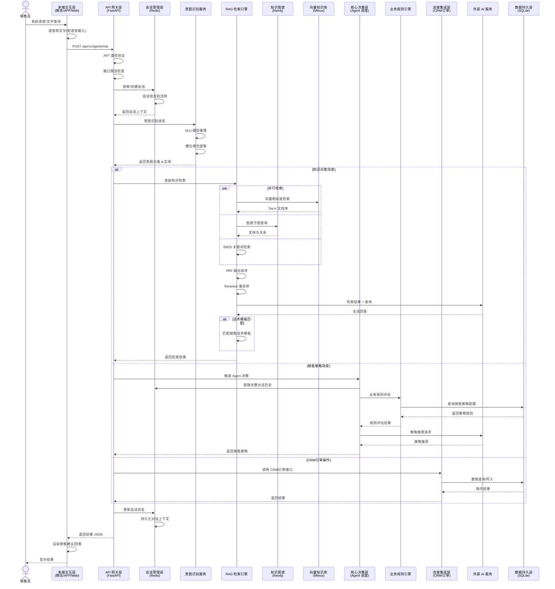

---

## 6. 类图

展示 KQuery Pro 核心服务类之间的七层架构关系。

```mermaid
classDiagram
    %% 多端交互层
    class VoiceHandler {
        -asr_sdk: ASRClient
        -language: str
        +speech_to_text(audio: bytes): str
        +text_to_speech(text: str): bytes
    }

    class WebClient {
        -session_id: str
        -user_id: str
        +send_message(msg: str): Response
        +upload_file(file: File): str
    }

    %% API 网关层
    class APIGateway {
        -auth_handler: JWTAuth
        -rate_limiter: RateLimiter
        -router: Router
        +authenticate(token: str): User
        +rate_limit(key: str): bool
        +route_request(req: Request): Response
    }

    class JWTAuth {
        -secret_key: str
        -algorithm: str
        +generate_token(user: User): str
        +verify_token(token: str): Claims
        +refresh_token(token: str): str
    }

    class RateLimiter {
        -strategy: TokenBucket
        -limits: dict
        +check_limit(key: str): bool
        +get_remaining(key: str): int
    }

    %% 会话管理层
    class SessionManager {
        -redis_client: RedisClient
        -state_machine: DialogStateMachine
        +create_session(user_id: str): Session
        +get_context(session_id: str): DialogContext
        +update_state(session_id: str, state: State): bool
    }

    class DialogStateMachine {
        -states: list~State~
        -transitions: dict
        +transition(current: State, event: Event): State
        +validate_transition(from_state: State, to_state: State): bool
    }

    class DistributedCache {
        -redis: RedisCluster
        -l1_cache: LRUCache
        +get(key: str): Any
        +set(key: str, value: Any, ttl: int)
        +invalidate(pattern: str)
    }

    %% 业务服务层
    class IntentService {
        -nlu_model: NLUModel
        -slot_filler: SlotFilling
        +classify_intent(text: str): IntentResult
        +extract_entities(text: str): List~Entity~
        +fill_slots(text: str, intent: Intent): dict
    }

    class RAGEngine {
        -retriever: HybridRetriever
        -embedding: EmbeddingService
        -reranker: Reranker
        +retrieve(query: str, top_k: int): List~Chunk~
        +hybrid_search(query: str): SearchResult
        +rerank(query: str, chunks: List~Chunk~): List~Chunk~
    }

    class HybridRetriever {
        -vector_retriever: VectorRetriever
        -graph_retriever: GraphRetriever
        -bm25_retriever: BM25Retriever
        +semantic_search(query: str): List~Chunk~
        +graph_search(query: str): List~Entity~
        +keyword_search(query: str): List~Chunk~
        +fusion_search(results: List): RRFResult
    }

    class ScriptTemplateManager {
        -templates: dict
        -scene_mapping: dict
        +match_template(intent: Intent, scene: Scene): Script
        +generate_dynamic(context: DialogContext): Script
        +evaluate_effectiveness(script_id: str): float
    }

    class KnowledgeGraphService {
        -graph_builder: GraphBuilder
        -entity_extractor: EntityExtraction
        -relation_extractor: RelationExtraction
        +build_graph(docs: List~Document~): Graph
        +query_subgraph(entity: str, depth: int): SubGraph
        +find_communities(): List~Community~
    }

    class EntityExtraction {
        -llm_client: LLMClient
        -rules: List~Rule~
        +extract_entities(text: str): List~Entity~
        +batch_extract(texts: List~str~): List~Entity~
    }

    %% 核心决策层
    class AgentScheduler {
        -workflow_engine: WorkflowEngine
        -rule_engine: BizRuleEngine
        -decision_evaluator: DecisionEvaluator
        +schedule(intent: Intent, context: Context): Action
        +orchestrate_agents(agents: List~Agent~): Result
        +evaluate_decision(action: Action): DecisionScore
    }

    class BizRuleEngine {
        -rules: List~BizRule~
        -rule_compiler: RuleCompiler
        +evaluate(context: dict): RuleResult
        +execute_rule(rule_id: str, params: dict): Any
    }

    class WorkflowEngine {
        -workflows: dict
        -executor: WorkflowExecutor
        +start_workflow(workflow_id: str, params: dict): Execution
        +get_status(execution_id: str): Status
        +cancel_workflow(execution_id: str): bool
    }

    class DecisionEvaluator {
        -metrics: dict
        +evaluate_outcome(action: Action, result: Result): Score
        +optimize_strategy(strategy: Strategy): Strategy
    }

    %% 连接集成层
    class CRMConnector {
        -api_client: HTTPClient
        -sync_strategy: SyncStrategy
        +query_customer(customer_id: str): Customer
        +sync_sales_record(record: SalesRecord): bool
        +update_customer_stage(customer_id: str, stage: str): bool
    }

    class OrderSDK {
        -api_endpoint: str
        -auth_credentials: dict
        +create_order(order: Order): OrderResult
        +query_order(order_id: str): Order
        +cancel_order(order_id: str): bool
    }

    class ExternalAIService {
        -providers: dict
        -load_balancer: LoadBalancer
        +chat_completion(messages: List~Message~): Response
        +embeddings(text: str): Vector
        +function_call(name: str, args: dict): Any
    }

    %% 数据持久层
    class SQLiteRepository {
        -session: Session
        +query(model: Model, filters: dict): List~Record~
        +save(entity: Entity): Entity
        +delete(model: Model, id: str): bool
    }

    class MilvusConnector {
        -collection: Collection
        +insert(vectors: List~Vector~, metadata: List~dict~)
        +search(query: Vector, top_k: int): List~SearchResult~
        +delete(ids: List~str~)
    }

    class Neo4jConnector {
        -driver: Driver
        +create_node(label: str, properties: dict): Node
        +create_relationship(type: str, from_node: Node, to_node: Node): Relationship
        +query(cypher: str): List~Record~
        +find_neighbors(node_id: str, depth: int): List~Node~
    }

    %% 数据模型
    class Session {
        +id: str
        +user_id: str
        +state: str
        +context: dict
        +created_at: datetime
        +expires_at: datetime
    }

    class DialogContext {
        +session_id: str
        +history: List~Message~
        +current_intent: Intent
        +extracted_entities: dict
        +scene: str
    }

    class IntentResult {
        +intent_type: str
        +confidence: float
        +entities: List~Entity~
        +slots: dict
    }

    class SalesScript {
        +id: str
        +scene: str
        +intent_type: str
        +template: str
        +variables: List~str~
        +effectiveness: float
    }

    %% 关系定义
    APIGateway --> JWTAuth
    APIGateway --> RateLimiter
    APIGateway --> SessionManager
    APIGateway --> IntentService
    APIGateway --> RAGEngine
    APIGateway --> AgentScheduler
    APIGateway --> CRMConnector

    SessionManager --> DialogStateMachine
    SessionManager --> DistributedCache

    IntentService --> DistributedCache

    RAGEngine --> HybridRetriever
    RAGEngine --> ScriptTemplateManager

    HybridRetriever --> MilvusConnector
    HybridRetriever --> Neo4jConnector
    KnowledgeGraphService --> Neo4jConnector
    KnowledgeGraphService --> EntityExtraction

    AgentScheduler --> WorkflowEngine
    AgentScheduler --> BizRuleEngine
    AgentScheduler --> DecisionEvaluator
    AgentScheduler --> RAGEngine
    AgentScheduler --> ExternalAIService

    CRMConnector --> SQLiteRepository
    OrderSDK --> SQLiteRepository

    VoiceHandler --> APIGateway
    WebClient --> APIGateway

    DialogStateMachine --> Session
    ScriptTemplateManager --> SalesScript
```

---

## 7. 组件图

展示系统主要组件及其跨层接口关系。

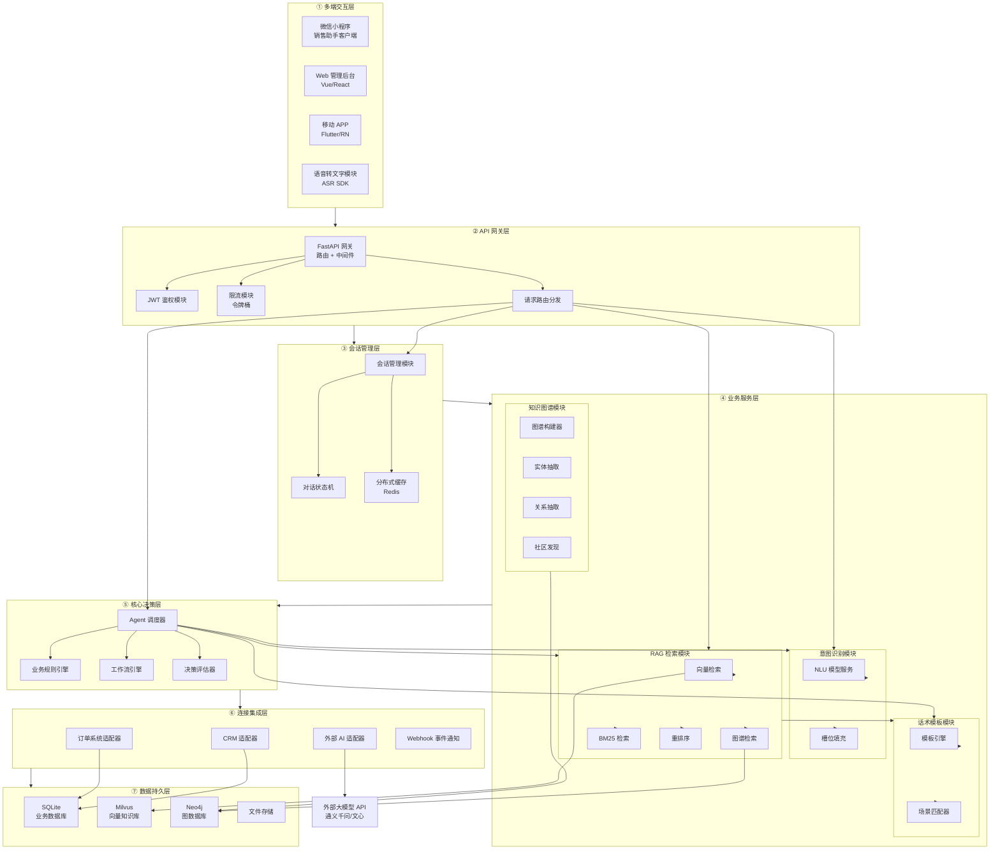

---

## 8. 部署架构图

展示 KQuery Pro 企业级智能销售助手平台的容器化部署架构。

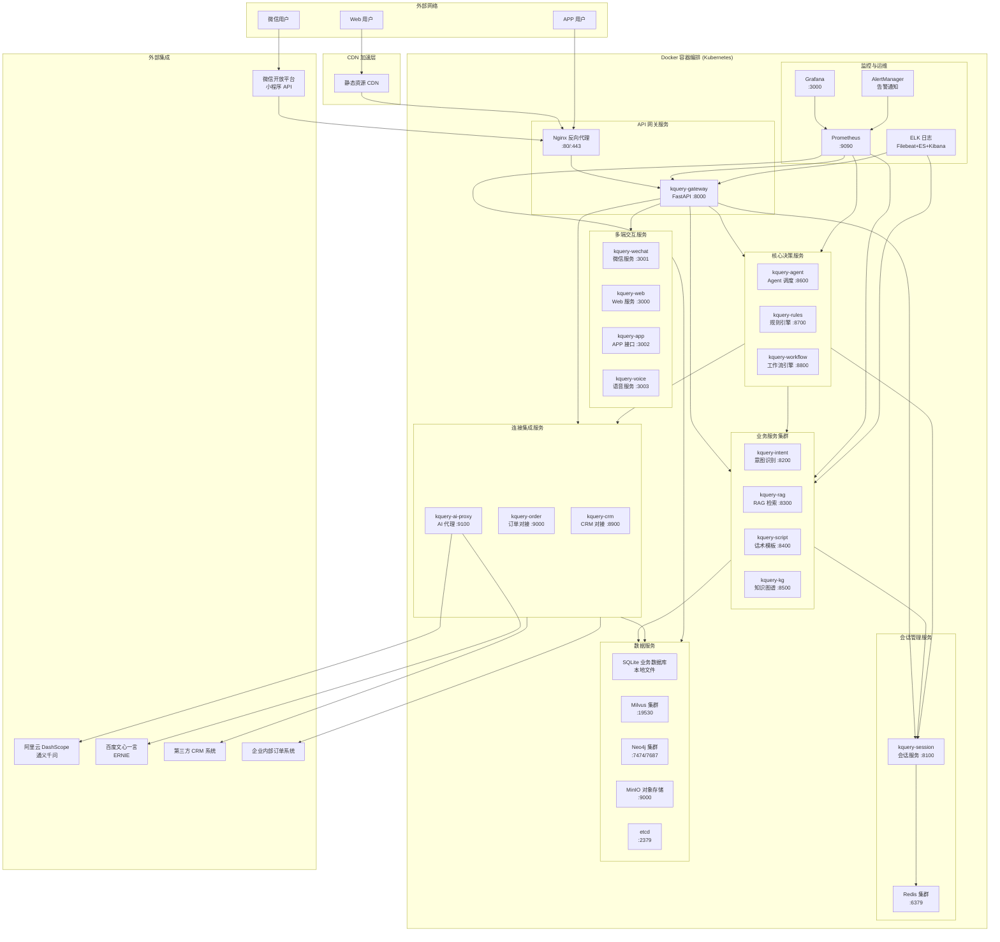

---

## 9. 缓存架构图

展示 Redis 分布式缓存 + 多级缓存架构。

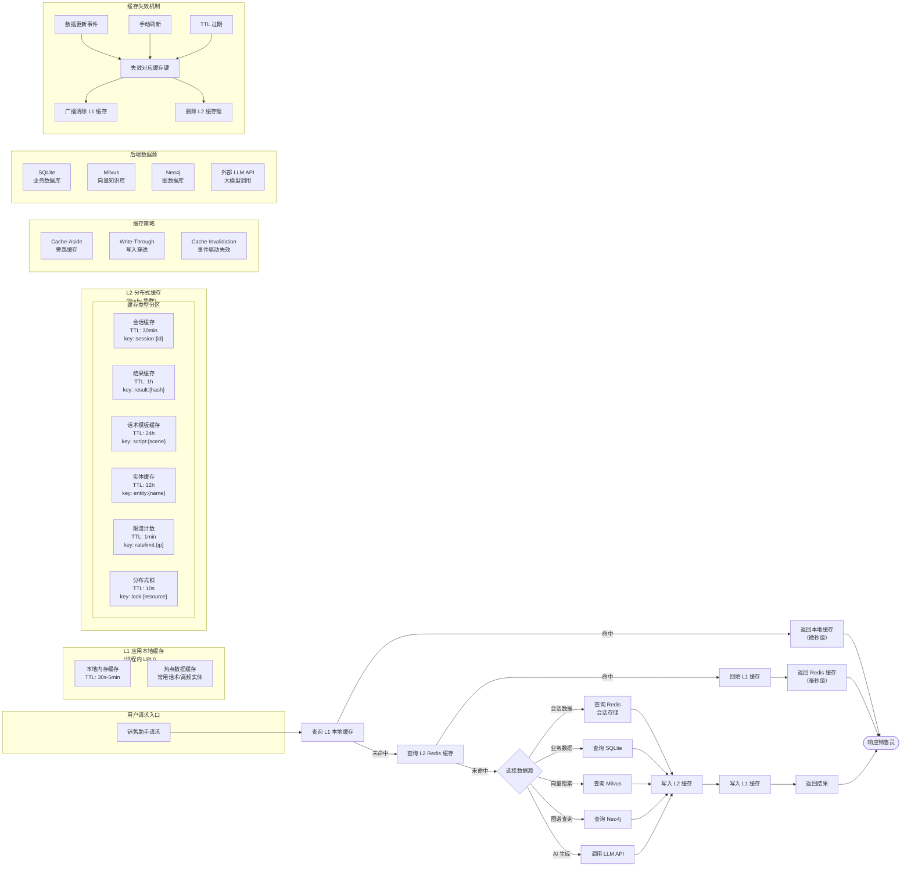

---

## 10. 拓展能力图（对标腾讯 ima）

展示 P0（多模型切换、AI 写作笔记、思维导图、联网搜索）、P1（语音、长期记忆、任务式 Agent）、P2（共享知识库、Skills 生态）在七层架构中的组件与时序关系，与《接口设计文档》第 12 章、《系统架构文档》第 18 章对应。

### 10.1 拓展能力组件图

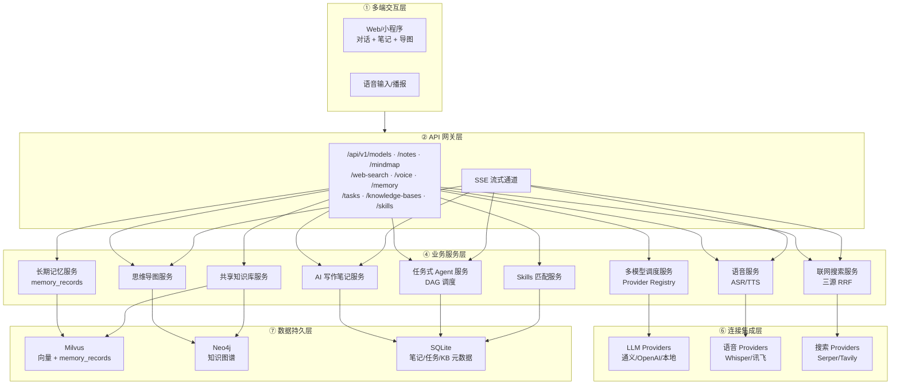

### 10.2 联网搜索增强时序图

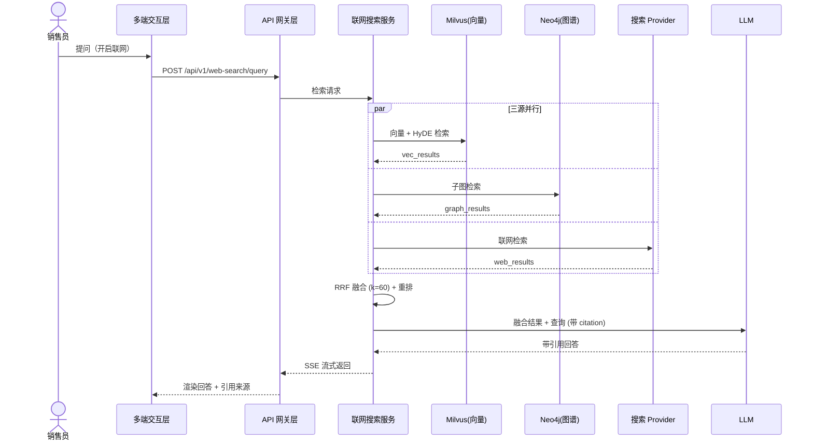

### 10.3 任务式 Agent（DAG）时序图

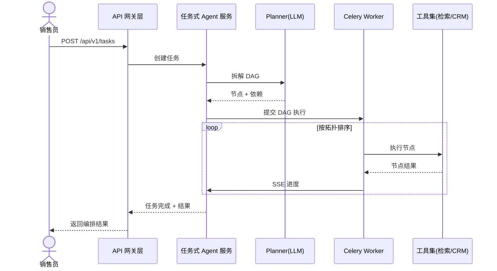

---

*文档生成时间：基于 KQuery Pro v3.0 七层架构文档自动生成*
