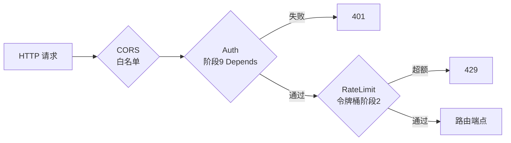

# Kquery 接口与工具

> - **文档日期**：2026-10-05
> - **对应代码**：`/Users/lizhipeng/workspace/project/Kquery/backend/app/` 当前代码
> - **覆盖内容**：REST API（ask / knowledge / ingest / analysis / feedback / admin / sessions / graph / reports / security）+ 9 阶段演进
> - **依据设计文档**：`doc/series/` 10 阶段系列
> - **体系**：本文为接口总览与速查（§一/§三/§十二）

---

## 〇、文档结构约定

本文档每个一级章节下统一采用两层结构：

| 层级 | 作用 | 形式 |
|---|---|---|
| **项目实现** | 对应当前代码的具体行为（路由、参数、配置） | 表格 / 列表 / 代码片段 / mermaid |
| **原理** | 解释为什么这样实现 + 覆盖该接口可能遇到的攻击/输入校验/异常处理/中间件语义等多角度分析 | 分点展开 |

### 〇.1 原理分点的三段式模板

每个原理点统一按"**现象 → 当前实现 → 业内参考**"三段式展开。

---

## 一、API 接口总览

### 1.1 端点清单（项目实现）

Kquery 是**单进程单端口** FastAPI 应用（端口 8000），`app/main.py` 的 `create_app()` 装配 10 个 router：

| Router | 端点前缀 | 实现文件 | 主要功能 |
|---|---|---|---|
| `ask_api` | `/api/ask` | `app/api/ask.py` | RAG 问答（SSE 流式）/ 单次问答 |
| `knowledge_api` | `/api/knowledge` | `app/api/knowledge.py` | 知识库 CRUD / 检索 / 配置 |
| `ingest_api` | `/api/ingest` | `app/api/ingest.py` | 文档上传 / 入库任务 |
| `analysis_api` | `/api/analysis` | `app/api/analysis.py` | Query 分析记录回放 |
| `feedback_api` | `/api/feedback` | `app/api/feedback.py` | 拒答反馈 / 用户标注 |
| `admin_api` | `/api/admin` | `app/api/admin.py` | 评测运行 / 配额管理 / 数据导入 |
| `sessions_api` | `/api/sessions` | `app/api/sessions.py` | 多轮会话存档（阶段 6） |
| `graph_api` | `/api/graph` | `app/api/graph.py` | GraphRAG 图谱浏览器（阶段 7） |
| `reports_api` | `/api/reports` | `app/api/reports.py` | 多智能体报告中心（阶段 8） |
| `security_api` | `/api/security` | `app/api/security.py` | 认证 / 配额 / ACL / 敏感词 / 审计（阶段 9） |
| `GET /health` | `/health` | `app/main.py` | 健康探针（仅返回 `{"status": "up"}`） |
| `GET /metrics` | `/metrics` | `app/main.py` | Prometheus 文本格式 |

完整端点列表（按阶段聚合）：

| 阶段 | 端点 | 方法 | 说明 |
|---|---|---|---|
| 1 | `/api/ask` | POST | 单次问答（NDJSON 流式） |
| 1 | `/api/knowledge/documents` | GET/POST | 文档 CRUD |
| 1 | `/api/knowledge/documents/{id}` | GET/DELETE | 单条查询 / 删除 |
| 2 | `/api/ask/hybrid` | POST | 混合检索（BM25 + 向量 + RRF + gte-rerank-v2） |
| 2 | `/api/knowledge/search` | POST | 知识库检索（独立配置） |
| 2 | `/api/knowledge/config` | GET/PUT | 检索配置（混合策略 / 融合 k） |
| 2 | `/api/admin/cache/clear` | POST | 清空语义缓存 |
| 2 | `/api/admin/ratelimit` | GET | 令牌桶状态 |
| 2 | `/metrics` | GET | Prometheus 抓取 |
| 3 | `/api/ingest/upload` | POST | 多模态文档上传（PDF / Docx / Markdown / 图片 / 音频） |
| 3 | `/api/ingest/tasks` | GET | 入库任务队列 |
| 3 | `/api/ingest/tasks/{id}` | GET | 单任务详情 |
| 3 | `/api/knowledge/chunks/{doc_id}/preview` | GET | 解析预览 |
| 3 | `/api/knowledge/parse/preview` | POST | 解析预览（不入库） |
| 4 | `/api/ask/preprocessed` | POST | Query 预处理（意图 / Fusion / HyDE / Step-Back / 多跳） |
| 4 | `/api/analysis/records` | GET | 分析记录回放 |
| 4 | `/api/analysis/records/{id}` | GET | 单条分析记录 |
| 5 | `/api/ask/reflection` | POST | 自反思（CRAG + 幻觉自检 + 拒答） |
| 5 | `/api/feedback/refusal` | POST | 拒答反馈工单 |
| 5 | `/api/admin/quality/metrics` | GET | 质量指标 |
| 6 | `/api/agent/run` | POST | Agentic RAG（LangGraph 状态机） |
| 6 | `/api/agent/run/stream` | POST | Agent 流式（事件流） |
| 6 | `/api/agent/sessions` | GET | 多轮会话存档 |
| 6 | `/api/agent/sessions/{id}` | GET/DELETE | 单会话查询 / 删除 |
| 6 | `/api/agent/tools` | GET | 工具注册表 |
| 7 | `/api/graph/build` | POST | GraphRAG 构建（实体抽取 / 消歧 / 社区摘要） |
| 7 | `/api/graph/query` | POST | 图谱查询（实体 / 关系 / 社区） |
| 7 | `/api/graph/communities` | GET | 社区列表 |
| 7 | `/api/graph/browse` | GET | 图谱浏览器 |
| 7 | `/api/image/search` | POST | 图像语义搜索（qwen-vl-max 描述 → 文本向量） |
| 8 | `/api/reports/generate` | POST | 多智能体报告生成（Planner/Researcher/Validator/Writer/Critic） |
| 8 | `/api/reports/{id}` | GET | 报告详情 |
| 8 | `/api/reports/{id}/status` | GET | 报告状态 |
| 8 | `/api/reports/list` | GET | 报告列表 |
| 9 | `/api/security/auth/login` | POST | 认证（4 要素：user_id / tenant_id / roles / groups） |
| 9 | `/api/security/auth/me` | GET | 当前用户 |
| 9 | `/api/security/quota/me` | GET | 当前租户配额 |
| 9 | `/api/security/acl/check` | POST | 文档 ACL 检查 |
| 9 | `/api/security/sensitive/scan` | POST | 敏感词扫描 |
| 9 | `/api/security/audit/list` | GET | 审计日志 |
| 9 | `/api/security/eval/run` | POST | 评测运行 |
| 9 | `/api/security/eval/compare` | POST | 评测对比（上线门禁） |
| 9 | `/api/security/platform/quota` | GET | 平台配额监控 |
| 9 | `/api/security/tokens` | GET/POST | Token 管理（admin） |
| 9 | `/api/security/groups` | GET/POST | 用户组管理（admin） |

### 1.2 中间件链原理分析

#### 1.2.1 项目实现

```python
# app/main.py 的 create_app
app.add_middleware(
    CORSMiddleware,
    allow_origins=[o.strip() for o in settings.cors_origins.split(",") if o.strip()],
    allow_credentials=True,
    allow_methods=["*"],
    allow_headers=["*"],
)
```

**当前中间件**：仅 `CORSMiddleware`（无条件启用，按配置白名单）。**未挂鉴权 / 限流中间件**——鉴权由阶段 9 的 `build_auth_provider` 在端点 Depends 中实现；限流由 `app/services/ratelimit.py` 的令牌桶在 `ask_api` 端点前置。



#### 1.2.2 原理分点

**原理 ① · 中间件极简：把鉴权 / 限流下沉到端点 Depends**

Kquery 没有传统 `add_middleware(AuthMiddleware)`，而是：

- **CORS**：必须中间件（处理 OPTIONS 预检）
- **鉴权**：阶段 9 `build_auth_provider` → `Depends(get_current_principal)` 端点级
- **限流**：阶段 2 `ratelimit.build_limiter()` → 端点前置检查

**优势**：
- 端点可选择性鉴权（`/health` 无需 token；`/api/security/*` 强制 token）
- 中间件链短，性能开销小
- 鉴权策略与端点同位置，删端点不会留孤儿鉴权

**业内参考**：
- **全中间件（FastAPI 早期实践）**：所有端点统一鉴权；选择性鉴权需维护 EXEMPT_PATHS
- **Depends 注入（FastAPI 现代实践）**：端点显式声明依赖；可读性高但需每端点加 `Depends`
- **API Gateway 层**：鉴权 / 限流外移到 Kong / Envoy；应用层专注业务

> **当前架构的合理之处**：阶段 1~8 阶段未要求强制鉴权，阶段 9 引入企业级护栏后才补；端点级 Depends 比中间件更灵活。

**原理 ② · 统一错误响应：`{code, message, trace_id, data}` 信封**

`app/core/envelope.py` 的 `error_envelope()` 与全局异常处理器：

```python
@app.exception_handler(ApiError)
async def api_error_handler(request: Request, exc: ApiError) -> JSONResponse:
    trace_id = new_trace_id()
    envelope = error_envelope(exc.code, exc.message, trace_id, 0)
    headers = {}
    if exc.retry_after is not None:
        headers["Retry-After"] = str(exc.retry_after)
    return JSONResponse(status_code=exc.http_status, content=envelope.model_dump(), headers=headers)
```

**统一格式**：
```json
{
  "code": "E_VECTOR_STORE_UNAVAILABLE",
  "message": "向量库不可用，请稍后再试",
  "trace_id": "...",
  "data": {}
}
```

**业内参考：RFC 9457 Problem Details**

按 RFC 9457（替代 RFC 7807），HTTP API 错误响应应使用 `application/problem+json` 媒体类型。Kquery 的 `{code, message, trace_id, data}` 自成体系，**未采用 RFC 9457**——demo 阶段简化。

> **进一步方向**：阶段 9 之后接入企业 SSO，可同时切 RFC 9457 信封（`type` 字段用 URI）。

### 1.3 错误响应统一格式

`app/core/envelope.py` 定义 `ApiError` 与 `error_envelope()`：

| 错误码 | HTTP 状态 | 触发场景 |
|---|---|---|
| `E_INTERNAL_ERROR` | 500 | 未处理异常（兜底 handler） |
| `E_INVALID_REQUEST` | 400 | 参数校验失败 |
| `E_AUTH_TOKEN_INVALID` | 401 | Token 缺失 / 无效 |
| `E_AUTH_TOKEN_EXPIRED` | 401 | Token 过期 |
| `E_RBAC_PERMISSION_DENIED` | 403 | RBAC 权限点不足 |
| `E_NOT_FOUND` | 404 | 资源不存在 |
| `E_QUOTA_EXCEEDED` | 429 | 租户配额超限 |
| `E_RATE_LIMITED` | 429 | 令牌桶限流 |
| `E_POLICY_VIOLATION` | 403 | 隐私策略违规（code_upload=never） |
| `E_VECTOR_STORE_UNAVAILABLE` | 503 | Milvus 不可用 |
| `E_LLM_TIMEOUT` | 504 | LLM 调用超时 |
| `E_LLM_RATE_LIMITED` | 429 | LLM 平台限流 |
| `E_REFUSED` | 200（业务码） | CRAG 自检拒答 |
| `E_PARSE_FAILED` | 422 | 文档解析失败 |

---

## 二、阶段接口详解

### 2.1 阶段 1：Naive RAG 基线

```http
POST /api/ask
Content-Type: application/json

{ "question": "什么是七天无理由退货？" }
```

**响应**（NDJSON 流式）：
```
data: {"type":"delta","delta":"七天"}
data: {"type":"delta","delta":"无理由"}
data: {"type":"delta","delta":"退货"}
data: {"type":"done","answer":"...","evidence":[...,"citations":[...]]}
```

### 2.2 阶段 2：混合检索

```http
POST /api/ask/hybrid
Content-Type: application/json

{ "question": "...", "top_k": 5, "rerank": true }
```

`hybrid` 端点额外支持：
- `bm25_weight` / `vector_weight`：BM25 / 向量权重
- `rrf_k`：融合参数（默认 60）
- `rerank_model`：重排序模型（默认 `gte-rerank-v2`）

### 2.3 阶段 5：自反思（CRAG + 幻觉自检 + 拒答）

```http
POST /api/ask/reflection
Content-Type: application/json

{ "question": "..." }
```

**响应字段扩展**：
```json
{
  "answer": "...",
  "evidence": [...],
  "verdict": "supported",  // supported / partial / unsupported / refused
  "confidence": 0.85,
  "self_check": {
    "is_grounded": true,
    "issues": []
  },
  "refused_reason": null  // verdict="refused" 时填写
}
```

### 2.4 阶段 6：Agentic RAG（LangGraph 状态机）

```http
POST /api/agent/run
Content-Type: application/json

{
  "question": "...",
  "session_id": "...",
  "tools": ["vector_search", "calculator"]
}
```

**响应**（同步模式）：
```json
{
  "answer": "...",
  "evidence": [...],
  "verdict": "supported",
  "plan": [{ "step": 1, "tool": "vector_search", "result": "..." }],
  "iterations": 3,
  "session_id": "..."
}
```

```http
POST /api/agent/run/stream
```

**响应**（事件流）：
```
data: {"event":"plan.start","plan":[{...}]}
data: {"event":"tool.call","tool":"vector_search","input":{...}}
data: {"event":"tool.result","output":{...}}
data: {"event":"reflect","verdict":"partial"}
data: {"event":"replan","plan":[{...}]}
data: {"event":"final","answer":"...","evidence":[...]}
```

### 2.5 阶段 7：GraphRAG 与多模态

```http
POST /api/graph/query
{ "entity": "退货政策", "bfs_depth": 2, "include_communities": true }
```

```http
POST /api/image/search
Content-Type: multipart/form-data
file: <binary>
```

### 2.6 阶段 8：多智能体报告

```http
POST /api/reports/generate
{
  "topic": "2024 年 RAG 行业趋势",
  "audience": "技术决策者",
  "max_subtasks": 5,
  "writer_critic_rounds": 2
}
```

**响应字段**：
```json
{
  "report_id": "...",
  "status": "running",
  "rounds": [
    { "round": 1, "writer_draft": "...", "critic_score": 7.5, "issues": ["..."] },
    { "round": 2, "writer_draft": "...", "critic_score": 8.8, "issues": [] }
  ]
}
```

### 2.7 阶段 9：企业级护栏

```http
POST /api/security/auth/login
{ "user_id": "zhangsan", "password": "..." }
```

**响应**：
```json
{
  "token": "...",
  "principal": {
    "user_id": "zhangsan",
    "tenant_id": "default",
    "roles": ["hr"],
    "groups": [],
    "enabled": true
  }
}
```

```http
POST /api/security/acl/check
{ "user_id": "zhangsan", "doc_id": "doc_abc123" }
```

**响应**：
```json
{ "allowed": true, "reason": "..." }
```

---

## 三、客户端契约手册

### 3.1 鉴权头（阶段 9 之后）

```http
POST /api/security/auth/login
POST /api/ask
Authorization: Bearer <token>
```

### 3.2 SSE 流式响应通用格式

所有 `*_stream` 端点返回 `application/x-ndjson`，每行一个 JSON 对象：

```
data: {"event":"...","data":{...}}
data: {"event":"...","data":{...}}
data: {"event":"done","answer":"...","evidence":[...]}
```

### 3.3 错误响应示例

```json
{
  "code": "E_VECTOR_STORE_UNAVAILABLE",
  "message": "向量库不可用，请稍后再试",
  "trace_id": "tr_abc123",
  "data": { "retry_after_sec": 30 }
}
```

HTTP 状态码：
| 错误码 | HTTP 状态 |
|---|---|
| `E_AUTH_TOKEN_INVALID` / `E_AUTH_TOKEN_EXPIRED` | 401 |
| `E_RBAC_PERMISSION_DENIED` / `E_POLICY_VIOLATION` | 403 |
| `E_NOT_FOUND` | 404 |
| `E_QUOTA_EXCEEDED` / `E_RATE_LIMITED` / `E_LLM_RATE_LIMITED` | 429 |
| `E_VECTOR_STORE_UNAVAILABLE` | 503 |
| `E_LLM_TIMEOUT` | 504 |
| `E_REFUSED` | 200（业务码，verdict="refused"） |

### 3.4 引用溯源格式（阶段 1~8）

所有答案都包含 `evidence` 数组，每项引用一条证据：

```json
{
  "evidence": [
    {
      "chunk_id": "chunk_abc123",
      "doc_id": "doc_xyz789",
      "doc_name": "退货政策.pdf",
      "text": "七天无理由退货...",
      "score": 0.92,
      "source": "vector",  // 或 "keyword" / "fusion" / "rerank"
      "rerank_score": 0.88,
      "citation": "[1]"
    }
  ]
}
```

答案文本中以 `[#N]` 占位符引用：`"根据 [#1] 文档，七天无理由退货..."`。

---

## 四、附录：核心代码位置速查

- `create_app` 函数（`app/main.py`）：FastAPI 装配 + lifespan + 全局异常处理器
- `app.state` 各组件（`app/main.py`）：embeddings / llm / reranker / store / hybrid / cache / limiter / pipeline 等单例
- `ApiError` 与 `error_envelope`（`app/core/envelope.py`）：统一错误响应
- `MetricsStore` + `PromMetrics`（`app/core/metrics.py`）：业务埋点 + Prometheus 暴露
- `build_auth_provider`（`app/services/security/auth.py`）：阶段 9 认证入口
- `build_limiter`（`app/services/ratelimit.py`）：阶段 2 令牌桶
- `RagPipeline`（`app/services/pipeline.py`）：RAG 主链路编排
- `AgentRunner`（`app/services/agent/runner.py`）：阶段 6 Agent 编排
- `Orchestrator`（`app/services/multiagent/orchestrator.py`）：阶段 8 多智能体
- `RetrievalConfigStore`（`app/services/config_store.py`）：运行时检索配置
