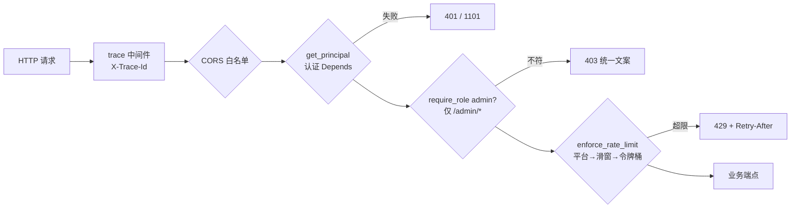

# Kquery 接口与工具

> ## ⚠️ 部分内容已随功能下线而失效（2026-10-17）
>
> 「**报告中心**（多智能体报告 / `/reports*` / `multiagent` 包）」与「**评测平台**（`/admin/eval*`）」两个功能已从代码库移除。
> 依据：`doc/plan/移除评测平台与报告中心-分析与实施计划.md`。
>
> 下列章节描述的是**下线前**的设计，仅作历史决策留档，**不代表当前实现**：
> - `/reports*` 全部端点（7 个）
> - `GET /admin/metrics/multiagent`
> - `/admin/eval/*` 全部端点（6 个）
> - 8xxx 报告错误码段
>
> 未列出的章节仍与当前代码一致。注意：`GET /admin/costs`（成本看板，TASK-134）与本主题无关，
> 已迁至 `app/api/admin.py`，继续有效。

> - **文档日期**：2026-10-17（按当前代码全面重写）
> - **对应代码**：`/Users/lizhipeng/workspace/project/Kquery/backend/app/` 当前代码
> - **覆盖内容**：REST API（ask / knowledge / sessions / graph / reports / feedback / admin）+ 公共契约（信封 / 错误码 / SSE / 认证）
> - **链路细节**：每条链路内部步骤见 `doc/analysis/链路分析.md`
>
> **口径说明**：后端端点**没有 `/api` 前缀**。前端 `fetch("/ask/stream")` 同源直连；开发态由 Vite 代理、部署态由 nginx（`deploy/nginx/nginx.conf`）反代到后端 8000。旧文档中的 `/api/ask`、`/api/agent/run`、`/api/security/*` 等路径均已不存在。

---

## 一、API 接口总览

### 1.1 Router 装配（`app/main.py` `create_app()`）

| Router | 前缀 | 实现文件 | 门禁 | 功能 |
|---|---|---|---|---|
| `ask_api` | —（`/ask*`） | `app/api/ask.py` | 认证 + 配额 | 问答（线性 / Agentic）、SSE、HITL、成本账单 |
| `knowledge_api` | `/knowledge` | `app/api/knowledge.py` | 认证 | 知识库 CRUD / 预览 / 检索诊断 / 统计 |
| `ingest_api` | `/knowledge` | `app/api/ingest.py` | 认证 | 异步入库任务（提交 / 进度 / 重试 / 取消） |
| `analysis_api` | `/knowledge` | `app/api/analysis.py` | 认证 | Query 分析记录回放 / 模式统计 |
| `feedback_api` | `/feedback` | `app/api/feedback.py` | 认证 | 拒答反馈工单 |
| `admin_api` | `/admin` | `app/api/admin.py` | **admin 角色** | 指标大盘 / 检索配置热更新 |
| `sessions_api` | `/sessions` | `app/api/sessions.py` | 认证 | 多轮会话存档 |
| `graph_api` | —（`/graph*`、`/search`、`/media`、`/assets`） | `app/api/graph.py` | 认证 | GraphRAG 图谱浏览器 / 多模态 |
| `reports_api` | —（`/reports*`、部分 `/admin/*`） | `app/api/reports.py` | 认证（指标类 admin） | 多智能体报告中心 / 成本看板 |
| `security_api` | —（`/admin/*`） | `app/api/security.py` | **admin 角色** | 用户 / ACL / 审计 / 配额 / 敏感词 / 评测 / 权限矩阵 |
| 内建 | `/health`、`/livez`、`/readyz`、`/healthz`、`/metrics` | `app/main.py` | 无 | 探针与 Prometheus |

### 1.2 完整端点清单

**问答（ask）**

| 端点 | 方法 | 说明 |
|---|---|---|
| `/ask` | POST | 单次问答（线性路径；`mode="agent"` 或带 `session_id` 时走 Agentic） |
| `/ask/stream` | POST | SSE 流式问答（线性 / Agentic 同端点） |
| `/ask/runs/{run_id}/interrupt` | GET | 查询 run 是否停在人工介入点（HITL） |
| `/ask/runs/{run_id}/resume` | POST | 唤醒挂起的 run（SSE；action=hint/force_answer/stop） |
| `/ask/runs/{run_id}/cancel` | POST | 中止进行中的 Agent run |
| `/ask/{trace_id}/cost` | GET | 单次问答成本账单（按阶段 × 模型归集） |

**知识库与入库（knowledge / ingest）**

| 端点 | 方法 | 说明 |
|---|---|---|
| `/knowledge/upload` | POST | 单文件同步上传入库（立等结果） |
| `/knowledge/ingest` | POST | 多文件异步入库（≤20 个，返回 task_id） |
| `/knowledge/tasks/{id}` | GET | 任务进度（文件级 7 态 + 阶段耗时 + 预估剩余） |
| `/knowledge/tasks/{id}/retry` | POST | 重试（file_id 可选；索引失败不清空已完成产物） |
| `/knowledge/tasks/{id}/cancel` | POST | 取消（仅排队/解析/切块阶段可取消） |
| `/knowledge/files` | GET | 文档列表（含块数与状态） |
| `/knowledge/files/{doc_id}` | DELETE | 删除文档（索引 + 源文件，不可恢复） |
| `/knowledge/rebuild/{doc_id}` | POST | 原内容原策略重建索引 |
| `/knowledge/{doc_id}/reparse` | POST | 新策略重新解析（生成新版本块集合，旧版本保留溯源） |
| `/knowledge/{doc_id}/offline` | POST | 临时下架（删索引保源文件） |
| `/knowledge/preview/{doc_id}` | GET | 解析预览（大纲 / 块列表 / 表格 / 资源 / RAPTOR 树） |
| `/knowledge/preview/{doc_id}/chunk/{chunk_id}` | GET | 单块详情（含父块/子块） |
| `/knowledge/{doc_id}/probe` | POST | 单文档检索诊断（该文档被命中的块） |
| `/knowledge/retrieval-probe` | POST | 同上（契约端点，请求体带 doc_id） |
| `/knowledge/stats` | GET | 知识库 KPI 看板 |
| `/knowledge/query-analysis` | GET | Query 分析历史（意图/检索/时间窗过滤） |
| `/knowledge/query-analysis/{id}` | GET | 单条分析详情 |
| `/knowledge/query-patterns` | GET | 意图分布统计 |

**会话（sessions）**

| 端点 | 方法 | 说明 |
|---|---|---|
| `/sessions` | GET / POST | 会话列表 / 创建 |
| `/sessions/{id}` | GET / PATCH / DELETE | 加载历史 / 重命名 / 删除（快照与工具明细一并删除） |

**图谱与多模态（graph）**

| 端点 | 方法 | 说明 |
|---|---|---|
| `/graph/entities` | GET | 实体列表（搜索 + 类型过滤，≤200） |
| `/graph/entity/{name}` | GET | 实体详情（入边/出边 + 社区摘要） |
| `/graph/subgraph` | GET | 子图（seed + depth 1~3；超 100 边截断） |
| `/graph/communities` | GET | 社区列表与摘要 |
| `/graph/build` | POST | 构建/重建图谱（doc_id 可选；rebuild_communities 默认 true） |
| `/graph/stats` | GET | 图谱健康度（孤立实体占比等） |
| `/search/media` | POST | 以文搜图（图像描述向量统一空间） |
| `/media/index` | POST | 扫描资源目录批量建图像索引（≤50/次，成本护栏） |
| `/assets/{name}` | GET | 图像资源服务（路径安全校验） |

**报告（reports）**

| 端点 | 方法 | 说明 |
|---|---|---|
| `/reports` | POST | 提交报告任务（异步，立即返回 report_id；`?sync=true` 调试同步） |
| `/reports` | GET | 报告列表 |
| `/reports/{id}` | GET / DELETE | 详情（含黑板快照）/ 删除 |
| `/reports/{id}/stream` | GET | SSE 进度流（8 类事件；终态补发 finished 幂等重连） |
| `/reports/{id}/plan` `/evidence` `/critique` | GET | 分视图（计划 / 证据采纳统计 / 评审轮次） |
| `/admin/costs` | GET（admin） | 成本看板（phase/model/tenant 聚合 + Top 消耗） |
| `/admin/metrics/multiagent` | GET（admin） | 多智能体指标（含 Critic 一次通过率） |

**反馈（feedback）**

| 端点 | 方法 | 说明 |
|---|---|---|
| `/feedback/refusal` | POST | 拒答反馈（类型 + 备注 + **必填 trace_id**）→ 工单号 |
| `/feedback/{ticket_id}` | GET | 工单处理状态 |

**管理面（admin，`require_role("admin")`）**

| 端点 | 方法 | 说明 |
|---|---|---|
| `/admin/metrics/summary` `/timeseries` `/top-queries` | GET | 监控大盘（首屏/趋势/高频查询） |
| `/admin/metrics/agent` | GET | Agent 指标（迭代/熔断率/工具分布） |
| `/admin/metrics/quality` | GET | 质量指标（Faithfulness/拒答率/CRAG 分支占比） |
| `/admin/retrieval-config` | GET / PUT | 检索参数读写（PUT 延迟 300s 生效，返回生效时刻） |
| `/admin/retrieval-config/reset` | POST | 重置为默认 |
| `/admin/users` | GET | 用户列表 |
| `/admin/users/{user_id}` | PUT | 编辑角色/用户组/启用态 |
| `/admin/users/permission-matrix` | GET | 角色 × 能力矩阵（含真实用户数） |
| `/admin/documents/acl` | GET | ACL 列表 |
| `/admin/documents/{doc_id}/acl` | PUT | 修改 ACL（返回影响人数与风险等级） |
| `/admin/audit` | GET | 审计查询（多维过滤） |
| `/admin/audit/export` | GET | 审计导出 CSV（只含哈希与元数据） |
| `/admin/quota` | GET / PUT | 配额总览 / 单租户配置 |
| `/admin/quota/platform` | GET | 平台侧额度余量（全租户共享约束） |
| `/admin/sensitive` | GET / POST | 敏感词列表 / 新增（按租户隔离） |
| `/admin/sensitive/{word}` | DELETE | 删除敏感词 |
| `/admin/eval/datasets` | GET / POST | 评测集列表 / 保存（名称+版本+样本） |
| `/admin/eval/run` | POST | 触发评测（走线性路径，四指标） |
| `/admin/eval/runs` `/runs/{run_id}` | GET | 运行列表 / 详情（绑定评测集+模型+代码三版本） |
| `/admin/eval/compare` | GET | 两次运行逐指标对比 + 失败样本差异 |
| `/admin/tools` | GET | 工具目录与健康状态（熔断徽标） |

**探针与指标（内建）**

| 端点 | 说明 |
|---|---|
| `/health` | `{"status":"up"}` |
| `/livez` | 存活探针（绝不查依赖） |
| `/readyz` | 就绪探针（索引为空单独标 `empty_index`，不等于未就绪） |
| `/healthz` | 完整依赖健康报告（向量库/BM25/图存储/共享状态/记忆/解析器/平台配额） |
| `/metrics` | Prometheus 文本格式 |

---

## 二、公共契约

### 2.1 统一响应信封（`app/core/envelope.py`）

所有端点返回同一结构：

```json
{
  "status": "ok | warn | error",
  "data": { ... },
  "error": { "code": 4401, "message": "本次未进行精排，结果可能不够精确" },
  "meta": { "trace_id": "...", "elapsed_ms": 123 }
}
```

- `ok`：正常结果；`warn`：降级但仍返回结果（用户该知道的降级）；`error`：失败；
- **拒答/兜底是一等公民**：`verdict="refused"`、`answer_source="parametric"` 都走 `ok/warn` + 字段标注，HTTP 仍是 200；
- 请求级 `trace_id` 由 trace 中间件生成（入站 `X-Trace-Id` 优先复用），响应头与信封同时回带。

### 2.2 错误码（IntEnum，全局唯一）

区段约定：1xxx 认证 / 2xxx 输入 / 3xxx 资源 / 4xxx 检索生成与降级 / 5xxx 服务端 / 6xxx 限流配额 / 8xxx 报告。常用码：

| 码 | HTTP | 场景 |
|---|---|---|
| 1101 | 401 | 未认证或凭证过期（前端跳登录） |
| 1201 | 403/404 | 无权限（统一文案「无权限或不存在」防探测） |
| 2001/2002/2004 | 400 | 参数不合法 / 问题为空 / 文件超限 |
| 3002/3301/3401 | 404 | 文档 / 任务 / 实体不存在 |
| 3601 | 400 | 切块策略不合法 |
| 4101 | 200 | Agent 达迭代上限（不完整的成功） |
| 4301/4302 | 404 | 会话不存在或归属不符 / 已过期 |
| 4401/4402 | 200（warn） | 重排降级 / 通用知识兜底 |
| 6101/6201 | 429 | 租户限流 / 平台或每日配额耗尽（带 Retry-After） |
| 8201/8301/8401 | 422/200/200 | 报告：子任务全失败 / 评审轮次耗尽 / 评审环节异常 |

### 2.3 认证头

```http
Authorization: Bearer <token>     # JWT 或静态凭证表
# 头部透传模式（默认兼容，仅开发演示）：
X-User-Id: zhangsan
X-Tenant-Id: default
X-Roles: hr,admin
X-Groups: group-a
```

**没有独立的登录端点**——认证是「凭证 → Principal」的解析过程（三档提供者：JWT / 静态凭证表 / 头部透传），不是会话发放流程。

### 2.4 SSE 流式

`/ask/stream`、`/ask/runs/{id}/resume`、`/reports/{id}/stream` 均为标准 SSE（`text/event-stream`）：

```
event: query_analysis
data: {"intent":"search",...}

event: token
data: {"content":"七天无理由"}

event: done
data: {"trace_id":"...","elapsed_ms":2341}
```

- 事件字典见 `链路分析.md` 附录 A；
- nginx 对 SSE 路径关闭缓冲（`proxy_buffering off`），超时 600s；
- token 事件一律是**终稿切片**（自检/扫描完成后才吐出），缓存命中时按 12 字切片重放。

### 2.5 引用溯源

`evidence[]` 每项：`{rank, chunk_id, doc_id, filename, content, source, score, source_route, modality, chunker, origin, used, rejected_reason?}`；答案正文以 `[#N]` 标注引用。被 ACL 过滤的内容**只报数量**（`acl_filtered`），不携带任何元信息。

---

## 三、中间件与门禁链



- 中间件只有两个：trace（`@app.middleware("http")`）与 CORS；鉴权/角色/配额全部走端点 Depends（`app/dependencies.py`）；
- 全局 4 个异常处理器：`ApiError` → 对应错误码 + `Retry-After`；`RequestValidationError` → 400 字段级中文提示；`StarletteHTTPException` → 404/405/413 统一信封；兜底 `Exception` → 500/5001；
- 管理面整 router 挂 `require_role("admin")`（`security_api` 与 `admin_api`），审计管理操作本身（`admin.action`）。

---

## 四、附录：核心代码位置速查

- `create_app`（`app/main.py`）：装配顺序 / lifespan / 中间件 / 探针 / 全局异常处理器
- `app/dependencies.py`：`get_principal` / `require_role` / `enforce_rate_limit` / `acl_filter_of`（ask 与 reports 共用的 ACL 收口）
- `app/core/envelope.py`：`Envelope` / `ErrCode` / `ok_envelope` / `warn_envelope` / `error_envelope`
- `app/core/tracing.py`：trace_id contextvar 与跨线程传递
- `app/api/ask.py`：问答端点（线性/Agentic 分流、SSE、HITL、成本）
- `app/api/knowledge.py` + `app/api/ingest.py`：知识库与入库任务
- `app/api/graph.py` / `reports.py` / `security.py` / `admin.py`：图谱 / 报告 / 企业管理面 / 指标与检索配置
- `app/services/pipeline.py`：线性问答主链路（详见 `链路分析.md` §一）
- `app/services/agent/runner.py` + `graph.py`：Agentic 编排（详见 `链路分析.md` §二）
- `app/services/multiagent/orchestrator.py`：报告编排（详见 `链路分析.md` §八）
