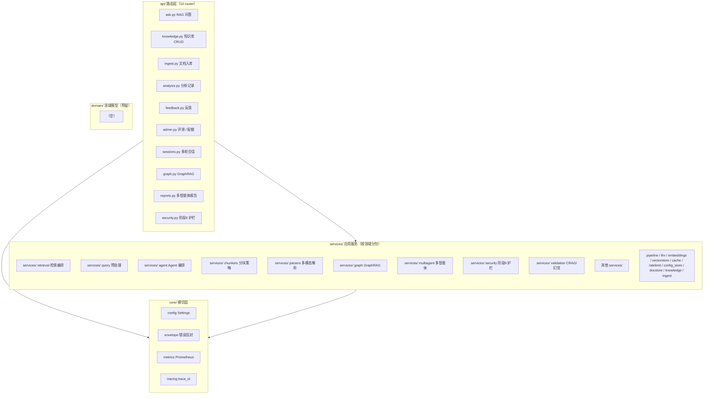
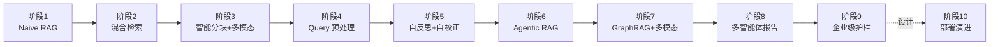

# Kquery 模块分析

> - **整理日期**：2026-10-05
> - **范围**：`/Users/lizhipeng/workspace/project/Kquery/backend/app/` 当前模块划分、实现事实与原理依据
> - **延伸文档**：混合检索（BM25 + 向量 + RRF + Rerank）编排见《知识工程.md》；自反思与 Agent 编排见《阶段架构.md》；接口契约见《接口.md》
> - **口径**：阶段 1~9 已落地；阶段 10 占位（设计文档目录已建）

---

# 第一部分　总览

## 一、模块地图与分层

`app/` 分层：`api/`（10 个路由文件）→ `services/`（按领域 9 个子包 + 12 个核心服务）→ `core/`（配置 / 错误 / 指标 / 链路追踪）；横切：`domain/`（领域模型，当前为空，预留）。



| 模块 | 文件 | 职责 |
|---|---|---|
| 应用入口 | `app/main.py` | `create_app()` 装配 + `lifespan` 初始化 9 阶段所有组件（embeddings / llm / reranker / store / bm25 / hybrid / cache / limiter / config_store / docstore / parser_router / task_manager / knowledge / pipeline / analysis_store / feedback_store / agent_runner / orchestrator / report_store / auth_provider / audit_store / acl_service / quota_service / platform_monitor / sensitive_scanner / eval_runner / eval_store） |
| RAG 问答 | `app/api/ask.py` + `app/services/pipeline.py` | 主链路 RAG 流水线（Query → 检索 → Prompt → LLM → 引用溯源 → 信封） |
| 知识库 | `app/api/knowledge.py` + `app/services/knowledge.py` | 文档 CRUD / 切片 / 检索（管理端） |
| 入库 | `app/api/ingest.py` + `app/services/ingest.py` | 文档上传 / 解析 / 切片 / 向量化 / 入库任务队列 |
| Query 预处理 | `app/services/query/` | 意图识别（qwen-turbo）+ Fusion 改写 + HyDE + Step-Back + 多跳拆解 + 数据源路由 |
| 检索 | `app/services/retrieval/` | BM25 + 向量 + 混合检索（RRF）+ Rerank |
| 解析 | `app/services/parsers/` | PDF / Docx / Markdown / 图片 OCR / 音频转写；解析路由 |
| 分块 | `app/services/chunkers/` | Recursive / Semantic / ParentChild / RAPTOR 四策略 |
| Agent | `app/services/agent/` | LangGraph 状态机 + 工具注册 + 会话存档 + 反射器 |
| 多智能体 | `app/services/multiagent/` | Planner/Researcher/Validator/Writer/Critic 五角色 + 黑板 + 拓扑并行 |
| GraphRAG | `app/services/graph/` | 实体关系抽取 + 消歧归一 + 内存图 BFS + 社区摘要 + 图谱浏览器 |
| 安全 | `app/services/security/` | 阶段 9 认证 / 配额 / ACL / 敏感词 / 审计 / 评测 / 平台配额 |
| 自反思 | `app/services/validation/` | CRAG 路由器 + 幻觉自检 + 拒答反馈工单 |
| 核心服务 | `app/services/{cache,chunking,config_store,docstore,embeddings,ingest,knowledge,llm,milvus_store,pipeline,ratelimit,vectorstore}.py` | 单文件核心能力（缓存 / 分块 / 配置存储 / 文档存储 / 嵌入 / LLM / 向量库 / 流水线 / 限流） |
| 配置 | `app/core/config.py` | Pydantic Settings + 9 阶段所有配置项 |
| 错误 | `app/core/envelope.py` | `ApiError` + `ErrCode` + `error_envelope()` 统一信封 |
| 指标 | `app/core/metrics.py` | `MetricsStore`（业务指标） + `PromMetrics`（Prometheus 暴露） |
| 追踪 | `app/core/tracing.py` | `new_trace_id()` 生成 + contextvars 传递 |

## 二、阶段一图谱（10 阶段递进）



---

# 第二部分　分模块实现与原理剖析

## 三、Stage01：Naive RAG 基线

### 3.1 实现

**主链路**（`RagPipeline.run`，`app/services/pipeline.py`）：
1. 接收用户问题 `question`
2. 向量检索：`VectorRetriever.retrieve(query_vec, top_k)`
3. 构造 Prompt：系统提示词 + Top-K 召回片段 + 用户问题
4. 调用 `llm.call(messages)`
5. 答案 + 引用溯源（`evidence` 数组） + 信封返回

```python
# 简化（app/services/pipeline.py 的 RagPipeline.run）
async def run(self, question: str, session_id: str = None, ...) -> dict:
    # 1. 向量检索
    chunks = await self.vector_retriever.retrieve(query_vec, top_k=5)
    
    # 2. 构造 prompt
    prompt = build_prompt(system=..., context=chunks, question=question)
    
    # 3. LLM 生成
    answer = await self.llm.call(messages=[{"role": "user", "content": prompt}])
    
    # 4. 引用溯源
    return {"answer": answer, "evidence": chunks, "trace_id": new_trace_id()}
```

### 3.2 原理剖析

**原理①　RAG = Retrieval + Generation：检索增强生成**

Naive RAG 是最基础的 RAG 范式：
- **检索（Retrieval）**：从知识库找到与问题相关的片段
- **增强（Augmented）**：把片段注入 Prompt
- **生成（Generation）**：LLM 基于片段回答

> **业内参考**：2020 年 Lewis 等人首次提出 RAG；2023 年后成为 LLM 应用的事实标准架构。

**原理②　Top-K 召回 + Prompt 注入：LLM 知识的"上下文扩展"**

LLM 知识受限于训练数据截止时间；RAG 通过检索把"当前知识"注入 Prompt，让 LLM 能回答训练数据外的问题。

**原理③　引用溯源（Citation）：可信度的可视化**

每条答案带 `evidence` 数组，客户端可点击 `[#1]` 跳转原文片段——这是 RAG 区别于 LLM 直答的核心体验。

## 四、Stage02：混合检索

### 4.1 实现

**`HybridRetriever`**（`app/services/retrieval/hybrid.py`）：
- 接收多个 retrievers（`{"keyword": bm25, "vector": vector_retriever}`）
- 每个 retriever 取 Top-N
- RRF（Reciprocal Rank Fusion）融合：`score = Σ 1/(k + rank)`
- Reranker（gte-rerank-v2）精排

```python
class HybridRetriever:
    def __init__(self, retrievers: dict, reranker, per_route_top_n=20, fused_top_n=10, rrf_k=60):
        self.retrievers = retrievers
        self.reranker = reranker
        self.per_route_top_n = per_route_top_n
        self.fused_top_n = fused_top_n
        self.rrf_k = rrf_k
    
    async def retrieve(self, query: str, top_k: int = 5) -> list[dict]:
        # 1. 多路召回
        route_results = {}
        for name, retriever in self.retrievers.items():
            route_results[name] = await retriever.retrieve(query, top_k=self.per_route_top_n)
        
        # 2. RRF 融合
        fused = reciprocal_rank_fusion(route_results, k=self.rrf_k)
        
        # 3. Reranker 精排
        top = fused[:self.fused_top_n]
        scores = await self.reranker.rerank(query, [c["text"] for c in top])
        for chunk, score in zip(top, scores):
            chunk["rerank_score"] = score
        return sorted(top, key=lambda c: c["rerank_score"], reverse=True)[:top_k]
```

### 4.2 原理剖析

**原理①　BM25 + 向量互补两路召回**

- **BM25**：精确关键词（型号 / 订单号 / 法律条款）
- **向量**：语义匹配（"退货"召回"退款"）
- **RRF 融合**：避免单一检索偏差

> **业内参考**：Cohere / Anthropic / OpenAI 的 RAG 最佳实践均推荐混合检索。

**原理②　gte-rerank-v2 重排序：精排提升相关度**

千问平台的 `gte-rerank-v2` 重排模型对 Top-N 候选精排，把最相关的片段排到最前。

**原理③　运行时配置：`RetrievalConfigStore` 热更新**

阶段 2 引入 `app/services/config_store.py`，支持：
- 运行时修改混合策略（`bm25_weight` / `vector_weight`）
- 延迟生效（`apply_delay_s`，避免频繁切换）
- 配置变更广播（前端实时刷新）

## 五、Stage03：智能分块与多模态

### 5.1 实现

**4 种分块策略**（`app/services/chunkers/`）：
- `recursive`：按字符递归切分（默认）
- `semantic`：按句子语义聚合（embedding 距离判定）
- `parent_child`：父块-子块结构（检索子块，返回父块）
- `raptort`：RAPTOR 树状摘要（递归聚类 + LLM 摘要）

**多模态解析**（`app/services/parsers/`）：
- `pdf.py`：PDF 解析 + 表格识别 + OCR（qwen-vl-ocr）
- `docx.py`：Word 文档
- `ocr.py`：图片 OCR（qwen-vl-ocr）
- `audio.py`：音频转写（paraformer-v2 + 时间戳）
- `router.py`：ParserRouter 自动按 MIME 选择解析器

### 5.2 原理剖析

**原理①　分块策略决定 RAG 上限**

分块过细 → 上下文碎片化；分块过粗 → 噪声多。Semantic 分块按语义聚类，比 recursive 更合理。

**原理②　qwen-vl-ocr 与 paraformer-v2：图像 / 音频到文本**

- **qwen-vl-ocr**：识别图像中的文字、表格、公式
- **paraformer-v2**：带时间戳的语音转写（视频字幕场景必需）

> **关键决策**：阶段 7 放弃双塔对比模型（CLIP/BGE-VL），改用「qwen-vl-max 生成结构化描述 → text-embedding-v3 编码」→ 图像描述向量与正文向量**共用同一个向量库/向量空间**。

## 六、Stage04：Query 预处理

### 6.1 实现

`QueryPreprocessor`（`app/services/query/orchestrator.py`）：
- `IntentClassifier`（qwen-turbo）：识别意图（搜索 / 闲聊 / 任务）
- `FusionExpander`（qwen-plus）：生成 N 个相关 query
- `HydeExpander`（qwen-plus）：生成假设性答案（HyDE）
- `StepBackExpander`（qwen-plus）：抽象问题（Step-Back Prompting）
- `Decomposer`：多跳拆解
- `SourceRouter`：数据源路由（FAQ / 文档 / 图像）

```python
class QueryPreprocessor:
    def __init__(self, intent_classifier, expanders, decomposer, router, query_budget, enabled):
        ...
    
    async def preprocess(self, query: str, ...) -> dict:
        # 1. 意图识别（qwen-turbo）
        intent = await self.intent_classifier.classify(query)
        if intent == "chitchat":
            return {"intent": "chitchat", "query": query, "skip_retrieval": True}
        
        # 2. Query 改写（Fusion 或 HyDE 互斥）
        expanded = await self.expanders[0].expand(query)
        
        # 3. 多跳拆解
        sub_queries = await self.decomposer.decompose(query)
        
        # 4. 数据源路由
        sources = self.router.route(intent)
        
        return {"intent": intent, "expanded": expanded, "sub_queries": sub_queries, "sources": sources}
```

### 6.2 原理剖析

**原理①　意图识别压到 qwen-turbo：成本分层**

- **qwen-turbo**：高频轻量（intent / classify / 闲聊）
- **qwen-plus**：复杂推理（Fusion / HyDE / Decompose）
- **qwen-max**：高难度任务（Writer / Critic）
- **qwen-vl-max**：多模态描述
- **qwen-vl-ocr**：OCR
- **text-embedding-v3**：唯一向量空间
- **gte-rerank-v2**：重排序

> **业内参考**：模型分层是降本关键。GPT-3.5 vs GPT-4 的成本差 10~30 倍；qwen-turbo vs qwen-plus 差 5~10 倍。

**原理②　Fusion 与 HyDE 互斥：避免互相稀释**

两者都是"扩展 query"——同时启用会生成大量冗余变体，反而降低检索精度。当前实现 `if "fusion" in expander_names: ... elif "hyde" in ...` 强制互斥。

## 七、Stage05：自反思与自校正

### 7.1 实现

`CragRouter`（`app/services/validation/crag.py`）+ `HallucinationChecker`（`app/services/validation/selfcheck.py`）：
- **CRAG 三分支**：correct（直接生成）/ incorrect（拒答）/ ambiguous（受限重生成）
- **证据评分**：对每个 evidence 评分（向量分 + rerank 分）
- **幻觉自检**：LLM 自检"我的回答是否基于证据"
- **拒答反馈**：拒答时生成工单（`feedback` 端点）

### 7.2 原理剖析

**原理①　CRAG 三分支路由器：替代单一阈值**

```python
class CragRouter:
    def __init__(self, correct_th=0.7, incorrect_th=0.3, max_iterations=3):
        self.correct_th = correct_th
        self.incorrect_th = incorrect_th
        self.max_iterations = max_iterations
    
    def route(self, evidence_score: float) -> str:
        if evidence_score >= self.correct_th:
            return "correct"  # 直接生成
        elif evidence_score <= self.incorrect_th:
            return "incorrect"  # 拒答
        else:
            return "ambiguous"  # 受限重生成
```

**原理②　三层熔断：避免 LLM 无限循环**

Agent 编排 + CRAG 迭代容易陷入"重生成→再检索→再重生成"的死循环。Kquery 在三层设置熔断：
- 单次迭代：max_iterations=3
- 整个 pipeline：total timeout 30s
- 单 LLM 调用：timeout 10s

## 八、Stage06：Agentic RAG

### 8.1 实现

`AgentRunner`（`app/services/agent/runner.py`）+ LangGraph 状态机（`app/services/agent/graph.py`）：
- **Plan / Tool / Reflect / Replan / Answer** 五状态
- **工具注册表**：`ToolRegistry` 注册 vector_search / calculator / graph_search / image_search
- **幻觉兜底**：所有 Tool 调用结果都进 HallucinationChecker
- **多轮会话存档**：`SessionStore`（`app/services/agent/sessions.py`）持久化

### 8.2 原理剖析

**原理①　LangGraph 状态机：把 Agent 决策可视化**

LangGraph 用 StateGraph 表达 Agent 决策流：
```python
class AgentState(TypedDict):
    question: str
    plan: list[dict]
    tool_results: list[dict]
    reflections: list[dict]
    final_answer: str
```

**原理②　中断恢复（Interrupt）**

用户可中断 Agent 任务 → 状态保存到 `SessionStore` → 后续 resume 从未完成步骤继续。

> **业内参考**：LangGraph 的 `interrupt` / `Command(resume)` 是人机协同 Agent 的事实标准。

## 九、Stage07：GraphRAG 与多模态

### 9.1 实现

**GraphRAG**（`app/services/graph/`）：
- `LLMExtractor`（qwen-plus）：实体关系抽取（subject, predicate, object）
- `EntityResolver`：实体消歧归一（"退货"和"退款"归一为同一实体）
- `InMemoryGraphStore`：BFS 遍历
- 稳定编号社区摘要：Leiden 算法

**多模态统一向量**：
- `QwenVlCaptioner`：qwen-vl-max 生成结构化描述（主体/属性/场景/图中文字）
- 描述向量与正文向量共用 `text-embedding-v3` 编码
- **无第二套模型与索引**

### 9.2 原理剖析

**原理①　GraphRAG 解决「全局问题」**

传统 RAG 适合「具体事实」（"退货政策是？"）；GraphRAG 适合「全局问题」（"这些文档讨论了哪些主题？"）。

**原理②　统一向量空间：避免双塔模型的代价**

放弃 CLIP/BGE-VL（双塔对比模型）→ 改用「视觉 LLM 生成描述 + 文本向量编码」→ 单一向量库。

> **业内参考**：GPT-4V + 文本向量是 OpenAI / Anthropic 多模态 RAG 的主流做法。

## 十、Stage08：多智能体报告

### 10.1 实现

**五角色**（`app/services/multiagent/roles.py`）：
- **Planner**（qwen-plus）：拆解任务
- **Researcher**（qwen-plus）：检索证据（并行）
- **Validator**（gte-rerank-v2）：证据评分
- **Writer**（qwen-max）：撰写报告
- **Critic**（qwen-plus）：评分 + issue 列表

**Blackboard + 拓扑分层并行**：报告任务分解为子任务，按依赖关系并行执行；Writer↔Critic 循环评分直到 pass 或 max_rounds。

### 10.2 原理剖析

**原理①　Writer↔Critic 循环：自动化质控**

```python
class Orchestrator:
    def __init__(self, planner, validator, writer, critic, ..., pass_score, max_rounds):
        self.pass_score = pass_score
        self.max_rounds = max_rounds
    
    async def run(self, topic: str, ...):
        plan = await self.planner.plan(topic)
        for round in range(self.max_rounds):
            draft = await self.writer.write(plan, evidence)
            critic_result = await self.critic.evaluate(draft, evidence)
            if critic_result.score >= self.pass_score:
                return draft
        return draft  # 超 max_rounds 返回最后一轮
```

**原理②　拓扑分层并行：子任务并发**

子任务按依赖分层（plan → evidence → write），同层并发执行。默认 `max_subtasks=5`、并发 `parallelism=2`。

## 十一、Stage09：企业级护栏

### 11.1 实现

`app/services/security/` 包含 9 个模块：
- `auth.py`：4 要素认证（user_id / tenant_id / roles / groups）
- `acl.py`：文档级 ACL（默认拒绝 / deny 优先）
- `quota.py`：租户滑动窗口配额
- `sensitive.py`：敏感词扫描（长词优先 / 掩码）
- `audit.py`：审计三事件（认证 / 访问 / 配额超限）只存哈希
- `evalrunner.py`：评测 `run` + `compare`（上线门禁）
- `keychain.py`：密钥管理（内存 + 机器派生密钥加密的本地文件）
- `platform_quota.py`：平台配额监控（千问账号级）
- `privacy.py`：数据边界（5 类：源码 / 索引 / 会话记忆 / 遥测 / 模型请求）

### 11.2 原理剖析

**原理①　文档级 ACL 双过滤（默认拒绝 / deny 优先）**

```python
class ACLService:
    def check(self, user_id: str, doc_id: str) -> bool:
        # 1. 默认拒绝
        if doc_id not in self._allowed_docs.get(user_id, []):
            return False
        # 2. deny 优先
        if doc_id in self._denied_docs.get(user_id, []):
            return False
        return True
```

**原理②　敏感词长词优先扫描**

"中华人民共和国居民身份证" 必须先于 "身份证" 匹配——避免误掩码。算法：按词长倒序排序，先匹配长词。

**原理③　审计三事件只存哈希**

```python
async def audit(self, event: str, user_id: str, payload: dict):
    # 仅存 payload 的哈希 + 必要字段；原始 payload 不落盘
    payload_hash = hashlib.sha256(json.dumps(payload).encode()).hexdigest()
    self.store.append({"event": event, "user_id": user_id, "hash": payload_hash})
```

> **业内参考**：GDPR / 等保 2.0 要求审计最小化原则；只存哈希既满足合规又不泄露敏感信息。

**原理④　平台侧配额 vs 应用侧配额分层**

- **平台配额（千问账号）**：模型客户端上报 → `install_monitor` 注入 → `platform_quota_per_day` 监控
- **应用配额（租户）**：`SlidingWindowQuota` 滑动窗口（每分钟 / 每天）

> **关键设计**：阶段 9 评测必须同时绑定评测集版本 + 千问档位版本（平台升级由平台方发起，应用侧无法拒绝）。

---

# 第三部分　底层原理

## 十二、并发与异步

Kquery 是 FastAPI 单进程单端口异步应用，全链路 asyncio：

| 操作 | 是否阻塞 | 实现 |
|---|---|---|
| LLM 调用 | 否 | httpx AsyncClient + DashScope SDK |
| 向量检索（FAISS / Milvus） | **是**（FAISS 同步） | `asyncio.to_thread` 包一层 |
| BM25 检索 | 否 | 纯 Python 计算，毫秒级 |
| 文档解析（PDF） | **是**（CPU 密集） | `asyncio.to_thread` |
| 多模态解析（OCR / ASR） | 否（云端 API） | httpx AsyncClient |
| Agent 状态机 | 否 | LangGraph 协程 |

## 十三、模型基线（统一）

Kquery 全部使用阿里云百炼（DashScope）千问平台，无本地模型：

| 能力 | 平台模型 | 用途 |
|---|---|---|
| 生成 / 规划 / 评审 | qwen-plus / qwen-max | 复杂推理 |
| 高频轻量 | qwen-turbo | 意图识别、闲聊 |
| 向量 | text-embedding-v3（1024 维） | 全域唯一向量空间 |
| 重排 | gte-rerank-v2 | 阶段 2 混合检索 + 阶段 5 CRAG |
| 图文理解 | qwen-vl-max / qwen-vl-plus | 阶段 7 结构化图像描述 |
| OCR | qwen-vl-ocr | PDF 表格 / 图片文字 |
| 语音转写 | paraformer-v2（带时间戳） | 音频 / 视频字幕 |

---

# 第四部分　设计原则与附录

## 十四、设计原则

1. **阶段递进**：每阶段在上一阶段基础上增量，不重写
2. **统一向量空间**：放弃双塔对比模型，图像描述走文本向量
3. **模型分层**：qwen-turbo / qwen-plus / qwen-max 按成本分层
4. **运行时配置**：RetrievalConfigStore 支持热更新
5. **企业级护栏（阶段 9）**：认证 / 配额 / ACL / 敏感词 / 审计
6. **三层熔断**：单次迭代 / 整个 pipeline / 单 LLM 调用

## 十五、附录：核心代码位置速查

- `create_app` 函数（`app/main.py`）：FastAPI 装配 + lifespan 初始化 9 阶段所有组件
- `RagPipeline`（`app/services/pipeline.py`）：RAG 主链路
- `HybridRetriever`（`app/services/retrieval/hybrid.py`）：BM25 + 向量 + RRF + Rerank
- `QueryPreprocessor`（`app/services/query/orchestrator.py`）：阶段 4 Query 预处理
- `CragRouter`（`app/services/validation/crag.py`）：阶段 5 自反思
- `AgentRunner`（`app/services/agent/runner.py`）：阶段 6 Agent 编排
- `GraphBuilder`（`app/services/graph/builder.py`）：阶段 7 GraphRAG
- `Orchestrator`（`app/services/multiagent/orchestrator.py`）：阶段 8 多智能体
- `ACLService`（`app/services/security/acl.py`）：阶段 9 文档级 ACL
- `RetrievalConfigStore`（`app/services/config_store.py`）：运行时检索配置

## 十六、与设计文档的对照

| 模块 | 设计文档 | 当前实现 |
|---|---|---|
| 阶段 1 Naive RAG | `stage-1-naive-rag/README.md` | ✅ 完整 |
| 阶段 2 混合检索 | `stage-2-hybrid-retrieval/README.md` | ✅ 完整 |
| 阶段 3 智能分块 | `stage-3-smart-chunking/README.md` | ✅ 完整 |
| 阶段 4 Query 预处理 | `stage-4-query-preprocessing/README.md` | ✅ 完整 |
| 阶段 5 自反思 | `stage-5-self-reflection/README.md` | ✅ 完整 |
| 阶段 6 Agentic RAG | `stage-6-agentic-rag/README.md` | ✅ 完整 |
| 阶段 7 GraphRAG | `stage-7-graph-rag/README.md` | ✅ 完整 |
| 阶段 8 多智能体 | `stage-8-multi-agent/README.md` | ✅ 完整 |
| 阶段 9 护栏 | `stage-9-guardrails/README.md` | ✅ 完整 |
| 阶段 10 部署 | `stage-10-deployment/README.md` | 🟡 留待后续 |
