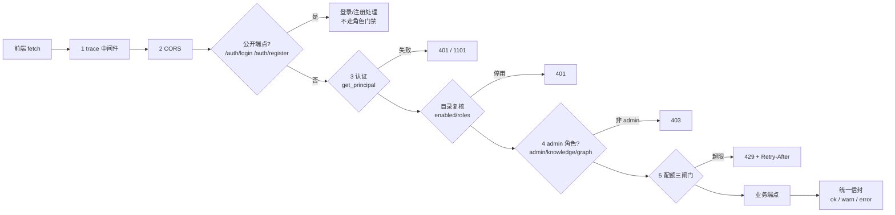
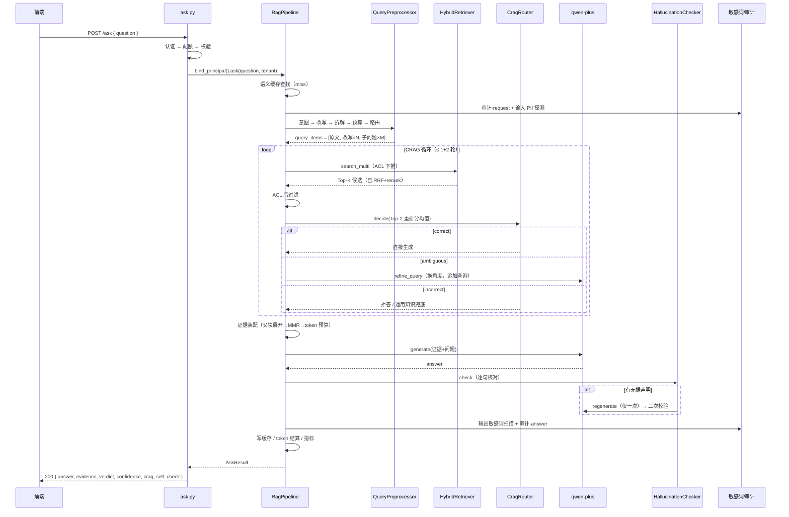
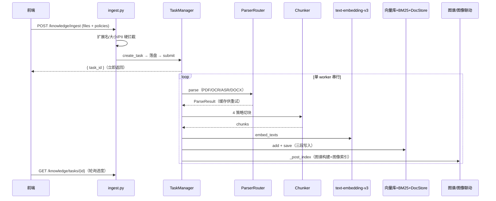
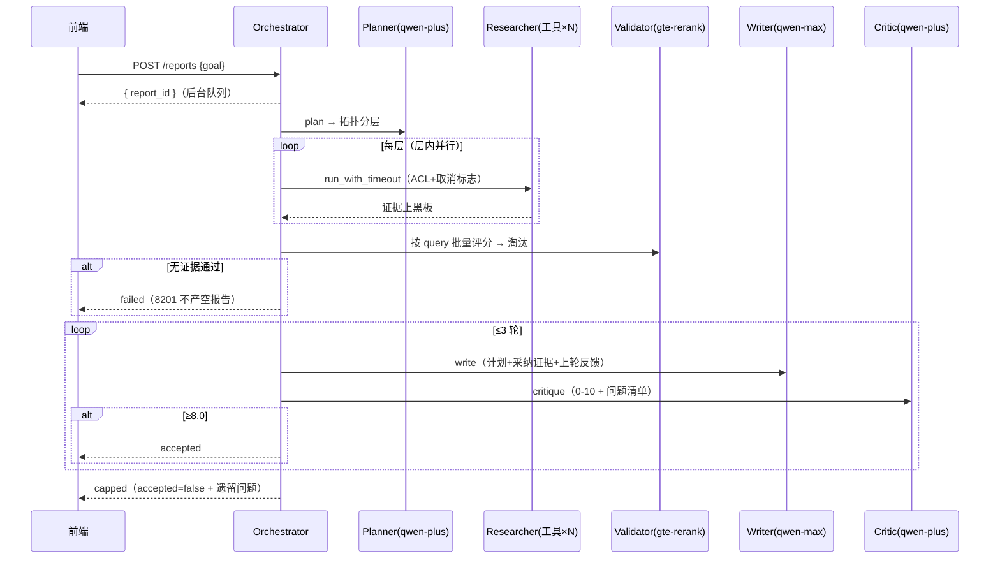

# Kquery 链路分析

> ## ⚠️ 部分内容已随功能下线而失效（2026-10-17）
>
> 「**报告中心**（多智能体报告 / `/reports*` / `multiagent` 包）」与「**评测平台**（`/admin/eval*`）」两个功能已从代码库移除。
> 依据：`doc/plan/移除评测平台与报告中心-分析与实施计划.md`。
>
> 下列章节描述的是**下线前**的设计，仅作历史决策留档，**不代表当前实现**：
> - 「多智能体报告链路（`/reports`）」整节
> - 「评测（`EvalRunner`）」整节
> - 链路 8 / 链路 9 概述
> - SSE 8 类进度事件表
>
> 未列出的章节仍与当前代码一致。注意：`GET /admin/costs`（成本看板，TASK-134）与本主题无关，
> 已迁至 `app/api/admin.py`，继续有效。

> - **文档日期**：2026-10-17（按当前代码全面重写）
> - **对应代码**：`/Users/lizhipeng/workspace/project/Kquery/backend/app/` 当前代码
> - **口径说明**：
>   1. 后端端点**没有 `/api` 前缀**——前端 `fetch("/ask/stream")` 直连，部署态由 nginx 反代同源转发（`deploy/nginx/nginx.conf`）；
>   2. 每条链路按「端点 → 依赖注入 → 服务调用 → 外部依赖」逐步展开，步骤编号与代码执行顺序一一对应；
>   3. 所有请求共享统一响应信封 `{status, data, error, trace_id, elapsed_ms}`（`app/core/envelope.py`），业务拒答/降级走成功状态码 + 字段标注，不走错误码。
>
> 全文共十一条链路（报告中心已下线，原"多智能体报告链路"并入下述说明）：
> 1. **线性问答链路**：`POST /ask`、`POST /ask/stream`——预处理 → 缓存 → 混合检索 → CRAG → 生成 → 自检；
> 2. **Agentic 问答链路**：`/ask`（mode=agent）+ `/ask/runs/*`——LangGraph 状态机 + 工具 + HITL；
> 3. **文档入库链路**：`POST /knowledge/ingest`（异步任务）+ `POST /knowledge/upload`（同步），**要求 admin 角色**；
> 4. **知识库管理链路**：`/knowledge/files`、`/knowledge/preview`、`/knowledge/{doc_id}/probe`、`/admin/retrieval-config`，**要求 admin 角色**；
> 5. **Query 分析链路**：`/knowledge/query-analysis*`、`/knowledge/query-patterns`，**要求 admin 角色**；
> 6. **GraphRAG 链路**：`/graph/build`、`/graph/entities`、`/graph/subgraph`、`/graph/communities`，**要求 admin 角色**；
> 7. **多模态链路**：`/search/media`、`/media/index`、`/assets/{name}`，**要求 admin 角色**（资源服务在 graph router 内，随其一并收口）；
> 8. **登录注册链路**（2026-10-17 新增）：`POST /auth/login`（口令校验 → 自签发 HS256 令牌）、`POST /auth/register`（固定最小权限 sales）、`GET /auth/me`（当前身份，不重新发令牌）；
> 9. **企业护栏链路**：认证（含四档与登录注册）/ ACL / 配额 / 敏感词 / 审计 / 口令重置（`/admin/*`）；
> 10. **反馈链路**：`/feedback/refusal`；
> 11. **观测链路**：`/health*`、`/readyz`、`/metrics`、`/admin/metrics/*`。

> **管理区收口（2026-10-17）**：知识库 / 图谱 / 入库 / 分析 / 多模态五组链路原先只要求"已认证"，现已统一提升为 `require_role("admin")`。普通用户（sales）保留的能力只有链路 1、2、10（对话与反馈）。

---

## 〇、请求公共前缀与应用装配

### 〇.1 每个请求必经的公共步骤

无论命中哪条链路，一个 HTTP 请求在到达业务端点之前依次经过：

| # | 步骤 | 位置 | 行为 |
|---|---|---|---|
| 1 | trace 中间件 | `app/main.py` `trace_middleware` | 复用入站 `X-Trace-Id` 或生成新 trace_id，写入 contextvar；响应头回带 `X-Trace-Id` |
| 2 | CORS 中间件 | `app/main.py` | 按 `settings.cors_origins` 白名单放行跨域 |
| 3 | 认证依赖 | `app/dependencies.py` `get_principal` | Bearer Token（JWT / 静态凭证表）或头部透传（X-User-Id / X-Tenant-Id / X-Roles / X-Groups）；产物 `Principal{user_id, tenant_id, roles, groups}` 挂到 `request.state.principal`；失败抛 1101（401）。令牌档下还会**回查用户目录**（`enabled` 与 `roles` 以目录为准），停用/降权即时生效 |
| 4 | 角色门禁（`/admin/*`、`/knowledge*`、`/graph*` 及部分多模态） | `require_role("admin")` | 角色不含 admin → 403「无权限或不存在」（统一文案防探测）。覆盖 admin / security / knowledge / ingest / analysis / graph 六 router |
| 5 | 配额依赖（仅写路径） | `enforce_rate_limit` | 三道闸门：平台侧配额（账号级）→ 租户滑动窗口（分钟/日/token 三维）→ 令牌桶（突发控制）；超限 429 + `Retry-After`。另有**登录专用限流**（独立令牌桶，6 次/分，键 `login:{username}`，不入此链） |
| 6 | 参数校验 | FastAPI + 全局 `RequestValidationError` 处理器 | 校验错误翻译成统一信封 400，字段级中文提示 |
| 7 | 业务端点 | 各 router | 见下文各链路 |
| 8 | 异常兜底 | 4 个全局 exception handler | `ApiError`→对应错误码；HTTP 404/405/413→统一信封；未捕获异常→500 + `INTERNAL_ERROR` |



### 〇.2 应用装配（`app/main.py` `create_app()` lifespan）

启动期一次性装配，全部服务挂到 `app.state`，路由经 `app/dependencies.py` 统一取用：

| 装配顺序 | 产物 | 关键默认配置 |
|---|---|---|
| 1. 配置校验 | `settings.validate_startup()` | 缺项直接拒绝启动 |
| 2. 模型层 | embeddings（text-embedding-v3，1024 维）/ llm（qwen-plus）/ reranker（gte-rerank-v2） | 全部千问平台；无凭据注入 Mock |
| 3. 存储层 | 向量库（`build_vector_store`，默认 **Milvus**，可切 FAISS）+ BM25 索引 | 索引损坏拒绝启动 |
| 4. 混合检索 | `HybridRetriever`（keyword + vector 双路 + rerank） | 每路 20 / 融合 20 / RRF k=60 |
| 5. 工程设施 | `RetrievalConfigStore`（延迟 300s 生效）/ 语义缓存（TTL 3600s）/ 令牌桶 / 指标 | — |
| 6. 入库体系 | `DocStore` / `ParserRouter`（PDF+OCR / Docx / 音频 ASR）/ `KnowledgeService` / `TaskManager` | 单文件 ≤50MB |
| 7. Query 预处理 | `QueryPreprocessor`（意图 qwen-turbo + Fusion/HyDE/Step-Back + 拆解 + 路由） | HyDE 与 Fusion 互斥 |
| 8. 线性流水线 | `RagPipeline`（+ CRAG 阈值 0.14/0.08 + 幻觉自检） | — |
| 9. 企业护栏 | 认证**四档**（含账号密码档：登录端点自签发 HS256 令牌）/ 用户目录持久化（`data/users.json`）/ **首个管理员口令引导** / ACL / 滑动窗口配额 / 平台配额监控 / 敏感词 / 审计 | 护栏**回填**到线性路径（`pipeline.attach_security`） |
| 10. Agent 体系 | 工具注册表（vector_search / calculator / list_documents / datetime / sql* / web* / graph* / image*）+ LangGraph 图 + checkpointer + SessionStore + AgentRunner | `*` 按配置条件注册 |
| 11. GraphRAG | SQLite 图存储 + 实体消歧（阈值 0.85）+ LLM 抽取器 + 社区摘要 + 图像索引 | 入库联动（`_post_index` 钩子） |
| 13. 共享状态/记忆 | `SharedState`（Redis 不可用时进程内降级）+ `LongTermMemory` | — |

> 装配表原第 12 行「多智能体（Planner/Writer/Critic + Orchestrator）」随报告中心下线，`app/services/multiagent/` 已不存在。

> **装配期回填模式**：因装配顺序约束，`hybrid._version_of`、`pipeline._acl_version/_quota/_acl_service/_knowledge`、`agent_runner._memory` 等在依赖就绪后回填——文档中称其为「晚绑定」，读代码时不要以为它们为空。

---

## 一、线性问答链路（`POST /ask` 与 `POST /ask/stream`）

> 入口：`app/api/ask.py` `ask()` / `ask_stream()`；核心：`app/services/pipeline.py` `RagPipeline`。
> 当 `settings.agent_enabled` 且请求带 `mode="agent"` 或 `session_id` 时改走链路二（Agentic），否则走本条**线性路径**。

### 1.1 端到端步骤（未命中缓存的完整流程）

**阶段 A：端点层**

1. **校验问题**：`_validate_question` 拦截纯空白问题（400 / QUESTION_EMPTY）。
2. **主体绑定**：`pipeline.bind_principal(tenant, user, principal)` 生成请求级流水线副本（流水线本体是单例，副本语义不改共享实例）。副本上挂：
   - `_visible_docs_provider`：惰性求值的「当前主体可见文档清单」（ACL 下推用）；
   - `_acl_filter`：`acl_filter_of()` 生成的 `doc_id → bool` 过滤函数（默认拒绝，`__` 前缀系统块租户内放行）。

**阶段 B：缓存查找（`RagPipeline.ask`）**

3. **取运行时配置**：`config_store.get_active()`——`/admin/retrieval-config` 修改的配置延迟 300s 后在此生效。
4. **算缓存键**：键维度 = 租户 + 问题 + 模型版本（provider+llm+embedding+rerank）+ 配置摘要（检索配置 / chunk_size / temperature / **索引版本** / CRAG 开关 / **用户** / **ACL 版本**）。权限撤销或重新入库后旧缓存自然失效。
5. **缓存查找**：先精确匹配，再语义近似（问题向量相似度）。命中 → 直接返回（`from_cache=True`，跳过阶段 C~F 全部 LLM 调用）；缓存故障 → 静默 miss 并上报 45xx 指标（无感降级）。

**阶段 C：核心事件流（`_core_events`，同步与流式共用）**

6. **审计·请求事件**：`audit.log_request`（问题只存哈希，不存原文）。
7. **输入侧 PII 探测**：`SensitiveScanner.scan(question)`——只探测+留痕（SSE 事件 `input_pii_detected`），**不阻断**：用户问自己的手机号是正当诉求。
8. **Query 预处理**（`QueryPreprocessor.process`，详见链路五）：
   - 意图识别（qwen-turbo）→ 判定 `needs_retrieval`；
   - 查询改写（Fusion 3 条 / HyDE / Step-Back，按配置启用）；
   - 多跳拆解（仅 compare/summarize 意图）；
   - 查询预算截断（默认 6 条，超出标记「生成但未使用」）；
   - 数据源路由 + 分析记录落库（`AnalysisStore`）。
   产出 SSE 事件 `query_analysis`。**预处理每步失败都降级**（默认需要检索 / 用原 query / 单跳），绝不中断请求。
9. **闲聊短路**：意图判定无需检索 → 直接 LLM 友好回应，不检索不校验，`_final{verdict:"answered", confidence:1.0}` 返回。

**阶段 D：CRAG 校验循环（校验发生在生成之前）**

10. **构造检索过滤器**：`_build_filters` 把 ACL 可见清单**下推**（`RetrievalFilters{tenant_id, visible_doc_ids}`）——Milvus 在召回阶段就排除不可见文档，避免不可见文档占满 top-k 名额；清单过大时自动降级为 tenant 粗过滤。
11. **多查询混合检索**：`hybrid.search_multi(query_items, ...)`（详见链路四内部步骤）——每条查询（原文/改写/子问题）× 每路（BM25/向量）分别召回 → 版本过滤 → RRF 融合 → gte-rerank 精排。单路失败降级跳过该路，全部路失败才抛 `RetrievalError`。
12. **ACL 后过滤**：`_visible_candidates` 应用层二次校验（deny 优先 + 多身份判定只能在应用层做），被过滤条目不进证据、不参与评分，只记数量 `acl_filtered`。
13. **证据评分与分支判定**：取 Top-2 重排分均值（`crag_score_top_n=2`，防长尾稀释），`CragRouter.decide`：
    - `≥0.14` → **correct**：跳出循环直接生成；
    - `≤0.08` → **incorrect**：跳出，进入拒答判定；
    - 之间 → **ambiguous**：`refine_query` 用 LLM 换个角度精炼查询，**追加**进查询集合（不替换原查询），重检索；最多 `crag_max_iterations=2` 轮。
    每轮产出 SSE 事件 `crag_branch` / `refine`，轮次落库 `ValidationHistoryStore`。
14. **拒答判定（一等公民）**：
    - incorrect / ambiguous 耗尽 → 区分三种原因：`no_content`（库里没有）/ `insufficient_evidence`（证据耗尽）/ `permission_denied`（库里有但没权限——由只读探测 `_probe_denied_content` 判定，只回布尔不泄露元信息）；
    - 开启通用知识兜底（`parametric_fallback_enabled`，默认开）且非权限拒答 → 改用 `GENERAL_KNOWLEDGE_PROMPT` 让模型用自身知识回答（`answer_source="parametric"`，固定置信度 0.3，不引用证据，禁止 `[n]` 标注）；兜底也输出拒答话术 → 维持原拒答；
    - 否则 `verdict="refused"` + `refusal_reason`，HTTP 200 正常返回。

**阶段 E：证据装配与生成**

15. **证据装配**（`_to_evidence`）：
    - 父块展开：命中子块 → 用父块全文替换（父子分块策略），同一父块只保留最高分一次命中；
    - 上下文组装 `assemble_context`：去重 → MMR 多样性（λ=0.7）→ token 预算裁剪（6000）→ 硬截断；被丢弃的候选记录原因（前端可解释「为什么没进上下文」）；
    - 未采纳证据（召回但未进 Top-K，最多 3 条）以 `used=false` + 原因一并返回。
16. **生成**：`build_prompt` 拼装「证据片段 + 回答要求（逐句 `[#n]` 引用 / 证据不足直说）」→ `llm.generate`（qwen-plus）。

**阶段 F：生成后校验与收口**

17. **幻觉自检 + 受限重生成**（`HallucinationChecker`，默认启用）：
    - 逐句核对答案是否被证据支持，产出无据声明清单；
    - 发现无据声明 → **受限重生成一次**（剔除无据声明重新生成）→ 二次校验；仍有无据声明则如实输出并按 `compute_confidence` 下调置信度，不掩饰；
    - 自检器异常 → 降级放行，`confidence=None`（未知）+ `unvalidated=True`；明细落库。
18. **提示词级拒答归一**：模型自己回答「知识库无相关内容」→ 统一转成 `verdict="refused"`；开启兜底时先尝试一次通用知识重答。
19. **输出侧敏感词扫描**：`scanner.scan(answer)`——`mask` 动作用掩码文本替换；`refuse` 动作整体拒答（缓冲的证据也不外带）。红线：扫描必须在响应返回前完成。
20. **产出事件流**：`evidence`（逐条）→ `retrieval_stats` → `confidence` → `_final`（完整结果）。
21. **收口**：审计·回答事件（哈希）、写语义缓存（TTL 3600s）、token 用量结算到配额（`_settle_tokens`）、Prometheus 指标（`requests_total` / `latency_seconds` / `llm_calls_total`）、质量指标（verdict/confidence/CRAG 分支）。

### 1.2 时序图



### 1.3 流式差异（`/ask/stream`，SSE）

- 事件序列：`input_pii_detected?` → `query_analysis` → `crag_branch`/`refine`（每轮）→ `refused?` → `evidence`（逐条）→ `retrieval_stats` → `confidence` → `token`（按 12 字切片）→ `done`；
- **token 是终稿**：答案在自检/重生成/敏感词扫描完成后才统一切片吐出，中间稿不会泄露给前端；
- 缓存命中路径：回放 `query_analysis` → `refused?` → `evidence` → `retrieval_stats(from_cache=True)` → `confidence` → `token`（切片重放）→ `done`；
- 异常也走 SSE：`event: error` 携带错误码，连接正常关闭。

### 1.4 降级矩阵

| 失败点 | 行为 | 用户可见 |
|---|---|---|
| 缓存读写异常 | 静默跳过，上报 45xx 指标 | 无感 |
| 意图识别失败 | 默认「需要检索」，标 `degraded=["intent"]` | 分析记录可见 |
| 改写/拆解失败 | 退回原 query / 单跳，标 degraded | 分析记录可见 |
| 单路检索失败（如 embedding 抖动） | 跳过该路继续，`stats.degraded_routes` 标注 | 检索统计可见 |
| 全部检索路失败 | `RetrievalError` → 走拒答分支 | 拒答 |
| 重排失败 | 用 RRF 融合序，`reranked=False`；CRAG 评分不可用 → 跳过校验 | warn 信封 4401「本次未进行精排」 |
| 幻觉自检失败 | 放行答案，`confidence=None` + `unvalidated` | 置信度显示未知 |
| LLM 超时/限流 | 重试（指数退避）后抛 `LLMError` → 错误信封 | 对应错误码 |
| 通用知识兜底命中 | `answer_source="parametric"`，置信度 0.3 | warn 信封 4402「来自模型自身知识」 |

---

## 二、Agentic 问答链路（mode=agent + 会话 + HITL）

> 入口：`app/api/ask.py`（`_use_agent` 判定）→ `app/services/agent/runner.py` `AgentRunner.run` → `app/services/agent/graph.py` LangGraph 状态机。

### 2.1 状态机拓扑

```
START → entry_router ─┬─ skip_retrieval → answer（闲聊直答）
                      ├─ thinker 注入 → think（ReAct 模式）
                      └─ 默认 → plan（计划式模式）
plan → tool → reflect ─┬─ continue → tool
                       ├─ replan → replan → plan
                       └─ answer → verify_router ─┬─ verify ─┬─ 通过 → END
                                                  │           └─ 不通过 → replan
                                                  └─ END
think ─┬─ tool（执行本轮决策）→ reflect →（react 模式回 think）
       └─ answer
```

### 2.2 端到端步骤

1. **入口判定**：`settings.agent_enabled` 且（`mode="agent"` 或带 `session_id`）；闲聊零成本短路：`is_obvious_chitchat(question)` 命中 → `skip_retrieval=True` 直奔 answer 节点，不跑 plan/tool/reflect。
2. **身份与归属**：tenant/user 以认证主体为准；`thread_id = {tenant}:{user}:{seq}:{turn}`——前缀即归属凭证，跨主体访问 run 一律 404（防存在性探测）。
3. **会话加载**：`SessionStore` 按 (tenant, user) 校验归属后加载/创建会话（TTL 过期即不存在）。
4. **审计与前置**：审计·request 事件；token 事件全程缓冲（答案过敏感词扫描后才放行）。
5. **预算初始化**（TASK-121 三预算）：迭代次数 / token / 墙钟时间，任一耗尽 → `budget_exhausted` 降级作答。预算计数进 state，HITL 恢复后保持单调（防反复 resume 绕过）。
6. **plan 节点**：`LLMPlanner`（qwen-plus，temperature=0）一次性生成步骤清单（≤6 步，含 `depends_on` 依赖）；重规划时新计划**追加**到尾部、步骤号与依赖同步偏移并剔除悬空依赖；动态迭代上限 = 步骤数 + 2 轮重规划余量。
7. **tool 节点**（每轮执行一个就绪步骤）：
   - **预算闸门**：调用任何工具前先查预算（花完才发现 = 钱已花）；
   - **循环检测**：`工具名::入参` 指纹重复 → 短路跳过并计无进展；
   - 经 `ToolRegistry.run_with_timeout` 调用工具（单步 30s 超时），**ACL 在注册表层对所有工具统一执行**（graph/image 证据同样受权限约束）；被过滤条数生成 `acl_notice` 提示条目（只报数量不报元信息）；
   - 工具幻觉兜底：Planner 编出不存在的工具名 → 映射到最相近的真实工具并标注；
   - 0 条结果视为失败不重试；异常标记失败不中断。
8. **reflect 节点**（四道防线，按序）：
   - 第一道：**总轮数熔断**（不调 LLM，省钱）→ `circuit_breaker` + `incomplete=True`；
   - `LLMReflector` 评分（证据充分度 0~1）→ 决定 answer/continue/replan；
   - 第二道：**低分纠正**——想作答但分数 < 阈值 → 强制 continue；
   - 对称纠正：证据已足却想 replan/空转 → 强制 answer；
   - 第三道：步骤耗尽升级（continue 但无剩余步骤 → replan；重规划余量耗尽 → 强制 answer）；
   - **无效进展熔断**：连续 3 轮证据未增加 → 熔断作答。
9. **answer 节点**：
   - 零证据 → 通用知识兜底（`answer_source="parametric"`）或拒答；
   - 有证据 → **HITL 判定**（见 2.3）；通过后按 `agent_prompt_builder` 拼提示词流式生成；
   - 证据路径下模型仍输出拒答话术 → 兜底重生成一次；
   - `incomplete`（熔断/预算）时提示词注入「开头说明答案可能不完整」。
10. **verify 节点**（默认关闭，`agent_verify_enabled` 开启）：答案逐句核对证据，不通过 → 带「哪些话没依据」回退 replan（≤`max_verify_rounds` 轮）；通用知识兜底答案跳过（无据可核，避免无意义回环）。
11. **收口**：幻觉自检（与线性路径同一套）→ 敏感词扫描 → 审计·answer → 会话存档（turns + 证据 + 工具调用明细）→ 长期记忆提炼（`LongTermMemory`，租户级经验注入后续规划）→ `_final` 事件。

### 2.3 人在环（HITL，`/ask/runs/*`）

- **挂起条件**（`hitl_trigger`，刻意保守）：判定拒答 / 全部工具失败 / 低置信（有证据但分数 < 0.5）/ 预算耗尽且证据 < 2 条；
- 挂起发生在 answer 节点**任何副作用之前**（LangGraph 恢复会从头重跑节点，先 emit token 会重复推送）；
- 前端流程：`GET /ask/runs/{run_id}/interrupt` 查挂起状态 → `POST /ask/runs/{run_id}/resume` 提交决策（`hint` 补充线索 / `force_answer` 授权作答 / `stop` 终止）→ SSE 继续推完；
- `POST /ask/runs/{run_id}/cancel`：停止产生**新的**工具调用（Python 线程无法强杀，当前步跑完后停止）；
- `GET /ask/{trace_id}/cost`：按阶段 × 模型归集 token 与金额的成本账单（价格表未覆盖的模型标 `priced=False`，金额显示未知而非免费）。

### 2.4 工具目录（`ToolRegistry`）

| 工具 | 注册条件 | 说明 |
|---|---|---|
| `vector_search` | 恒注册 | 走 HybridRetriever 全链路（双路+RRF+rerank），ACL 过滤 |
| `calculator` / `datetime_calc` | 恒注册 | 计算与日期推理 |
| `list_documents` | 恒注册 | 「库里有什么」能力盲区补齐 |
| `sql_search` / `sql_schema` | 配置 `sql_dsn` | 只读、行数上限、租户列同源 |
| `web_search` | 配置 `web_search_endpoint` | 联网检索 |
| `graph_search` / `image_search` | `graph_enabled` | GraphRAG / 图像（见链路六、七） |

> 未配置外部依赖的工具**不注册**——目录里放必然失败的工具会诱导 Planner 规划注定失败的步骤。

---

## 三、文档入库链路

> 两条入口：异步 `POST /knowledge/ingest`（`app/api/ingest.py`，多文件任务制）；同步 `POST /knowledge/upload`（`app/api/knowledge.py`，单文件立等结果）。两者殊途同归到 `KnowledgeService` 的解析 → 切块 → 索引三段式。

### 3.1 异步任务制（`/knowledge/ingest`）

**阶段 A：提交（请求线程）**

1. 解析表单：`files`（多文件 `getlist`，≤20 个）+ `parse_policy` + `chunk_policy`（JSON，`validate_chunk_policy` 校验）；
2. 逐文件校验：扩展名白名单（`SUPPORTED_EXTENSIONS`）→ 大小（≤50MB）→ **PII 硬拦截**（仅 .txt/.md/.csv/.json/.yaml 等可解码纯文本：命中身份证/手机号/邮箱/银行卡四类 → 400 拒绝入库；PDF/DOCX 等二进制交给输出侧掩码兜底）；
3. **两阶段提交**：`manager.create_task()` 建任务记录 → 文件落盘 `data/ingest/<task_id>/<filename>` → `manager.submit()` 入队；立即返回 `{task_id, total_files}`。

**阶段 B：执行（单 worker 线程串行消费，`TaskManager._loop`）**

4. **解析**：`ParserRouter` 按扩展名分发——PDF（文本层提取；扫描件判定 `<scan_min_chars` → qwen-vl OCR，DPI/页数上限可控）/ DOCX（段落+表格+图片）/ 图片（OCR）/ 音频（paraformer-v2 ASR，静音切分+并行转写）/ Markdown 等纯文本直读；产出 `ParseResult{text, tables, assets, outline}`，解析产物缓存供重试复用（切块失败重试不重跑 OCR）；
5. **切块**：`apply_chunk_policy` 按策略分发——`recursive`（默认，300 字/重叠 50）/ `semantic`（embedding 距离判定语义边界）/ `parent_child`（子块检索、父块进上下文，父块存 DocStore）/ `raptor`（kmeans 聚类 + LLM 摘要递归成树，摘要节点 `level>0`）；
6. **向量化与索引**：逐块 `embed_texts` → 向量库 `add` + BM25 `add_doc` + DocStore 存父块/表格/资源 → `store.save()` 持久化；
7. **入库联动（`_post_index` 钩子）**：`graph_enabled` 时对该文档的块跑 GraphRAG 构建（`build_from_chunks`，重建模式先删旧关系）+ 解析产物中的图片资产逐张 `image_index.index_image`（见链路七）；
8. **状态推进**：文件级 7 态（queued → parsing → chunking → indexing → done / failed），每步落盘 `tasks.json`；任务汇总为 done / partial_failed / failed。

**阶段 C：查询与控制**

9. `GET /knowledge/tasks/{id}`：进度视图（文件级状态 + 阶段耗时 + 产物统计 + 预估剩余）；
10. `POST /knowledge/tasks/{id}/retry`：重试（`file_id` 可选；索引失败属一致性临界区，重试**不清空**已完成产物；解析产物缓存命中则直接进入切块）；
11. `POST /knowledge/tasks/{id}/cancel`：仅排队/解析/切块阶段可取消（索引中取消会留半成品索引，禁止）；
12. **重启恢复**：加载任务文件时把「仍在执行中」的文件标记失败（诚实失败，不留假进度）。

### 3.2 同步上传（`/knowledge/upload`）

`KnowledgeService.ingest_file`：校验 → `create_record`（元数据 + 源文件落盘）→ `parse_document` → `index_parsed`（切块+向量化+三处写入）→ `_run_post_index`（图谱/图像联动，同步路径同样触发）。单文件失败只标记该文件 failed，不阻塞其他文件。

### 3.3 版本与管理操作

| 操作 | 端点 | 行为 |
|---|---|---|
| 重建 | `POST /knowledge/rebuild/{doc_id}` | 原内容原策略重建（chunk_id 稳定） |
| 重新解析 | `POST /knowledge/{doc_id}/reparse` | 新策略生成**新版本**块集合：旧块 chunk_id 加 `@v{旧版本}` 后缀下线保留（供历史答案溯源），新块带 `@v{新版本}`；检索侧按当前版本过滤（`hybrid._version_of` + `is_current_version`）；保留最近 `index_version_keep` 个版本 |
| 下架 | `POST /knowledge/{doc_id}/offline` | 删索引保源文件，文档从检索消失 |
| 删除 | `DELETE /knowledge/files/{doc_id}` | 向量库 + BM25 + DocStore + 源文件物理删除（不可恢复） |



---

## 三之一、语音输入链路（F2）

### 通路 A：后端 ASR 代理（默认，`mode=transcribe`）

```
浏览器 AudioContext(16k) → ScriptProcessor 采集 → Int16 PCM
   → Blob(audio/pcm) → POST /speech/transcribe (multipart)
   → 后端包 44B WAV 头 → HTTPS → 百炼 qwen3-asr-flash（base64 data URI 内联）
   → {text, language} → 回填输入框（不自动发送）
```

- **为什么录 PCM 而不是 MediaRecorder**：Chrome 的 MediaRecorder 只能产出 `webm/opus`，
  而云端 ASR 普遍不收 webm；PCM 是各端都稳定的中间格式，后端包 WAV 头即可，
  不值得为它往镜像里塞 ffmpeg。
- **为什么音频要内联成 data URI**：百炼原生接口要的是音频内容而不是公网 URL；
  内网部署下"传 URL"根本不可行。
- **凭据只在后端**：前端拿到的只有转写文本，云厂商 API Key 不进任何前端产物。
- 体积上限 `SPEECH_MAX_AUDIO_MB`（默认 10MB）：先按 multipart 长度拒，再读 body 复核。

### 通路 B：火山 STS 直连（`mode=sts`）

配了 `VOLC_APPID` / `VOLC_ACCESS_KEY` 时优先走这条：后端换 STS token →
前端 `byted-ailab-speech-sdk` 直连火山 WebSocket 流式识别（延迟低，但需要闭源前端 SDK）。

## 三之二、快问链路（`POST /quickask/*`，单文档「上传即问」）

1. **上传**（`/quickask/upload`，multipart）：
   扩展名白名单校验（复用 `parsers/router.SUPPORTED_EXTENSIONS`）→ 体积/页数上限（20MB / 20 页段）
   → 落临时文件 `data/uploads/quick/quick_xxx.<ext>` → **自建 `DocumentRecord`**（**不调 `create_record`**：
   它会写 `_docs` 与 `metadata.json`，等于把快问文件混进知识库）
   → `parse_document` → `index_transient`。
2. **临时索引**（`KnowledgeService.index_transient`）：向量库 + **BM25 双写**；
   **不写 DocStore / metadata.json**；**不 bump 索引版本**（版本进缓存键，bump 会清空全站语义缓存）。
3. **登记**：临时元数据（doc_id / 文件名 / 片段数 / `principal.user_id` / 临时文件路径）写 Redis
   （多副本共享），Redis 不可用降级为进程内；TTL 默认 2 小时。
4. **提问**（`/quickask/ask` 或 `/ask` 带 `doc_id`）：
   归属校验（他人 → 404 / 3004）→ 流水线 `doc_id` 过滤（**独立于 ACL 生效**：
   ACL 关闭时若不单独构造过滤条件，范围限制会整个失效）→ 语义缓存键带 `scope=doc_id` → 常规检索生成。
5. **清理**：主动删除（`DELETE /quickask/{doc_id}`）或 TTL 到期 → `purge_transient`
   （清向量 + BM25，**不 bump 版本**）；另有**启动清扫**：按临时目录兜底清理进程崩溃留下的残留向量。

## 四、混合检索内部链路（被链路一/二/四共用）

> `app/services/retrieval/hybrid.py` `HybridRetriever.search_multi`。四段式：**多路召回 → 版本过滤 → RRF 融合 → 重排精排**。

1. **多路召回**：每条查询（原文/改写/HyDE/Step-Back/子问题/refined）× 每个启用的路（`bm25_enabled` / `vector_enabled`）分别召回 Top-20（`per_route_top_n`，可被运行时配置覆盖）；
   - 向量路：query → embedding → Milvus/FAISS `search`（携带 tenant + ACL 可见清单 + doc_id 过滤）；
   - BM25 路：内存倒排索引（k1/b 可调），同样过租户与过滤器；
   - 单路异常 → 跳过该路并记 `degraded_routes`，**全部路失败才抛 `RetrievalError`**；
2. **版本过滤**：`is_current_version` 剔除 reparse 产生的历史版本块（统一在融合前过滤，保证三个后端行为一致）；
3. **RRF 融合**：`rrf_fuse` 只用排名不用分数（跨路比较的唯一合法位置），`score = Σ weight/(k+rank)`，k=60，路权重 = `bm25_weight` / `vector_weight`，取融合 Top-20（`fused_top_n`）；来源标注（`keyword@original` 等）随路传递用于证据溯源；
4. **重排精排**：gte-rerank-v2 以**用户原话**为基准对融合集精排取 Top-K（默认 4）；失败/关闭 → 降级为融合序并标 `reranked=False`；
5. **产出**：`HybridResult{candidates, stats(各阶段 ms/候选数), reranked, rejected(未采纳 Top-3)}`。

---

## 五、Query 预处理与分析链路

### 5.1 预处理（在链路一/二内部执行，`QueryPreprocessor.process`）

五步流水线（每步失败降级，绝不中断）：

1. **意图识别**（`IntentClassifier`，qwen-turbo）：search / chitchat / task / faq / compare / summarize + `needs_retrieval` + 置信度；失败 → 默认需要检索；
2. **查询改写**：`FusionExpander`（qwen-turbo 生成 3 个变体）/ `HydeExpander`（qwen-plus 生成假设答案，用答案向量检索）/ `StepBackExpander`（抽象上位问题）——**HyDE 与 Fusion 互斥**（同时启用互相稀释）；全部失败 → 只用原 query；
3. **多跳拆解**（`Decomposer`，qwen-plus）：仅 compare/summarize 意图拆成子问题，子问题标注期望数据源；失败 → 单跳；
4. **预算截断**：查询集合（原文+改写+子问题）超 `query_budget=6` 时截断，被截改写标记「生成但未使用」；
5. **数据源路由**（`SourceRouter`）：规则路由到 vector/faq 等，兜底 vector；分析记录（含策略版本、耗时、成本估算）落 `AnalysisStore`。

### 5.2 分析回放（`/knowledge/query-analysis*`）

- `GET /knowledge/query-analysis`：列表（按意图 / 是否检索 / 时间窗过滤）；
- `GET /knowledge/query-analysis/{id}`：单条详情（改写/子问题/路由/降级全字段）；
- `GET /knowledge/query-patterns`：意图分布统计（Query 模式分析卡片）。

---

## 六、GraphRAG 链路

> 构建：`app/services/graph/builder.py`；查询：`query.py`；存储：默认 **SQLite 增量持久化**（`sqlite_store.py`，旧 JSON 自动迁移备份）；全部按租户分区（复合 key）。

### 6.1 构建链路（入库联动 + 手动 `POST /graph/build`）

1. 触发：入库 `_post_index` 钩子（按文档增量，`rebuild_doc_id` 先删该文档旧关系）或手动全量/单文档构建；
2. **实体关系抽取**：逐块 `LLMExtractor.extract`（qwen-plus，非 dashscope 环境用 `ScriptedExtractor`）→ 实体（名/类型/描述）+ 三元组；
3. **实体消歧**（`EntityResolver`）：同类型硬约束下，向量索引（`vector_index.py`）召回候选，cosine ≥ 0.85 → 归一为既有实体并登记别名；否则新建实体同步入向量索引；消歧表持久化 `graph/resolver.json`；
4. **写图**：实体（度统计）+ 关系（含来源 chunk_id 溯源）写 SQLite；
5. **社区摘要**（`rebuild_communities`）：Leiden 社区发现（层数/合并阈值/社区上限可配）→ LLM 摘要（带 model_version）→ 摘要块以 `__community__#` 前缀入统一向量库（社区摘要可被普通检索命中）。

### 6.2 查询链路

| 端点 | 步骤 |
|---|---|
| `GET /graph/entities` | 租户内全量实体 → 类型过滤 + 名称/别名搜索 → 截断 200 条 |
| `GET /graph/entity/{name}` | 别名归一查找 → 实体详情 + 一度邻居（入边/出边分方向）+ 所属社区摘要 |
| `GET /graph/subgraph` | 有 seed：BFS（深度 1~3，默认 1）取子图；无 seed：高连接度 Top-10 核心实体的一度邻居；超 100 边截断并标 `truncated` |
| `GET /graph/communities` | 社区列表（摘要/成员/生成时间/模型版本） |
| `GET /graph/stats` | 实体/关系/社区数 + 孤立实体占比（>20% 说明抽取质量下降）+ 图像索引统计 |
| （Agent 工具）`graph_search` | `GraphQueryService.search`：别名命中 + 向量召回种子实体（≤3 个）→ BFS（深度 2）取路径 → 转证据条目 |

---

## 七、多模态链路（图像）

> `app/services/graph/images.py` `ImageIndex`。核心设计：**统一向量空间**——放弃 CLIP 双塔，改用「qwen-vl-max 结构化描述 → text-embedding-v3 编码」，图像描述块与正文块共用同一向量索引（`__images__#` 前缀 doc_id）。

1. **建索引**（三路触发：入库 `_post_index` / 手动 `POST /media/index` / Agent `image_search` 间接消费）：
   - 内容哈希去重（同图多处出现只入一次）；
   - `QwenVlCaptioner.caption`：qwen-vl-max 生成结构化描述（主体/属性/场景/图中文字）；
   - 描述文本 → embedding → 入向量库；元数据（asset_id/uri/page/doc_id/租户/hash）落 `image-index.json`；
2. **以文搜图**（`POST /search/media`）：query → embedding → 向量库搜 `__images__` 文档（超取 3 倍再截断）→ 回填元数据返回 `{asset_id, caption, uri, page, score}`；
3. **资源服务**（`GET /assets/{name}`）：路径安全校验（必须落在 assets 目录内）后 `FileResponse` 返回图片，供前端渲染。

---

## 八、多智能体报告链路（`/reports`）

> ⚠️ **已下线**：报告中心与多智能体（`app/services/multiagent/`、报告相关 `/reports*` 端点、`frontend/src/features/reports/`）已随功能移除下线，本节仅作历史设计参考，不代表当前代码。审计/成本相关能力请见「企业护栏」部分。


> `app/services/multiagent/orchestrator.py` `Orchestrator`。五角色 + 黑板 + 拓扑分层 + Writer↔Critic 循环。

### 8.1 端到端步骤

1. **提交**：`POST /reports {goal}` → `ReportStore.create`（归属租户）→ 默认投入**有界后台队列**（`BackgroundQueue`，worker 数与队列上限可配，优雅停机跑完当前任务）立即返回 `report_id`；`?sync=true` 同步执行（调试用）；
2. **规划**（status=planning）：`LLMPlanner`（qwen-plus）把 goal 拆成子任务（≤8，含工具选择与依赖）→ `topo_layers` 拓扑分层 → 落黑板；事件 `plan_ready`；
3. **分层检索**（status=researching）：**同层并行**（ThreadPoolExecutor，≤8 worker）**跨层串行**，子任务经 `ToolRegistry.run_with_timeout` 调工具（带 ACL 过滤与 report_id 取消标志）；失败不阻塞（标 failed 继续）；证据（含 chunk_id/score 溯源）上黑板；事件 `task_start`/`task_end`/`evidence_added`；
4. **校验**（status=validating）：`RerankValidator` 按 query 分组**批量** rerank 打分（同子任务证据合并一次调用），低于采纳阈值（0.14）淘汰并保留原因；**硬约束：无一条证据通过 → 不产出空报告**（8201，明确失败）；事件 `validate_done`；
5. **Writer ↔ Critic 循环**（≤3 轮）：
   - `LLMWriter`（qwen-max，temperature=0.3；不可用降级 agent_llm）基于计划+采纳证据写稿；事件 `draft_ready`；
   - `LLMCritic`（qwen-plus，temperature=0）打分（0-10）+ 问题清单；`≥8.0` 通过；
   - 不通过 → 反馈落黑板 → Writer 修订；第 3 轮仍不过 → 返回最后一稿 + `accepted=false` + 遗留问题清单（8301，正常返回不报错）；
   - 评审环节本身异常 → `status=unreviewed`（与「未通过」严格区分，8401）；
6. **终态**：`accepted` / `capped`（轮次耗尽）/ `unreviewed` / `failed`，全过程（黑板快照、草稿、各角色调用次数）逐步落盘；
7. **进度订阅**：`GET /reports/{id}/stream`（SSE，8 类事件按 report_id 路由，多连接互不串流；终态报告补发一条 `finished` 即关闭，支持幂等重连；客户端断开不中断生成）；
8. **查询**：`GET /reports`（列表）/ `/reports/{id}`（详情+黑板）/ `/plan` / `/evidence` / `/critique` 分视图；跨租户访问一律 404（防探测）；
9. **指标**：`GET /admin/metrics/multiagent`（admin）——按状态分布 / 平均子任务 / 平均评审轮次 / **Critic 一次通过率** / 层分布 / 角色调用归集；`GET /admin/costs`（admin）——成本看板（phase/model/tenant 聚合 + Top 消耗问答）。



---

## 九、企业护栏链路（阶段 9）

### 9.1 认证（含登录注册端点）

四档提供者（`build_auth_provider` 按 `auth_enabled` 等选择，优先级自上而下）：**账号密码**（`auth_password_enabled`，登录端点自签发 HS256 令牌）/ **标准 JWT**（`auth_jwt_enabled`，外部 IdP 签发，本系统只验签）/ **静态凭证表**（`auth_tokens_json`，演示）/ **头部透传**（`auth_enabled=false`，不验证任何凭证，严禁生产）。产物 Principal 四要素：`user_id / tenant_id / roles / groups`；ACL 匹配的是身份集合（`user:` / `role:` / `group:` 三类表达式并集）。

**账号密码档（2026-10-17 新增）**的关键设计：

- **口令哈希**：`password.py` 用 PBKDF2-HMAC-SHA256（600 000 轮，约 60 ms/次），格式 `pbkdf2_sha256$<iter>$<salt_b64>$<hash_b64>`。刻意不引 bcrypt/argon2——与 `auth.py` 自述"刻意不引第三方库"一致，把算法约束写在代码里而不是藏进依赖。轮数写在记录里，调参后旧口令仍可校验（`needs_rehash` 预留升密钩子）。
- **失败信息不可区分（防账号枚举）**：账号不存在 / 口令错误 / 账号停用，一律 `401 + AUTH_FAILED(1001)` +「用户名或密码不正确」。对不存在的用户也执行一次哈希（`burn()`），抹平时序侧信道。
- **登录限流**：独立 `TokenBucketLimiter` 实例（6 次/分、桶 8，键 `login:{username}`），与租户问答配额桶**不共用计数器**。超限 `429 + RATE_LIMITED(6101)`。
- **注册固定最小权限**：新账号角色硬编码 `["sales"]`，请求体里的 `roles` 一律丢弃；需 `AUTH_REGISTRATION_ENABLED=true`。
- **令牌有效期**：`AUTH_SESSION_TTL_S`（默认 900 秒）。
- **首个管理员口令引导**：`lifespan` 中若目录无任何口令且提供了 `AUTH_BOOTSTRAP_ADMIN_PASSWORD`，则为 admin 写入口令；否则**拒绝启动**并给出可操作指引——避免"服务全绿却没人能登录"这种最难排查的状态。
- **停用/降权即时生效**：`get_principal` 在令牌档下回查用户目录（`enabled`、`roles` 以目录为准），不依赖令牌过期。

### 9.2 ACL（默认拒绝 + deny 优先，双过滤）

1. **召回阶段下推**：可见文档清单 → Milvus 表达式过滤（清单过大降级为 tenant 粗过滤）；
2. **检索后过滤**：应用层逐条 `acl.check(principal, doc)`（doc 不存在/无主 → 拒绝；`__` 系统块放行）；被过滤只报数量；
3. **权限拒答区分**：空结果时只读探测「不过滤再查一次」→ 区分 `no_content` 与 `permission_denied`（只回布尔，不泄露元信息）；
4. 管理面：`GET /admin/documents/acl`、`PUT /admin/documents/{doc_id}/acl`（返回变更影响人数与风险等级，写审计）。

### 9.3 配额（四层）

平台侧配额（账号级，先于一切，`PlatformQuotaMonitor`）→ 租户滑动窗口（分钟/日/token 三维，`SlidingWindowQuota`）→ 令牌桶（突发控制，速率与容量随检索配置可调）→ token 结算（问答完成后 `record_tokens` 回填）。管理面：`GET/PUT /admin/quota`、`GET /admin/quota/platform`。

### 9.4 敏感词（`SensitiveScanner`，长词优先）

- **输入侧**（提问）：探测+留痕不阻断（SSE `input_pii_detected`）；
- **入库侧**：纯文本 PII 硬拦截（链路三步骤 2）；
- **输出侧**（回答）：`mask`（掩码替换）/ `refuse`（整体拒答）/ `tag`（仅标注）——响应返回前必须完成；
- 管理面：`GET/POST/DELETE /admin/sensitive`（按租户隔离；审计不记词条本身）。

### 9.5 审计（三事件，只存哈希）

`log_request` / `log_retrieve`（retrieved vs visible）/ `log_answer`（+敏感命中数）写 `audit.jsonl`；管理操作另写 `admin.action`（查审计的人也留痕）。查询：`GET /admin/audit`（多维过滤）；导出：`GET /admin/audit/export`（CSV 不含原文）。

### 9.6 评测（`EvalRunner`，走线性路径）

1. `POST /admin/eval/datasets` 建评测集（名称+版本+样本）；
2. `POST /admin/eval/run`：逐样本走**线性路径** `pipeline.ask`（Agent 路径拿不到 faithfulness 口径，两种口径不可比），计算四指标——faithfulness（忠实度）/ citation_accuracy（引用准确率）/ refusal_accuracy（拒答准确率）/ coverage（覆盖率）；
3. 运行摘要绑定三版本：**评测集版本 + 模型版本 + 业务代码版本**（缺一指标变化无法归因）；
4. `GET /admin/eval/runs` / `/runs/{id}` / `/compare?a=&b=`（逐指标对比 + 失败样本差异，差值口径后端唯一实现）。

### 9.7 其余管理端点

用户（`GET /admin/users`、`PUT /admin/users/{id}`，**响应体已脱敏不含 `password_hash`**）、重置口令（`PUT /admin/users/{id}/password`，只记 user_id 不记口令，审计 `users.password_reset`）、权限矩阵（`GET /admin/users/permission-matrix`，角色×能力+真实用户数）、工具健康（`GET /admin/tools`，熔断状态徽标）。全部 `/admin/*` 挂 `require_role("admin")`。

---

## 十、反馈链路（拒答工单）

1. `POST /feedback/refusal`：`feedback_type`（枚举校验）+ `refusal_reason` + `user_note` + **必填 trace_id**（复现拒答的唯一桥梁）→ `FeedbackStore.create` 生成工单；
2. `GET /feedback/{ticket_id}`：查询处理状态（pending → processing → resolved）。

---

## 十一、观测链路

| 端点 | 语义边界 |
|---|---|
| `GET /health` | 仅 `{"status":"up"}` |
| `GET /livez` | 只证明进程在跑，**绝不查依赖**（依赖抖动会误杀 Pod） |
| `GET /readyz` | 能否接流量（store 装配完成）；**索引为空 ≠ 未就绪**（全新部署永远 503 会死锁），空索引用 `empty_index` 单独标注 |
| `GET /healthz` | 完整依赖报告：向量库/BM25/图存储/共享状态/长期记忆/解析器/provider/平台配额，逐个探活 + 耗时；任一 down → 503 degraded；附 `data_version` |
| `GET /metrics` | Prometheus 文本（requests/latency/cache/retrieval_stage/llm_calls/top_score 等） |
| `GET /admin/metrics/summary` `/timeseries` `/top-queries` `/agent` `/quality` | 运营大盘：延迟分布/缓存命中/高频查询；Agent 平均迭代/熔断率/工具分布；Faithfulness/拒答率/重生成率/CRAG 分支占比 |

---

# 附录

## A. SSE 事件字典

| 事件 | 链路 | 载荷要点 |
|---|---|---|
| `input_pii_detected` | 线性 | PII 类别（探测留痕，不阻断） |
| `query_analysis` | 线性 | 意图/改写/子问题/路由/降级 |
| `crag_branch` / `refine` | 线性 | 分支与均分 / 精炼前后查询 |
| `evidence` | 线性 | 逐条证据（含 used/rejected_reason） |
| `retrieval_stats` / `confidence` | 线性 | 检索统计 / verdict+置信度+自检 |
| `token` / `done` | 全部 | 终稿切片 / 收尾 |
| `refused` | 全部 | 拒答 + reason |
| `plan` / `tool_start` / `tool_end` | Agent | 步骤清单 / 工具调用与命中数 |
| `reflect` / `iteration` / `fuse` | Agent | 评分与决策 / 轮次 / 熔断原因 |
| `thought` / `verify` / `hitl_resolved` | Agent | ReAct 思考 / 答案校验 / 人工决策 |
| `plan_ready` / `task_start` / `task_end` / `evidence_added` / `validate_done` / `draft_ready` / `critique_done` / `finished` | 报告 | 8 类进度事件（顺序即编排顺序） |

## B. 核心代码位置速查

| 功能 | 位置 |
|---|---|
| 线性主链路 | `app/services/pipeline.py` `RagPipeline.ask / ask_stream / _core_events` |
| 混合检索 | `app/services/retrieval/hybrid.py` `HybridRetriever.search_multi` |
| RRF 融合 / 重排 | `app/services/retrieval/fusion.py` / `rerank.py` |
| 上下文组装（MMR+预算） | `app/services/context.py` `assemble_context` |
| Query 预处理 | `app/services/query/orchestrator.py` `QueryPreprocessor.process` |
| CRAG / 幻觉自检 | `app/services/validation/crag.py` / `selfcheck.py` |
| 语义缓存 | `app/services/cache.py` |
| 入库任务 | `app/services/ingest.py` `TaskManager`；`app/services/knowledge.py` `ingest_file / reparse` |
| 解析路由 | `app/services/parsers/router.py`（pdf/docx/ocr/audio） |
| 分块策略 | `app/services/chunkers/factory.py`（recursive/semantic/parent_child/raptor） |
| Agent 状态机 | `app/services/agent/graph.py` `build_agent_graph`；`runner.py` `AgentRunner` |
| 工具注册表 | `app/services/agent/tools.py` `ToolRegistry` |
| GraphRAG | `app/services/graph/builder.py` / `query.py` / `resolver.py` / `sqlite_store.py` |
| 图像索引 | `app/services/graph/images.py` `ImageIndex` |
| 登录注册端点 | `app/api/auth.py`（登录 / 注册 / 当前身份） |
| 口令哈希 | `app/services/security/password.py`（PBKDF2-HMAC-SHA256 / `burn()` 防枚举） |
| 认证/用户目录/ACL/配额/敏感词/审计 | `app/services/security/{auth,password,acl,quota,sensitive,audit,platform_quota}.py` |
| 依赖注入（认证/配额/ACL 收口） | `app/dependencies.py` |
| 应用装配 | `app/main.py` `create_app()` |

## C. 错误与降级语义总表

| 语义 | 体现 |
|---|---|
| 拒答是一等公民 | HTTP 200 + `verdict=refused` + `refusal_reason`（no_content / insufficient_evidence / permission_denied） |
| 降级是平行分支 | 评分器/自检器/缓存失败 → 继续走完并如实标注（`reranked=False` / `confidence=None` / 45xx 指标），不走异常出口 |
| warn 信封 | 用户该知道的降级（未精排 4401 / 通用知识兜底 4402）走 `status=warn` 成功返回 |
| 防探测 | 跨租户/越权资源一律 404「无权限或不存在」统一文案，不用 403 |
| 审计红线 | 问题/答案只存哈希；被 ACL 过滤的文档只报数量不报元信息 |
