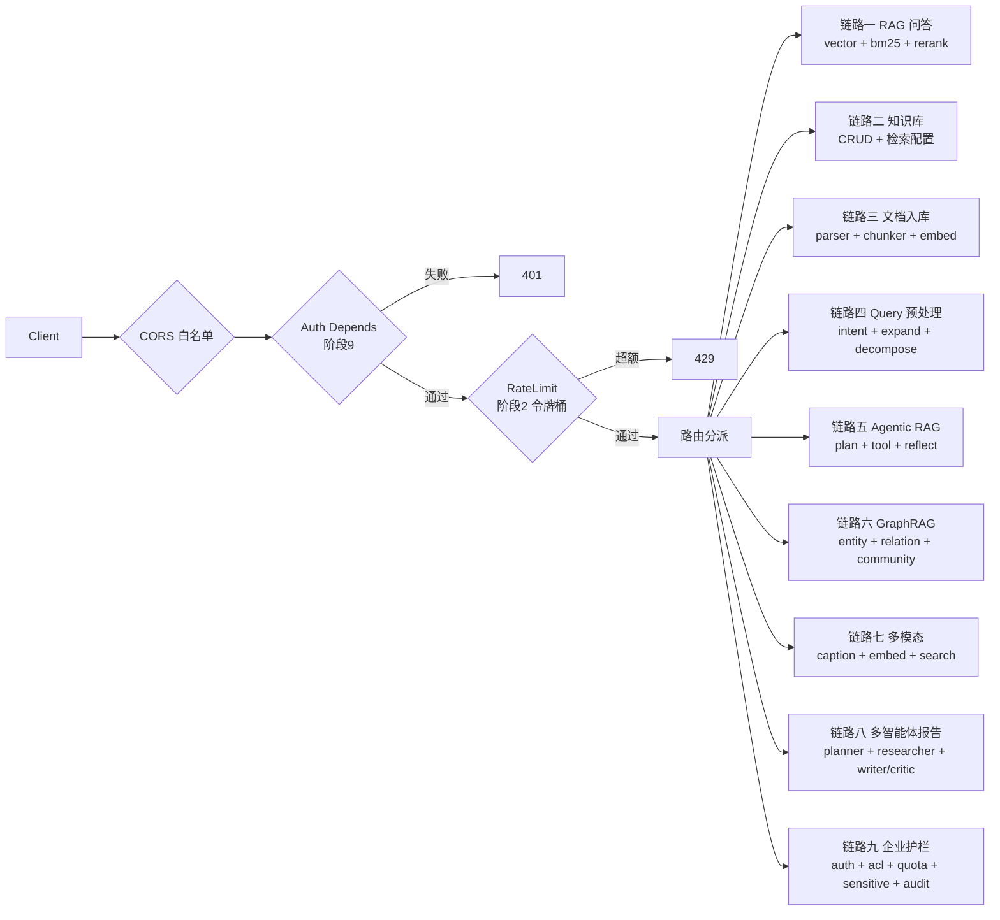
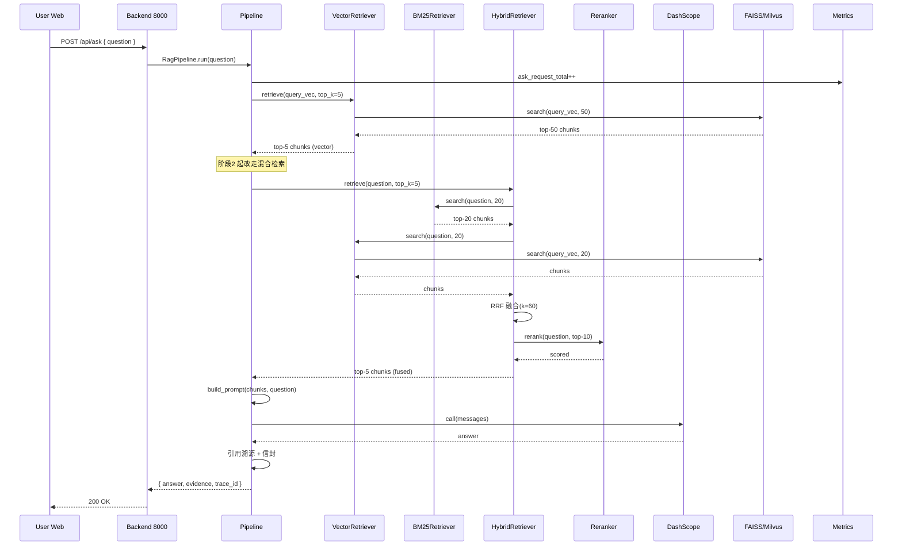
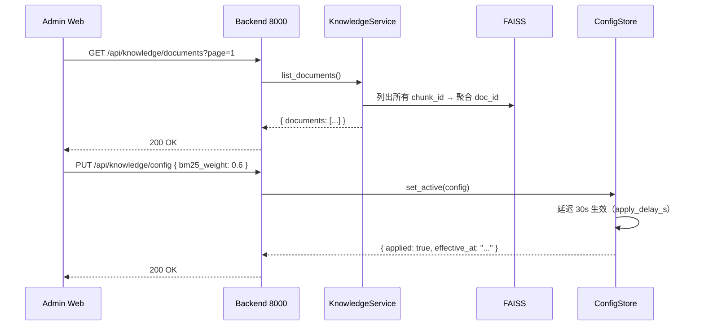
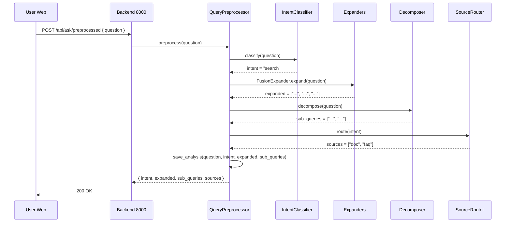
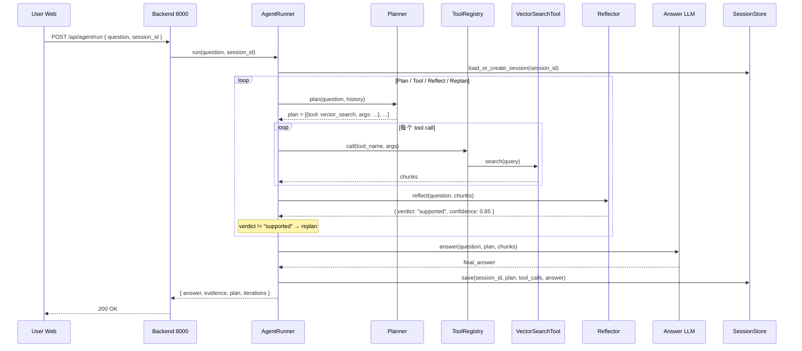
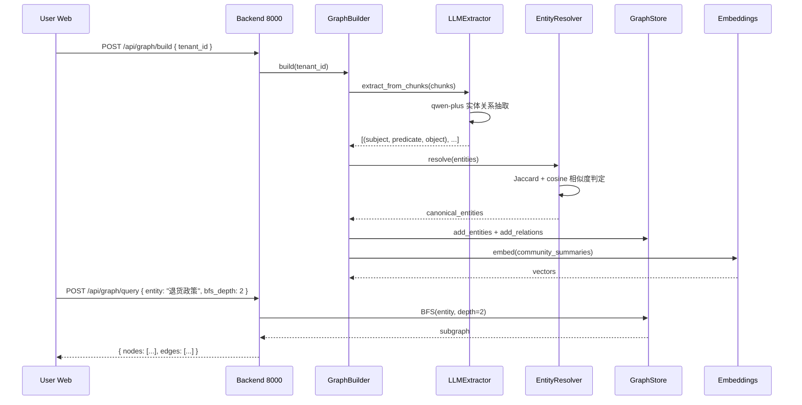
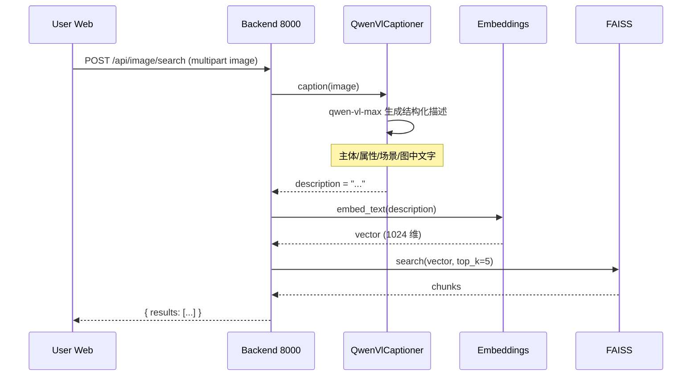
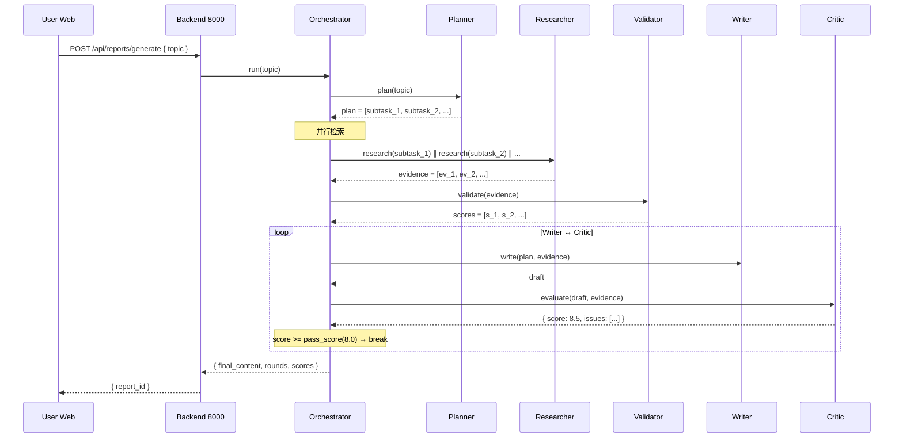
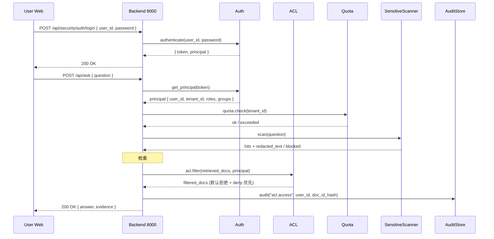

# Kquery 链路分析

> 本文档按**链路**分别分析，所有代码事实对应 `Kquery/backend/app/` 当前代码。
>
> 全文共九条链路（按 9 阶段顺序）：
> 1. **RAG 问答链路**：`/api/ask`、`/api/ask/hybrid`、`/api/ask/reflection`——单次问答、混合检索、自反思；
> 2. **知识库 CRUD 链路**：`/api/knowledge/documents`、`/api/knowledge/search`、`/api/knowledge/config`；
> 3. **文档入库链路**：`/api/ingest/upload`、`/api/ingest/tasks/{id}`——多模态解析、分块、向量化、入库；
> 4. **Query 预处理链路**：`/api/ask/preprocessed`、`/api/analysis/records`；
> 5. **Agentic RAG 链路**：`/api/agent/run`、`/api/agent/run/stream`、`/api/agent/sessions`；
> 6. **GraphRAG 链路**：`/api/graph/build`、`/api/graph/query`、`/api/graph/browse`；
> 7. **多模态链路**：`/api/image/search`；
> 8. **多智能体报告链路**：`/api/reports/generate`、`/api/reports/{id}`；
> 9. **企业护栏链路**：`/api/security/auth/login`、`/api/security/acl/check`、`/api/security/eval/run`。

---

## 〇、链路总览

### 〇.1 链路划分

| # | 链路 | 端点 | 中间件 | 存储参与 | LLM 参与 |
|---|---|---|---|---|---|
| 一 | RAG 问答 | `/api/ask`、`/api/ask/hybrid`、`/api/ask/reflection` | CORS | FAISS / Milvus + BM25 + JSON | qwen-plus / qwen-turbo + gte-rerank-v2 |
| 二 | 知识库 CRUD | `/api/knowledge/*` | CORS | FAISS / Milvus + JSON | — |
| 三 | 文档入库 | `/api/ingest/upload`、`/api/ingest/tasks` | CORS | FAISS / Milvus + JSON + 文件系统 | — |
| 四 | Query 预处理 | `/api/ask/preprocessed`、`/api/analysis/records` | CORS + 限流 | JSON | qwen-turbo（意图）+ qwen-plus（Fusion/HyDE/Step-Back） |
| 五 | Agentic RAG | `/api/agent/run`、`/api/agent/run/stream`、`/api/agent/sessions` | CORS + 限流 | 会话 JSON | qwen-plus（Planner）+ gte-rerank-v2（Validator） |
| 六 | GraphRAG | `/api/graph/*` | CORS | 图 JSON | qwen-plus（实体抽取）+ qwen-vl-max（多模态） |
| 七 | 多模态 | `/api/image/search` | CORS | FAISS / Milvus | qwen-vl-max（描述）+ text-embedding-v3 |
| 八 | 多智能体报告 | `/api/reports/*` | CORS + 限流 | 报告 JSON | qwen-plus（Planner）+ qwen-max（Writer）+ qwen-plus（Critic） |
| 九 | 企业护栏 | `/api/security/*` | CORS + Auth Depends | JSON + Keychain | — |



---

## 一、链路一：RAG 问答

### 1.1 端到端流程（单次问答）



### 1.2 关键步骤详解

#### 1.2.1 向量检索（`app/services/retrieval/vector.py`）

```python
class VectorRetriever:
    async def retrieve(self, query: str, top_k: int = 5) -> list[dict]:
        # 1. embed query
        query_vec = await self.embeddings.embed_text(query)
        # 2. FAISS 检索 (to_thread)
        loop = asyncio.get_running_loop()
        distances, indices = await loop.run_in_executor(
            None, self.store.search, np.array([query_vec]), top_k * 4
        )
        # 3. 转换为 chunk 列表
        return self._format_chunks(distances, indices)
```

#### 1.2.2 混合检索（阶段 2+，`app/services/retrieval/hybrid.py`）

```python
class HybridRetriever:
    async def retrieve(self, query: str, top_k: int = 5) -> list[dict]:
        # 1. 多路召回
        route_results = {}
        for name, retriever in self.retrievers.items():
            route_results[name] = await retriever.retrieve(query, top_k=self.per_route_top_n)
        
        # 2. RRF 融合
        fused = reciprocal_rank_fusion(route_results, k=self.rrf_k)
        
        # 3. Rerank
        top = fused[:self.fused_top_n]
        scores = await self.reranker.rerank(query, [c["text"] for c in top])
        for chunk, score in zip(top, scores):
            chunk["rerank_score"] = score
        return sorted(top, key=lambda c: c["rerank_score"], reverse=True)[:top_k]
```

#### 1.2.3 自反思（阶段 5+，`app/services/validation/crag.py`）

```python
class CragRouter:
    def route(self, evidence_score: float) -> str:
        if evidence_score >= self.correct_th:  # 0.7
            return "correct"  # 直接生成
        elif evidence_score <= self.incorrect_th:  # 0.3
            return "incorrect"  # 拒答
        else:
            return "ambiguous"  # 受限重生成
```

### 1.3 失败兜底

| 失败点 | 兜底策略 |
|---|---|
| FAISS 索引损坏 | 启动期 fail-fast；运行期降级到 BM25 only |
| 千问 API 超时 | 30s 超时 + 指数退避重试 3 次 |
| 千问限流 | `E_LLM_RATE_LIMITED` (429) |
| 检索无结果 | `answer` 不引用任何证据；客户端提示 |
| CRAG 拒答 | `verdict="refused"` + `feedback_store` 记录工单 |

---

## 二、链路二：知识库 CRUD

### 2.1 端到端流程（文档列表 + 检索配置修改）



### 2.2 关键设计

#### 2.2.1 检索配置热更新（`app/services/config_store.py`）

```python
class RetrievalConfigStore:
    async def set_active(self, new_config: RetrievalConfig):
        # 1. 写入 pending
        self._pending = new_config
        self._pending_at = time.time()
    
    def get_active(self) -> RetrievalConfig:
        # 2. 检查 pending 是否到期
        if self._pending and time.time() - self._pending_at > self.apply_delay_s:
            self._active = self._pending
            self._pending = None
        return self._active
```

**价值**：避免频繁切换（每改一次都生效 → 检索结果抖动）。

#### 2.2.2 文档删除（`app/services/knowledge.py`）

```python
async def delete_document(self, doc_id: str):
    # 1. FAISS 删除（按 chunk_id 过滤重建索引）
    chunks = self.store.get_chunks_by_doc(doc_id)
    for chunk in chunks:
        self.store.remove(chunk.chunk_id)
    
    # 2. JSON DocStore 删除
    self.docstore.remove(doc_id)
    
    # 3. 持久化
    self.store.save()
    self.docstore.save()
```

> **关键设计**：删除是**物理删除**（不软删）——demo 阶段简化。

---

## 三、链路三：文档入库

### 3.1 端到端流程（PDF 上传）

```mermaid
sequenceDiagram
    participant U as User Web
    participant ADM as Backend 8000
    participant TM as TaskManager
    participant PAR as ParserRouter
    participant CHK as Chunker
    participant EMB as Embeddings
    participant FS as FAISS
    participant DS as DocStore

    U->>ADM: POST /api/ingest/upload (multipart PDF)
    ADM->>TM: enqueue(task)
    TM-->>ADM: { task_id }
    ADM-->>U: 202 Accepted

    Note over TM: 异步处理
    TM->>PAR: parse(pdf_bytes)
    PAR->>PAR: 文本提取 + 表格识别 + OCR
    PAR-->>TM: { text, tables, images }
    TM->>CHK: chunk(text, strategy="semantic")
    CHK-->>TM: chunks = [c1, c2, c3]
    loop 每个 chunk
        TM->>EMB: embed_text(chunk.text)
        EMB-->>TM: vector (1024 维)
    end
    TM->>FS: add(vectors, chunk_ids)
    TM->>DS: save(parent_chunks, tables, media)
    TM->>TM: update_task_status(task_id, "completed")
```

### 3.2 关键设计

#### 3.2.1 任务队列（`app/services/ingest.py`）

```python
class TaskManager:
    def __init__(self):
        self._queue = asyncio.Queue()
    
    async def start(self):
        asyncio.create_task(self._worker())
    
    async def _worker(self):
        while True:
            task = await self._queue.get()
            try:
                await self._process_task(task)
            except Exception as e:
                logger.exception(f"Task {task.task_id} failed: {e}")
            finally:
                self._queue.task_done()
```

**关键设计**：单实例串行处理（避免并发冲突）；多实例需外置 MQ。

#### 3.2.2 4 种分块策略

| 策略 | 适用场景 | 优点 | 缺点 |
|---|---|---|---|
| `recursive` | 通用 | 简单稳定 | 语义不连续 |
| `semantic` | 高质量文档 | 语义聚合 | 慢（需 embedding 距离判定） |
| `parent_child` | 问答需上下文 | 检索子块、返回父块 | 切片数翻倍 |
| `raptort` | 跨文档摘要 | 树状递归 | 慢（多轮聚类 + LLM 摘要） |

> **业内参考**：LlamaIndex 与 LangChain 都内置 4 种策略；Kquery 与 LlamaIndex 风格一致。

---

## 四、链路四：Query 预处理

### 4.1 端到端流程



### 4.2 关键设计

#### 4.2.1 意图识别（`app/services/query/intent.py`）

```python
class IntentClassifier:
    def __init__(self, fast_llm):
        self.llm = fast_llm  # qwen-turbo
    
    async def classify(self, question: str) -> str:
        prompt = f"""判断以下问题的意图：
- search：需要检索知识库
- chitchat：闲聊（无需检索）
- task：需要执行操作
- faq：常见问题（可直接回答）

问题：{question}
意图："""
        return (await self.llm.call([{"role": "user", "content": prompt}])).strip()
```

**关键**：用 `qwen-turbo` 而非 `qwen-plus`——5x 成本节省。

#### 4.2.2 Fusion 与 HyDE 互斥

```python
if "fusion" in expander_names:
    expanders.append(FusionExpander(fast_llm, n=settings.fusion_n))
elif "hyde" in expander_names:  # 互斥
    expanders.append(HydeExpander(llm))
```

> **关键设计**：两者都是"扩展 query"——同时启用会生成大量冗余变体，反而降低检索精度。

---

## 五、链路五：Agentic RAG

### 5.1 端到端流程



### 5.2 关键设计

#### 5.2.1 LangGraph 状态机（`app/services/agent/graph.py`）

```python
def build_agent_graph(registry, planner, reflector, answer_llm, ...):
    workflow = StateGraph(AgentState)
    workflow.add_node("plan", planner.plan)
    workflow.add_node("execute", execute_tool_calls)
    workflow.add_node("reflect", reflector.reflect)
    workflow.add_node("answer", answer_llm.answer)
    
    workflow.add_edge(START, "plan")
    workflow.add_edge("plan", "execute")
    workflow.add_conditional_edges("execute", should_continue, {"reflect": "reflect", "answer": "answer"})
    workflow.add_conditional_edges("reflect", should_replan, {"replan": "plan", "answer": "answer"})
    workflow.add_edge("answer", END)
    
    return workflow.compile()
```

#### 5.2.2 三层熔断

```python
class AgentRunner:
    async def run(self, question, session_id, ...):
        with timeout(self.total_timeout):  # 整体 30s
            while iteration < self.max_iterations:  # ≤10 步
                async with timeout(self.step_timeout):  # 单步 10s
                    ...
```

---

## 六、链路六：GraphRAG

### 6.1 端到端流程



### 6.2 关键设计

**实体消歧**：Jaccard + embedding cosine > 0.85 → 归一为同一实体（如"退货"和"退款"归一）。

**稳定编号社区摘要**：Leiden 算法 → 社区 → LLM 摘要 → 稳定编号（哈希）→ 跨重建可追溯。

---

## 七、链路七：多模态

### 7.1 端到端流程



### 7.2 关键设计

**统一向量空间**：放弃双塔对比模型（CLIP/BGE-VL），改用「qwen-vl-max 描述 → text-embedding-v3」→ 图像描述向量与正文向量共用同一个 FAISS / Milvus 索引。

---

## 八、链路八：多智能体报告

### 8.1 端到端流程



---

## 九、链路九：企业护栏

### 9.1 端到端流程



---

# 附录

## 十、附录：核心代码位置速查

- `RagPipeline.run`（`app/services/pipeline.py`）：RAG 主链路
- `HybridRetriever.retrieve`（`app/services/retrieval/hybrid.py`）：BM25 + 向量 + RRF + Rerank
- `QueryPreprocessor.preprocess`（`app/services/query/orchestrator.py`）：阶段 4 预处理
- `CragRouter.route`（`app/services/validation/crag.py`）：阶段 5 CRAG
- `HallucinationChecker.check`（`app/services/validation/selfcheck.py`）：阶段 5 幻觉自检
- `AgentRunner.run`（`app/services/agent/runner.py`）：阶段 6 Agent 编排
- `GraphBuilder.build`（`app/services/graph/builder.py`）：阶段 7 GraphRAG 构建
- `GraphQueryService.query`（`app/services/graph/query.py`）：阶段 7 图谱查询
- `QwenVlCaptioner.caption`（`app/services/graph/images.py`）：阶段 7 多模态描述
- `Orchestrator.run`（`app/services/multiagent/orchestrator.py`）：阶段 8 多智能体
- `build_auth_provider`（`app/services/security/auth.py`）：阶段 9 认证
- `ACLService.check`（`app/services/security/acl.py`）：阶段 9 ACL
- `SlidingWindowQuota.check`（`app/services/security/quota.py`）：阶段 9 配额
- `SensitiveScanner.scan`（`app/services/security/sensitive.py`）：阶段 9 敏感词
- `EvalRunner.compare`（`app/services/security/evalrun.py`）：阶段 9 评测门禁
