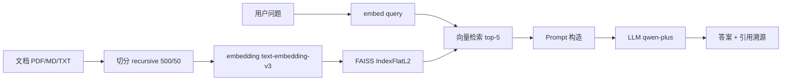
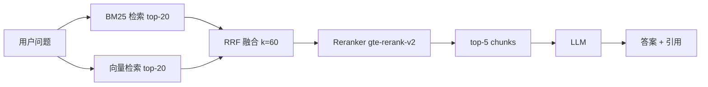
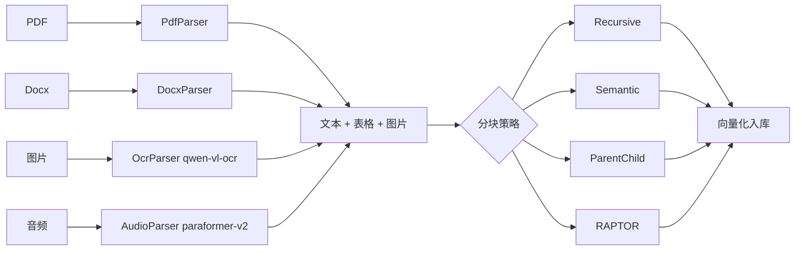
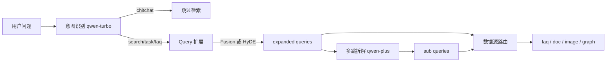
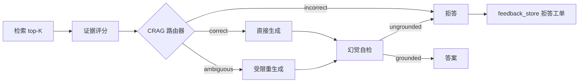
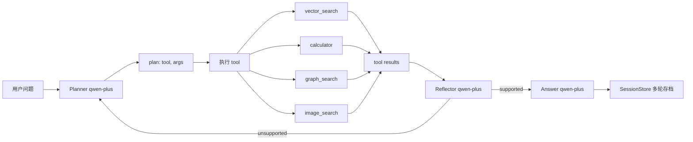
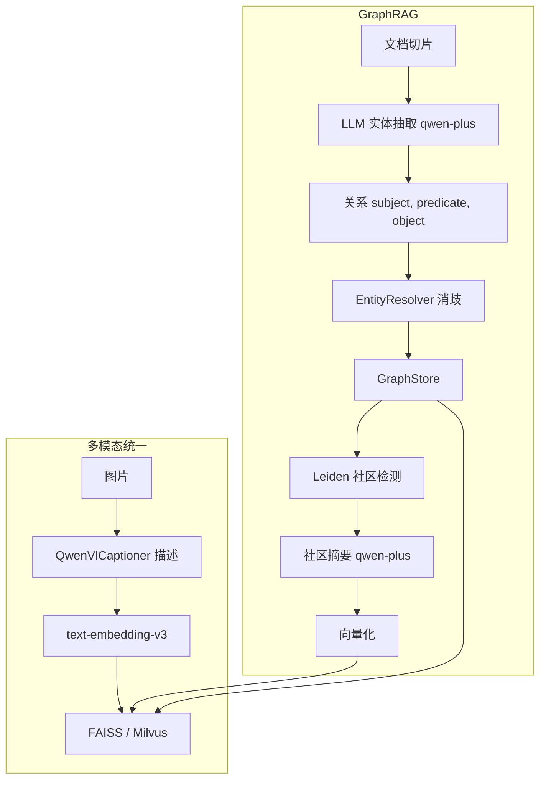
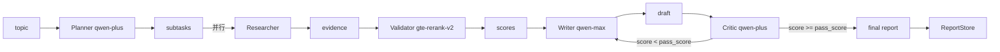
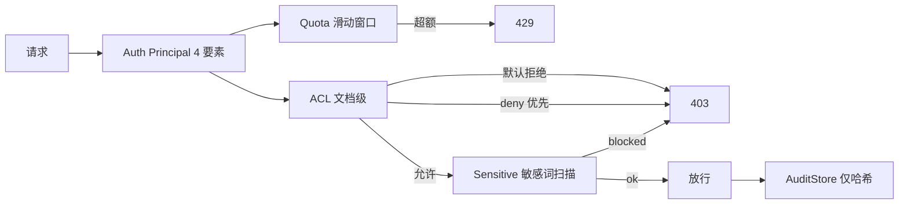

# Kquery 阶段架构总览

> ## ⚠️ 部分内容已随功能下线而失效（2026-10-17）
>
> 「**报告中心**（多智能体报告 / `/reports*` / `multiagent` 包）」与「**评测平台**（`/admin/eval*`）」两个功能已从代码库移除。
> 依据：`doc/plan/移除评测平台与报告中心-分析与实施计划.md`。
>
> 下列章节描述的是**下线前**的设计，仅作历史决策留档，**不代表当前实现**：
> - 「阶段 8：多智能体报告」整节
> - 阶段 9 中的评测门禁与评测管理页
> - 架构图中的 S8 / S9 节点
> - 「评测必须绑定版本」决策
>
> 未列出的章节仍与当前代码一致。注意：`GET /admin/costs`（成本看板，TASK-134）与本主题无关，
> 已迁至 `app/api/admin.py`，继续有效。

> - **整理日期**：2026-10-05
> - **范围**：`/Users/lizhipeng/workspace/project/Kquery/` 9 阶段（阶段 1~9 已完成）+ 阶段 10 演进
> - **依据**：`backend/app/` 当前代码（原 `doc/series/` 10 阶段系列设计文档已于 2026-10-17 删除）
> - **口径**：每阶段在上一阶段基础上增量；统一使用阿里云百炼千问平台；统一向量空间

---

# 第一部分　总览

## 一、9 阶段全景图

```mermaid
flowchart LR
    S1["阶段1<br/>Naive RAG<br/>文档 → 切片 → 向量 → 检索 → 千问 → 答案"]
    S2["阶段2<br/>混合检索<br/>BM25 + 向量 + RRF + gte-rerank-v2"]
    S3["阶段3<br/>智能分块 + 多模态<br/>4 分块策略 + PDF/OCR/ASR"]
    S4["阶段4<br/>Query 预处理<br/>意图 + Fusion + HyDE + Step-Back + 多跳"]
    S5["阶段5<br/>自反思 + 自校正<br/>CRAG + 幻觉自检 + 拒答"]
    S6["阶段6<br/>Agentic RAG<br/>LangGraph 状态机 + 工具 + 会话"]
    S7["阶段7<br/>GraphRAG + 多模态<br/>实体抽取 + 消歧 + 图谱 + 图像"]
    S8["阶段8<br/>多智能体报告<br/>Planner/Researcher/Validator/Writer/Critic"]
    S9["阶段9<br/>企业级护栏<br/>认证 + ACL + 配额 + 敏感词 + 审计 + 评测"]
    S10["阶段10<br/>部署演进<br/>（设计阶段）"]
    
    S1 --> S2 --> S3 --> S4 --> S5 --> S6 --> S7 --> S8 --> S9 --> S10
```

## 二、各阶段核心能力

| 阶段 | 核心能力 | 关键模块 | 主要交付 |
|---|---|---|---|
| 1 | Naive RAG 基线 | `pipeline.py` / `vectorstore.py` | 文档 → 切片 → 向量 → 检索 → 千问 → 答案（含引用溯源） |
| 2 | 混合检索 + 工程化 | `hybrid.py` / `bm25.py` / `cache.py` / `ratelimit.py` / `metrics.py` | BM25 + 向量 + RRF + gte-rerank-v2 + 语义缓存 + 令牌桶限流 + Prometheus 指标 |
| 3 | 智能分块 + 多模态 | `chunkers/` / `parsers/` / `docstore.py` | Recursive / Semantic / ParentChild / RAPTOR 四策略 + PDF / Docx / OCR / ASR + 入库任务队列 |
| 4 | Query 预处理 | `query/` | 意图识别（qwen-turbo）+ Fusion 改写 + HyDE + Step-Back + 多跳拆解 + 数据源路由 + 分析记录回放 |
| 5 | 自反思 + 自校正 | `validation/` | CRAG 三分支 + 证据评分 + 幻觉自检 + 受限重生成 + 显式拒答 + 置信度 + 拒答反馈工单 + 质量指标 |
| 6 | Agentic RAG | `agent/` | LangGraph 状态机 Plan / Tool / Reflect / Replan / Answer + 工具注册表 + 幻觉兜底 + 三层熔断 + 多轮会话存档 + 执行轨迹可视化 |
| 7 | GraphRAG + 多模态 | `graph/` | qwen-plus 实体关系抽取 + 向量消歧归一 + SQLite 图存储 BFS（租户分区）+ 稳定编号社区摘要 + qwen-vl-max 结构化描述统一向量空间 + 入库联动构建 + graph_search / image_search 工具 + 图谱浏览器 |
| 8 | 多智能体报告 | `multiagent/` | Planner / Researcher / Validator / Writer / Critic 五角色 + Blackboard 黑板 + 拓扑分层并行 + Writer ↔ Critic 评分循环 + 报告中心 |
| 9 | 企业级护栏 | `security/` | 认证 Principal 四要素 + 租户隔离 + 文档级 ACL 双过滤（默认拒绝 / deny 优先）+ 审计三事件只存哈希 + 敏感词长词优先扫描与掩码 + 租户滑动窗口配额 + 平台侧配额监控 + 评测集与四指标运行 + 六个管理页面 |
| 10 | 部署演进 | （设计阶段） | K8s 部署 + 多实例 + Redis 共享 + Milvus 集群 |

## 三、各阶段模型档位映射

| 阶段 | 用途 | 模型 |
|---|---|---|
| 1 | 答案生成 | qwen-plus |
| 2 | 重排 | gte-rerank-v2 |
| 3 | 表格识别 / OCR | qwen-vl-ocr |
| 3 | 音频转写 | paraformer-v2 |
| 4 | 意图识别 | qwen-turbo |
| 4 | Fusion / HyDE / Step-Back | qwen-plus |
| 4 | 多跳拆解 | qwen-plus |
| 5 | CRAG 重生成 | qwen-plus |
| 5 | 幻觉自检 | qwen-plus |
| 6 | Planner | qwen-plus |
| 6 | Validator | gte-rerank-v2 |
| 6 | Answer | qwen-plus |
| 7 | 实体抽取 | qwen-plus |
| 7 | 社区摘要 | qwen-plus |
| 7 | 多模态描述 | qwen-vl-max |
| 8 | Planner | qwen-plus |
| 8 | Researcher | qwen-plus |
| 8 | Validator | gte-rerank-v2 |
| 8 | Writer | qwen-max |
| 8 | Critic | qwen-plus |
| 9 | 决策不用模型 | — |

---

# 第二部分　阶段演进详解

## 四、阶段 1：Naive RAG 基线

**核心命题**：最小可用 RAG，能用就行。

**关键决策**：
- **切片策略**：Recursive 500 字 / overlap 50（最简单但可用）
- **向量库**：FAISS IndexFlatL2（单进程零依赖）
- **LLM**：qwen-plus（默认）
- **引用溯源**：`[#N]` 占位符 + `evidence` 数组

**验收**：
- ✅ PDF/MD/TXT 上传 → 切片 → 向量化 → 检索
- ✅ 答案带 `[#N]` 引用 → 点击跳转原文

## 五、阶段 2：混合检索 + 工程化

**核心命题**：单纯向量不够；向量 + BM25 + Rerank 才稳。

**关键决策**：
- **混合检索**：BM25（精确关键词）+ 向量（语义）→ RRF 融合
- **Reranker**：gte-rerank-v2 精排 top-10
- **语义缓存**：规范化 prompt + provider + model → 24h TTL
- **令牌桶限流**：每用户 / 每 IP QPS + 每日限额
- **Prometheus 指标**：`/metrics` 端点暴露

**验收**：
- ✅ 关键词召回（订单号 / 型号 / 法律条款）
- ✅ 语义召回（"退货" ↔ "退款"）
- ✅ Rerank 精排（top-10 → top-5）

## 六、阶段 3：智能分块 + 多模态

**核心命题**：分块决定 RAG 上限；多模态扩展知识来源。

**关键决策**：
- **4 种分块**：Recursive（通用）/ Semantic（语义聚合）/ ParentChild（子块检索 + 父块返回）/ RAPTOR（树状摘要）
- **多模态解析**：PDF / Docx / 图片 OCR / 音频 ASR
- **入库任务队列**：`TaskManager` 异步处理
- **解析预览**：上传前预览解析结果

**验收**：
- ✅ 4 种分块策略可选
- ✅ PDF 表格识别
- ✅ 图片 OCR（qwen-vl-ocr）
- ✅ 音频转写带时间戳（paraformer-v2）

## 七、阶段 4：Query 预处理

**核心命题**：用户问题往往不"标准"——需扩展 / 拆解 / 路由。

**关键决策**：
- **意图识别压 qwen-turbo**：高频轻量（成本节省 5x）
- **Fusion 与 HyDE 互斥**：避免互相稀释
- **闲聊短路**：直接回复，不检索
- **数据源路由**：按意图决定走 FAQ / 文档 / 图像 / 图谱
- **分析记录可回放**：每条预处理都存档

**验收**：
- ✅ 意图识别准确率 > 90%（FAQ 简单问题）
- ✅ Fusion / HyDE / Step-Back 互斥
- ✅ 多跳问题拆解为子查询

## 八、阶段 5：自反思 + 自校正

**核心命题**：LLM 会"幻觉"——需自检、拒答、重生成。

**关键决策**：
- **CRAG 三分支**：correct（≥0.14）/ ambiguous / incorrect（≤0.08），评分为 Top-2 重排分均值
- **证据评分**：复用 gte-rerank-v2 相关度分（不混用评分器）
- **幻觉自检**：LLM 逐句核对"回答是否被证据支持"，无据声明 → 受限重生成一次
- **拒答反馈**：拒答时生成工单（`POST /feedback/refusal`，必填 trace_id）
- **通用知识兜底**：无内容/证据耗尽时改由模型自身知识回答（`answer_source="parametric"`，权限拒答不兜底）
- **Agent 三层熔断**：动态迭代上限（计划步骤数+2 重规划余量）/ 连续 3 轮无效进展 / 单步工具 30s；另有迭代/token/墙钟三预算闸门

**验收**：
- ✅ 高置信问题直接生成
- ✅ 低置信问题拒答（不胡编）
- ✅ 中等置信问题重生成

## 九、阶段 6：Agentic RAG

**核心命题**：单次 RAG 不够 → Agent 决策 → 多轮工具调用。

**关键决策**：
- **LangGraph 状态机**：Plan / Tool / Reflect / Replan / Answer
- **工具注册表**：VectorSearch / Calculator / GraphSearch / ImageSearch
- **幻觉兜底**：所有 Tool 结果都进 HallucinationChecker
- **三层熔断**：单任务 ≤10 步 / pipeline ≤30s / 单步 ≤10s
- **多轮会话存档**：SessionStore 持久化

**验收**：
- ✅ 6-1 PEO ✅、6-2 内置工具 ✅、6-3 工具注册 ✅
- ✅ 6-4 路径白名单 ✅、6-5 命令分级 ✅
- ✅ 6-10 中断恢复 ✅、6-12 单步超时 ✅、6-13 最大迭代 ✅

## 十、阶段 7：GraphRAG + 多模态

**核心命题**：单切片不够 → 全局视角（图谱）+ 视觉理解（多模态）。

**关键决策**：
- **实体抽取**：qwen-plus 生成 (subject, predicate, object) 三元组
- **实体消歧**：同类型硬约束下向量索引召回 + cosine ≥ 0.85 → 归一并登记别名（消歧表持久化 `graph/resolver.json`）
- **SQLite 图存储 BFS**：默认 SQLite 增量持久化（`sqlite_store.py`，旧 JSON 自动迁移备份），按租户复合 key 分区
- **稳定编号社区摘要**：Leiden 算法 → LLM 摘要（带 model_version）→ 摘要块入统一向量库
- **统一向量空间**：放弃双塔对比模型（CLIP/BGE-VL），改用「qwen-vl-max 描述 + text-embedding-v3」
- **入库联动**：文档入库经 `_post_index` 钩子自动增量建图谱 + 图像索引（不再只能手动触发）

**验收**：
- ✅ 实体关系抽取
- ✅ 实体消歧归一
- ✅ 社区摘要稳定编号
- ✅ 图谱浏览器
- ✅ 图像语义搜索

## 十一、阶段 8：多智能体报告

**核心命题**：单 Agent 不够 → 5 角色协同 + Writer ↔ Critic 循环。

**关键决策**：
- **5 角色**：Planner / Researcher / Validator / Writer / Critic
- **Blackboard 黑板**：报告任务分解为子任务
- **拓扑分层并行**：plan → research（并行）→ validate → write/critic 循环
- **Writer ↔ Critic 循环**：直到 pass 或 max_rounds（默认 2）
- **pass_score 默认 8.0**：评分阈值

**验收**：
- ✅ Planner 拆解任务
- ✅ Researcher 并行检索
- ✅ Validator 评分证据
- ✅ Writer 撰写报告（qwen-max）
- ✅ Critic 评分 + issue 列表

## 十二、阶段 9：企业级护栏

**核心命题**：SaaS 多租户 + 安全合规 + 评测门禁。

**关键决策**：
- **认证 4 要素**：user_id / tenant_id / roles / groups
- **租户隔离**：每个 tenant 独立配额 / 数据
- **文档级 ACL**：默认拒绝 + deny 优先；召回阶段下推 + 检索后应用层二次过滤（双保险）
- **审计三事件只存哈希**：rag.request / rag.retrieve / rag.answer（问题与答案只存哈希），管理操作另写 admin.action
- **敏感词长词优先**："中华人民共和国居民身份证" 必须先于 "身份证" 匹配；输入侧探测不阻断、入库侧 PII 硬拦截、输出侧掩码/拒答
- **租户滑动窗口配额**：每分钟 / 每日 / token 三维；token 用量在问答完成后结算回填
- **平台侧配额监控**：千问账号级，接近上限告警
- **评测门禁**：pass_rate 回归 >2% / cost >1.2× / latency >1.1× → fail
- **六个管理页面**：用户 / Token / 用户组 / 配额 / 评测 / 审计

**验收**：
- ✅ 多租户隔离
- ✅ 文档级 ACL
- ✅ 审计最小化
- ✅ 敏感词长词优先
- ✅ 评测门禁

## 十三、阶段 10：部署演进（设计阶段）

**核心命题**：从单进程单端口到 K8s 多实例生产部署。

**设计要点**：
- 多实例横向扩展（FastAPI `--workers N`）
- Redis 共享语义缓存 / 配额状态
- Milvus 集群（替代 FAISS）
- 三级探针（liveness / readiness / startup）
- 启动期 fail-fast（索引 / Redis / 千问连通性验证）

---

# 第三部分　阶段对照与关键决策记录

## 十四、阶段对照表

| 维度 | 阶段 1 | 阶段 5 | 阶段 9 |
|---|---|---|---|
| 检索 | 向量 | 混合 + CRAG | 混合 + CRAG + ACL 过滤 |
| 生成 | qwen-plus | qwen-plus + 幻觉自检 | qwen-plus + 护栏 |
| 失败兜底 | 无 | 拒答 | 拒答 + 配额 + 敏感词 |
| 多轮 | 无 | 无 | SessionStore（阶段 6 起） |
| 租户隔离 | 无 | 无 | 多租户 |

## 十五、关键决策记录

### 15.1 统一向量空间（阶段 7）

**决策**：放弃 CLIP / BGE-VL 等双塔对比模型，改用「qwen-vl-max 生成结构化描述 → text-embedding-v3 编码」。

**原因**：
- 双塔模型需要第二套索引与向量空间，运维复杂
- qwen-vl-max 描述能力远超双塔模型
- 文本向量在 RAG 场景已验证稳定

**代价**：
- 图像检索前需先调一次 LLM（额外 ~500ms）
- 描述质量依赖 LLM 稳定性

### 15.2 三层熔断（阶段 5）

**决策**：单次迭代 / 整个 pipeline / 单 LLM 调用三层熔断。

**原因**：
- LLM Agent 容易陷入"重生成→再检索→再重生成"的死循环
- 单一超时不够保护（pipeline 总超时 30s 但单步超时 10s）

### 15.3 ACL 默认拒绝 + deny 优先（阶段 9）

**决策**：用户不在 allowed → 拒绝；同时在 allowed + denied → 拒绝。

**原因**：
- "默认允许"是 SaaS 常见的安全漏洞
- deny 优先符合最小权限原则

### 15.4 审计最小化（阶段 9）

**决策**：仅存 payload 的 sha256 哈希 + 必要字段。

**原因**：
- GDPR / 等保 2.0 要求审计最小化
- 哈希仍可关联同一事件的不同阶段
- 原始 payload 不落盘 → 即使数据库泄露也不暴露敏感信息

### 15.5 评测必须绑定版本（阶段 9）

**决策**：评测 `EvalResult` 必须含 `eval_set_version` + `model_version`。

**原因**：
- 千问平台模型档位会升级（应用侧无法拒绝）
- 评测结果必须可追溯到具体评测集 + 模型档位组合

### 15.6 Fusion 与 HyDE 互斥（阶段 4）

**决策**：两者都是 query 扩展——同时启用会生成冗余变体，反而降低检索精度。

**实现**：`if "fusion" in expander_names: ... elif "hyde" in ...`

---

# 第四部分　附录

## 十六、与设计文档的对照

| 阶段 | 设计文档章节 | 当前实现 |
|---|---|---|
| 1 | `stage-1-naive-rag/README.md` | ✅ 完整 |
| 2 | `stage-2-hybrid-retrieval/README.md` | ✅ 完整 |
| 3 | `stage-3-smart-chunking/README.md` | ✅ 完整 |
| 4 | `stage-4-query-preprocessing/README.md` | ✅ 完整 |
| 5 | `stage-5-self-reflection/README.md` | ✅ 完整 |
| 6 | `stage-6-agentic-rag/README.md` | ✅ 完整 |
| 7 | `stage-7-graph-rag/README.md` | ✅ 完整 |
| 8 | `stage-8-multi-agent/README.md` | ✅ 完整 |
| 9 | `stage-9-guardrails/README.md` | ✅ 完整 |
| 10 | `stage-10-deployment/README.md` | 🟡 留待后续 |

## 十七、附录：核心代码位置速查

- `create_app`（`app/main.py`）：FastAPI 装配 + lifespan
- `RagPipeline`（`app/services/pipeline.py`）：阶段 1 主链路
- `HybridRetriever`（`app/services/retrieval/hybrid.py`）：阶段 2 混合检索
- `ParserRouter`（`app/services/parsers/router.py`）：阶段 3 多模态解析
- `QueryPreprocessor`（`app/services/query/orchestrator.py`）：阶段 4 预处理
- `CragRouter`（`app/services/validation/crag.py`）：阶段 5 自反思
- `AgentRunner`（`app/services/agent/runner.py`）：阶段 6 Agent 编排
- `GraphBuilder`（`app/services/graph/builder.py`）：阶段 7 GraphRAG
- `Orchestrator`（`app/services/multiagent/orchestrator.py`）：阶段 8 多智能体
- `ACLService`（`app/services/security/acl.py`）：阶段 9 ACL
- `SlidingWindowQuota`（`app/services/security/quota.py`）：阶段 9 配额
- `SensitiveScanner`（`app/services/security/sensitive.py`）：阶段 9 敏感词
- `EvalRunner`（`app/services/security/evalrun.py`）：阶段 9 评测门禁
