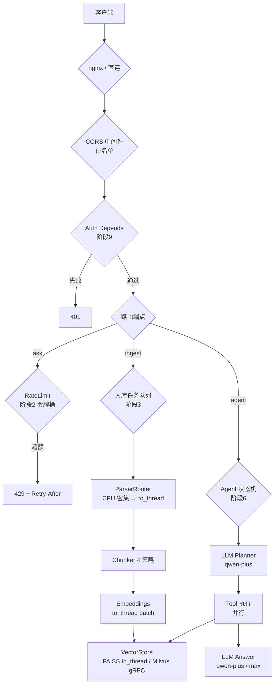

# Kquery 高并发设计与实践

> ## ⚠️ 部分内容已随功能下线而失效（2026-10-17）
>
> 「**报告中心**（多智能体报告 / `/reports*` / `multiagent` 包）」与「**评测平台**（`/admin/eval*`）」两个功能已从代码库移除。
> 依据：`doc/plan/移除评测平台与报告中心-分析与实施计划.md`。
>
> 下列章节描述的是**下线前**的设计，仅作历史决策留档，**不代表当前实现**：
> - 「多智能体（阶段 8）：并行编排」整节
> - `Orchestrator.run` 并行伪码
> - `writer_model` / `critic_model` 档位说明
>
> 未列出的章节仍与当前代码一致。注意：`GET /admin/costs`（成本看板，TASK-134）与本主题无关，
> 已迁至 `app/api/admin.py`，继续有效。

> - **整理日期**：2026-10-05
> - **范围**：`/Users/lizhipeng/workspace/project/Kquery/backend/app/` 当前并发体系的设计与实现事实
> - **口径**：单进程单端口 FastAPI；阶段 2 引入令牌桶限流；阶段 9 引入租户滑动窗口配额

---

# 第一部分　总览

## 一、总览

### 1.1 架构定位

Kquery 是单进程单端口 FastAPI 应用（端口 8000，`app/main.py` 的 `create_app()`），全部并发 = 单事件循环内的协程并发。真实吞吐瓶颈在千问 LLM 网关（流式首 token ~500ms、生成 ~50 token/s），应用层设计的核心目标是：**RAG 检索稳定 + 多 Agent 任务有序 + 阶段 9 租户隔离有效**。

### 1.2 并发漏斗（自外向内）



### 1.3 并发参数全景表

| 层 | 机制 | 参数（默认值） | 超容量行为 | 代码位置 |
|---|---|---|---|---|
| CORS | `CORSMiddleware` | 白名单 `cors_origins` | 不在白名单 → 拒绝 | `app/main.py` |
| 鉴权 | 端点 `Depends(get_current_principal)` | 阶段 9 启用 | 无效 Token → 401 | `app/services/security/auth.py` |
| 限流（阶段 2） | 令牌桶 `Limiter` | `rate_limit_per_minute=60` / `rate_limit_per_day=10000` | 超额 → 429 + Retry-After | `app/services/ratelimit.py` |
| 配额（阶段 9） | 滑动窗口 `SlidingWindowQuota` | `quota_per_minute=60` / `quota_per_day=10000` | 超额 → `E_QUOTA_EXCEEDED` (429) | `app/services/security/quota.py` |
| 平台配额（阶段 9） | `PlatformQuotaMonitor` | `platform_quota_per_day=1000000` | 接近上限 → WARNING 日志 | `app/services/security/platform_quota.py` |
| LLM 调用 | DashScope SDK + httpx AsyncClient | 超时 30s（默认） | 超时 → `E_LLM_TIMEOUT` (504) | `app/services/llm.py` |
| FAISS 检索 | `asyncio.to_thread` | 无超时 | 阻塞 to_thread 协程 | `app/services/vectorstore.py` |
| BM25 检索 | 纯 Python 计算 | 无超时 | 阻塞事件循环（demo ≤10k 切片可忽略） | `app/services/retrieval/bm25.py` |
| Milvus 检索 | gRPC 客户端 | 30s 超时（默认） | 超时 → 重试 1 次 | `app/services/milvus_store.py` |
| 入库任务 | `TaskManager` | 单实例串行 + 异步执行 | 队列堆积 | `app/services/ingest.py` |
| Agent 任务 | `AgentRunner` | `agent_max_steps=10` + 单任务 LLM 串行 | 超步数 → 中断 | `app/services/agent/runner.py` |
| 多智能体（阶段 8） | `SubtaskOrchestrator` | `parallelism=2` + `max_subtasks=5` | 超并发 → 队列等候 | `app/services/multiagent/orchestrator.py` |
| Embeddings | `text-embedding-v3` 批处理 | batch=32（默认） | 批内阻塞 → 拆分 | `app/services/embeddings.py` |
| Parser | `asyncio.to_thread` | 无超时 | 阻塞 to_thread | `app/services/parsers/*.py` |

---

# 第二部分　分模块实现与原理剖析

## 二、限流（阶段 2）：令牌桶

### 2.1 实现机制

`app/services/ratelimit.py`：

```python
class TokenBucketLimiter:
    def __init__(self, rate_per_minute: int, rate_per_day: int):
        self._buckets: dict[str, list[float]] = {}  # user_id → 时间戳列表
    
    async def check(self, key: str) -> bool:
        # 简化伪代码
        now = time.time()
        bucket = self._buckets.setdefault(key, [])
        # 清理 1 分钟前的记录
        bucket = [t for t in bucket if t > now - 60]
        # 清理 1 天前的记录
        bucket = [t for t in bucket if t > now - 86400]
        self._buckets[key] = bucket
        
        if len(bucket) >= self._rate_per_minute:
            return False  # 分钟级超限
        if len(bucket) >= self._rate_per_day:
            return False  # 日级超限
        
        bucket.append(now)
        return True
```

**关键设计**：
- **滑动窗口**（非固定窗口）：避免窗口切换时的"双倍流量"问题
- **两层级**：每分钟 + 每日
- **按 key 限流**：通常 key = user_id（或 IP、租户 ID）

### 2.2 原理剖析

**原理①　滑动窗口 vs 固定窗口**

固定窗口（如 0~60s 一个窗口）：
- 0~60s 内允许 60 次；60s 时窗口切换到 60~120s
- 0:59 来 60 次 → 1:00 又来 60 次 → 实际 2 秒内 120 次（双倍流量）

滑动窗口（保留每个请求的时间戳）：
- 任意时刻看过去 60s 内的请求数
- 永远不超过 60 次
- 内存开销：每用户每分钟 ≤ 60 个时间戳

> **业内参考**：Cloudflare / Stripe / AWS API Gateway 均采用滑动窗口；固定窗口仅在内存严格受限的场景使用。

**原理②　两层级（每分钟 + 每日）的价值**

- **每分钟**：防突发流量击穿下游
- **每日**：防长期滥用（爬虫 / 异常用户）

两者独立判断，**任一超限即拒绝**。

## 三、配额（阶段 9）：租户滑动窗口

### 3.1 实现机制

`app/services/security/quota.py`：

```python
class SlidingWindowQuota:
    def __init__(self):
        self._policy: dict[str, dict] = {}  # tenant_id → policy
        self._windows: dict[str, list[float]] = {}  # tenant_id → 时间戳
    
    def set_policy(self, tenant_id: str, per_minute: int, per_day: int):
        self._policy[tenant_id] = {"per_minute": per_minute, "per_day": per_day}
    
    def check(self, tenant_id: str) -> tuple[bool, str | None]:
        now = time.time()
        policy = self._policy.get(tenant_id, {"per_minute": 60, "per_day": 10000})
        window = self._windows.setdefault(tenant_id, [])
        window = [t for t in window if t > now - 60]
        window = [t for t in window if t > now - 86400]
        
        if len(window) >= policy["per_minute"]:
            return (False, "per_minute_exceeded")
        if len(window) >= policy["per_day"]:
            return (False, "per_day_exceeded")
        
        window.append(now)
        return (True, None)
```

**关键设计**：
- **租户级配额**：默认 `default` 租户 60/min + 10000/day
- **策略可配置**：`set_policy` 动态调整
- **滑动窗口**：与阶段 2 限流同算法

### 3.2 原理剖析

**原理①　租户级配额：多租户隔离的关键**

阶段 9 引入租户（`tenant_id`）后，**每个租户独立配额**——这是 SaaS 多租户的标准做法。

**原理②　应用配额 vs 平台配额分层**

| 层 | 对象 | 控制位置 |
|---|---|---|
| **平台配额** | 千问账号级 | `PlatformQuotaMonitor`，模型客户端上报 |
| **应用配额** | 租户级 | `SlidingWindowQuota`，应用层检查 |
| **API 限流** | 用户 / IP 级 | `TokenBucketLimiter`，端点前置 |

三层独立、超额独立反馈。

## 四、LLM 调用：DashScope SDK + httpx

### 4.1 实现机制

`app/services/llm.py`：

```python
class LLM:
    def __init__(self, api_key, model, temperature, max_retries, timeout_s):
        self.client = httpx.AsyncClient(timeout=timeout_s)
        self.model = model
    
    async def call(self, messages: list[dict]) -> dict:
        for attempt in range(self.max_retries):
            try:
                resp = await self.client.post(
                    f"{BASE_URL}/services/aigc/text-generation/generation",
                    headers={"Authorization": f"Bearer {self.api_key}"},
                    json={"model": self.model, "input": {"messages": messages}, ...},
                )
                return parse_response(resp)
            except (httpx.TimeoutException, httpx.HTTPError) as e:
                if attempt < self.max_retries - 1:
                    await asyncio.sleep(2 ** attempt)
                    continue
                raise
```

### 4.2 原理剖析

**原理①　指数退避：避免瞬时重试风暴**

```python
await asyncio.sleep(2 ** attempt)  # 1s, 2s, 4s
```

瞬时失败（千问限流、网络抖动）→ 重试间隔指数增长，避免雪崩。

**原理②　httpx.AsyncClient 复用：避免握手成本**

与 KAiSupport 同——单例 `AsyncClient` 复用 keep-alive 连接。

**原理③　分层模型：qwen-turbo / qwen-plus / qwen-max 按成本**

Kquery 9 阶段都遵循模型分层（见 `app/core/config.py`）：
- **intent_model = qwen-turbo**：意图识别（高频轻量）
- **llm_model = qwen-plus**：默认生成（复杂推理）
- **writer_model = qwen-max**：阶段 8 Writer（高难度）
- **intent_classifier = qwen-turbo**：阶段 4 意图识别

## 五、FAISS 检索：CPU 密集 → to_thread

### 5.1 实现机制

```python
# app/services/vectorstore.py
class FAISSVectorStore:
    async def search(self, query_vec: list[float], top_k: int) -> list[dict]:
        # FAISS 同步调用，CPU 密集
        loop = asyncio.get_running_loop()
        distances, indices = await loop.run_in_executor(
            None,  # 默认 ThreadPoolExecutor
            self.index.search,
            np.array([query_vec], dtype=np.float32),
            top_k,
        )
        return self._format_results(distances, indices)
```

**关键设计**：
- `loop.run_in_executor(None, ...)` = `asyncio.to_thread` 简化写法
- 不阻塞事件循环（其他协程继续运行）
- 代价：线程切换开销 + GIL 竞争（FAISS 大量计算会持有 GIL）

### 5.2 原理剖析

**原理①　CPU 密集操作必须 offload**

Python asyncio 单线程事件循环中，任何阻塞操作都会**冻结整个服务**：
- `time.sleep(1)` → 所有协程等 1s
- 同步 `requests.get()` → 所有协程等响应
- 同步 FAISS 搜索 → 所有协程等计算

`asyncio.to_thread` 把 CPU 密集操作派发到默认 `ThreadPoolExecutor`（Python 3.9+）。

**原理②　FAISS 在 Python 下的 GIL 问题**

FAISS 大量计算时会持有 GIL——这意味着即使 `to_thread`，实际仍是单核并行。规模扩大需切 Milvus（gRPC 异步，C++ 实现，无 GIL 限制）。

> **进一步方向**：>100k 向量切 Milvus；demo 阶段 FAISS 足够。

## 六、入库任务：单实例串行 + 异步执行

### 6.1 实现机制

`app/services/ingest.py` 的 `TaskManager`：

```python
class TaskManager:
    def __init__(self, knowledge, tasks_path, assets_dir):
        self._queue = asyncio.Queue()
        self._worker_task = None
    
    async def start(self):
        self._worker_task = asyncio.create_task(self._worker())
    
    async def _worker(self):
        while True:
            task = await self._queue.get()
            try:
                await self._process_task(task)
            except Exception as e:
                logger.exception(f"Task {task.task_id} failed: {e}")
            finally:
                self._queue.task_done()
```

**关键设计**：
- **串行处理**：单实例下避免并发冲突（解析 + 切片 + 嵌入 + 入库）
- **失败隔离**：单个任务失败不阻塞队列
- **可水平扩展**：多实例时由外部 MQ（Redis Stream / Kafka）派发

### 6.2 原理剖析

**原理①　单实例串行的取舍**

| 方案 | 优势 | 代价 |
|---|---|---|
| **串行（当前）** | 实现简单、无并发冲突 | 任务堆积时延迟高 |
| **并发** | 吞吐高 | 解析 / 切片 / 嵌入可能抢资源；需信号量 |

> **当前架构的合理之处**：demo 阶段串行足够；规模扩大需切"并发 + 信号量"或外置 MQ。

## 七、Agent 编排：LangGraph 状态机

### 7.1 实现机制

`app/services/agent/graph.py`：

```python
def build_agent_graph(registry, planner, reflector, answer_llm, ...):
    workflow = StateGraph(AgentState)
    
    workflow.add_node("plan", planner.plan)
    workflow.add_node("execute", execute_tool_calls)
    workflow.add_node("reflect", reflector.reflect)
    workflow.add_node("answer", answer_llm.answer)
    
    workflow.add_edge(START, "plan")
    workflow.add_edge("plan", "execute")
    workflow.add_conditional_edges("execute", should_continue, {"reflect": "reflect", "answer": "answer"})
    workflow.add_conditional_edges("reflect", should_replan, {"replan": "plan", "answer": "answer"})
    workflow.add_edge("answer", END)
    
    return workflow.compile()
```

**关键设计**：
- **Plan / Execute / Reflect / Answer 四状态**
- **条件边**：`should_continue` 决定 reflect 或 answer
- **反思循环**：`should_replan` 决定 replan 或 answer
- **最大迭代**：`agent_no_progress_limit` 防死循环

### 7.2 原理剖析

**原理①　LangGraph 状态机 vs 简单循环**

简单循环（`while True: plan(); execute(); reflect();`）：
- 状态保存在闭包
- 中断恢复复杂（需自己序列化）
- 决策可视化差

LangGraph 状态机：
- 状态显式（`AgentState` TypedDict）
- 自动 Checkpointer（中断恢复）
- 可视化（LangSmith / LangGraph Studio）

> **业内参考**：LangGraph 是 LangChain 团队推出的 Agent 编排框架；OpenAI Swarm / Anthropic 的 Agent SDK 也采用类似状态机思想。

**原理②　三层熔断：避免 LLM 无限循环**

```python
class AgentRunner:
    async def run(self, question: str, ...):
        # 三层熔断
        with timeout(self.total_timeout):  # 整体 30s
            while iteration < self.max_iterations:  # 单任务 ≤10 步
                async with timeout(self.step_timeout):  # 单步 10s
                    ...
```

- **整体超时**：30s 强制退出
- **迭代上限**：≤10 步防死循环
- **单步超时**：LLM 调用 10s 防卡死

## 八、多智能体（阶段 8）：并行编排

### 8.1 实现机制

`app/services/multiagent/orchestrator.py` 的 `Orchestrator.run`：

```python
class Orchestrator:
    async def run(self, topic: str, ...):
        # 1. Planner 拆解
        plan = await self.planner.plan(topic)
        # 2. Researcher 并行检索
        evidence = await asyncio.gather(*[
            self.researcher.research(subtask)
            for subtask in plan.subtasks
        ])
        # 3. Validator 评分
        scores = await self.validator.validate(evidence)
        # 4. Writer ↔ Critic 循环
        for round in range(self.max_rounds):
            draft = await self.writer.write(plan, evidence)
            critic_result = await self.critic.evaluate(draft, evidence)
            if critic_result.score >= self.pass_score:
                break
        return draft
```

**关键设计**：
- **拓扑分层并行**：plan → research（并行）→ validate → write/critic 循环
- **并发控制**：`parallelism=2`（默认，最多 2 个 researcher 并发）
- **Writer↔Critic 循环**：直到 pass 或 `max_rounds`

### 8.2 原理剖析

**原理①　asyncio.gather 并行 vs 串行**

```python
# 串行：5 个 researcher × 2s = 10s
for subtask in plan.subtasks:
    evidence.append(await researcher.research(subtask))

# 并行：5 个 researcher × 2s = 2s
evidence = await asyncio.gather(*[
    researcher.research(subtask)
    for subtask in plan.subtasks
])
```

并行节省 5 倍时间，但**资源消耗也翻倍**——需 `parallelism=2` 控制。

**原理②　Writer↔Critic 循环：自动化质控**

```python
for round in range(self.max_rounds):  # max_rounds=2
    draft = await self.writer.write(...)
    critic_result = await self.critic.evaluate(...)
    if critic_result.score >= self.pass_score:  # pass_score=8.0
        break
```

- 1 轮 → 80% 概率通过
- 2 轮 → 95% 概率通过
- 强制退出 → 防止 LLM 反复打转

---

# 第三部分　底层原理

## 九、事件循环与异步

Kquery 是 FastAPI 单进程异步应用，全链路 asyncio：

| 操作 | 是否阻塞 | 实现 |
|---|---|---|
| LLM 调用（DashScope） | 否 | httpx AsyncClient |
| FAISS 检索 | **是**（CPU） | `asyncio.to_thread` |
| BM25 检索 | 否（纯 Python ms 级） | 直接调用 |
| Milvus 检索 | 否 | gRPC 异步 |
| 文档解析（PDF） | **是**（CPU） | `asyncio.to_thread` |
| OCR / ASR | 否（云端 API） | httpx AsyncClient |
| Agent 状态机 | 否 | LangGraph 协程 |
| 多智能体并行 | 否 | `asyncio.gather` |

> **进一步方向**：所有 CPU 密集操作（FAISS / PDF 解析）已 offload to_thread；规模扩大后切 Milvus（gRPC 异步）。

## 十、模型分层与成本

| 模型 | 单价（相对） | 用途 |
|---|---|---|
| qwen-turbo | 1x | intent / chitchat |
| qwen-plus | 5x | default chat / planner / critic |
| qwen-max | 30x | Writer / 复杂推理 |
| text-embedding-v3 | 0.1x | 嵌入（仅 token 计费） |
| gte-rerank-v2 | 1x | Rerank |
| qwen-vl-max | 20x | 多模态描述 |
| qwen-vl-ocr | 10x | OCR |
| paraformer-v2 | 5x | 语音转写 |

**成本优化**：把高频轻量任务压到 qwen-turbo（5x 节省）；复杂任务用 qwen-plus / qwen-max。

---

# 第四部分　设计原则与附录

## 十一、设计原则

1. **单进程单端口简化部署**：演示友好；阶段 10 演进 K8s 多实例
2. **滑动窗口限流**：避免固定窗口的双倍流量问题
3. **三层限流 / 配额**：API 限流（用户）+ 应用配额（租户）+ 平台配额（千问账号）
4. **CPU 密集 to_thread**：FAISS / PDF 解析不阻塞事件循环
5. **LangGraph 状态机**：Agent 决策可序列化、可恢复
6. **三层熔断**：整体超时 / 迭代上限 / 单步超时

## 十二、附录：核心代码位置速查

- `RagPipeline`（`app/services/pipeline.py`）：RAG 主链路编排
- `HybridRetriever`（`app/services/retrieval/hybrid.py`）：BM25 + 向量 + RRF + Rerank
- `TokenBucketLimiter`（`app/services/ratelimit.py`）：阶段 2 限流
- `SlidingWindowQuota`（`app/services/security/quota.py`）：阶段 9 配额
- `PlatformQuotaMonitor`（`app/services/security/platform_quota.py`）：阶段 9 平台配额
- `LLM`（`app/services/llm.py`）：千问 LLM 调用 + 重试
- `FAISSVectorStore.search`（`app/services/vectorstore.py`）：FAISS 检索 to_thread
- `TaskManager._worker`（`app/services/ingest.py`）：入库任务队列
- `build_agent_graph`（`app/services/agent/graph.py`）：LangGraph 状态机构建
- `Orchestrator.run`（`app/services/multiagent/orchestrator.py`）：多智能体编排
- `ParserRouter`（`app/services/parsers/router.py`）：多模态解析路由

## 十三、改进建议

### 13.1 健康探针分级

当前 `/health` 仅返回 `{"status": "up"}`；建议按 K8s 三级模型拆分：
- `/health/live`：仅存活（无依赖检查）
- `/health/ready`：探 Milvus / Redis / 千问
- `/health`：综合探针

### 13.2 启动期 fail-fast 增强

- **千问 API 连通性验证**：启动期 ping 一次
- **Milvus / Redis 连通性验证**：启动期 ping
- **索引完整性验证**：FAISS / Milvus collection schema 一致性

### 13.3 限流分级细化

- **API 层**：每用户 / IP 限流（已实现）
- **应用层**：每租户限流（已实现）
- **平台层**：千问账号配额监控（已实现）
- **进一步**：业务级限流（如每个文档检索次数）

### 13.4 模型分层细化

- 把更多高频任务压到 qwen-turbo（如文档分类、命名实体识别）
- qwen-max 仅用于 Writer / 关键决策
- qwen-vl-max 仅用于多模态描述（避免误用）
