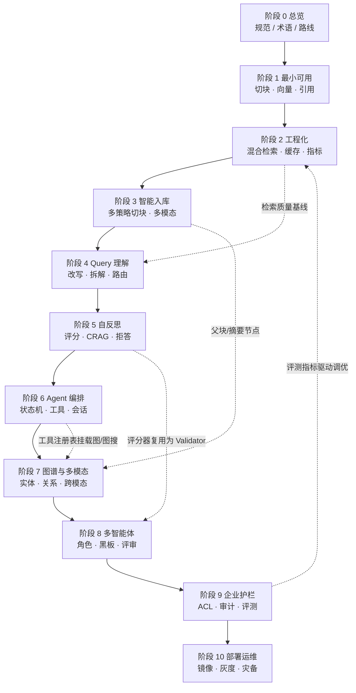

# 智能 RAG（Agentic RAG）项目文档系列

> 本目录是 [`../智能 rag.md`](../智能 rag.md) 的**配套项目文档**。按 **10 个阶段** 递进式构建生产级智能 RAG 系统。
>
> **全系列不含任何源码 / 伪代码 / 配置文件**，只交付两类内容：
> ① 后端与算法的**实现细节、设计原理、决策依据**（`README.md`）；
> ② 对应的**前端设计规范**（`frontend-design.md`）。

---

## 一、目录结构

```
series/
├── README.md                               ← 本文档（导航 + 约定 + 术语表）
│
├── stage-0-overview/                       ← 总览：路线图与全局规范
│   ├── README.md                           ← 能力金字塔、技术栈、阶段速查
│   └── frontend-design.md                  ← 前端基础规范（视觉/组件/状态/契约）
│
├── stage-1-naive-rag/                      ← 阶段 1：最小可用 RAG
│   ├── README.md                           ← 切块 / 向量检索 / 提示工程 / 引用溯源
│   └── frontend-design.md                  ← 对话框 + 文档上传 + 引用跳转
│
├── stage-2-hybrid-search/                  ← 阶段 2：工程化与混合检索
│   ├── README.md                           ← BM25 + RRF + gte-rerank-v2 重排 + 缓存/限流/指标
│   └── frontend-design.md                  ← 检索过程可视化 + 监控大盘 + 参数配置
│
├── stage-3-smart-chunking/                 ← 阶段 3：智能分块与多模态解析
│   ├── README.md                           ← 语义/父子/RAPTOR 切块 + qwen-vl-ocr / paraformer-v2
│   └── frontend-design.md                  ← 分块预览 + 多模态上传向导 + 任务进度
│
├── stage-4-query-preprocessing/            ← 阶段 4：Query 理解与前置处理
│   ├── README.md                           ← 意图 / HyDE / Step-Back / 融合 / 拆解 / 路由
│   └── frontend-design.md                  ← 改写预览 + 意图标签 + 子问题列表
│
├── stage-5-self-reflection/                ← 阶段 5：自反思与自校正
│   ├── README.md                           ← 证据评分 + CRAG 三分支 + 幻觉自检 + 拒答
│   └── frontend-design.md                  ← 置信度条 + 评分明细 + 拒答引导
│
├── stage-6-agentic-rag/                    ← 阶段 6：Agent 编排与状态机
│   ├── README.md                           ← LangGraph 状态机 + 工具注册 + 熔断 + 会话
│   └── frontend-design.md                  ← Agent 轨迹 + 工具调用卡片 + 多轮会话
│
├── stage-7-graph-multimodal/               ← 阶段 7：GraphRAG 与跨模态检索
│   ├── README.md                           ← 实体/关系/社区 + qwen-vl 图文理解 + 图存储抽象
│   └── frontend-design.md                  ← 图谱浏览器 + 实体详情 + 跨模态结果
│
├── stage-8-multi-agent/                    ← 阶段 8：多智能体协同
│   ├── README.md                           ← 五角色 + Blackboard + 拓扑分层 + Critic 循环
│   └── frontend-design.md                  ← 角色标签 + 黑板面板 + 报告中心
│
├── stage-9-enterprise/                     ← 阶段 9：企业级护栏
│   ├── README.md                           ← 认证 / ACL / 审计 / 脱敏 / 配额 / 评测
│   └── frontend-design.md                  ← 权限矩阵 + 审计日志 + 评测平台 + 配额
│
└── stage-10-deployment/                    ← 阶段 10：部署运维与演进
    ├── README.md                           ← 镜像 / K8s / 探针 / 灰度 / 灾备 / 选型
    └── frontend-design.md                  ← 部署监控 + 灰度控制台 + 备份与演练
```

---

## 二、文档写作约定

为了保证 23 篇文档结构统一、可横向对照，全系列遵守以下约定。

### 2.1 命名与编号

- 阶段目录一律 `stage-<序号>-<主题英文短名>`，序号与正文的「阶段 N」严格一致；
- 每阶段固定两个文件：`README.md`（后端/算法）与 `frontend-design.md`（前端）；
- 章级标题用中文数字（`## 一、`），节级标题用阿拉伯数字（`### 1.1`），**编号必须连续不跳号**；
- 阶段之间的引用一律用相对路径（如 `../stage-5-self-reflection/README.md`）。

### 2.2 三个必备设计维度

每个阶段都必须能回答"**接口是什么、数据长什么样、流程怎么走**"三个问题。这三维缺任何一维，方案都无法落地实现：

| 维度 | 落在哪 | 必须包含的内容 | 缺失时的后果 |
| --- | --- | --- | --- |
| **接口设计** | 前端文档的「API 契约」 + README 中的组件接口 | 端点、入参出参字段、流式事件、错误码与降级语义 | 前后端无法对接；降级行为无人定义 |
| **数据模型设计** | README 的「数据模型设计」 | 实体清单、实体关系图、字段与约束、生命周期与保留策略、演进规则 | 无法建表；字段缺失导致的返工要到很后期才暴露 |
| **流程设计** | README 的「关键流程图」 + 前端文档的「关键交互流程」 | 端到端时序、分支与降级路径、失败与中止的处理 | 只知模块不知串联；异常路径无人负责 |

**三个维度的共同要求**：都必须包含**正常路径与降级路径**。只画正常路径的设计，在实现时一定会遇到"出错了怎么办"无人定义的问题。

### 2.3 README.md（后端/算法）固定结构

| 序号 | 章节 | 说明 |
| --- | --- | --- |
| 一 | 阶段定位与边界 | 业务能力范围图、能解决/不能解决、验收标准 |
| 二～核心 | 核心机制与实现细节 | 本阶段引入的算法/架构及其取舍、原理推导、参数依据、失败模式、工程注意点 |
| 数据模型 | **数据模型设计** | 实体清单、实体关系图、字段与约束、生命周期与保留、演进影响 |
| 决策 | 关键决策记录 | "为什么这样做、为什么不那样做" |
| 流程 | 关键流程图 | mermaid 流程图 / **端到端时序图** / 状态图 |
| 差异 | 与上一阶段差异 | 模块级 diff 对照表 |
| 预告 | 遗留问题 → 下一阶段预告 | 本阶段不解决什么，由哪个阶段接管 |

### 2.4 frontend-design.md（前端）固定结构

| 序号 | 章节 | 说明 |
| --- | --- | --- |
| 一 | 页面结构 | 新增/变更路由 + 布局草图 |
| 二～N | 页面与组件设计 | 组件属性、四态（loading/empty/error/data）、交互 |
| N+1 | 监控大盘增量 | 本阶段新增的运营指标（如适用） |
| N+2 | **API 契约（本阶段新增）** | 端点、关键字段、流式事件、错误码 |
| N+3 | **关键交互流程** | mermaid 交互流程：主流程、分支与降级、异常与边界 |
| N+4 | 视觉规范（新增） | 本阶段引入的色板/形状/图标语义 |
| N+5 | 可访问性 | 键盘、屏幕阅读器、对比度 |
| N+6 | 性能预算 | 渲染与交互时延目标 |
| N+7 | 本阶段交付清单 | 可勾选的验收项 |

### 2.5 模型基线（全系列强制）

**所有模型能力一律通过千问平台（阿里云百炼 / DashScope）的接口调用，禁止在文档中引入本地模型、本地权重或本地推理**。这条基线在各阶段文档中被反复引用，**任何阶段都不得自行引入第二套模型体系**。

| 能力 | 平台模型 | 说明 |
| --- | --- | --- |
| 生成 / 规划 / 评审 / 判定 | `qwen-plus`（默认）、`qwen-max`（复杂推理）、`qwen-turbo`（高频轻量） | 同接口切换档位 |
| 文本向量 | `text-embedding-v3` | 全域唯一向量空间，正文与图像描述共用 |
| 重排 / 证据相关度 | `gte-rerank-v2` | 阶段 2 与阶段 5 复用同一口径 |
| 图文理解 | `qwen-vl-max` / `qwen-vl-plus` | 生成结构化图像描述 |
| OCR | `qwen-vl-ocr` | 扫描件与表格识别 |
| 语音转写 | `paraformer-v2` | 带时间戳输出 |

**写作要求**：

1. 提到模型时必须**写出平台模型名**（如 `text-embedding-v3`），不写"某个本地模型""自部署嵌入模型"这类含糊表述；
2. 涉及模型选型的地方，必须说明**为什么选平台模型而不是本地部署**（通常是不必维护 GPU 与权重、能力开箱可用、与其它能力同平台同口径）；
3. 必须**显式承认云端调用的代价**——限流、超时、配额不足三类失败模式，并为每一类给出降级路径；
4. 少量纯几何/规则的**解析库**（如 PDF 文字抽取、表格几何识别）不属于"模型能力"，可以照常描述，但**必须在文中区分清楚**。

### 2.6 内容红线

1. **不出现源码、伪代码、配置文件、命令行**——只描述"怎么做、为什么"；
2. 允许使用 **mermaid 图** 与 **ASCII 布局草图**（它们表达结构与关系，不是代码）；
3. 表格中的字段名、工具名、指标名可以与真实实现一致，但**不给出实现语法**；
4. 每个能力点必须回答三个问题：**解决什么问题 / 为什么这样设计 / 失败时会怎样**；
5. 数值阈值的出现必须有依据（经验值 / 离线评测分位数 / 论文默认），**不允许无来源的拍脑袋数字**。

---

## 三、跨阶段能力 — 前端组件对照矩阵

下表是"后端在哪一阶段引入能力"与"前端在哪一阶段落地对应可视化"的对应关系，用于检查两套文档是否同步演进。

| 能力 | 后端引入 | 前端落地 | 前端核心组件 |
| --- | --- | --- | --- |
| 引用溯源 | 阶段 1 | 阶段 1 | `CitationChip` / `EvidenceCard` |
| 流式响应协议 | 阶段 1（协议预留） | 阶段 1 | `StreamText` + SSE 事件路由 |
| 混合检索（BM25+向量） | 阶段 2 | 阶段 2 | `RetrievalTracePanel` |
| 重排 | 阶段 2 | 阶段 2 | 证据卡片 score 展示 |
| 缓存 / 限流 / 指标 | 阶段 2 | 阶段 2 | `CacheHitBadge` / 限流横幅 / `MetricCard` |
| 多种切块策略 | 阶段 3 | 阶段 3 | `ChunkPreview` / RAPTOR 树形视图 |
| 多模态解析（OCR/表格/音频） | 阶段 3 | 阶段 3 | `DocumentUploader` 向导 / `ParserProgressBar` |
| Query 改写（HyDE/融合/拆解） | 阶段 4 | 阶段 4 | `QueryRewriteDiff` / `IntentBadge` / `SubQuestionList` |
| CRAG 三分支 | 阶段 5 | 阶段 5 | CRAG 分支高亮（`RetrievalTracePanel` 扩展） |
| 证据评分与置信度 | 阶段 5 | 阶段 5 | `EvidenceScoreTable` / `ConfidenceBar` |
| 显式拒答 | 阶段 5 | 阶段 5 | `RefusalCard` |
| Agent 状态机与工具 | 阶段 6 | 阶段 6 | `AgentTraceTimeline` / `ToolCallCard` |
| 多轮会话状态 | 阶段 6 | 阶段 6 | 会话侧边栏 / `IterationCounter` |
| 知识图谱 | 阶段 7 | 阶段 7 | `GraphVisualization` / 实体详情页 |
| 跨模态检索 | 阶段 7 | 阶段 7 | `MediaSearchResult` / 大图查看器 |
| 多智能体协同 | 阶段 8 | 阶段 8 | `AgentRoleBadge` / `BlackboardPanel` / `CriticScoreHistory` |
| 认证 / ACL | 阶段 9 | 阶段 9 | `PermissionMatrix` / ACL 编辑面板 |
| 审计 / 脱敏 / 配额 | 阶段 9 | 阶段 9 | `AuditLogTable` / 配额状态卡 |
| 自动评测 | 阶段 9 | 阶段 9 | `EvalComparisonChart` |
| 健康探针 / 灰度 / 备份 | 阶段 10 | 阶段 10 | `DeployStatusBadge` / `CanaryTrafficSlider` / 演练详情 |

**校验规则**：任一前端组件不得依赖"尚未引入的后端能力"；若为前瞻展示（如工具注册表中列出后续阶段的工具），必须在文档中显式标注"（阶段 N 引入）"。

### 3.1 三个设计维度的覆盖自查

下表用于快速核对每篇文档是否具备三个必备维度。**任何一格为空，都意味着该阶段方案无法直接落地实现**。

| 阶段 | 接口设计 | 数据模型设计 | 流程设计 |
| --- | --- | --- | --- |
| 0 | API 契约约定（统一信封 / 流式事件 / 错误码区段） | 全系列数据模型总览（五条主干 + 全局关系图 + 演进路线） | 一次提问的端到端流程（全系列时序） |
| 1 | 问答 / 流式 / 知识库端点与字段 | 文档、块、证据、答案、会话 | 索引构建 + 问答链路时序；前端问答与上传流程 |
| 2 | 响应字段扩展 + 管理端点 + 降级错误码 | 缓存条目、限流桶、指标时序、证据扩展 | 检索链路时序；前端检索排查与降级流程 |
| 3 | 任务 / 预览 / 诊断端点 + 阶段统计字段 | 入库任务、文件记录、表格、图像资源、块扩展 | 入库流水线时序；前端向导与重试流程 |
| 4 | 分析字段扩展 + 历史查询端点 + 三步降级语义 | 查询分析、改写条目、子问题、意图 | 预处理端到端时序（含降级分支）；前端查看与降级流程 |
| 5 | verdict / refusal_reason / crag 字段 + 拒答反馈 | 证据评分、答案判定、自检结果、路由轮次、反馈工单 | 校验闭环端到端时序；前端拒答 / 置信度 / 降级流程 |
| 6 | 轨迹与工具调用字段 + 会话端点 | Agent 状态、会话快照、工具调用、计划步骤 | 状态机执行时序；前端多轮会话与轨迹流程 |
| 7 | 图谱 / 子图 / 社区 / 跨模态端点 | 实体、关系、社区、图像向量与元数据 | 图检索执行时序；前端图谱探索与跨模态流程 |
| 8 | 报告 / 计划 / 证据 / 评审端点 + accepted=false 语义 | 报告、子任务、证据记录、评审、草稿 | 拓扑分层执行时序；前端任务全流程与异常流程 |
| 9 | 管理端点 + 审计字段脱敏 + 权限错误码 | 租户、调用主体、ACL、审计、配额、词表、评测 | 权限判定与审计时序；前端权限变更与拒答流程 |
| 10 | 部署 / 灰度 / 备份 / 演练端点 + 探针约定 | 配置项、部署记录、灰度状态、备份、演练 | 灰度发布与回滚时序、灾备恢复；前端三套运维流程 |

**共同特征**：三个维度的设计都要求同时给出**正常路径**与**降级 / 失败路径**。只描述正常路径的方案，在实现阶段一定会卡在"出错了怎么办"。

---

## 四、阶段依赖关系图



**依赖性质说明**：

- **主链是硬依赖**（实线）：后一阶段的验收必须建立在前一阶段的产出上，不可跳级；
- **虚线是能力复用**（非依赖）：说明某阶段的抽象在更后的阶段被再次利用，用于检查"接口是否设计得足够通用"。

---

## 五、术语表

全系列统一使用以下术语，避免同义异名。

| 术语 | 含义 | 首次出现 |
| --- | --- | --- |
| **Chunk** | 文档被切分后的最小检索单元 | 阶段 1 |
| **chunk_id** | 切块的稳定标识，跨重建索引保持一致 | 阶段 1 |
| **Evidence** | 被检索并进入生成上下文的证据片段 | 阶段 1 |
| **Citation** | 答案中对证据的编号引用标记 | 阶段 1 |
| **SSE** | 服务端推送的流式响应协议 | 阶段 1 |
| **RRF** | Reciprocal Rank Fusion，仅用排名做多路融合 | 阶段 2 |
| **Rerank** | 用平台重排模型（`gte-rerank-v2`）对候选做精细排序 | 阶段 2 |
| **语义缓存** | 以 query + 模型版本为键的答案缓存 | 阶段 2 |
| **令牌桶 / 滑动窗口** | 两种限流算法（突发友好 / 严格计数） | 阶段 2 |
| **父块 / 子块** | 检索用小块，生成用大块的双层结构 | 阶段 3 |
| **RAPTOR** | 递归聚类摘要，构建多层级索引 | 阶段 3 |
| **HyDE** | 先让模型想象答案，再用假设答案去检索 | 阶段 4 |
| **Step-Back** | 把具体问题抽象为原则性问题后再检索 | 阶段 4 |
| **RAG-Fusion** | 多路改写并行检索后融合 | 阶段 4 |
| **CRAG** | 依据证据平均分把检索结果分为三分支的校正式 RAG | 阶段 5 |
| **Faithfulness** | 答案能被证据支持的比例 | 阶段 5 |
| **Refused** | 证据不足时的显式拒答状态（HTTP 200 + verdict） | 阶段 5 |
| **StateGraph** | 有状态、可循环的编排图 | 阶段 6 |
| **Checkpointer** | 会话状态的持久化机制 | 阶段 6 |
| **工具注册表** | 供 Planner 选择的可调用能力清单 | 阶段 6 |
| **实体消歧** | 把不同表述指向同一图节点 | 阶段 7 |
| **社区检测** | 对图谱做聚类并生成主题摘要 | 阶段 7 |
| **Blackboard** | 多智能体共享的结构化状态区 | 阶段 8 |
| **拓扑分层** | 按依赖关系把子任务分层的调度方式 | 阶段 8 |
| **Deny by Default** | 未显式授权即拒绝的权限模型 | 阶段 9 |
| **Principal / Identity** | 认证主体 / ACL 匹配身份集合 | 阶段 9 |
| **灰度发布** | 按流量比例逐步放量的发布方式 | 阶段 10 |
| **RPO / RTO** | 允许丢失的数据量 / 允许的恢复时长 | 阶段 10 |

---

## 六、阅读路径

| 读者类型 | 建议路径 |
| --- | --- |
| 首次接触 RAG 的算法工程师 | 0 → 1 → 2 → 4 → 5 → 6 |
| 企业落地后端工程师 | 0 → 1 → 2 → 3 → 9 → 10 |
| 复杂推理与图谱研究者 | 0 → 1 → 4 → 5 → 6 → 7 → 8 |
| 架构师 / Tech Lead | 0 → 6 → 8 → 9 → 10 |
| 前端工程师 | 0（前端总纲）→ 各阶段 `frontend-design.md` 顺读 |
| 只需要总体判断的决策者 | 0 → 各阶段 README 的「阶段定位与边界」+「验收标准」 |

---

## 七、设计原则（全系列贯穿）

1. **可观测先行**：每引入一个模块，必须同步定义结构化日志与关键指标。
2. **评测驱动**：能力升级必须给出前后对比，不达标不进入下一阶段。
3. **失败显式化**：不确定场景必须返回结构化的置信度与证据，不允许"装作答得对"。
4. **依赖注入**：模型、存储、时钟、随机源一律可从外部替换，保证可测与可换供应商。
5. **配置外置**：阈值、模型名、提示模板走配置，不硬编码。
6. **权限零信任**：默认拒绝 + ACL 强制过滤 + 检索前后双重校验。
7. **阶段递进**：不跳级、不并行实现；每阶段暴露明确的失败模式，由下一阶段量化倒逼。

---

## 八、配套资源

- 原文档：[`../智能 rag.md`](../智能 rag.md)（能力清单，未改动）
- 主流框架：LangChain、LangGraph、LlamaIndex、Haystack、RAGFlow、QAnything
- 关键论文：Self-RAG、CRAG、RAPTOR、GraphRAG
- 评测框架：RAGAS、DeepEval、TruLens、ARES
- 监控与追踪：Prometheus、Grafana、Loki、Tempo、Langfuse、LangSmith
