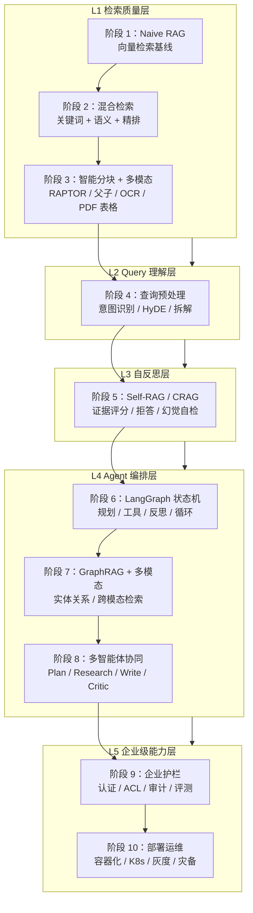
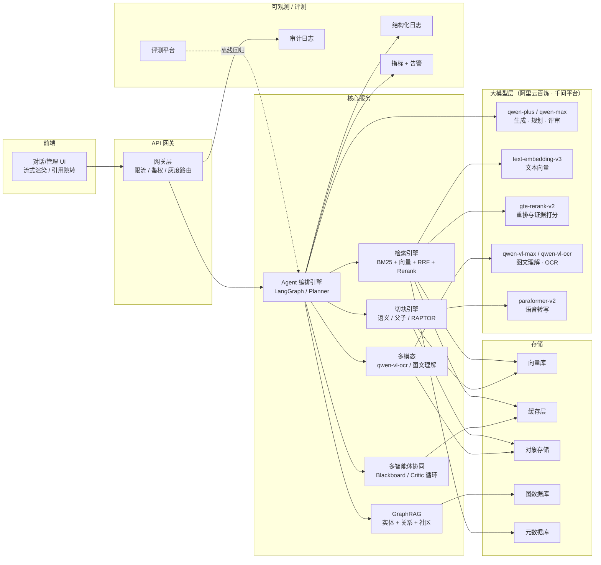
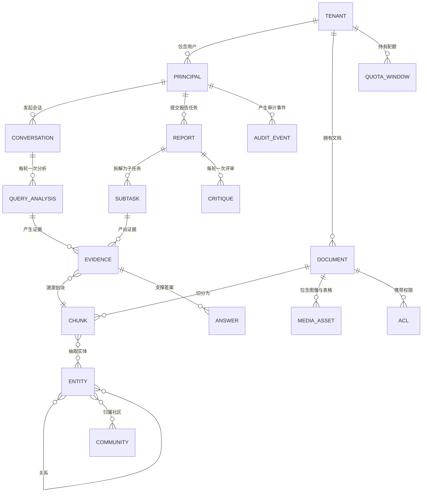
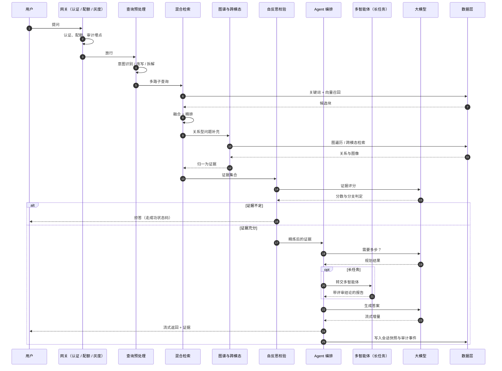

# 阶段 0：智能 RAG 项目总览与十阶段演进路线图

> 本阶段是整套系列文档的**目录与导读**，不引入业务功能。它回答两个核心问题：
> ① 什么是智能 RAG、它包含哪些能力？
> ② 为什么不能一次性实现所有能力？十阶段递进的工程依据是什么？

---

## 一、智能 RAG 的本质

### 1.1 与传统 RAG 的根本差异

传统 RAG 把"问题→检索→生成"固化成单轮流水线，**不判断、不反思、不循环**。它能应付的只是"用户问的内容恰好就在某一段连续文本里"的简单场景。

智能 RAG 把大模型当成调度 **Agent**，具备四项本质能力：

1. **规划**：把用户的复合目标拆解为可独立检索的子任务；
2. **迭代**：证据不足时主动改写 query、换工具、再检索；
3. **校验**：对每一段检索片段评估与问题的相关性，对最终答案做事实核查；
4. **工具调用**：超出文档范围时可调 SQL、Web、API、计算器等外部能力。

围绕 Agent 这一中心，再叠加 **GraphRAG**（实体关系推理）和**多模态 RAG**（图、文、表格混合检索），就构成 2025–2026 年主流的生产级 RAG 形态。

### 1.2 智能 RAG 能力的五个维度

| 维度 | 典型能力 | 解决的具体业务问题 |
| --- | --- | --- |
| 数据准备 | 多源接入、智能切块、实体抽取、OCR | 表格/扫描件入库、跨文档关联 |
| 查询理解 | 意图识别、查询改写、问题拆解 | 用户口语化提问、复合意图 |
| 检索能力 | 混合检索、神经网络重排、迭代检索、图检索 | 编号型 query、跨段证据、跨实体关系 |
| 答案生成 | 引用溯源、自检自纠、样式定制、多轮记忆 | 幻觉、可信度、长上下文 |
| 系统能力 | 工具调用、多智能体、可观测、评测、安全 | 复杂分析、合规、可运维 |

这五个维度不是并列关系，而是**层层倒逼**的栈式依赖：上一维度的能力不达标，下一维度就会失效。

---

## 二、为什么需要十阶段递进

### 2.1 三大根本约束

任何试图一次性实现所有能力的项目都会遇到三道墙：

**约束 1：复杂度爆炸**。智能 RAG 涉及切块、嵌入、检索、重排、改写、反思、Agent 编排、图谱、多模态、可观测、安全 —— 全部模块若同时上线，故障定位几乎无门。一次性 PR 的代码量会让 review 沦为形式，问题被埋到生产。

**约束 2：数据驱动调优需要单变量环境**。调 embedding 模型时如果同时改了切块策略，无法判断效果变化来自哪一环。**阶段递进是天然的 A/B 测试基线**。

**约束 3：业务倒逼才能定优先级**。不同业务对幻觉、并发、可观测的容忍度差异极大；不跑业务验证就会陷入"什么都想做"的陷阱。

### 2.2 递进的两层意图

十阶段有两层意图——**上层 L1~L5** 是能力维度（解决什么性质的问题），**底层 1~10** 是项目阶段（按什么顺序实现）。两者一一映射：

| 能力层 | 对应阶段 | 业务倒逼源 |
| --- | --- | --- |
| L1 检索质量 | 阶段 1-3 | "答非所问" → 加混合检索；"表格丢失" → 加多模态解析 |
| L2 Query 理解 | 阶段 4 | "用户口语化提问召不回" → 加 HyDE、改写、拆解 |
| L3 自反思 | 阶段 5 | "LLM 在证据不足时硬答" → 加 CRAG、幻觉自检 |
| L4 Agent 编排 | 阶段 6-8 | "多跳问答答不全" → LangGraph；"长报告炸上下文" → 多智能体 |
| L5 企业级 | 阶段 9-10 | "上线需要合规" → ACL、审计、灰度发布 |

### 2.3 递进的工程纪律

- **每个阶段必须可独立验收**：明确定义验收指标，不达标不进入下一阶段；
- **前一阶段的所有能力在下一阶段继续可用**：不删代码、不破坏接口；
- **每一阶段暴露明确的失败模式**：本阶段不解决什么 → 下一阶段被量化倒逼。

---

## 三、十阶段能力金字塔

---

## 四、技术栈全局视图

技术栈的核心取舍：

1. **多框架共存，不押注单一全家桶**——Agent 编排（LangGraph 系）、RAG 组件（LangChain / LlamaIndex 系）、评测（RAGAS / DeepEval 系）、追踪（Langfuse / LangSmith 系）各取所长；
2. **存储按语义分层**——向量库管相似度、图库管关系、缓存管命中、关系库管元数据与审计，**没有银弹**；
3. **前后端分离**——前端独立演进（流式渲染、引用跳转、暗色模式），后端专注检索与编排；
4. **依赖可替换**——模型、向量库、图库、缓存全部走接口抽象，任一层可换供应商而不改上层；
5. **模型统一走千问平台**——生成、向量、重排、图文理解、语音转写全部调用阿里云百炼（DashScope）的千问系列模型，**不部署本地模型、不做本地推理**；
6. **评测在旁路**——评测平台以"离线回归"方式反哺主链路，不在请求路径上增加时延。

### 4.1 模型选型基线（全系列统一）

**全系列的模型能力一律通过千问平台（阿里云百炼 / DashScope）的接口调用，不引入本地权重、不做本地推理、不占用 GPU。** 这条基线贯穿十阶段，各阶段只描述"用什么能力、为什么用它"，不再重复讨论部署形态。

| 能力 | 平台模型 | 引入阶段 | 选型理由 |
| --- | --- | --- | --- |
| 生成 / 规划 / 评审 / 判定 | `qwen-plus`（默认）、`qwen-max`（复杂推理）、`qwen-turbo`（高频轻量） | 1 | 同平台内按需切换档位，**不必为不同档位维护多套推理环境** |
| 长文档摘要（RAPTOR） | `qwen-plus` | 3 | 摘要量大，成本必须可控，不宜用最强档 |
| 文本向量 | `text-embedding-v3`（默认 1024 维，支持自定义维度） | 1 | 中文语义稳、维度可调；**换模型需全量重编码** |
| 重排 / 证据相关度打分 | `gte-rerank-v2` | 2 | 与向量模型同平台、按量计费；**阶段 5 的证据评分复用同一模型** |
| 图文理解（图像描述、视觉问答） | `qwen-vl-max` / `qwen-vl-plus` | 7 | 生成式多模态，可直接产出图像描述文本，与文本向量天然对齐 |
| 扫描件与表格 OCR | `qwen-vl-ocr` | 3 | 免部署 OCR 服务，中英混排与表格线场景优于通用文字识别 |
| 语音转写 | `paraformer-v2` | 3 | 支持时间戳输出，满足"跳转到视频时间点"的交互需求 |

**为什么坚持云端 API 而不本地部署**：

| 维度 | 云端千问平台 | 本地部署 |
| --- | --- | --- |
| 基础设施 | 无需 GPU 资源规划与显存容量评估 | 需按模型规模预留 GPU，**阶段 10 的资源模型会显著复杂化** |
| 能力更新 | 平台升级即生效，无需重新部署 | 每次升级都要重新拉取权重并重测效果 |
| 弹性 | 天然具备突发扩容能力 | 扩容即扩容 GPU，**成本与交付周期都不可控** |
| 多模态与语音 | 图文理解、OCR、转写全部开箱可用 | **需分别部署三类模型**，工程量成倍上升 |
| 代价 | 按 token 与调用量计费，存在配额与限流 | 单位成本低，但固定成本高、换模型代价大 |

**代价必须显式承认**：云端调用会引入**限流、超时、配额不足**三类新的失败模式，因此每个相关阶段都必须给出对应降级路径——阶段 2 的检索兜底与阶段 9 的配额治理正是其落点。

---

## 五、全系列数据模型总览

十阶段会陆续引入二十余个实体。**它们不是各自独立的，而是围绕同一份"知识资产"逐层生长出来的**。本节先给出全局视图与演进路线，各阶段的具体字段设计见该阶段 README 的「数据模型设计」一节。

### 5.1 五条主干

所有实体可以归入五条主干，**任何新增实体都应能放进其中一条**——放不进去通常意味着设计跑偏了。

| 主干 | 承担的职责 | 核心实体 | 引入阶段 |
| --- | --- | --- | --- |
| **知识资产链** | 描述"库里有什么" | 知识库 → 文档 → 块 → 表格 / 图片资源 | 1（表格与图片在 3 扩展） |
| **语义关系链** | 描述"知识之间怎么关联" | 实体 → 关系 → 社区（含社区摘要） | 7 |
| **问答链路** | 描述"一次提问发生了什么" | 会话 → 查询分析 → 检索证据 → 答案判定 | 1（各环节在 2/4/5 扩展） |
| **协同链路** | 描述"长任务怎么被拆解完成" | 报告 → 子任务 → 证据记录 → 评审记录 | 8 |
| **治理链路** | 描述"谁能看、谁看过、用了多少" | 租户 → 调用主体 → 文档权限 → 审计事件 → 配额记录 | 9（字段在 1 起预留） |

**五条主干的交汇点只有两个**：知识资产链与语义关系链在"块"处交汇（关系抽取的输入是块）；其余四链在"证据"处交汇（检索结果、图谱结果、工具结果最终都归一为证据）。

### 5.2 全局实体关系

### 5.3 三条贯穿全系列的建模约定

这三条约定在每个阶段都被重复使用，**破坏其中任何一条都会导致后续阶段无法平滑叠加**。

| 约定 | 具体含义 | 为什么必须 |
| --- | --- | --- |
| **标识稳定且可组合** | 块标识由"文档标识 + 序号"构成，重建索引后不变；会话标识由"租户 + 用户 + 随机号"构成 | 缓存键、证据评分、图谱溯源、会话续跑都直接依赖标识；标识一变，历史数据全部失联 |
| **租户字段从第一天就存在** | 即使阶段 1 只有单一租户，文档与块也必须带租户字段（可取默认值） | 后补租户字段需要全量重刷数据并重建索引，**代价极高且容易遗漏** |
| **证据是一等实体** | 检索结果不是临时变量，而是带标识、可追溯、可评分的记录 | 前端引用跳转、置信度计算、评审取材、审计回溯**全部以证据为输入** |

### 5.4 数据模型的演进路线

| 阶段 | 新增实体 | 对已有实体的改动 |
| --- | --- | --- |
| 1 | 文档、块、证据、答案、会话 | 建立主干 |
| 2 | 检索缓存条目、检索统计 | 证据增加来源路径与分数 |
| 3 | 入库任务、表格、图片资源 | 块增加层级与父子关系；文档增加解析状态机 |
| 4 | 查询分析 | 证据增加来源标注（哪条改写/哪个子问题带回） |
| 5 | 证据评分、答案判定、拒答反馈 | 证据增加采纳状态；答案增加判定与置信度 |
| 6 | 会话状态快照、工具调用记录 | 会话增加跨轮状态 |
| 7 | 实体、关系、社区、图像向量 | 证据增加类型（文本/图像/图谱） |
| 8 | 报告、子任务、评审记录 | 证据记录增加淘汰原因；证据可被多任务复用 |
| 9 | 租户、调用主体、ACL、审计事件、配额、词表、评测样本与运行 | 所有实体补齐租户维度 |
| 10 | 部署记录、备份记录、演练记录 | 不改变业务实体，只增加运维元数据 |

**演进的基本原则是"只加不改"**：新增字段、新增实体、新增枚举值都可以；**删除字段或改变字段语义则不允许**——历史数据、缓存快照、审计记录都会因语义变更而失真。

---

## 六、一次提问的端到端流程

十阶段的能力最终都收敛到同一条请求链路上。这张时序图给出**能力全景**，各阶段文档中的流程图是它在某一环节的放大视图。

**流程设计的四条主线**：

| 主线 | 阶段 | 关键性质 |
| --- | --- | --- |
| **预处理** | 阶段 4 | 每一步失败都必须降级不阻断，并在响应中如实标注"未生效" |
| **检索** | 阶段 2、3、7 | 多路召回 → 融合 → 精排三段式；各路结果最终**归一为同一证据结构** |
| **校验** | 阶段 5 | **校验发生在生成之前**——先把证据筛干净，再让模型写 |
| **编排** | 阶段 6、8 | 循环必须有上限、失败必须有语义、结论必须诚实（未通过就标未通过） |

**贯穿全程的两条不变量**：

1. **任何环节的失败都不允许破坏"答案 + 证据"这个响应契约**——降级只影响内容质量，不影响结构；
2. **任何环节产生的中间产物都必须可追溯**——从最终答案能一路回溯到具体文档的块，这是智能 RAG 区别于普通问答系统的根本。

---

## 七、阶段产出物速查

> 详细文档见每个阶段独立目录的 README.md。

| 阶段 | 目录 | 解决的具体问题 | 关键能力 | 前端关键组件 |
| --- | --- | --- | --- | --- |
| 1 | `stage-1-naive-rag/` | 最小可跑通 demo | FAISS + LCEL + FastAPI | 对话框、文档上传、答案卡片 |
| 2 | `stage-2-hybrid-search/` | 召回率与稳定性 | BM25 + 向量 + RRF + 缓存/限流/监控 | 检索过程可视化、混合检索配置面板 |
| 3 | `stage-3-smart-chunking/` | 长文档/扫描件 | 语义/父子/RAPTOR、PDF 表格、OCR | 分块配置页、文档解析预览、多模态上传 |
| 4 | `stage-4-query-preprocessing/` | 用户口语化 | 意图/HyDE/Fusion/拆解 | 查询改写预览、意图标签展示 |
| 5 | `stage-5-self-reflection/` | 幻觉与拒答 | CRAG、证据评分、自检 | 置信度条、证据评分明细、拒答原因 |
| 6 | `stage-6-agentic-rag/` | 多跳问答 | LangGraph、工具注册、熔断 | Agent 执行轨迹、工具调用可视化 |
| 7 | `stage-7-graph-multimodal/` | 实体关系 + 跨模态 | 知识图谱、社区、qwen-vl 图文理解 | 图谱可视化、跨模态检索结果 |
| 8 | `stage-8-multi-agent/` | 长任务分析 | 五角色协同、Blackboard | 多 Agent 协同流、报告生成过程 |
| 9 | `stage-9-enterprise/` | 合规与运维 | ACL、审计、配额、RAGAS | 权限配置、审计日志查看、评测面板 |
| 10 | `stage-10-deployment/` | 生产上线 | Docker、K8s、灰度、灾备 | 部署监控面板、灰度发布控制台 |

每阶段独立目录里同时包含两个文档：
- **`README.md`**：业务背景、架构设计、实现细节、关键决策、流程图；
- **`frontend-design.md`**：该阶段对应的前端页面/组件/交互/视觉规范。

---

## 八、设计原则（全系列贯穿）

与 [`../README.md`](../README.md) 第七节保持一致，共 7 条：

1. **可观测先行**：每引入一个模块，必须同步定义结构化日志与关键指标——日志先于实现。
2. **评测驱动**：能力升级必须给出前后对比，不达标不进入下一阶段。
3. **失败显式化**：所有不确定场景必须返回结构化的置信度与证据，绝不"装作答得对"。
4. **依赖注入**：模型、存储、时钟、随机源一律可从外部替换，保证可测与可换供应商。
5. **配置外置**：阈值、模型名、提示模板走配置而非硬编码，便于多环境切换。
6. **权限零信任**：默认拒绝 + ACL 强制过滤；公开文档也受租户隔离。
7. **阶段递进**：不跳级、不并行实现；每跳一级都会引入无法定位的复杂度。

> 术语统一定义见 [`../README.md`](../README.md) 第五节「术语表」；后端与前端文档的固定章节结构见 [`../README.md`](../README.md) 第二节「文档写作约定」。

---

## 九、推荐读者路径

| 读者类型 | 建议阅读路径 |
| --- | --- |
| **首次接触 RAG 的算法工程师** | 1 → 2 → 4 → 5 → 6 |
| **需要做企业落地的后端工程师** | 1 → 2 → 3 → 9 → 10 |
| **关注复杂推理与图谱的研究者** | 1 → 4 → 5 → 6 → 7 → 8 |
| **架构师 / Tech Lead** | 0（本阶段）→ 6 → 8 → 9 → 10 |
| **前端工程师** | 0 → 各阶段 README 简读 → 各阶段 frontend-design.md 细读 |

---

## 十、参考与扩展

- **原文档**：[`../../智能 rag.md`](../../智能 rag.md)（能力清单，未改动）
- **主流框架参考**：LangChain、LangGraph、LlamaIndex、Haystack、RAGFlow、QAnything
- **关键论文**：Self-RAG（Asai et al., 2023）、CRAG（Yan et al., 2024）、RAPTOR（Sarthi et al., 2024）、GraphRAG（Edge et al., 2024）
- **评测框架**：RAGAS、DeepEval、TruLens、ARES