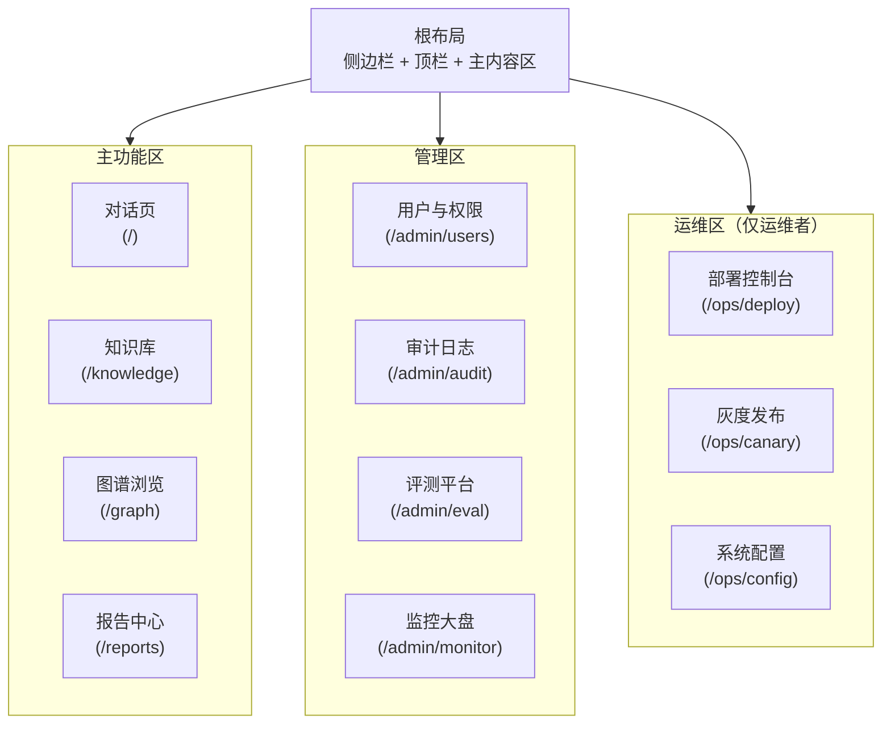
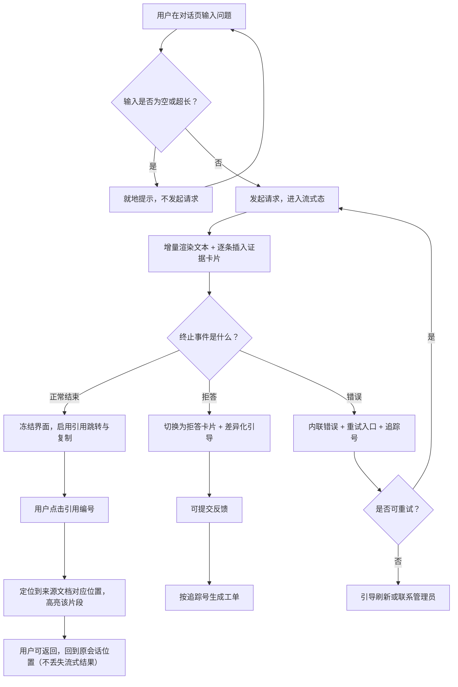
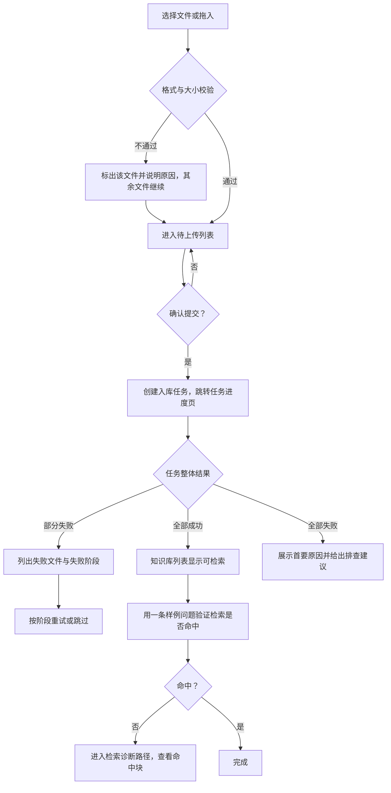

# 阶段 0：智能 RAG 前端设计总览

> 本文档是整套前端设计的导读与基础规范，定义**视觉系统、组件层级、状态管理、API 契约、交互原则**，后续各阶段的前端文档在此基础上叠加演进。所有阶段的前端共享以下基础能力。

---

## 一、产品定位与用户角色

### 1.1 三类用户

| 角色 | 使用场景 | 核心诉求 |
| --- | --- | --- |
| **普通提问者** | 在对话框输入问题，浏览引用 | 答案可信、快速响应、能溯源 |
| **知识库管理员** | 上传文档、调试切块、管理权限 | 看见每一步处理过程、可回滚 |
| **平台运维者** | 监控质量、配置限流、查审计 | 实时大盘、异常告警、问题定位 |

三类用户共享一套界面，但**通过权限与导航区分功能区**。

### 1.2 核心场景

- **问答主流程**：用户提问 → 流式渲染答案 → 点击引用跳转原文 → 多轮追问；
- **知识库管理**：上传文档 → 监控解析进度 → 调整切块参数 → 触发重采；
- **系统观测**：查看检索过程、Agent 执行轨迹、监控指标、审计日志。

---

## 二、整体信息架构（页面树）



各阶段对前端能力的演进：

| 阶段 | 前端新增能力 |
| --- | --- |
| 1 | 对话框、文档上传、答案卡片、引用跳转 |
| 2 | 检索过程可视化、混合检索配置面板、缓存命中率看板 |
| 3 | 分块可视化（每个块的来源/长度/层级）、多模态上传、OCR 进度 |
| 4 | 查询改写预览、意图标签展示、子问题列表 |
| 5 | 证据评分明细、置信度条、拒答原因可视化 |
| 6 | Agent 执行轨迹时间轴、工具调用详情、循环次数 |
| 7 | 图谱可视化（节点/边/社区）、跨模态检索结果混排 |
| 8 | 多智能体协同流、Blackboard 状态查看、Critic 评分历史 |
| 9 | 权限配置面板、审计日志过滤、评测指标对比图、配额管理 |
| 10 | 部署监控面板、灰度发布控制台、灾备状态 |

---

## 三、关键交互流程

前端的一切页面最终都服务于两条主流程。**本节的流程图是全系列的"交互骨架"**，各阶段的前端文档是它在某个页面上的放大视图。

### 3.1 主流程：从提问到核对



**两条不可妥协的交互约定**：

1. **终止事件必须驱动界面收敛**——无论正常、拒答还是错误，界面都必须离开"加载态"。**永久转圈是最严重的体验缺陷**，因为它让用户无法判断该等待还是该重试；
2. **引用跳转必须能原路返回**，且返回后**流式结果不能丢失**——用户核对完原文回来后看到空白的对话，等同于一次失败。

### 3.2 主流程：从上传到可检索



**"用一条样例问题验证"是本流程的关键收尾动作**：入库成功不等于能被检索到。**跳过这一步，问题会在用户第一次提问时才暴露**。

### 3.3 通用交互规则（全系列适用）

| 规则 | 说明 |
| --- | --- |
| **错误就地展示** | 错误出现在出错的组件内，不用全屏弹窗打断 |
| **可预期的等待必须有进度** | 超过 1 秒的操作展示进度；超过 10 秒的展示阶段与预估剩余 |
| **破坏性操作必须二次确认** | 且确认文案要写清"影响范围"与"不可逆项" |
| **降级必须可见** | 增强能力失效时轻提示，保护能力触发时显著提示 |
| **任何提示都要带追踪号** | 让用户的抱怨能转化为可排查的问题 |

---

## 四、视觉系统规范

### 4.1 配色

| 用途 | 浅色 | 深色 | 含义 |
| --- | --- | --- | --- |
| 主色（Primary） | `#1F6FEB` | `#4C8DFF` | 主按钮、链接、强调 |
| 成功（Success） | `#16A34A` | `#22C55E` | 通过、可用、合格 |
| 警告（Warning） | `#D97706` | `#F59E0B` | 需关注、降级提示 |
| 错误（Error） | `#DC2626` | `#EF4444` | 拒答、失败、超限 |
| 信息（Info） | `#0891B2` | `#06B6D4` | 提示、辅助说明 |
| 中性背景 | `#FAFAFA` / `#FFFFFF` | `#0F172A` / `#1E293B` | 页面与卡片背景 |
| 文本主色 | `#0F172A` | `#F1F5F9` | 主要文字 |
| 文本次色 | `#475569` | `#94A3B8` | 次要文字 |
| 边框 | `#E2E8F0` | `#334155` | 卡片、分割线 |

**置信度专属语义**：

| confidence 范围 | 颜色 | 含义 |
| --- | --- | --- |
| 0.85 – 1.0 | Success（绿） | 高可信 |
| 0.5 – 0.85 | Info（青） | 一般可信 |
| 0.0 – 0.5 | Warning（橙） | 低可信，建议核对原文 |

### 4.2 字体系统

- **正文**：等宽可变字距，西文 `Inter` / 中文 `思源黑体 SC`；
- **代码 / 检索片段**：`JetBrains Mono` 或 `Fira Code`；
- **数字与指标**：等宽数字（`font-feature-settings: "tnum"`），保证指标对齐；
- **标题层级**：H1 24px / H2 20px / H3 16px，正文 14px，行高 1.6。

### 4.3 间距与圆角

- **8 像素基准网格**：4 / 8 / 12 / 16 / 24 / 32 / 48；
- **卡片内边距**：16px；
- **页面内边距**：24px；
- **圆角**：组件 6px，模态 3px，胶囊 999px；
- **阴影**：浅色用 `0 1px 3px rgba(0,0,0,0.05)`，模态用 `0 10px 30px rgba(0,0,0,0.12)`。

---

## 五、组件层级

### 5.1 组件分层

```
原子组件 (atoms)
└── 业务组件 (molecules)
    └── 区块组件 (organisms)
        └── 页面模板 (templates)
            └── 路由页面 (pages)
```

**原子组件**：Button、Input、Tag、Tooltip、Badge、Progress、Skeleton、Divider、Icon、Avatar。

**业务组件（阶段 1 起）**：
- `MessageBubble`（用户/系统消息气泡）
- `CitationChip`（引用编号芯片）
- `EvidenceCard`（证据卡片）
- `DocumentUploader`（文档上传器）
- `StreamText`（流式渲染文本，逐字显现）

**阶段 2+ 业务组件**：
- `RetrievalTracePanel`（检索过程可视化）
- `CacheHitBadge`（缓存命中标签）
- `MetricCard`（指标卡片）

**阶段 3+ 业务组件**：
- `ChunkPreview`（切块预览）
- `ParserProgressBar`（解析进度条）
- `MediaPreview`（图片/表格预览）

**阶段 4+ 业务组件**：
- `IntentBadge`（意图标签）
- `QueryRewriteDiff`（改写前后对比）
- `SubQuestionList`（子问题列表）

**阶段 5+ 业务组件**：
- `ConfidenceBar`（置信度条）
- `EvidenceScoreTable`（证据评分明细）
- `RefusalReasonCard`（拒答原因）

**阶段 6+ 业务组件**：
- `AgentTraceTimeline`（Agent 执行时间线）
- `ToolCallCard`（工具调用卡片）
- `IterationCounter`（循环计数）

**阶段 7+ 业务组件**：
- `GraphVisualization`（图谱可视化）
- `CommunitySummaryCard`（社区摘要卡片）
- `MediaSearchResult`（跨模态检索结果）

**阶段 8+ 业务组件**：
- `AgentRoleBadge`（角色标签）
- `BlackboardPanel`（黑板状态面板）
- `CriticScoreHistory`（Critic 评分历史）

**阶段 9+ 业务组件**：
- `PermissionMatrix`（权限矩阵）
- `AuditLogTable`（审计日志表）
- `EvalComparisonChart`（评测对比图）
- `QuotaUsageCard`（配额使用卡片）

**阶段 10+ 业务组件**：
- `DeployStatusBadge`（部署状态标签）
- `CanaryTrafficSlider`（灰度流量滑块）
- `DisasterRecoveryStatus`（灾备状态）

### 5.2 组件复用原则

- 业务组件之间**不直接调用**，通过状态管理或事件总线通信；
- **同一个语义只有一种视觉表达**：例如"检索中"状态用同一种骨架屏，不在不同页面再造轮子；
- **配置驱动渲染**：阈值、配色、布局走配置，方便不同租户白标。

---

## 六、状态管理架构

### 6.1 全局状态分层

状态按**生命周期与共享范围**分成四层，**越靠上层越稳定、越应集中管理**：

| 层级 | 典型内容 | 存放位置 | 是否需持久化 |
| --- | --- | --- | --- |
| 应用级 | 主题、租户信息、当前用户、权限 | 全局状态容器 | 是（由服务端恢复） |
| 会话级 | 当前对话、检索参数、筛选条件 | **URL 参数** | 是（可分享、可前进后退） |
| 视图级 | 当前打开的弹窗、选中的标签页 | 组件局部状态 | 否 |
| 临时级 | 表单输入、悬停态、动画中间态 | 组件内部 | 否 |

**分层的关键纪律**：

- **会话级状态必须进 URL**——这样"把链接发给同事"就能复现同一视图，浏览器前进后退也符合直觉；放在全局容器里会导致刷新丢失、无法分享；
- **临时级状态绝不允许进入全局容器**——悬停态、输入框内容这类高频变化的值若进全局，会引发全量重渲染，是性能问题的常见来源；
- **应用级状态必须有明确的失效与刷新时机**（如权限变更后主动刷新），否则会出现"改了权限但界面还是旧的"。
- **临时级**纯组件内部，**不进入任何 store**。

### 6.2 数据获取策略

- **流式响应**（问答）：使用 Server-Sent Events 增量推送，每收到一个 token 即更新 DOM，避免卡顿；
- **大结果集**（审计/评测）：分页 + 虚拟滚动；
- **轮询**（部署状态）：3-5 秒间隔，**非实时面板**走轮询，**实时面板**走 SSE。

### 6.3 加载与错误状态

每个数据组件必须有四种状态：

| 状态 | 表现 | 必须包含 |
| --- | --- | --- |
| 加载中 | 骨架屏或进度指示 | 若有耗时预估则展示进度 |
| 空 | 空态插画 / 说明文案 | **下一步建议**（如"暂无文档，去上传 →"） |
| 错误 | 就地提示（非全屏弹窗） | 可读原因 + 重试入口 + 追踪号 |
| 有数据 | 正常渲染 | 数据量超限时的折叠或虚拟滚动策略 |

**"空"与"错误"必须严格区分**：把"没有数据"渲染成错误会让用户误以为系统故障；把"请求失败"渲染成空态则会让用户以为数据本就不存在。**两者的引导动作完全不同**（前者是"去创建"，后者是"去重试"）。

---

## 七、API 契约约定

### 7.1 统一响应信封

所有接口（除流式与探针外）返回**统一信封**，业务数据一律放在数据字段内，**不允许顶层直接返回业务数组**。

| 字段 | 含义 | 前端用法 |
| --- | --- | --- |
| 状态 | `ok` / `warn` / `error` | 决定走正常渲染还是错误分支 |
| 数据 | 业务负载 | 各页面自定义解析 |
| 错误 | 错误码 + 错误说明 | **错误码用于映射用户文案，不直接展示后端说明** |
| 元信息 | 追踪号 + 耗时 | 追踪号用于反馈与排障；耗时用于性能埋点 |

**两条约定**：

- **状态为 `warn` 表示"部分成功 + 部分告警"**（例如证据中有一条被权限过滤、某个增强能力降级），前端应正常渲染并附加提示，而不是走错误分支；
- **追踪号必须可复制**，且在界面上与错误提示一同出现。

### 7.2 流式响应协议

问答类接口采用服务端推送的流式协议。**事件类型按演进预留**，由各阶段逐步启用。

| 事件 | 载荷要点 | 引入阶段 | 前端处理入口 |
| --- | --- | --- | --- |
| `token` | 增量文本 | 1 | 流式文本组件 |
| `evidence` | 证据（编号 / 正文 / 来源 / 分数） | 1（阶段 2 加分数） | 证据列表 |
| `done` | 追踪号 / 耗时 / 统计 | 1 | 结束流式、冻结界面 |
| `error` | 错误码 / 说明 | 1 | 内联错误 + 重试 |
| `rewritten_query` | 改写后的查询 | 4 | 改写对比组件 |
| `confidence` | 置信度与判定 | 5 | 置信度条 |
| `crag_branch` | 分支判定与轮次 | 5 | 检索过程面板 |
| `agent_step` | 执行步骤 | 6 | 执行轨迹 |
| `graph_path` | 关系路径 | 7 | 关系路径迷你图 |

**四条协议纪律**：

1. **每类事件有唯一处理入口**，避免多组件争抢同一事件导致状态不一致；
2. **未知事件必须被静默忽略**，保证前后端可独立灰度和回滚；
3. **终止事件必须恰好出现一次**（正常结束或错误二选一），否则界面会永久停留在加载态；
4. **事件不保证顺序无关**——前端需容忍"证据先于首个文本片段到达"的情况。

### 7.3 错误码约定

| 区段 | 含义 | 前端典型处置 |
| --- | --- | --- |
| 1xxx | 认证与权限 | 跳转登录 / 清缓存 / 引导申请权限 |
| 2xxx | 输入校验 | 就地提示并高亮出错字段 |
| 3xxx | 资源（文档 / 索引）问题 | 提示稍后重试 / 引导查看任务进度 |
| 4xxx | 检索与生成 | 可重试；部分错误走降级展示 |
| 6xxx | 限流与配额 | 展示倒计时并自动重试 |
| 5xxx | 服务端异常 | 指数退避重试两次后提示 |

**注意区段的排序不是按数值大小**：6xxx（限流）排在 5xxx（服务端异常）之前，因为限流是**可预期、可自愈**的状态，而 5xxx 才是真正需要人介入的异常。前端按"严重程度"而非"数值顺序"设计处置策略。

每个错误码在文档站有对应的"用户友好文案"——**前端不展示后端原始错误信息**。

---

## 八、关键交互原则

### 8.1 引用溯源是核心体验

- 答案中每个事实性陈述后必须紧跟 `[#1]` `[#2]` 引用编号，**编号必须可点击**；
- 点击引用 → 弹出**原文片段卡片** → 点击"查看全文"跳转文档；
- 答案卡片默认折叠证据列表，提供"展开证据"按钮，避免初次阅读被淹没；
- 引用编号的颜色与证据卡片左侧边框颜色一一对应，方便视觉对位。

### 8.2 流式响应不要"假装即时"

- 第一个 token 出现前显示思考态（"思考中…"）；
- 流式过程中**不显示完整进度条**（容易跳变让人焦虑）；
- 流式过程中答案文本**可被用户打断**（点击"停止"按钮）；
- 中断后给出"是否重新生成？"二次确认。

### 8.3 错误恢复

- **不弹大红色 alert** 吓人——错误以 inline 方式呈现；
- 给出**最可能的修复建议**（如"网络异常，重试"）；
- **失败操作可一键重试**，重试按钮在按钮旁显示上一次的错误原因。

### 8.4 性能感

- 大列表（>100 项）必须**虚拟滚动**；
- 文档解析预览**懒加载图片**；
- 检索过程可视化**分批渲染**（每 50 个 chunk 一批）；
- 监控大盘**按需加载时间区间**（默认近 1 小时，避免一次拉太多数据）。

---

## 九、可访问性

- **键盘可操作**：所有交互组件必须能 Tab 到达，回车触发主按钮；
- **屏幕阅读器**：图标按钮必须有 aria-label；流式响应必须给屏幕阅读器一份完整文本；
- **对比度**：正文与背景对比度 ≥ 4.5:1；
- **不依赖颜色**：错误不仅靠红色，**还配图标和文字**。

---

## 十、性能与监控指标

### 10.1 前端性能预算

| 指标 | 目标 |
| --- | --- |
| 首屏 LCP | ≤ 2.0s |
| TTI | ≤ 3.0s |
| 流式首 token | ≤ 800ms |
| 路由切换 | ≤ 200ms |

### 10.2 前端要打的埋点

- `page_view`：每次路由切换；
- `interaction`：主要按钮点击（不记录具体内容）；
- `error`：JS 异常、API 错误；
- `streaming`：每个问答的完整耗时、首 token 延迟、token 总数；
- `client_metric`：前端资源加载时长（LCP/FCP 等）。

---

## 十一、设计交付清单

每阶段交付的设计文档必须包含以下要素，**才能进 frontend-design.md**：

1. **新增/变更的页面**（带路由）；
2. **新增/变更的组件**（含 props 接口描述）；
3. **交互状态机**（loading / empty / error / data 四态）；
4. **API 契约字段表**（请求 / 响应 / 流式事件）；
5. **视觉规范**（如该阶段引入新 token）；
7. **与前端方案的交互图表**（如该阶段引入新可视化）。

文档不需要写代码实现，但**必须有可被前端工程师直接照着做的细节**——例如按钮的 hover 行为、空态文案、错误兜底策略。