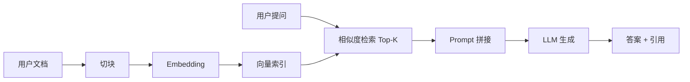
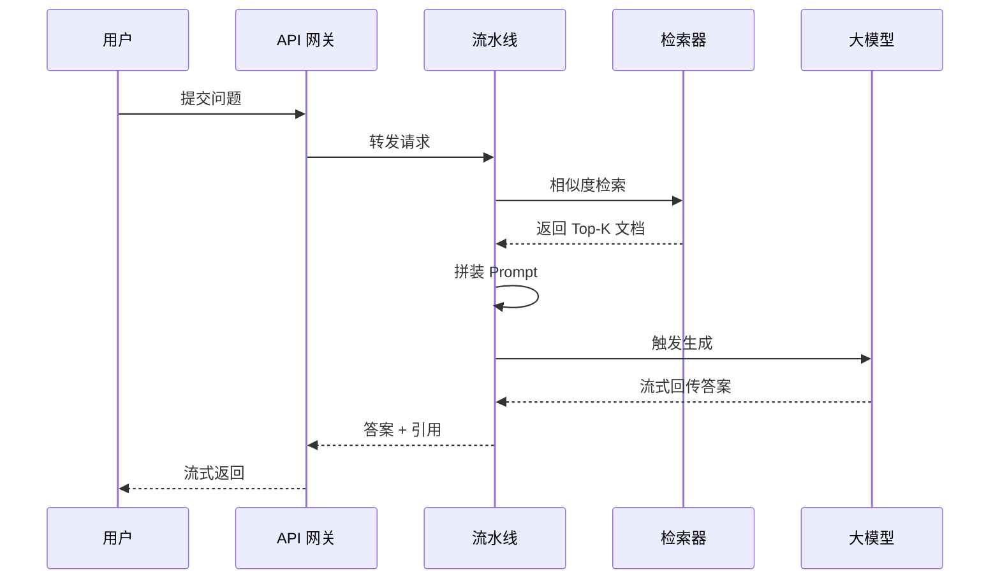
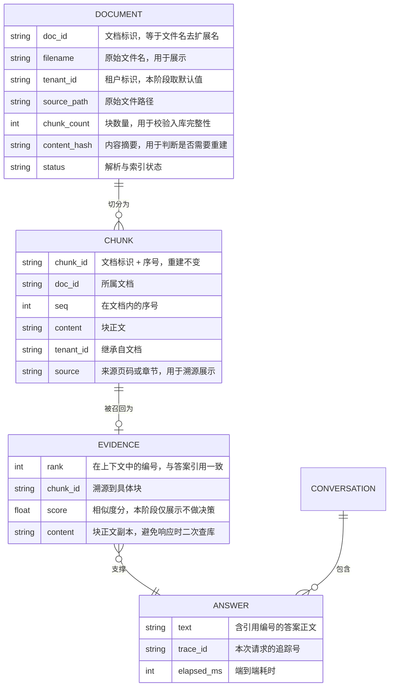
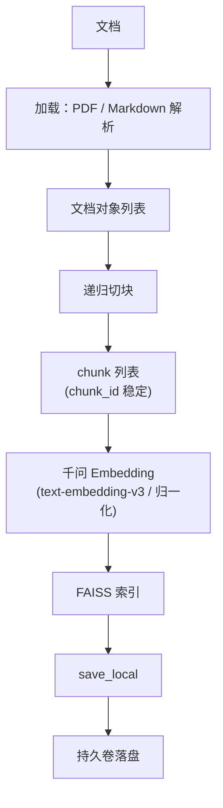
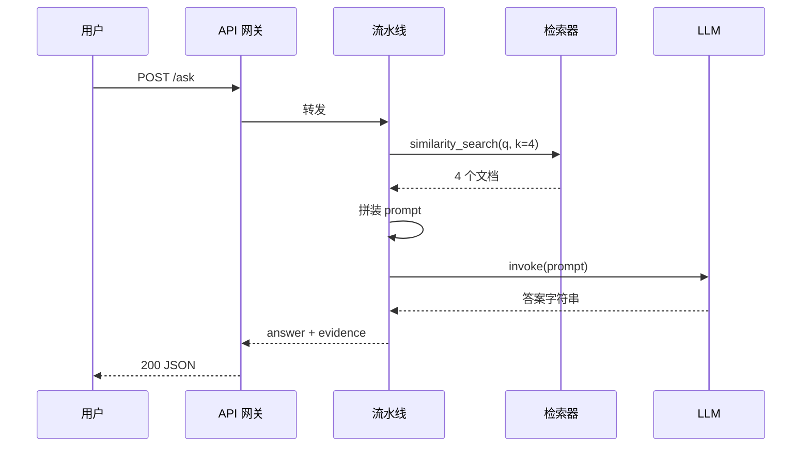

# 阶段 1：传统 Naive RAG 最小可用系统（实现细节）

> 本阶段交付一个**能跑通的最小 RAG 基线**：加载文档 → 切块 → Embedding → 向量索引 → 用户提问 → 检索 → LLM 生成。所有可注入组件都用接口化设计，便于后续阶段叠加混合检索、Query 预处理、Agent 编排等能力而无需破坏接口。

---

## 一、阶段定位与边界

### 1.1 业务能力范围

### 1.2 能解决与不能解决

**能解决**：
- 单文档、单跳、事实型问答；
- 答案相关原文片段集中在 1~2 段；
- 用户能容忍 3-5 秒响应延迟。

**不能解决（后续阶段倒逼源）**：
- 编号 / 型号 query 召回不稳 → 阶段 2 加 BM25；
- Top-K 顺序噪声 → 阶段 2 加 Rerank；
- 无缓存 / 无限流 / 无指标 → 阶段 2 工程化；
- 表格 / 扫描件入不了库 → 阶段 3 多模态；
- 口语化 query 召不回 → 阶段 4 HyDE；
- 幻觉硬答 → 阶段 5 自反思；
- 多跳答不全 → 阶段 6 Agentic。

### 1.3 验收标准

| 验收项 | 数值化标准 |
| --- | --- |
| 端到端延迟 | 检索 ≤ 500ms，生成 ≤ 3s（视 LLM 而定） |
| 召回准确率（人工抽查） | 简单事实问 ≥ 80% |
| 服务可用性 | 单实例能通过冒烟 |
| 日志可追溯 | 每次问答有 trace_id，可关联到检索 query 和 LLM 调用 |

---

## 二、架构设计

### 2.1 端到端数据流

### 2.2 核心设计原则

**原则一：可注入化**。

检索器、Embedding 模型、LLM 全部以接口形式存在，生产环境组装具体类，提示与调测环节可注入替代实现。**这一步必须在第一阶段就做好**，否则后续每个阶段都会被"换不了查询语句"逼着改一大圈代码。

**原则二：稳定 chunk_id**。

每个切块都生成可复现的 `chunk_id`（`doc_id#序号`）。**这看似不起眼的设计是后续阶段溯源、缓存 key、引用编号的基石**。一旦第一阶段用了自增 ID，后续所有阶段升级都会变成改造工程。

**原则三：响应结构化**。

返回值绝不只给字符串。**`answer` + `evidence[]` 双字段是标配**——`answer` 给人看，`evidence` 给前端做引用跳转。后续阶段在这个结构上叠加 `score`、`confidence`、`from_cache`、`regenerated` 等字段。

**原则四：提示模板里的"信息不足即拒答"**。

提示词必须显式写"信息不足请直接回答'知识库无相关内容'"。这是**降低幻觉的第一道闸门**——很多项目即使上了阶段 5 的自检也仍在出幻觉，根因往往是忘了这条最朴素的提示约束。

### 2.3 关键参数选择

| 参数 | 推荐值 | 选择依据 |
| --- | --- | --- |
| `chunk_size` | 300 字符 | 既能保留段落完整，又能让单次检索聚焦 |
| `chunk_overlap` | 50 字符（≈ 17%） | 经验值；过大会引入冗余向量，过小会切断跨段引用 |
| `top_k` | 4 | 4 个证据基本能覆盖事实型答案；更多会干扰生成 |
| `embedding 维度` | 1024 | 千问 `text-embedding-v3` 默认维度；降维会损失精度，过大则影响存储 |
| `distance` | 余弦 | 文本语义检索的事实标准 |

---

## 三、实现细节

### 3.1 文档加载与切块的细节考量

**递归字符切块的优先级**：

切块器按"段落 → 行 → 中文句号 → 空格 → 字符"降级匹配。这套顺序背后的考量：

1. **段落优先**（空行）：段落是语义的天然边界，先按段落切能最大程度保留完整语义；
2. **行次之**（换行符）：文档中可能存在紧凑、无空行的列表；
3. **中文句号**（"。"）：中文章节内常以句号收尾，按句号切能保留最完整的句子；
4. **空格**：英文的词与专有名称靠空格分隔；
5. **字符兜底**：以上分隔符都不存在时（如超长无标点串），按固定字符数硬切，**保证不会产生超长块**。

**切块粒度按字符而非 token 计算的原因**：中文场景下"1 个汉字 ≈ 1 个 token"的偏差小，而字符数与用户可读长度直接对应，调参更直观。若后续需要严格控制 LLM 上下文占用，应改为按 token 计数，并把 `chunk_size` 的语义一并改写。

**切块 size 边界问题**：

当 `chunk_size=300, chunk_overlap=50` 时，**两个相邻 chunk 共享最后 50 个字符**。这看似浪费，实则保留了跨段语义——"故障现象"与"故障原因"若恰好被切在边界上，没有重叠就会被切断。

**chunk_id 的稳定性**：

chunk_id 由「文档标识 + `#` + 块序号」拼接而成，例如同一文档的第 3 块恒为 `<doc>#3`。重建索引时同一份文档的 chunk_id 保持一致，这是引用编号回溯、缓存命中判断、跨版本比对的基石。**绝对不要**用随机 UUID 生成——一旦随机化，引用跳转与缓存失效判断会全部失准。

### 3.2 Embedding 与向量索引的实现考量

**Embedding 模型的选型**：

- 统一使用千问平台 `text-embedding-v3`（阿里云百炼），**通过接口调用，不部署本地向量模型**；
- 默认 1024 维；如需压缩存储可在平台侧指定更低维度，但**降维决策必须在上线前定死，中途变更等于全量重编码**；
- 中文与中英混排场景优先；**换用同平台其它向量模型时必须全量重编码并重建索引**，不存在"只补增量"的做法；
- **必须做归一化**，使 cosine 等价于内积——平台返回的向量通常已归一化，但入库前仍应显式校验一次模长（应接近 1），FAISS 检索更快、效果更稳。

**FAISS 的索引类型**：

- 演示/小数据（< 10 万向量）：`IndexFlat`（暴力检索）足够，无需训练；
- 生产（> 100 万向量）：`IndexIVFFlat`（倒排索引）或 `IndexHNSWFlat`（图索引）；
- 千万级以上：切换专门的向量库（Qdrant、Milvus），详见阶段 10。

**向量库的落盘**：

FAISS 支持 `save_local` 把索引落到磁盘，路径独立于代码。**生产环境必须挂载持久卷**，容器重启后直接复用已建好的索引，无需每次启动重跑。重建索引应该是**手动触发**的运维操作。

### 3.3 检索过程的细节

**Top-K 不是越多越好**：

`top_k=4` 是经验值。1–2 个证据会让答案偏狭窄，4–8 个证据能涵盖复合答案，> 8 个会显著增加 prompt 长度，干扰 LLM 注意力。

**score 字段的处理**：

FAISS `similarity_search_with_relevance_scores` 返回 cosine 相似度，范围 [0, 1]。**第一阶段不用 score 做决策**——只是返回给前端展示；决策逻辑（CRAG 路由器）在阶段 5 才引入。

### 3.4 Prompt 拼接的实现细节

**编号引用机制**：

Prompt 模板把检索到的片段编号 `[#1]`、`[#2]`、`[#3]`、`[#4]`，提示词末尾强制要求"列出引用片段编号"。这是**让 LLM 学会引用原文的最有效手段**——比训练层面接管提示更稳定。

**证据流展示原则**：

- 同一文档的多个相关片段**不要合并**——保留分段结构，引用编号才不会假取整；
- 不同文档的证据**要用**"---"或类似分隔符，避免 LLM 误把它们当成同一文档。

### 3.5 LLM 调用的细节

**生成模型**：

统一调用千问平台 `qwen-plus`（阿里云百炼），**通过接口调用而非本地部署**。默认档位选 `qwen-plus` 的理由是它在事实性回答、指令遵循与成本之间平衡最好；后续阶段出现的结构化输出密集场景可换 `qwen-turbo`，复杂推理场景可换 `qwen-max`——**三者走同一个接口，切换只改模型名，不改调用代码**。

**temperature=0**：

所有 RAG 场景 temperature 应设为 0。RAG 的核心是事实性回答，creative 反而会引入幻觉。

**流式 vs 非流式**：

第一阶段可以同步返回（非流式），但**前端最好按 SSE 协议设计**——这样阶段 6 引入多智能体时只需切换实现，不用改协议。

**平台侧的三类新失败模式**：

云端调用在带来免运维的同时，也带来本地部署不存在的失败形态，必须在本阶段就纳入降级设计：

| 失败形态 | 表现 | 处理 |
| --- | --- | --- |
| 限流 | 并发请求被平台拒绝 | 请求级重试 + 指数退避；持续限流时降级为"稍后重试"提示 |
| 超时 | 长回答超出平台时限 | 设置请求级超时，超时返回明确的生成失败信息，**不返回半截答案** |
| 配额不足 | 账号维度额度耗尽 | 直接失败并上报告警；**这属于运维事件而非业务异常**，阶段 9 的配额治理是其落点 |

---

## 四、数据模型设计

第一阶段不引入数据库，实体以**索引目录 + 元数据文件**的形式落盘。但**字段设计必须按"将来要进数据库"的标准来做**，否则阶段 3 引入任务表、阶段 9 引入审计时会出现大面积返工。

### 4.1 本阶段引入的四个实体

| 实体 | 作用 | 存放位置 | 生命周期 |
| --- | --- | --- | --- |
| 文档记录 | 描述"库里有哪些文档" | 元数据文件（后续迁至关系库） | 用户删除时终结 |
| 块记录 | 描述"文档被切成了什么" | **向量库的元数据字段** | 随文档重建而整体替换 |
| 证据 | 描述"这次回答依据了什么" | 请求期内存生成，随响应返回 | 请求级 |
| 会话 | 描述"这次对话到目前为止说了什么" | 前端持有（本阶段无服务端会话） | 前端会话级 |

**"证据"在本阶段是临时对象而非存储实体**——它只在一次请求内存在。这是有意为之：阶段 2 起它会被缓存，阶段 5 会被评分，阶段 8 会被写进黑板。**先把它当作有标识、有字段的正式结构来设计，后续才能在不变语义的前提下把它持久化**。

### 4.2 实体关系

### 4.3 三个实体的字段与约束

**文档记录**：

| 字段 | 必填 | 约束 | 说明 |
| --- | --- | --- | --- |
| 文档标识 | 是 | **全局唯一** | 本阶段由文件名推导；阶段 3 起改由上传动作生成，**推导方式变更时需保留兼容** |
| 原始文件名 | 是 | — | 展示用；**与文档标识分离**，避免改名导致标识变化 |
| 租户标识 | 是 | 本阶段取默认值 | 见 4.4 约定 |
| 来源路径 | 是 | — | 溯源与重建索引的输入 |
| 块数量 | 是 | ≥ 0 | **入库后必须回填**，用于校验"索引是否与文档一致" |
| 内容摘要 | 是 | — | 判断"文件变了但名字没变"的情况，重建索引的触发依据 |
| 状态 | 是 | 枚举 | 本阶段仅"已索引"与"索引失败"两态；阶段 3 扩展为七态 |

**块记录**：

| 字段 | 必填 | 约束 | 说明 |
| --- | --- | --- | --- |
| 块标识 | 是 | **文档内唯一、跨版本稳定** | 由"文档标识 + 序号"组成；**不能用随机值** |
| 文档标识 | 是 | 外键 | 反向查询"某文档有哪些块" |
| 序号 | 是 | 从 0 或 1 起递增 | 与块标识中的序号一致 |
| 正文 | 是 | 非空 | 空块必须在入库前被过滤 |
| 租户标识 | 是 | 继承自文档 | **冗余存储**，因为检索时无法先查文档再过滤（见 4.4） |
| 来源 | 是 | — | 页码或章节标题；缺失会导致引用无法定位到原文位置 |

**证据**：

| 字段 | 必填 | 约束 | 说明 |
| --- | --- | --- | --- |
| 编号 | 是 | 从 1 起连续 | **必须与答案中的引用标记严格对应**，不允许跳号 |
| 块标识 | 是 | 必须存在于索引中 | 是"可追溯"的落点 |
| 相似度分 | 否 | — | 本阶段只展示不做决策 |
| 正文副本 | 是 | — | **刻意冗余**：避免流式返回时二次查库，也避免文档被更新后证据与答案不匹配 |

### 4.4 三条建模约定（本阶段立下，全系列遵守）

1. **块标识必须稳定**：标识由"文档标识 + 序号"推导而非随机生成。**随机标识会让缓存键、证据评分、图谱溯源全部失效**——重建索引后历史证据就找不到对应的块了。
2. **租户字段必须存在**：即使本阶段是单租户，文档与块也要带租户字段。**后补租户字段意味着全量重刷数据并重建索引**，且极易遗漏；预先留字段的成本接近于零。
3. **检索时需要的过滤条件必须冗余到块上**：租户、可见范围这类过滤条件若只存在文档层面，检索时就必须"先取块、再查文档、后过滤"，在数据量大时既慢又容易漏。**在块上冗余一份，让过滤能在一次检索内完成**。

### 4.5 本阶段的存储布局

| 内容 | 存放形态 | 是否可重建 |
| --- | --- | --- |
| 向量与块元数据 | 向量索引文件 + 伴随的元数据文件 | **可**（由原始文件重建） |
| 原始文档 | 原始文件目录 | 否（用户资产） |
| 证据与会话 | 不持久化 | — |

**"是否可重建"决定了备份策略**：可重建的内容无需备份（重建即可），不可重建的原始文档必须备份。**阶段 10 的备份范围正是由这条判断划定的**。

---

## 五、关键决策记录

### 5.1 为什么先实现切块与索引再实现检索？

倒序实现很容易陷入"切块到底切多细"的争论。**先实现切块与索引是为了让检索有数据可查**，再调检索逻辑时就可以一边看 chunk 内容一边调 prompt 工程。

### 5.2 为什么不在第一阶段就加 BM25？

BM25 是混合检索的一部分（§1）。但第一阶段优先建立"加 BM25 的位置"——把检索器抽象成接口，BM25 是其中一个实现。**接口先行，实现可加**。

### 5.3 为什么不用 in-memory FAISS？

In-memory FAISS 启动时加载索引，重启即丢失。**生产必须落盘**，启动时从磁盘 load。如果容器编排 + 持久卷配得对，**重建索引不应该每次启动都跑**。

### 5.4 为什么 answer 不直接是字符串？

前端要为每个答案配引用跳转，需要 evidence 列表。**返回 answer + evidence[] 是契约**——后续阶段叠加 score / confidence / regenerated 等字段时也走这个契约。

---

## 六、失败模式与降级策略

第一阶段虽小，但必须把"出错时怎么办"写清楚，否则后续阶段无法在其上叠加治理能力。

| 失败场景 | 表现 | 本阶段的降级动作 | 由谁接管治理 |
| --- | --- | --- | --- |
| 文档解析失败（加密 PDF / 损坏文件） | 该文件无 chunk 入库 | 跳过该文件并记录失败清单，**不阻塞其他文件** | 阶段 3（解析器路由 + 任务重试） |
| 切块后出现超短块（< 20 字） | 检索命中噪声 | 保留但标记，检索时降低其排序权重 | 阶段 3（语义切块） |
| 千问 Embedding 接口不可用（限流 / 超时 / 欠费） | 索引构建中断 | **整批中止**并保留已完成的向量，避免半成品索引；重试带指数退避 | 阶段 2（重试 + 兜底模型）、阶段 9（配额治理） |
| 向量索引文件缺失或损坏 | 启动即失败 | 拒绝启动（带明确错误信息），**不允许以空索引对外服务** | 阶段 10（配置校验 + 三级探针） |
| 检索返回 0 条 | 无证据可拼 | 提示词要求模型直接输出"知识库无相关内容"，不做自由发挥 | 阶段 5（CRAG 拒答） |
| 检索结果相关性普遍偏低 | 答案离题 | 本阶段**无法识别**（没有评分能力） | 阶段 5（证据评分器） |
| LLM 调用超时 | 请求挂起 | 设置请求级超时，超时返回"生成失败，请重试" | 阶段 2（限流 + 熔断） |
| LLM 输出中出现不存在的引用编号 | 用户点击跳转失败 | 前端对越界编号做灰化处理 | 阶段 5（幻觉自检） |

**两条硬纪律**：

1. **宁可拒答，不可硬答**——提示词必须显式写明"证据不足时回答无相关内容"；
2. **降级必须显式**——任何降级都要在响应里带上可读的原因标识，不允许静默失败。

---

## 七、关键流程图

### 7.1 索引构建

### 7.2 问答链路

---

## 八、与上一阶段差异（本阶段为系列起点）

本阶段是十阶段链路的起点，**没有前序阶段**。下表给出本阶段建立的"基础设施契约"，它们是后续九个阶段能够平滑叠加的前提。

| 契约 | 本阶段的定义 | 在后续阶段的作用 |
| --- | --- | --- |
| 检索器接口化 | 检索层以统一入参/出参存在，可注册多路实现 | 阶段 2 直接注册 BM25 与向量两路，无需改动调用方 |
| 稳定的 chunk_id | 「文档标识 + 序号」形式，重建索引不变 | 阶段 2 缓存键、阶段 5 证据评分、阶段 7 图节点溯源均依赖它 |
| answer + evidence 双字段响应 | 答案给人看，证据给前端做溯源 | 阶段 2 追加 score、阶段 5 追加 confidence、阶段 6 追加轨迹 |
| 提示词级拒答约束 | 证据不足即声明无相关内容 | 阶段 5 的显式拒答是这条约束的"结构化升级" |
| 流式事件协议预留 | 按 token / evidence / done / error 四类事件规划 | 阶段 6 追加 agent_step 事件时协议不必重构 |

---

## 九、本阶段遗留问题 → 下一阶段预告

| 现象 | 根因 | 下一阶段 |
| --- | --- | --- |
| 编号 / 型号 query 召回不稳 | 仅余弦相似度 | 阶段 2 BM25 + RRF |
| Top-K 顺序噪声 | 无精排 | 阶段 2 平台重排（`gte-rerank-v2`） |
| 无缓存 / 无限流 / 无指标 | 未工程化 | 阶段 2 缓存 + 限流 + Prometheus |
| PDF 表格 / 扫描件无法入库 | 仅 PyPDFLoader | 阶段 3 多模态解析 |

→ 下一阶段：[`../stage-2-hybrid-search/README.md`](../stage-2-hybrid-search/README.md)