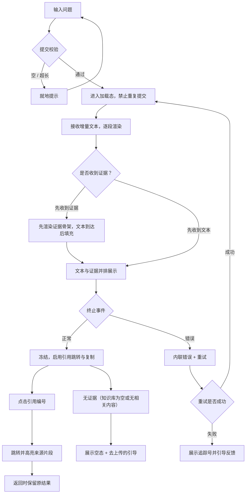
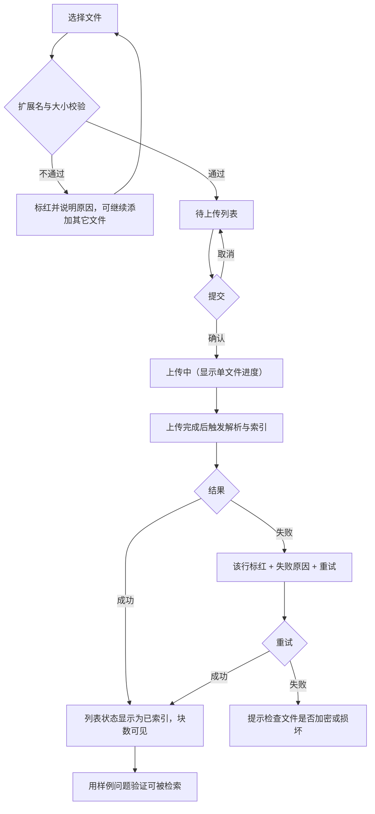

# 阶段 1 前端设计：对话问答 + 文档上传 + 答案卡片

> 本阶段建立前端的基础设施：布局、对话框、文档上传、答案卡片、引用跳转。这是后续所有阶段 UI 演进的起点。

---

## 一、页面结构

### 1.1 路由

| 路由 | 页面 | 主要角色 |
| --- | --- | --- |
| `/` | 对话页 | 全部用户 |
| `/knowledge` | 知识库管理 | 管理员 |

### 1.2 页面布局

```
┌────────────────────────────────────────────────────┐
│  顶栏：Logo｜租户切换｜用户头像                      │
├──────┬─────────────────────────────────────────────┤
│      │  对话区                                     │
│ 侧   │       ┌─────────────────────────────┐      │
│ 边   │       │  问题                       │      │
│ 栏   │       ├─────────────────────────────┤      │
│      │       │  答案 + 证据               │      │
│ - 对 │       │  [引用1] [引用2] [引用3]   │      │
│   话 │       └─────────────────────────────┘      │
│ - 知 │                                             │
│   识│  输入框 [输入问题]                  │
│      │                                       [发送]  │
│      │                                             │
└──────┴─────────────────────────────────────────────┘
```

---

## 二、核心组件

### 2.1 MessageBubble

用于显示用户问题气泡与系统答案气泡。

**Props 接口**：
- `role`: `'user' | 'assistant'`
- `content`: 文本内容（assistant 时支持 markdown）
- `timestamp`: 时间戳
- `evidence`: 证据数组（assistant 专用）
- `isStreaming`: 是否正在流式渲染

**视觉差异**：
- 用户气泡：右对齐，主色背景，白色文字；
- 系统答案：左对齐，白色背景（浅色模式）/ 主背景（深色模式），主文本色。

**关键交互**：
- 长按 / 鼠标悬停 → 弹出复制、点赞、点踩操作菜单；
- 点踩 → 弹出反馈表单（首次出现提交提示）。

### 2.2 CitationChip

引用编号芯片 `[#1] [#2]`。

**视觉**：
- 蓝色圆角胶囊；
- 与对应证据卡片左侧边框颜色一致；
- 鼠标悬停 → 显示证据前 50 字预览。

**交互**：
- 点击 → 跳转至答案下方的证据卡片；
- 点击证据卡片"查看原文"按钮 → 打开文档预览。

### 2.3 EvidenceCard

单条证据展示卡片。

**Props 接口**：
- `rank`: 编号
- `content`: 证据文本
- `source`: 来源（文档名 + 页码 / 时间戳）
- `score`: 相似度（阶段 2 起显示）
- `defaultExpanded`: 默认是否展开

**视觉**：
- 左侧 4px 颜色边框（与对应 CitationChip 颜色一致）；
- 灰色背景（`#F8FAFC` 浅色 / `#1E293B` 深色）；
- 顶部"来源 + 分数"，中部证据内容，底部"查看原文"按钮。

**交互**：
- 点击标题栏 → 展开 / 折叠；
- 点击"查看原文" → 打开文档预览弹窗，跳转到对应段落。

### 2.4 DocumentUploader

文档上传器（出现在 `/knowledge`）。

**Props 接口**：
- `accept`: 接受的文件扩展名（阶段 1 仅 `.pdf .md`，阶段 3 扩展）
- `maxSize`: 单文件最大尺寸
- `onUploaded`: 上传成功回调

**视觉**：
- 拖拽区域：大虚线边框，主色 hover 高亮；
- 文件队列：列表形式，每行显示文件名、大小、状态（待传 / 上传中 / 成功 / 失败）、进度条；
- 上传完成后自动开始"解析"，状态变更为"解析中"，阶段 3 后细化为多个子状态。

**交互**：
- 支持拖拽 / 点击选择 / 粘贴；
- 失败重试；
- 单文件删除；
- **批量上传**（一次拖拽多个）。

### 2.5 StreamText

流式渲染文本框。

**Props 接口**：
- `content`: 当前已富文本
- `isStreaming`: 是否仍在接收
- `enableCitations`: 是否启用引用编号解析

**实现考量**：
- 每个 token 到来用 `requestAnimationFrame` 调度渲染，避免抖动；
- 渲染时识别 `[#N]` 自动转 `CitationChip`；
- 流式结束后不再追加，保持可滚动；
- 中断按钮（停止生成）出现于文本末尾，光标闪烁位置。

### 2.6 ChatInput

问题输入框。

**Props 接口**：
- `placeholder`: 占位文字
- `disabled`: 是否禁用（生成中）
- `onSend`: 发送回调

**视觉**：
- 自适应高度（1~6 行）；
- 左侧"附件"按钮（阶段 1 暂为禁用态，阶段 6 后启用，关联到运行时图片查询）；
- 右侧"发送"按钮（主色）。

**交互**：
- Enter 发送，Shift+Enter 换行；
- 输入框内容本地存储（防止刷新丢失）；
- 上传文件后变为"含附件"状态。

---

## 三、交互细节

### 3.1 引用溯源（最关键体验）

1. 答案中出现 `[#1]` → 渲染为 `CitationChip`；
2. 点击芯片 → 平滑滚动到证据卡片，**自动展开**该条；
3. 证据卡片左侧高亮 2 秒后消失；
4. 证据卡片点击"查看原文" → 打开文档预览，**高亮对应段落**；
5. 文档预览关闭 → 自动回到答疑列表，**滚动位置保持**。

### 3.2 加载与错误状态

| 状态 | 表现 |
| --- | --- |
| 加载中 | 骨架屏占位 + "思考中…" 文字 |
| 流式中 | 文字逐字显示，底部闪烁光标 |
| 空态 | 欢迎语 + 三条示例问题（如"产品手册有什么内容？"） |
| 错误 | 答案区红色 inline 提示 + 重试按钮 + trace_id |
| 网络断开 | 全局横幅提示 + 自动重连指示 |

### 3.3 多轮对话（本阶段先预留接口）

- 对话列表按时间倒序；
- 切换对话保留滚动位置；
- 新对话 → 自动 focus 输入框；
- 删除对话 → 二次确认；
- 阶段 6 之后才会真正启用"基于历史"的多轮能力。

---

## 四、API 契约

### 4.1 问答端点

**`POST /ask`**（允许同步返回，也允许流式返回）

| 方向 | 字段 | 类型 | 说明 |
| --- | --- | --- | --- |
| 请求 | `question` | 文本 | 用户问题原文，**不做任何前端侧改写** |
| 响应 | `answer` | 文本 | 含引用编号标记的答案正文 |
| 响应 | `evidence[]` | 数组 | 证据列表，每条含 `rank`（编号）、`content`（片段正文）、`source`（来源文档） |
| 响应 | `trace_id` | 字符串 | 全链路追踪号，**必须展示在错误提示中**供用户反馈 |

**`evidence[]` 的编号必须与答案中的引用标记一一对应**：答案里出现 `[#1]`，证据列表中就必须存在 `rank = 1` 的条目；反之，证据列表中的每一条也应在答案中被引用过（未被引用的证据可折叠展示，但不能缺失）。

### 4.2 流式协议（`POST /ask/stream`）

采用服务端推送的流式协议，**事件类型在设计时就按演进预留**，避免后续阶段重构协议。

| 事件 | 载荷 | 引入阶段 | 前端动作 |
| --- | --- | --- | --- |
| `token` | `content`（增量文本） | 阶段 1 | 追加到答案区 |
| `evidence` | 证据对象（编号 / 正文 / 来源） | 阶段 1 | 追加证据卡片 |
| `done` | `trace_id` / `elapsed_ms` | 阶段 1 | 结束流式，隐藏停止按钮 |
| `error` | `code` / `message` | 阶段 1 | 展示内联错误 + 重试 |
| `rewritten_query` | 改写后的查询 | 阶段 4 | 更新改写对比组件 |
| `confidence` | 置信度与判定结论 | 阶段 5 | 更新置信度条 |
| `agent_step` | 执行步骤 | 阶段 6 | 追加轨迹节点 |

**协议设计的三条约定**：

1. **每类事件对应唯一的前端处理入口**，不允许两个组件同时消费同一事件（避免状态竞争）；
2. **未知事件必须被忽略而不报错**——保证新旧版本前后端可灰度共存；
3. **`done` 与 `error` 互斥且必有其一**，前端据此判断"流是否正常结束"，避免界面永久停留在加载态。

### 4.3 知识库端点

| 端点 | 方向 | 字段 | 说明 |
| --- | --- | --- | --- |
| `POST /knowledge/upload` | 请求 | 表单文件字段 | 单文件上传 |
| | 响应 | `file_id` / `filename` / `size` / `doc_id` / `status` | `status` 本阶段仅"已上传"与"已索引"两态 |
| `GET /knowledge/files` | 响应 | 数组，每项含 `file_id` / `filename` / `doc_id` / `uploaded_at` / `chunks` / `status` | 知识库列表 |

**`trace_id` 与 `file_id` 都必须在界面上可复制**——前者用于问题反馈，后者用于定位具体文件。

---

## 五、知识库管理页面

### 5.1 布局

```
┌─────────────────────────────────────────┐
│  [上传文档]  [+ 新建]                    │
├─────────────────────────────────────────┤
│  文件名 │ 状态 │ 切块数 │ 上传时间 │ 操作 │
│  a.pdf  │ 已索引│ 18    │  ...     │ ⋮    │
│  b.docx │ 解析中│ -     │  ...     │ ⋮    │
└─────────────────────────────────────────┘
```

### 5.2 文件状态

| 状态 | 视觉 | 说明 |
| --- | --- | --- |
| `uploaded` | 灰色 | 仅完成上传 |
| `parsing` | 蓝色 + 进度条 | 文档解析中（阶段 1 不细分，阶段 3 细化） |
| `indexed` | 绿色 | 解析 + 索引构建完毕 |
| `failed` | 红色 | 失败，需 hover 查看原因 |

### 5.3 操作菜单

点击 `⋮` → 弹出操作列表：
- 重新构建索引（重新跑切块 + Embedding）；
- 删除（确认对话框）；
- 查看解析详情（阶段 3 起打开预览）。

---

## 六、关键交互流程

阶段 1 只涉及两条流程，但**这两条流程的形态会一直沿用到最后**，因此这里把它画清楚，后续阶段都是在其上追加分支。

### 6.1 问答流程



**阶段 1 必须处理的一个边界**：**"先收到证据、后收到文本"是可能的**。若前端把渲染顺序写死成"先文本后证据"，会出现证据无处安放或闪烁。**按事件类型独立渲染、互不依赖到达顺序**，是流式界面的基本要求。

### 6.2 上传与入库流程



**"块数可见"这个细节值得保留**：它是用户判断"入库是否真的成功"的唯一直接证据。**只显示"已索引"而不给块数，遇到"入库成功但切出 0 块"的情况时无法被发现**。

---

## 七、视觉规范（本阶段专属）

- **引用编号默认色板**：
  - `[#1]` 蓝
  - `[#2]` 紫
  - `[#3]` 青
  - `[#4]` 琥珀
  - `[#5]` 粉红
  - `[#6]` 翠绿
  - 6 个颜色循环，按 rank 取色；
- **答案卡片阴影**：浅色模式 `0 1px 3px rgba(0,0,0,0.05)`，深色模式无阴影 + 边框；
- **证据卡片间距**：相邻证据之间 8px 间距，整组证据上方有 12px 分隔线。

---

## 八、页面状态机与错误处理

对话页与知识库页必须显式实现"四态"，不允许出现"白屏等结果"。

| 状态 | 触发条件 | 界面表现 | 可执行动作 |
| --- | --- | --- | --- |
| `loading` | 请求已发出、首个响应未到 | 打字指示器 + 骨架屏（3 条占位气泡） | 停止生成 |
| `streaming` | 正在接收流式 token | 文本逐字追加 + 光标闪烁 | 停止生成 / 复制已生成内容 |
| `empty` | 无历史对话或知识库为空 | 欢迎语 + 3 条示例问题；知识库页为"暂无文档，去上传 →" | 点击示例直接提问 / 打开上传 |
| `error` | 请求失败或返回错误码 | 气泡位置 inline 提示 + 重试按钮 + trace_id | 重试 / 复制 trace_id 反馈 |

**错误分类与文案**（前端需按错误码映射到用户可读文案，不直接展示后端 message）：

| 错误码段 | 场景 | 用户文案 | 是否自动重试 |
| --- | --- | --- | --- |
| 1xxx | 认证失败 | 登录已过期，请重新登录 | 否 |
| 2xxx | 输入校验失败 | 问题内容不合法，请修改后重试 | 否 |
| 3xxx | 文档/索引问题 | 该文档尚未完成索引，请稍后再试 | 否 |
| 4xxx | 检索与生成失败 | 生成失败，可点击重试 | 是（一次） |
| 6xxx | 限流或配额 | 请求过于频繁，{N} 秒后自动重试 | 是（倒计时后） |
| 5xxx | 服务端异常 | 服务暂时不可用，请稍后再试 | 是（指数退避两次） |

**边界情况**：

- 消息超长（> 8000 字）→ 折叠显示前 800 字 + "展开全文"；
- 证据条数 > 6 → 默认只展示前 3 条 + "展开全部 N 条"；
- 上传文件 > 50MB → 前置拦截并给出提示，不发起请求；
- 上传进行中关闭页面 → 提示"上传未完成，确认离开？"。

---

## 九、可访问性

- 答案卡片中引用编号**可被 Tab 到达**，按 Enter → 滚动到对应证据；
- 文档上传区支持**键盘 Enter 打开文件选择器**；
- 加载中文本与进度用 `aria-live="polite"` 通知屏幕阅读器；
- 引用编号、状态标签除颜色外必须有文字或图标区分，**不单独依赖颜色传达信息**。

---

## 十、性能预算

| 指标 | 目标 |
| --- | --- |
| 首屏 LCP | ≤ 1.5s（无 RAG 调用，仅 UI 渲染） |
| 路由切换 | ≤ 150ms |
| 流式首 token | ≤ 800ms |
| 文档列表加载 | ≤ 200ms |

---

## 十一、本阶段交付清单

- [x] 对话页（`/`）：MessageBubble、EvidenceCard、CitationChip、ChatInput、StreamText
- [x] 知识库管理页（`/knowledge`）：DocumentUploader、文件列表、状态标签
- [x] API 契约：`/ask`、`/knowledge/upload`、`/knowledge/files`
- [x] SSE 协议预留（事件类型枚举）
- [x] 流式渲染与四态（loading / streaming / empty / error）
- [x] 引用溯源交互（点击编号 → 滚动 → 展开证据 → 跳转原文）

→ 下一阶段：[`../stage-2-hybrid-search/frontend-design.md`](../stage-2-hybrid-search/frontend-design.md)