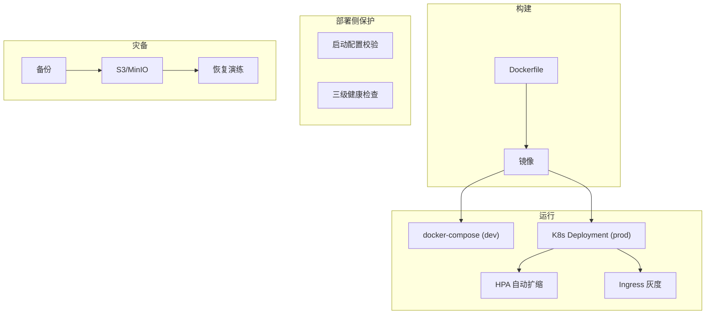
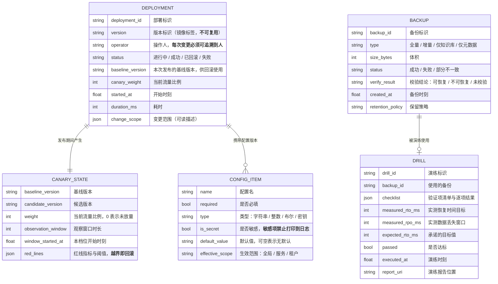
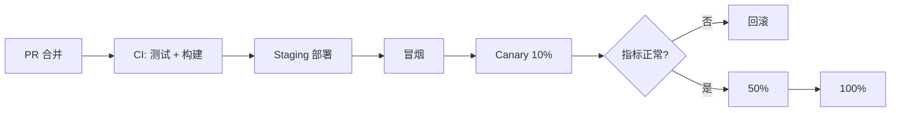
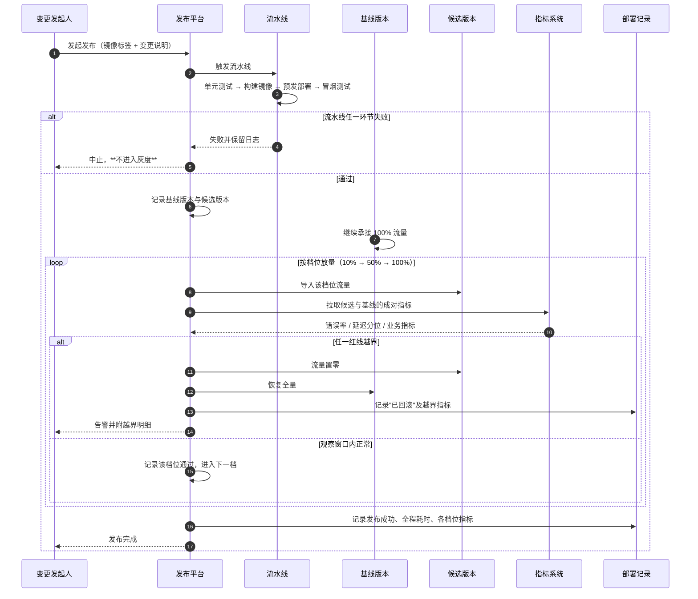
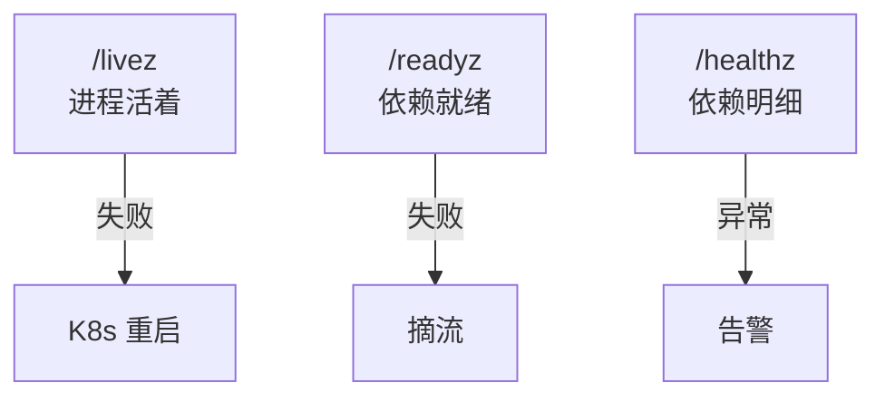

# 阶段 10：部署运维与未来演进（实现细节）

> 本阶段把前 9 个阶段推向生产——**容器化、K8s 编排、灰度发布、备份恢复、容量评估、向亿库选型矩阵**。

---

## 一、阶段定位与边界

### 1.1 业务能力范围



### 1.2 解决的核心问题

| 旧问题 | 新解法 |
| --- | --- |
| 没有可重现的镜像 | 多阶段 Dockerfile + 锁版本 |
| 没有 K8s manifest | 完整 deployment 模板 |
| 故障难回滚 | 灰度发布 + 一键回滚 |
| 索引损坏无恢复 | 备份 + 恢复演练 |
| 向量库选型拍脑袋 | 选型决策矩阵 |

### 1.3 验收标准

| 指标 | 目标值 |
| --- | --- |
| 启动配置校验 | 缺项即拒绝启动 |
| 三级健康检查 | 100% 覆盖 |
| 灰度发布 | 流量可逐步切 |
| 备份恢复演练 | 季度演练 1 次 |
| 灾备恢复 RPO | ≤ 1 小时 |
| 灾备恢复 RTO | ≤ 4 小时 |

---

## 二、容器镜像设计

### 2.1 多阶段构建

**镜像构建分两个阶段**：

| 阶段 | 职责 | 需要的工具 | 进入最终镜像 |
| --- | --- | --- | --- |
| 构建阶段 | 编译依赖、产出可安装包 | 编译器、构建工具（体积数百 MB） | **否** |
| 运行阶段 | 安装编译好的包 + 业务代码 | 仅运行时依赖（数十 MB） | 是 |

**为什么必须分阶段**：编译所需的工具链（编译器、头文件、构建脚本）在运行期毫无用处，却会显著放大镜像体积与攻击面。**把它们隔离在构建阶段、只把产物复制到运行阶段**，是容器化的基本纪律。

**运行阶段的三个硬要求**：

1. **以非特权用户运行**——容器逃逸时不会直接拿到宿主最高权限；
2. **依赖版本全部锁定**——保证"今天构建"与"一年后重建"产出一致；
3. **内置健康检查**——容器编排系统据此判断实例是否可用。

### 2.2 锁版本

**所有依赖锁版本**：

- requirements.txt 锁版本（如 `fastapi==0.115.0`）；
- 系统包锁版本（如 `python:3.11-slim` 的固定 tag）；
- pip、apt 都锁版本。

**锁版本的目的**：可重现构建。**今天 build 与一年后 build 产物一致**。

### 2.3 非 root 运行**：

- 创建专用 user（如 UID 1000）；
- 容器以非 root user 启动；
- 防止容器逃逸后获得主机 root。

### 2.4 健康检查**：

- HEALTHCHECK 指令 / Docker HEALTHCHECK 字段；
- 检查 HTTP `/livez` 端点；
- 失败 3 次 → Docker 标记 unhealthy。

---

## 三、K8s 部署架构

### 3.1 资源模型

**API Pod**（业务服务）：
- replicas: 3（最小）；
- 资源：CPU 1-4 核、内存 2-8 GB；
- HPA 自动扩缩（CPU 65% 触发）。

**基础设施**（中间件）：
- Redis（缓存 / 黑板）；
- PostgreSQL（Checkpoint / 元数据）；
- 向量库（Qdrant / Milvus）；
- 对象存储（S3 / MinIO）。

**模型侧**（关键差异）：

**全部模型能力通过千问平台（阿里云百炼）接口调用，集群内不存在任何模型推理负载，因此不需要 GPU 节点、不需要显存容量规划、不需要模型权重分发**。这直接简化了本阶段的资源模型：

| 若采用本地部署模型 | 本项目（云 API） |
| --- | --- |
| 需预留 GPU 节点并用节点亲和性绑定 | **无 GPU 资源，纯 CPU 节点即可** |
| 需为模型权重准备大容量镜像或持久卷 | 镜像只含业务代码，**体积小、拉取快** |
| 扩缩容需预热模型，冷启动以分钟计 | HPA 直接按 CPU 扩容，**冷启动以秒计** |
| 多模态与语音需分别部署三类模型 | 三类能力共用一套凭证与出口 |

**代价是新增了两个运维关注点**：一是**平台侧配额与限流**必须纳入容量评估（见阶段 9 的配额治理）；二是**出口网络与凭证**成为关键依赖，凭证失效等同于全部模型能力失效，必须纳入告警。

### 3.2 三级健康检查

**/livez（liveness）**：

- 检查进程是否存活；
- K8s 失败 → 重启 Pod；
- 失败率阈值 3 次；
- 间隔 15 秒。

**/readyz（readiness）**：

- 检查依赖是否就绪；
- K8s 失败 → 从 Service 摘流（不重启）；
- 失败率阈值 1 次；
- 间隔 10 秒。

**/healthz（深度）**：

- 返回每个依赖的状态明细；
- 用于监控告警 + 人工诊断；
- K8s 不直接使用，人工诊断接口。

**三级探针的语义差异**：

| 端点 | K8s 用途 | 失败后果 |
| --- | --- | --- |
| livez | liveness | 重启 Pod |
| readyz | readiness | 摘流（流量路由） |
| healthz | 监控 | 告警 |

**为什么必须分三级**：

- livez 仅反映"还在跑"，失败则重启；
- readyz 反映"可以服务"，失败则摘流；
- healthz 反映"完整健康度"，由监控报警。

**混用会出大事**：把 readyz 当 livez 用 → 索引暂时不可用 → Pod 被重启 → 服务雪崩。

### 3.3 HPA 自动扩缩

**HPA 触发条件**：

- CPU 利用率 > 65%；
- 内存利用率 > 80%（可选）。

**扩缩范围**：

- minReplicas: 3（保活）；
- maxReplicas: 12（防爆炸）；
- 扩缩步长默认（CPU 利用率按比例调整）。

**冷却时间**：

- scaleDown 默认 5 分钟（防止抖动）；
- scaleUp 默认 0 秒（紧急扩容）。

---

## 四、灰度发布

### 4.1 灰度的三种切流方式

灰度能力的实现方式是**在入口层按规则把一部分流量路由到新版本**。可用的切流维度有三种：

| 切流方式 | 切分依据 | 优点 | 缺点 |
| --- | --- | --- | --- |
| **按权重** | 请求总量的固定比例 | 实现简单、比例可控 | 同一用户可能一会儿走新版本、一会儿走旧版本 |
| **按请求头** | 调用方携带的标记 | 可指定特定客户端验证 | 需要调用方配合 |
| **按用户标识** | 用户/租户的稳定标识 | **同一用户始终走同一版本**，体验一致 | 需要能稳定取到用户标识 |

**生产推荐路径**：先按权重放量（10% → 50% → 100%）验证整体稳定性，再对特定租户按用户标识灰度——**这样既能验证整体，又能保证重点客户的体验一致**。

**两个必须提前准备的开关**：

1. **一键回滚**：把新版本权重直接置零即可全量回退，**回滚必须比放量更快**；
2. **快速熔断**：当新版错误率超过旧版的设定倍数时，**自动处置**（而非等人发现），避免夜间故障无人值守。

### 4.2 灰度决策

**每个权重档位至少观察 30 分钟**，观察项如下：

| 观察项 | 期望 | 异常处置 |
| --- | --- | --- |
| 错误率 | 不高于基线 | 立即回滚 |
| P95 / P99 延迟 | 不高于基线 | 回滚或排查依赖 |
| 业务指标（拒答率、引用覆盖率等） | 不劣化 | 视严重度决定回滚或继续观察 |
| 资源占用 | 与基线相当 | 检查是否引入资源泄漏 |

**决策纪律**：**任一红线指标越界即回滚，不做"再观察一会儿"的侥幸判断**。灰度的成本很低，线上事故的成本极高，二者的期望收益不对称。

**决策**：

- 指标正常 → 进入下一权重阶段；
- 异常 → 回滚（`canary-weight=0`）+ 调查原因。

### 4.3 灰度 + CI/CD

```
PR 合并 → CI 单元测试 → 镜像构建 → Staging 部署
  → Staging 冒烟 → Canary 10% → 30min 观察
  → 50% → 30min → 100% → 全量
```

---

## 五、配置校验

### 5.1 为什么启动期校验

**宁可在 boot 时崩，也不要带病上线**：

- 缺少千问平台访问凭证 → 服务启动后所有模型调用都失败；
- 端口被占用 → 服务启动后又崩溃；
- 向量索引路径不存在 → 启动后又崩溃。

**启动期校验 → 立刻失败**，K8s 不会进入"Running 但不工作"。

### 5.2 校验的覆盖

**必查**：

- 必需环境变量（千问平台凭证、向量库地址、向量索引目录等）；
- 类型正确（端口不能是字母）；
- 路径可访问（用一次性探针）。

**不强求值的检查**：

- 远程依赖可达（依赖启动耗时长 → 改用 healthcheck）；
- 业务规则校验（不需要）。

### 5.3 校验失败的报告

**校验失败报告必须做到三件事**：

1. **列出全部问题**，而不是遇到第一个就中止——让运维一次改完，避免"修一个启一次"的反复；
2. **指明具体项与原因**，例如"缺少必需的密钥配置"、"某数值参数无法解析为整数"；
3. **明确宣告启动已中止**，并给出退出码。

**不要只抛原始堆栈**——堆栈里看不到"到底缺哪个配置"，运维必须能一眼定位。校验失败是**部署阶段最高频的问题来源**，报告质量直接决定排障效率。

### 5.4 平台凭证的管理

采用千问平台后，**凭证取代了模型权重，成为新的关键依赖**：

| 事项 | 要求 | 理由 |
| --- | --- | --- |
| 存放 | **只进密钥托管，绝不进镜像、配置库与日志** | 凭证泄露等于账号内所有额度与数据暴露 |
| 校验 | 启动期只校验"存在且格式合法"，**不在启动期发起真实调用** | 启动期调用会拖慢冷启动，且把平台可用性绑到启动路径上 |
| 轮换 | 支持双凭证并存与热切换 | **轮换期间不能停机**；单凭证方案下换 Key 必然产生一次服务中断 |
| 出口 | 出口网络必须可达平台域名 | 网络策略收紧时，**表现是所有模型能力同时失效**，而 CPU、内存、探针均正常，极易误判为业务代码问题 |
| 告警 | 凭证校验失败与平台返回鉴权错误必须单独告警 | 与"限流"的处置方式完全不同，**混在一起会延误定位** |

**"启动期不发起真实调用"这条容易被忽略**：很多方案为了"确认凭证可用"在启动时调一次模型，结果是**平台抖动会连带让新 Pod 无法就绪**，扩缩容直接失效。正确做法是启动期只做格式校验，真实可用性交给运行期指标与告警。

---

## 六、备份恢复

### 6.1 备份什么

| 资产 | 备份频率 | 保留时长 |
| --- | --- | --- |
| 向量索引 | 每日 | 30 天 |
| 图数据库 | 每日 | 30 天 |
| 元数据库 | 每日 | 30 天 |
| 配置文件 | 每次变更 | 永久 |

**为什么向量索引要单独备份**：

向量索引重建成本高（embedding 调用 + 索引构建），**生产每天都有数据更新**。备份可让"灾备"成为现实选择。

### 6.2 备份格式

**归档文件包**：

- `tar.gz` 包含所有需要恢复的文件；
- `manifest.json` 包含文件清单 + sha256；
- 时间戳命名（`backup-2026-10-01.tar.gz`）。

### 6.3 恢复校验

**校验流程**：

1. 解压到恢复位置；
3. 用 manifest 的 sha256 验证；
5. 报告同与不同。

**同与不同是关键**：

- 静默失败的备份（看似恢复成功但文件错误）= 灾难；
- 校验发现不一致 → 立即报警。

### 6.4 灾备演练

**频率**：

- 季度一次；
- 不演练的灾备计划等于没有。

**演练必须按固定步骤执行，且全程计时**：

1. 从备份存储中取出一个备份包（**随机抽取，避免只演练最新的那个**）；
2. 恢复到一套全新的临时环境（**不得复用现有实例**，否则演练无效）；
3. 启动服务并通过三级探针检查；
4. 执行冒烟测试：典型问答、检索、引用跳转；
5. 与生产做一致性比对：抽样问题的答案与证据是否一致；
6. 记录实测的 RTO / RPO，与实际值偏差写入报告。

**"恢复到全新环境"是演练的核心价值所在**：在原有实例上恢复无法验证"备份本身是否完整可用"，只能验证"服务能重启"。真正的灾难场景下原环境已不可用。

---

## 七、向量库选型矩阵

### 7.1 选型维度

| 维度 | FAISS | Chroma | Qdrant | Milvus | pgvector |
| --- | --- | --- | --- | --- | --- |
| 运维难度 | 零 | 低 | 中 | 高 | 低（复用 PG） |
| 元数据过滤 | 无 | 基础 | 强 | 强 | 最强（SQL） |
| 100w+ 扩展 | 单机受限 | 弱 | 好 | 最好 | 中 |
| 备份 | 文件拷贝 | 文件拷贝 | 快照 API | 快照 | pg_dump |
| 推荐起点 | 起步 <10w 向量 | 演示 | 主流起步 <100w | 超大规模 >100k | 重度 PG 团队 |

### 7.2 决策路径

| 你的处境 | 推荐选择 | 理由 |
| --- | --- | --- |
| 起步阶段，向量量小（十万以内） | 零运维的文件型索引 | 无需额外组件，先跑通业务 |
| 百万以内 + 权限过滤需求强 | 支持强元数据过滤的服务型向量库 | ACL 过滤能下推到存储层，避免"先取后筛"的越权风险 |
| 团队已重度依赖关系型数据库 | 数据库内向量扩展 | 复用现有备份/监控/权限体系，**运维成本最低** |
| 千万级以上 | 分布式向量数据库 | 单机内存与索引结构无法承载 |
| 无运维能力的团队 | 嵌入式方案（仅限演示） | **不可用于生产**——无高可用、无快照、无扩容 |

**决策的真正约束不是"哪个最好"，而是"团队能运维哪个"**。选择超出团队运维能力的方案，会导致"上线即失联"。

### 7.3 迁移路径

迁移向量库是**高风险操作**，因为向量一旦丢失必须全量重编码（成本高且耗时长）。

**推荐的五步迁移法**：

1. **目标库就绪**：先搭好目标集群，验证可用性与容量；
2. **历史数据全量导入**：从现有索引读出向量与元数据，批量写入目标库；
3. **双写期**：写入路径同时写两套，读取路径先切到目标库——此阶段两库数据应完全一致；
4. **一致性校验**：比对两库的向量条数与抽样检索结果，**必须完全一致才能进入下一步**；
5. **停写旧库**：观察期无异常后，移除旧库写入路径并下线旧库。

**双写期是最危险的阶段**，风险集中在三点：

- **漏写**：若写入逻辑在多个入口，容易漏改其中一个，造成"新库缺数据"且长期不被发现；
- **不一致**：双写不是事务性的，一侧成功一侧失败会出现分叉，**必须有补偿任务**定期比对修复；
- **回滚困难**：一旦停写旧库且旧库数据已过期，回滚等于重新迁移。

**因此必须：进入双写期前先做一次完整的一致性基线，并在双写期内持续比对。**

---

## 八、容量评估

### 8.1 API Pod 数量

```
Pod 数 = ceil(QPS × 单请求CPU秒 / (核数 × 目标利用率))
```

**例子**：

- QPS = 200，单请求 CPU = 0.3s，核数 = 4，利用率 65%
- Pod 数 = ceil(200 × 0.3 / (4 × 0.65)) = ceil(60/2.6) = 24

**需要 6 个 4 核 Pod**（或 4 个 8 核 Pod）。

### 8.2 向量库内存

```
内存 = 向量数 × 维度 × 4 字节 × 1.3 (HNSW 开销)
```

**例子**：

- 100w 向量 × 768 维 × 4 × 1.3 ≈ 4 GB

### 8.3 存储估算

| 资产 | 大小 | 增长率 |
| --- | --- | --- |
| 向量索引 | 维度 × 4 × 文档数 | 与文档数线性 |
| 原文 | 文档字节数 | 与入文流 |
| 图谱 | 节点数 + 边数 | 与文档内容相关 |

**每月预留**：原始数据 × 2（包含重建索引）+ 向量 × 1.5 + 图谱 × 1.5。

---

## 九、数据模型设计

本阶段**不改动任何业务实体**，只新增四类运维元数据。但它们的重要性不低——**没有这些记录，"谁在什么时候改了什么"就无从回答**，而这恰恰是生产环境最常被追问的问题。

### 9.1 新增实体一览

| 实体 | 作用 | 存放位置 | 生命周期 |
| --- | --- | --- | --- |
| 配置项定义 | 声明每个配置的名称、是否必填、类型与默认值 | 版本化的配置文件（随代码走） | 随代码版本 |
| 部署记录 | 一次发布的全过程 | 关系库或部署平台自带记录 | 长期 |
| 灰度状态 | 当前基线与候选版本、流量比例 | 关系库或配置中心 | 随发布周期 |
| 备份记录 | 一次备份的产物与校验结果 | 关系库 + 备份存储 | 按保留策略 |
| 演练记录 | 一次灾备演练的验证项与实测指标 | 关系库 | 长期，**是合规材料** |

**配置项定义必须"随代码走"而不是存在数据库里**：配置的合法取值依赖代码逻辑，**把定义与代码分离会导致"配置校验通过但代码不支持"的错配**。数据库里只应存配置的取值，不应存它的定义。

### 9.2 实体关系



### 9.3 关键字段的约束

**部署记录**：

| 字段 | 约束 | 说明 |
| --- | --- | --- |
| 版本标识 | **不可复用** | 同一个版本标识对应同一个镜像内容；复用标签会让"回滚到某个版本"变得不确定 |
| 操作人 | 必填 | **生产环境的每一次放量与回滚都必须可追溯到人**，这不是可选项 |
| 基线版本 | 必填 | 回滚的目标；**发布前必须先确认基线是什么**，否则出了故障无处可退 |
| 变更范围 | 必填（可读） | 便于事后分析"哪个变更引发了指标波动" |

**灰度状态**：

| 字段 | 约束 | 说明 |
| --- | --- | --- |
| 流量比例 | 单一事实来源 | **必须只有一处记录当前比例**（配置中心或发布平台），多源会导致"界面显示 10%，实际已放量 50%" |
| 观察窗口起点 | 必填 | 保证每个档位都经过完整观察窗，**避免"刚放量就往上加"的盲推** |
| 红线指标 | 必填 | 越界即回滚的判据；**没有红线就只能靠人盯盘，夜间无人值守时必然出问题** |

**备份记录**：

| 字段 | 约束 | 说明 |
| --- | --- | --- |
| 校验结论 | 必填 | **未经验证的备份等于没有备份**。备份完成只说明"写成功了"，不代表"能恢复" |
| 类型 | 必填 | 决定恢复步骤；知识库与元数据的恢复顺序不同 |
| 保留策略 | 必填 | 备份会持续增长，**没有保留策略会在某天耗尽存储** |

**演练记录**：

| 字段 | 约束 | 说明 |
| --- | --- | --- |
| 验证项清单 | 逐项结果 | 只记"演练成功"没有价值；必须记录**哪几项通过、哪几项失败** |
| 实测恢复时间与数据丢失窗口 | 必填 | 与承诺目标对比，**差异必须显式记录**，否则承诺值永远停留在文档里 |
| 是否达标 | 必填 | 不达标必须进入改进清单，**"演练不通过但不了了之"是灾备体系最常见的失效方式** |

### 9.4 数据保留与合规

| 数据 | 保留建议 | 理由 |
| --- | --- | --- |
| 部署记录 | 长期 | 变更追溯与事故复盘的依据 |
| 备份 | 按策略（如最近 N 份 + 每月留档） | 兼顾恢复能力与存储成本 |
| 演练记录 | 长期 | **属于合规材料**，需要能证明"我们定期验证过恢复能力" |
| 配置项定义 | 随代码版本 | 与代码同步演进，旧版本配置定义应能从历史版本中查到 |

**部署记录与业务审计是两套不同的记录**：前者回答"系统被怎么改了"，后者回答"数据被谁看过"。**二者都不可相互替代**，在事故复盘中通常需要同时调阅。

---

## 十、关键决策记录

### 10.1 为什么多阶段 Docker 而非简单生命周期脚本？

多阶段构建**减少镜像体积与攻击面**——简单 RUN apt-get install 留下的 gcc 是无意义的 attack surface。

### 10.2 为什么必须三级探针？

混用探针是 K8s 部署的经典坑。**每个探针只负责一个语义**，与 K8s 行为一一映射。

### 10.3 为什么备份额外有 manifest.json？

**灾备场景需要能快速判断"备份是否完整有效"**——manifest 提供"预期文件清单与 hash"，与解压后的实际文件 hash 比对。

### 10.4 为什么不直接用 k8s CronJob？

可以。**单纯为了备份任务，k8s CronJob 比手动 cron 更适合**。本阶段示例用容器内脚本，**生产换 k8s CronJob 或 Argo Workflow**。

---

## 十一、关键流程图

### 11.1 CI/CD + 灰度



### 11.2 灰度发布与回滚时序

发布流程的关键在于**"每一步都有明确的判据与退路"**，时序图能把这个性质表达得比流程图更清楚。



**四个必须体现在流程里的约束**：

| 约束 | 时序图中的体现 |
| --- | --- |
| 流水线失败即中止 | 失败分支**不进入灰度**，避免"带着问题开始放量" |
| 先记录基线再放量 | 基线是回滚的唯一目标，**必须在放量前确定** |
| 每档位都有观察窗 | 循环体内必须完成一次完整的指标拉取与比对 |
| 越界即回滚 | 判据在循环内、立即生效，**不等待人确认** |

**"回滚路径必须比放量路径更快"**：放量要逐档观察，回滚只需一次置零。**如果回滚也要走逐档降级，系统就失去了止损能力**。

### 11.3 三级探针语义



---

## 十二、与上一阶段差异

| 模块 | 阶段 9 | 阶段 10 |
| --- | --- | --- |
| 交付形态 | 可运行的服务与护栏 | **可部署、可灰度、可回滚的发布物** |
| 配置管理 | 环境变量散落各处 | 启动期集中校验，缺项即拒绝启动 |
| 健康检查 | 无统一探针 | 三级探针（存活 / 就绪 / 深度），各司其职 |
| 扩容能力 | 手动调整实例数 | 按资源利用率自动扩缩，含上下限保护 |
| 发布方式 | 全量替换 | **按流量比例灰度**，逐档放量并观察指标 |
| 故障恢复 | 依赖人工重建索引 | 定期备份 + 恢复演练 + 校验清单 |
| 存储选型 | 单一实现 | 按规模与运维能力的选型决策矩阵 + 迁移路径 |

**本阶段是"能上线"与"敢上线"的分界线**：阶段 9 之前解决的是"功能对不对"，阶段 10 解决的是"出问题时能不能快速止损"。**没有灰度与回滚能力的系统，任何一次上线都是一次赌博**。

---

## 十三、未来 12 个月演进趋势

| 趋势 | 本项目接入点 |
| --- | --- |
| 长上下文模型 | 阶段 3 RAPTOR 与长上下文路由互补；千问平台长上下文档位可直接替换 |
| Agentic Workflow 标准化 | 阶段 6 AgentNodes 可平移到 LangGraph 1.0 |
| 原生多模态模型能力增强 | 阶段 7 的图像描述由 `qwen-vl-max` 生成，**平台升级即可受益，无需改架构** |
| GraphRAG + RAG 融合常态化 | 阶段 7 已是融合架构 |
| 模型档位分级路由 | 阶段 4 意图识别器是天然的分级路由点，可在 `qwen-turbo` / `qwen-plus` / `qwen-max` 间按难度切换 |

---

## 十四、十阶段总收束

| 阶段 | 核心能力 | 关键交付物 | 验收红线 |
| --- | --- | --- | --- |
| 1 | 最小可用 RAG | 切块 + 向量索引 + 引用溯源 | 简单事实问答可答且可溯源 |
| 2 | 工程化与混合检索 | BM25 + 融合 + 重排 + 缓存/限流/指标 | Recall@10 达标、P95 在预算内 |
| 3 | 智能分块与多模态 | 四类切块 + 解析器路由 + 层级索引 | 长文档 / 表格 / 扫描件可入库 |
| 4 | Query 理解 | 意图 + 改写 + 拆解 + 路由 | 口语化问题召回显著提升 |
| 5 | 自反思 | 证据评分 + 三分支 + 幻觉自检 + 拒答 | 一致性与拒答准确率双达标 |
| 6 | Agent 编排 | 状态机 + 工具注册 + 三层熔断 + 会话 | 多跳问答准确率达标、熔断可控 |
| 7 | 图谱与跨模态 | 实体关系抽取 + 图检索 + 跨模态检索 | 关系型与图文问题可答 |
| 8 | 多智能体协同 | 五角色 + 黑板 + 拓扑分层 + 评审循环 | 长任务可拆解、评审可收敛 |
| 9 | 企业护栏 | 认证 + ACL + 审计 + 脱敏 + 配额 + 评测 | 默认拒绝生效、审计无泄漏 |
| 10 | 部署运维 | 镜像 + 集群 + 三级探针 + 灰度 + 灾备 | 可灰度、可回滚、可恢复 |

**收束结论**：十阶段不是十个独立系统，而是**同一套能力栈的逐层加固**——每一阶段都保留前一阶段的全部能力，只在其上叠加新的抽象。任何一跳级实现都会引入无法定位的复杂度（例如跳过阶段 2 的指标直接上阶段 6，Agent 的熔断率与工具失败率将无从观测）。

→ 阶段闭环，回到 [`../README.md`](../README.md)