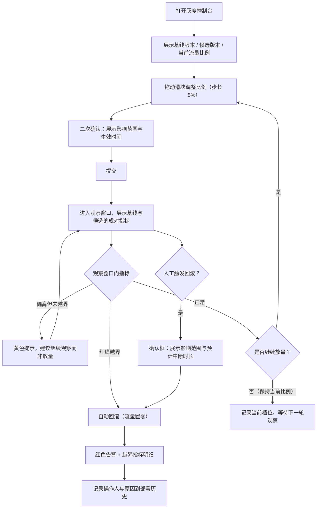
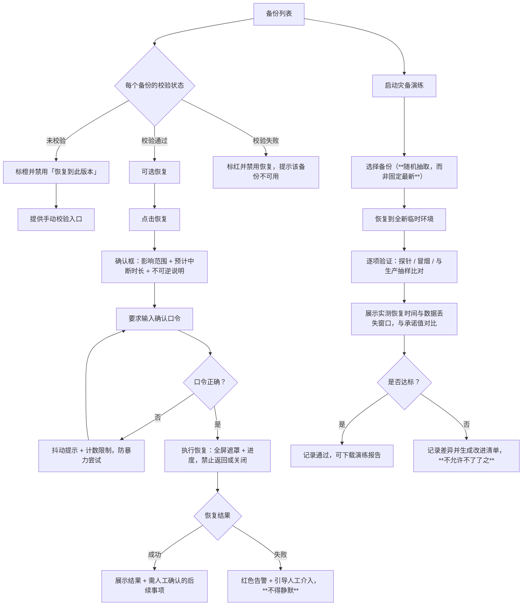
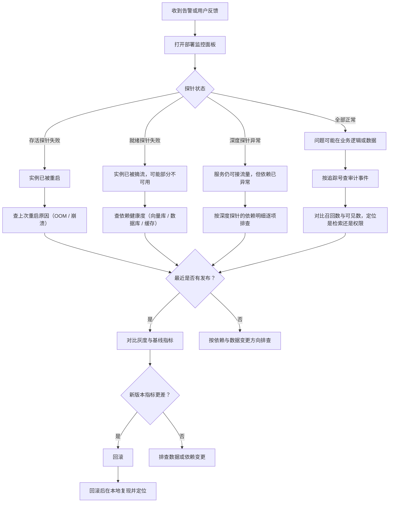

# 阶段 10 前端设计：部署监控与灰度控制台

> 本阶段在前端引入 **部署监控面板、灰度发布控制台、灾备状态可视化**。运维者第一次能"控制"生产环境的发布节奏。

---

## 一、新增页面

| 路由 | 页面 | 角色 |
| --- | --- | --- |
| `/ops/deployments` | 部署历史 | 运维者 |
| `/ops/deployments/:id` | 单次部署详情 | 运维者 |
| `/ops/canary` | 灰度发布控制台 | 运维者 |
| `/ops/backup` | 备份管理 | 运维者 |
| `/ops/disaster-recovery` | 灾备演练 | 运维者 |

---

## 二、部署监控面板（`/admin/monitor` 增量）

### 2.1 服务集群指标

| 指标卡片 | 含义 |
| --- | --- |
| Pod 数 | running / desired |
| CPU 利用率 | 集群平均 |
| 内存利用率 | 集群平均 |
| 副本数变更 | 近 24h HPA 触发次数 |
| 探针状态 | livez/readyz 通过率 |

### 2.2 探针矩阵

```
服务: kquery-api
  livez  (liveness):              ✓ 通过 12.4k / 失败 0
  readyz (readiness):             ✓ 通过 11.9k / 失败 12 (0.1%)
  healthz (深度):                 ✓ 依赖全部正常
  上次失败:                           5 分钟前 (redis 抖动 0.8s)
```

### 2.3 Pod 列表

```
Pod             │ Node     │ 状态  │ CPU │ 内存 │ 重启 │ 启动时间 │
kquery-api-0    │ node-01  │ Running│ 30%│ 512M│ 0    │ 2h ago    │
kquery-api-1    │ node-01  │ Running│ 28%│ 480M│ 0    │ 2h ago    │
kquery-api-2    │ node-02  │ Running│ 35%│ 520M│ 0    │ 1h ago    │
```

**交互**：

- 点击 Pod → 详情（事件日志、容器状态）；
- 点击"查看日志"→ 跳转到日志系统。

---

## 三、灰度发布控制台（`/ops/canary`）

### 3.1 布局

```
┌────────────────────────────────────────────────────────┐
│ 灰度发布控制台                                          │
├────────────────────────────────────────────────────────┤
│ 当前版本: v1.2.0 (生产)                                │
│ 候选版本: v1.3.0-rc1                                  │
│ ─────────────────────────────────────────────────── │
│ 灰度流量:                                             │
│   ●────────────────────────○  5%                       │
│   [0%] [10%] [25%] [50%] [100%]                  │
│                                                         │
│ 灰度观察指标 (近 30 分钟):                              │
│   错误率:   0.12% (基线 0.10%)  ✓ 正常               │
│   P95 延迟:  1.8s (基线 1.7s)    ✓ 正常               │
│   QPS:      85                  -                    │
│                                                         │
│ 决策:                                                 │
│   [提升到 25%] [提升到 50%] [全量 100%] [回滚]       │
└────────────────────────────────────────────────────────┘
```

### 3.2 灰度流量滑块 (CanaryTrafficSlider)

**视觉**：

- 水平滑块，区间 0-100%；
- 颜色：0% 灰、1-99% 琥珀渐变、100% 绿；
- 当前值显示在滑块上方大字。

**操作**：

- 拖动滑块 → 显示对应流量下的预期指标（基线对比）；
- 点击预设按钮（10/25/50/100）→ 直接跳到指定位置；
- **每次变化都需要二次确认**。

### 3.3 灰度指标对比

**对比维度**：

- 错误率（与基线对比）；
- P95 延迟；
- 业务指标（自定义，如拒答率、引用覆盖率）；
- 用户反馈数（点踩数）。

**视觉**：

- 折线图（灰度期间 vs 基线）；
- 偏差绿（正向）/ 红（负向）/ 灰（无差异）；
- 阈值超限时**面板顶部红色告警**。

### 3.4 一键回滚

**触发**：发现严重问题。

**视觉**：

```
┌────────────────────────────────────────┐
│ ⚠️ 确认回滚到基线版本 v1.2.0?         │
│ ────────────────────────────────────── │
│  当前: v1.3.0-rc1 (灰度 25%)            │
│  回滚后: v1.2.0 (100%)                │
│ ────────────────────────────────────── │
│  预计影响:                            │
│  - 用户无感知仍需切回 v1.2.0           │
│  - 但上下文丢失中未完成的多智能体会话  │
│ ────────────────────────────────────── │
│  [确认回滚] [取消]                     │
└────────────────────────────────────────┘
```

---

## 四、部署历史（`/ops/deployments`）

### 4.1 列表

```
┌────────────────────────────────────────────────────────────────────────────────┐
│ 部署历史                                          时间: [近 7 天 ▼]            │
├────────────────────────────────────────────────────────────────────────────────┤
│ 版本     │ 操作者 │ 状态   │ 灰度进度 │ 开始时间  │ 耗时     │ 操作              │
│ v1.3.0-rc1│ alice  │ 灰度中 │ 25%     │ 测试完成│ 2h ago    │ -     │ ⋮       │
│ v1.2.0   │ bob    │ 生产   │ 100%    │ 测试完成│ 2d ago    │ 5m    │ ⋮       │
│ v1.1.0   │ bob    │ 已回滚 │ 0       │ 测试完成│ 5d ago    │ 3m    │ ⋮       │
└────────────────────────────────────────────────────────────────────────────────┘
```

### 4.2 部署详情

```
┌────────────────────────────────────────────────────────┐
│ 部署详情: v1.3.0-rc1                                  │
├────────────────────────────────────────────────────────┤
│ 状态: 灰度中 (25%)                                   │
│ 开始: v1.3.0-rc1 上线于 2 小时前                   │
│ 操作者: alice                                        │
│ 灰度历程:                                            │
│   10:00  开始灰度 5%                                │
│   10:30  提升到 25%                                 │
│   (下阶段: 50%)                                      │
│                                                        │
│ 关联指标:                                            │
│   错误率: 0.12%                                      │
│   P95: 1.8s                                          │
│   测试覆盖率: 87%                                   │
│                                                        │
│ [查看代码变更] [复制版本号]                         │
└────────────────────────────────────────────────────────┘
```

---

## 五、备份管理（`/ops/backup`）

### 5.1 备份列表

```
┌────────────────────────────────────────────────────────────────────┐
│ 备份管理        时间: [近 30 天 ▼]    类型: [全部 ▼]    [立即备份] │
├────────────────────────────────────────────────────────────────────┤
│ 时间           │ 类型   │ 大小  │ 状态   │ 验证     │ 操作      │
│ 2026-10-01 03:00│ 全量  │ 2.4GB│ 成功  │ ✓ 通过  │ ⋮       │
│ 2026-09-30 03:00│ 全量  │ 2.3GB│ 成功  │ ✓ 通过  │ ⋮       │
│ 2026-09-29 03:00│ 全量  │ 2.3GB│ 成功  │ ✓ 通过  │ ⋮       │
│ 2026-09-28 03:00│ 全量  │ 2.3GB│ 失败  │ ✗ 部分不一致│ ⋮   │
└────────────────────────────────────────────────────────────────────┘
```

### 5.2 备份详情

```
┌────────────────────────────────────────────────────────┐
│ 备份详情: 2026-10-01 03:00                            │
├────────────────────────────────────────────────────────┤
│ 文件数: 18                                           │
│ 总字节: 2.4 GB                                      │
│ 耗时: 12 分钟                                       │
│ sha256 校验: ✓ 全部通过                            │
│                                                        │
│ 包含:                                                │
│   - 向量索引 (faiss.index)                          │
│   - 元数据 (PostgreSQL dump)                       │
│   - 图数据库 (Neo4j backup)                        │
│   - 配置文件 (config/)                             │
│                                                        │
│ [下载] [恢复到此版本] [验证]                          │
└────────────────────────────────────────────────────────┘
```

### 5.3 一键恢复

**触发**：管理员手动点击。

**视觉**：

```
┌────────────────────────────────────────────────────────────────────┐
│ ⚠️ 确认恢复 2026-10-01 03:00 的备份?                              │
│ ────────────────────────────────────────────────────────── │
│ 警告:                                                              │
│   - 当前数据将被替换                                │
│   - 服务会中断约 5-10 分钟                              │
│   - 多智能体会话状态会丢失                                │
│ ────────────────────────────────────────────────────────── │
│ [输入 'RESTORE' 确认] [取消]                                │
└────────────────────────────────────────────────────────────────────┘
```

**必须输入指定字符才解锁**——防误操作。

---

## 六、灾备演练（`/ops/disaster-recovery`）

### 6.1 演练列表

```
┌────────────────────────────────────────────────────────┐
│ 灾备演练         [启动新演练]                            │
├────────────────────────────────────────────────────────┤
│ 演练ID  │ 类型    │ 启动时间  │ 状态     │ RTO │ RPO │ 操作 │
│ DR-001 │ 全恢复  │ Q3末    │ 上线    │ 4m │ 30m │ ⋮   │
│ DR-002 │ 部分    │ Q2末    │ 上线    │ 2m │ 1h  │ ⋮   │
└────────────────────────────────────────────────────────┘
```

### 6.2 演练详情

```
┌────────────────────────────────────────────────────────┐
│ 演练: DR-001 (全量恢复)                                │
├────────────────────────────────────────────────────────┤
│ 目标: 验证备份恢复到全新实例的 RTO ≤ 4h                 │
│ 启动时间: 2026-09-30 14:00                           │
│ 完成时间: 2026-09-30 14:04 (4 分钟)                  │
│                                                        │
│ 验证项:                                                │
│   ✓ 备份解压成功                                     │
│   ✓ 向量库可加载                                     │
│   ✓ 元数据可查询                                     │
│   ✓ 检索 smoke test 通过                            │
│   ✓ 评测集 100 条跑分与生产一致                     │
│                                                        │
│ 发现问题:                                                │
│   - 配置文件需要手动调整                        │
│                                                        │
│ [下载演练报告]                                          │
└────────────────────────────────────────────────────────┘
```

---

## 七、API 契约（本阶段新增）

**新增端点**：

| 端点 | 用途 | 关键字段 |
| --- | --- | --- |
| `GET /ops/deployments` | 部署历史 | `version` / `operator` / `status` / `canary_weight` / `started_at` / `duration_ms` |
| `GET /ops/deployments/{id}` | 单次部署详情 | 灰度历程（各阶段权重与时间）、关联指标、代码变更范围 |
| `GET /ops/canary/state` | 当前灰度状态 | `baseline_version` / `candidate_version` / `weight` / `observation_window_ms` |
| `PUT /ops/canary/weight` | 调整灰度流量 | 入参 `weight`；返回**生效确认与回滚窗口** |
| `POST /ops/canary/rollback` | 回滚 | 返回 `rolled_back_to` 与**不可回滚的副作用说明** |
| `GET /ops/canary/metrics` | 灰度与基线的指标对比 | 错误率 / 延迟分位 / 业务指标，**成对返回便于绘制对比线** |
| `GET /ops/backups` | 备份列表 | `created_at` / `type` / `size` / `status` / `verify_result` |
| `POST /ops/backups/{id}/restore` | 触发恢复 | 需携带确认口令；返回 `downtime_estimate_ms` |
| `POST /ops/drills` | 启动灾备演练 | 返回 `drill_id`；异步执行 |
| `GET /ops/drills/{id}` | 演练详情 | 验证项清单与逐项结果、RTO / RPO 实测值 |

**探针端点的响应约定**：

| 端点 | 语义 | 返回内容 | 严禁做的事 |
| --- | --- | --- | --- |
| `/livez` | 进程是否存活 | **极简**（通常只有状态码） | 不查任何外部依赖——否则依赖抖动会导致 Pod 被误杀 |
| `/readyz` | 能否接流量 | 依赖就绪与否的布尔结果 | 不做重操作、不返回依赖明细 |
| `/healthz` | 完整健康报告 | 每个依赖的状态、耗时、错误摘要 | 不参与流量路由决策 |

**前端对三个探针的呈现策略**：livez / readyz 只在监控大盘汇总展示通过率（**高频数据，不逐条渲染**）；`/healthz` 的依赖明细供人工诊断页展示，**按需拉取而非轮询**。

**错误码**：

| 错误码 | 场景 | 前端表现 |
| --- | --- | --- |
| 71xx | 灰度权重调整失败（无候选版本等） | 滑块**回弹到原值**并提示原因 |
| 72xx | 回滚失败 | 红色告警 + 引导人工介入，**不得静默** |
| 73xx | 备份校验不通过 | 该备份行标橙，禁用"恢复到此版本" |
| 74xx | 恢复口令错误 | 输入框抖动 + 计数限制（防暴力尝试） |
| 75xx | 演练环境资源不足 | 提示需先释放资源，不自动重试 |

**两条安全约定**：

1. **破坏性操作必须二次确认 + 影响说明**（回滚、恢复、全量放量）；
2. **灰度放量与回滚的接口必须记录操作者**，并在部署历史中体现——**生产环境的每一次变更都要可追溯到人**。

---

## 八、关键交互流程

### 8.1 灰度放量与回滚流程

本阶段的交互特点是**"操作即生产影响"**。流程设计的目标是：**让每一次影响都可控、可观察、可撤销**。



**"自动回滚"与"人工回滚"必须都具备**：自动回滚用于无人值守（夜间）时止损，人工回滚用于指标未越界但人工判断有风险的情况。**只有自动回滚会误杀，只有人工回滚会在夜间失守**。

### 8.2 备份恢复与演练流程



**"未校验的备份禁止恢复"是流程中最重要的一道闸门**：备份写成功不代表能恢复。**允许恢复一个未验证的备份，等于在灾难发生时才第一次验证备份**——那时已经没有退路。

**"破坏性操作必须焦点锁定"**（见可访问性一节）：确认框若焦点不锁定，用户误按 Tab 加回车就会触发恢复，**这类误操作在生产事故中占比不低**。

### 8.3 故障排查流程



**排查流程的入口选择由探针语义决定**：存活探针失败说明"进程没了"，就绪探针失败说明"依赖不可用"，**两者指向完全不同的排查方向**。这正是三级探针分层的实际价值。

---

## 九、视觉规范（新增）

### 9.1 灰度状态色板

| 流量 | 颜色 |
| --- | --- |
| 0% | 灰 |
| 1-50% | 琥珀渐变 |
| 50-99% | 琥珀 |
| 100% | 绿 |

### 9.2 备份状态色板

| 状态 | 颜色 |
| --- | --- |
| 成功 | 绿 |
| 失败 | 红 |
| 部分不一致 | 橙 |
| 验证中 | 蓝 |

### 9.3 灾备演练状态色板

| 状态 | 颜色 |
| --- | --- |
| 进行中 | 蓝 |
| 成功 | 绿 |
| 部分失败 | 橙 |
| 失败 | 红 |

---

### 9.4 破坏性操作的视觉统一

回滚、恢复、全量放量三类操作使用**同一套破坏性视觉语义**：

| 元素 | 规范 |
| --- | --- |
| 按钮 | 红色实心，与普通按钮明确区分 |
| 二次确认 | 展示"影响范围 + 预计中断时长 + 不可逆项" |
| 高风险项 | 要求输入指定确认口令（如 RESTORE）才解锁按钮 |
| 执行中 | 全屏遮罩 + 进度 + **禁止返回或关闭** |
| 完成后 | 明确展示结果与后续需人工确认的事项 |

---

## 十、可访问性

- 灰度滑块支持**键盘左右方向键**调整，且每次调整步长为 5%；
- 备份恢复确认的警告**必须可被屏幕阅读器完整读到**，包括不可逆说明；
- 破坏性操作确认框需**焦点锁定**，避免误 Tab 到确认按钮后回车；
- 部署详情中的版本号用语义化代码标签，便于复制与朗读。

---

## 十一、性能预算

| 指标 | 目标 |
| --- | --- |
| 灰度面板渲染 | ≤ 200ms |
| 部署历史加载 | ≤ 500ms（100 条内） |
| 备份列表加载 | ≤ 300ms |
| 演练详情加载 | ≤ 1s |
| 灰度指标对比图刷新 | ≤ 300ms（含两条对比线） |

---

## 十二、本阶段交付清单

- [x] 部署监控面板（服务集群指标 + Pod 列表）
- [x] 探针矩阵（livez / readyz / healthz 三态及各自语义）
- [x] 灰度发布控制台（流量滑块 + 基线对比指标 + 一键回滚）
- [x] 部署历史（列表 + 详情 + 灰度历程 + 操作者追溯）
- [x] 备份管理（列表 + 详情 + 校验状态 + 一键恢复）
- [x] 灾备演练（启动演练 + 验证项清单 + RTO/RPO 实测 + 报告下载）
- [x] API 契约（部署 / 灰度 / 备份 / 演练端点 + 探针响应约定 + 破坏性操作安全约定）
- [x] 灰度 / 备份 / 演练三套色板 + 破坏性操作视觉统一规范

→ 阶段闭环，回到 [`../README.md`](../README.md)