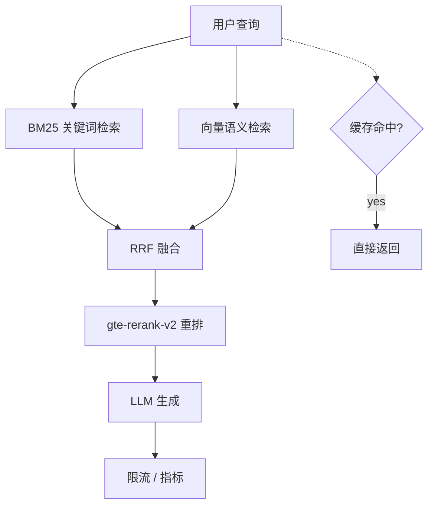
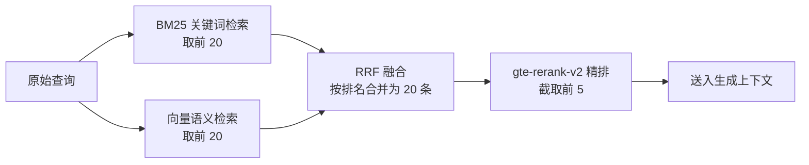
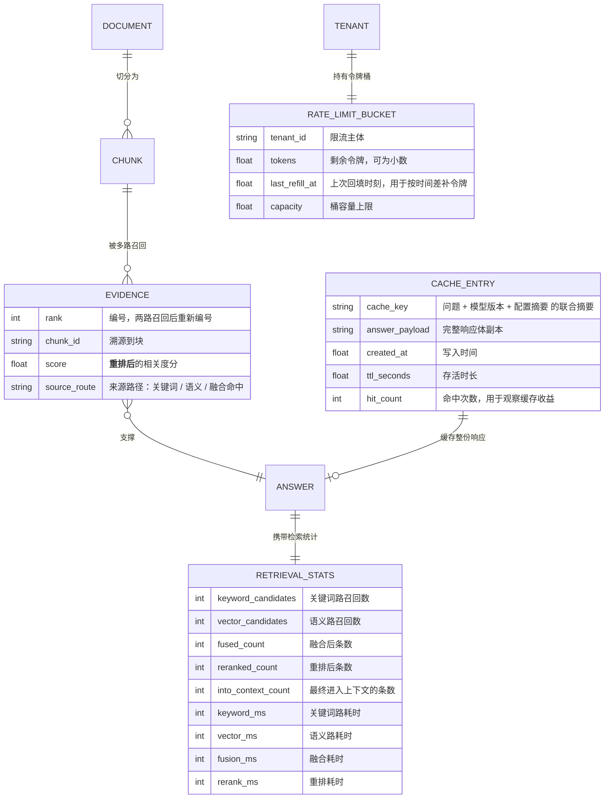
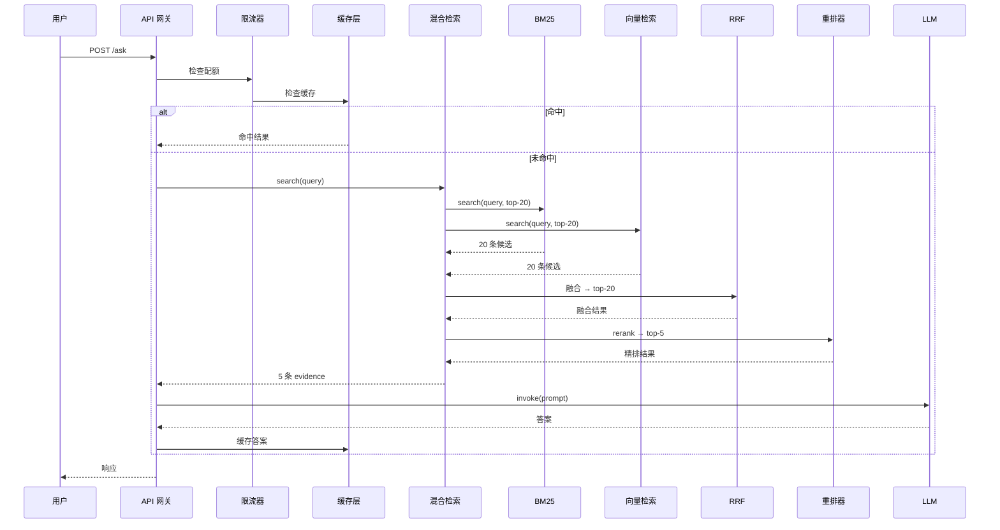
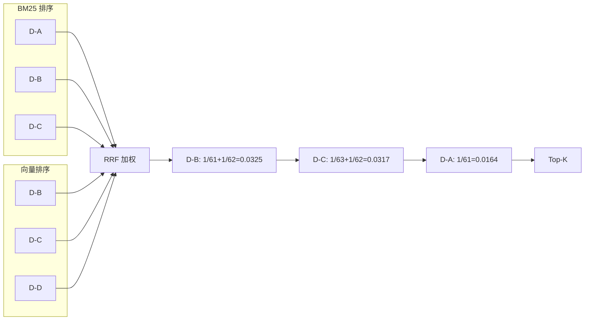

# 阶段 2：工程化 RAG 与混合检索（实现细节）

> 本阶段在阶段 1 的 Naive RAG 之上，把"单路向量检索"升级为 **BM25 + 向量 + RRF 融合 + 神经网络重排**四段式混合检索；同时补齐 **缓存、限流、Prometheus 指标** 三大工程基础设施。

---

## 一、阶段定位与边界

### 1.1 业务能力范围



### 1.2 解决的核心问题

| 旧问题 | 新解法 |
| --- | --- |
| 编号 / 型号召回不稳 | BM25 关键词精确匹配 |
| Top-K 顺序噪声 | 平台重排（gte-rerank-v2）精排 |
| 重复 query 反复扣 LLM 费用 | 语义级缓存 |
| 突发流量压垮服务 | 令牌桶限流 |
| 上线后无法观测指标 | Prometheus 指标 + Grafana 看板 |

### 1.3 验收标准

| 指标 | 目标值 |
| --- | --- |
| Recall@10 | ≥ 0.70（人工评测集） |
| P95 端到端延迟 | ≤ 2s（不含 LLM） |
| 缓存命中率（高频 query） | ≥ 30% |
| 限流生效 | 超额请求 100% 429 |
| 指标可观测 | `/metrics` 端点暴露 ≥ 5 个核心指标 |

---

## 二、架构设计

### 2.1 四段式检索链路的取舍



**为什么 BM25 与向量都要先多召**（Top-20 而不是 Top-5）？

如果两路分别只召 Top-5 后再融合，会损失召回率——某个文档在某路正好排第 6 被截掉。**多召是为了给 RRF 与 Rerank 留候选空间**。但每路多召多少不能拍脑袋：太少损失召回，太多影响性能，经验值是最终 Top-K 的 3~5 倍。

**为什么 RRF 而不是分数归一化**？

BM25 的分数范围是 0~∞，向量的 cosine 范围是 0~1，**两者的分数分布完全不同**。强行线性归一化再加权会出现"BM25 0.5 与向量 0.5 实际意义不同"的校准难题。

**RRF 只用排名不用分数**，把"某路第 1 名"统一视为贡献度，不做分数校准——天然支持异构检索器融合。

**为什么 Rerank 只能精排**？

重排模型把"query + doc"拼在一起整体编码、逐对计算相关度——比向量检索的双塔模型精细得多，**但代价是与候选数成正比的逐对计算**，不能在百万候选上跑。

千问平台的 `gte-rerank-v2` 就是这类模型的托管版本：**技术上是交叉编码器，部署上只是一个接口**——本项目因此不需要自行维护重排模型的运行环境。

**所以链路必须分层**：先用 BM25 + 向量粗排（毫秒级），再用 `gte-rerank-v2` 精排（百毫秒级），最后只把 Top-K 喂给生成模型。

### 2.2 缓存的设计

**为什么是语义级缓存而不是文档级缓存**？

文档级缓存（同一文档返回同一答案）粒度过粗——同一问题换一个文档答案就变。**语义级缓存的 key 是 query + model + 配置版本**，只要 query 与模型版本不变就命中。

**为什么缓存里只存答案而不存证据**？

证据往往在不同 query 之间会有微调（Top-K 不同），缓存全量证据反而增加存储。**只缓存最终字符串答案**，下一次同 query 直接复用。

**缓存键必须包含模型版本与配置版本**：

缓存键由三部分摘要而成——**用户问题原文、生成所用模型的版本标识、检索与生成的配置摘要**。三者任一变化，键即变化。

否则换模型后仍会命中旧模型产出的答案，造成"升级了模型但用户体验没变"的质量倒挂。**这是工程上的细节，但很多团队第一版缓存设计就漏掉**，上线后表现为"灰度切了模型，指标毫无变化"。

### 2.3 限流的设计

**令牌桶 vs 滑动窗口**：

- 令牌桶允许**突发流量**在桶未空时被吃掉，适合"偶尔长尾但总体平稳"的 RAG；
- 滑动窗口**严格按时间窗口计数**，不会漏记但实现稍复杂。

本阶段选令牌桶：实现简单且 RAG 业务很少有"瞬时大量并发"的场景。

**限流粒度**：

按 **租户 ID** 限流（不是按用户）。原因：RAG 业务通常"一个租户多个用户共用一个 KB"，按租户限流更符合业务场景；按用户限流容易被共享账号绕过。

### 2.4 指标的设计

**核心指标**：

| 指标 | 含义 | 用途 |
| --- | --- | --- |
| `rag_requests_total{status}` | 请求总数（按状态分组） | 错误率告警 |
| `rag_latency_seconds_bucket{tenant}` | 端到端延迟直方图 | P95 告警 |
| `rag_cache_total{result}` | 缓存命中/未命中 | 命中率看板 |
| `rag_retrieval_top_score_bucket` | Top-1 融合分数分布 | 评估 query 难度 |
| `rag_llm_calls_total` | LLM 调用次数 | 成本核算 |

**指标分 label 的考量**：

`tenant` 与 `status` 都是**高基数/低基数区分**：tenant 高基数（按租户切片），status 低基数（ok/error）。**不要把 request 内容当作 label**——会爆炸。

---

## 三、实现细节

### 3.1 BM25 的实现考量

**中文分词**：

BM25 假设"词"是基本单位，需要先分词。中文场景必须用 jieba 或 pkuseg（不能按字分），否则"电池"与"电池电压"无法匹配。

**分词粒度**：

- 粗切：要精准，过滤停用词
- 细切：保留 NER 实体，便于"XB-2024 电池"这种专有名词匹配

**BM25 参数调优**：

BM25 的 `k1`、`b` 参数控制词频饱和与文档长度归一化。**默认值 k1=1.5, b=0.75 对大多数场景够用**。追求极致时可以基于自有语料调优。

**BM25 的零分文档**：

BM25 对无关文档给 0 分。**测试和实现都应过滤掉 0 分文档**，否则融合时它们会进入 RRF 排名计算但永远在最末位，污染链路。

### 3.2 向量检索的实现考量

复用阶段 1 的向量检索实现，但**接口必须抽象**。

**检索器抽象应具备的三项能力**：

| 能力 | 说明 | 为什么必需 |
| --- | --- | --- |
| 统一的检索入口 | 传入查询与返回条数，返回「文档 + 分数」列表 | 让融合层不关心是哪一路检索 |
| 自带名称标识 | 每个检索器有唯一名字 | 融合时能标注证据来自哪一路，便于前端展示与排障 |
| 支持多实现并存 | 同一抽象下可注册任意数量的实现 | 阶段 3 新增图检索、阶段 7 新增跨模态检索时无需改动融合层 |

**注意**：不同检索器返回的分数**语义不同**（BM25 是 0~∞ 的无界分，向量是 -1~1 的余弦分），所以抽象层只承诺"分数越大越相关"这一条弱契约，**不允许上层直接跨路比较分数**，跨路比较统一交给 RRF。

**向量归一化的重要性**：

千问 `text-embedding-v3` 在编码时应做归一化（平台返回值通常已归一化，入库前仍须显式校验模长），使余弦相似度等价于内积。**如果不归一化，不同向量的模长差异会直接污染分数**——长文档的向量模长通常更大，会把无关的长文本推到前面。这是向量检索最高频的隐性错误。

### 3.3 RRF 融合的数学原理

**公式**：

```
score(d) = Σ 1 / (k + rank_i + 1)
```

其中 `rank_i` 是文档 d 在第 i 路检索结果中的排名（从 0 开始）。

**关键参数 `k`**：

- `k=60` 是论文默认值，适合大多数场景；
- `k` 越大，高排名的贡献越小（更平滑），越能容忍某路个别错位；
- `k` 越小，高排名贡献越大（更激进），适合某路特别可靠的情况。

**必须做的数值自检**：

RRF 公式极易写错（排名从 0 还是 1 开始、是否漏加常数、是否重复计同路）。上线前必须用可手工验算的算例核对：

- 某文档只在 A 路排第 1 → 得分应为 1/(60+0+1) ≈ 0.0164；
- 同一文档在 A、B 两路都排第 1 → 得分应为 2 × 0.0164 ≈ 0.0328，**必须大于只在单路排第 1 的文档**；
- 某文档在 A 路排第 3、B 路排第 1，应超过在 A 路排第 1、B 路排第 3 的文档（**两路同时靠前胜过单路极靠前**）。

**这三种排序关系是 RRF 的语义内核**，任何一条不成立都说明公式实现有误。

### 3.4 Rerank 的实现考量

**重排模型的选型**：

- 统一使用千问平台 `gte-rerank-v2`（阿里云百炼），**通过接口调用，不部署本地重排模型**；
- 选它的核心原因是**与向量模型同平台、同计费口径**，且阶段 5 的证据相关度打分可直接复用同一接口，避免维护两套相关度口径；
- 若未来更换重排模型，**必须重跑基线评测并重新标定阈值**——不同重排模型的分数尺度不可直接比较。

**重排粒度**：

候选数（Top-50）越小越快，**但太少会失去精排意义**。经验值：候选数 = 最终 Top-K × 5~10。本阶段选 Top-50 → Top-5。

**重排调用的开销**：

千问重排接口对 50 个候选的耗时为百毫秒量级（含网络往返），**单次问答建议只调用一次重排**。若对多组上下文分别重排，时延会线性叠加，在流式体验下不可接受。

**平台接口的失败处理**：重排属于**增强能力**，接口超时或限流时应跳过重排、直接使用融合结果，并在响应中标记"本次未精排"——**绝不能让重排失败阻断整次检索**。

### 3.5 缓存的失效策略

**TTL 设为 1 小时**：

过短：缓存命中率低，长期价值膨胀。
过长：陈旧答案堆积，模型升级后还使用旧结果。

**模型升级时的失效机制**：

不采用"手动清缓存"这种易遗忘的方式，而是**把模型版本与配置摘要编入缓存键**——键变了，旧条目自然不再被命中，TTL 到期后被回收。这样生产升级模型无需任何额外运维动作，也不会出现"切了模型但答案没变"的假升级。

**同时要防止的两种误判**：

- **假失效**：键里混入了时间戳、请求 ID 等易变字段 → 缓存永不命中，等于没做缓存；
- **假命中**：键里漏掉了租户、知识库、模型版本 → 跨租户或跨版本串答案，属于严重的数据越权。**租户标识必须进键**。

### 3.6 限流的实施细节

**令牌桶的三个要素**：

| 要素 | 含义 | 取值依据 |
| --- | --- | --- |
| 桶容量 | 允许瞬间消费的最大令牌数 | 按业务允许的突发峰值设定；本阶段取 60 |
| 补充速率 | 单位时间恢复的令牌数 | 按常态承载能力设定；本阶段取每分钟 60 |
| 粒度 | 每个桶服务的对象 | **按租户独立成桶**，避免单租户拖垮全局 |

**运行语义**：

1. 请求到达时先查桶内可用令牌数；
2. 有令牌则扣除一枚并放行；无令牌则拒绝；
3. 令牌按"距上次补充的时间 × 补充速率"累加，**且不得超过桶容量**（否则长时间空闲后会积累出无限额度，失去限流意义）；
4. 桶状态需在进程间共享（多副本部署时），否则每个副本各算一份，实际放行量是配置值的 N 倍——**这是限流最常见的失效原因**。

**拒绝的细节**：

拒绝必须返回标准的"请求过多"状态码，并**显式携带 Retry-After 字段**告知下次可重试的秒数。**前端要解析该字段并显示倒计时**，倒计时归零后自动重试一次。若不带该字段，客户端只能盲目重试，反而放大流量。

---

## 四、数据模型设计

本阶段在阶段 1 的四个实体之外，新增**缓存条目、限流桶状态、指标时序**三类运行期数据，并**扩展证据与检索统计的字段**。

### 4.1 新增实体与存放位置

| 实体 | 作用 | 存放位置 | 生命周期 |
| --- | --- | --- | --- |
| 缓存条目 | 命中即免去检索与生成 | 键值存储（生产）/ 进程内存（开发） | 1 小时自动过期 |
| 限流桶状态 | 记录某租户的可用令牌 | 键值存储（**必须跨副本共享**） | 持续存在并随时间回填 |
| 指标时序 | 运营观测 | 指标系统（Prometheus 等） | 按保留策略滚动 |
| 检索统计（响应内嵌） | 让用户与运营看清"慢在哪" | 不持久化，随响应返回 | 请求级 |

**运行期数据与业务数据必须分开存放**：缓存与限流状态属于"丢了可以重建、且不应进备份"的数据，**绝不能和知识库数据放在同一个持久卷里**——否则一次缓存故障会连带影响业务数据的可用性。

### 4.2 实体关系



### 4.3 关键字段的约束

**缓存条目**：

| 字段 | 约束 | 说明 |
| --- | --- | --- |
| 缓存键 | 由**问题原文 + 生成模型版本 + 检索与生成配置摘要**三部分联合摘要 | 三者任一变化即换键——**这是"换模型不会命中旧答案"的唯一保证** |
| 响应副本 | **必须缓存完整响应结构** | 只缓存答案是错的：证据与统计也要一并返回，否则命中缓存时前端会拿到残缺数据 |
| 过期时长 | 1 小时 | 与知识库更新频率匹配；过长会返回过期知识 |
| 命中计数 | 单调递增 | 用于评估缓存收益，**也是判断"知识库是否稳定"的信号** |

**限流桶状态**：

| 字段 | 约束 | 说明 |
| --- | --- | --- |
| 剩余令牌 | **可为小数** | 若强制取整会引入额外误差，导致长期限流偏严 |
| 上次回填时刻 | 必须记录 | 令牌按"距上次回填的时间 × 速率"补足，**不记录时刻就无法正确回填** |
| 桶容量 | 上限约束 | 补充后的令牌数**不得超过容量**，否则长时间空闲会积累出无限额度 |

**证据（扩展字段）**：

| 新增字段 | 类型 | 语义 |
| --- | --- | --- |
| 相关度分 | 浮点 | **由重排模型给出**，与阶段 1 的相似度分**不是同一口径**——两者不可比较，不可混用 |
| 来源路径 | 枚举 | 关键词召回 / 语义召回 / 两者融合后命中；前端据此标注证据出处，运营据此判断哪一路更有效 |

### 4.4 检索统计的四个计数与四段耗时

**排查"召回率下降"这类问题，靠的就是这八个值**：

| 观察 | 含义 | 结论方向 |
| --- | --- | --- |
| 关键词候选数骤降 | 关键词路出问题 | 检查分词、索引是否被重建 |
| 语义候选数正常但融合后条数骤降 | 融合环节异常 | 检查融合算法与去重逻辑 |
| 重排后条数远小于入参 | 重排阈值过严 | 考虑放宽阈值 |
| 进入上下文数被截断 | 上下文预算不足 | 调整截断策略而非检索参数 |

**四段耗时必须分开上报**：只上报总耗时会让排查无从下手；分开后可以立刻回答"是召回慢、融合慢还是重排慢"——**这是本阶段最重要的可观测性设计**。

### 4.5 数据保留与清理

| 数据 | 保留策略 | 理由 |
| --- | --- | --- |
| 缓存条目 | 自动过期，**不做手动清理** | 键中含模型与配置版本，升级后自然失效，无需运维介入 |
| 限流桶状态 | 长期存在，随时间回填 | 桶状态可重建（默认为满桶），丢失只影响一次限流精度 |
| 指标时序 | 按保留策略滚动 | 长期留存成本高，按排查需求定窗口 |

**"缓存不做手动清理"是一条重要的运维约定**：任何依赖人工清理的机制都会在某次上线时被遗忘。把失效逻辑编进键的设计里，才是可持续的做法。

---

## 五、关键决策记录

### 5.1 为什么 RRF 而不是 Condorcet fusion 或 Borda count？

**RRF 的优势**：
- 公式简单，O(N·M) 计算（N=候选数, M=路数）；
- 异构分数天然适配；
- 实验上与复杂模型融合效果相当。

**Condorcet / Borda**：
- 都需要打分而非排名；
- 优势是理论上的"社会选择"公平性，但 RAG 场景不需要。

### 5.2 为什么 Rerank 一定要在融合后？

如果对 BM25 与向量分别重排再融合，会**让同一批候选被重复打分，并放大两路分数口径的差异**——而重排模型并不关心候选来自 BM25 还是向量。**先融合后重排**让 `gte-rerank-v2` 面对同一份统一候选集做一次精排，这也是它能与阶段 5 的证据评分复用同一口径的前提。

### 5.3 为什么缓存不包含证据？

证据是"这次检索的结果"，缓存 evidence 等于缓存"这次检索过程"。**缓存只有"答案字符串"**——下次重检索可能换了证据，但答案（语义上）应该一致。

### 5.4 为什么指标不暴露到 /ask 响应里？

指标是"服务侧的运营数据"，不应该进用户的请求响应。**延迟或超限错误通过专门的状态码（如 429）反映**，而不是把内部指标塞给前端。

---

## 六、关键流程图

### 6.1 混合检索完整链路



### 6.2 RRF 融合示意



---

## 七、混合检索的调参与评估方法

混合检索引入了 6 个可调参数，**不能靠直觉调**。下表给出每个参数的作用、默认值、调优方向与观察指标。

| 参数 | 作用 | 默认值 | 调大 / 调小的后果 | 观察指标 |
| --- | --- | --- | --- | --- |
| 单路召回条数 | 每路进入融合的候选数 | 20 | 调小则融合前就丢召回；调大则融合开销上升 | Recall@20 |
| 融合后候选数 | 进入重排的候选数 | 20 | 调小则重排无从选择；调大则重排时延上升 | 重排后 Recall@5 |
| 最终 Top-K | 进入生成上下文的条数 | 4 | 调小则答案不全；调大则提示变长、注意力分散 | 答案完整率 / 提示长度 |
| RRF 平滑常数 k | 排名贡献的衰减速度 | 60 | 调大更平滑（容忍某路错位）；调小更激进 | 融合后排序的稳定性 |
| BM25 词频饱和 k1 | 词频的边际贡献 | 1.5 | 调大则重复词权重更高；调小则更看重词的有无 | 编号型查询召回 |
| BM25 长度归一 b | 文档长度的影响 | 0.75 | 调大则偏爱短文档；调小则长度影响减弱 | 长短文档的排序公平性 |

**调参顺序（一次只动一个）**：


**评估方法**：

1. **固定评测集**：准备 50~100 条"问题 → 正确证据"样本，覆盖事实、编号、跨段三类；
2. **单变量对比**：每轮只改一个参数，记录 Recall@K 与 P95 时延；
3. **埋点对照**：线上同时记录"融合前 Top-1 命中率"与"重排后 Top-1 命中率"，两者的差值即重排的实际增益；
4. **回归红线**：任何参数调整若使 Recall@10 下降超过 2%，必须回退。

**常见的伪提升**：只测"答案是否通顺"而不测"证据是否命中"。检索指标（Recall@K）与生成指标（Faithfulness）必须分开度量，**否则会把检索问题误判为生成问题**。

---

## 八、与上一阶段差异

| 模块 | 阶段 1 | 阶段 2 |
| --- | --- | --- |
| 检索 | 单路 FAISS | BM25 + 向量 + RRF + Rerank |
| 响应 | 字符串 | answer + evidence + score + from_cache |
| 缓存 | 无 | 语义级缓存 |
| 限流 | 无 | 令牌桶 429 |
| 监控 | 仅日志 | Prometheus 指标 + 日志 |

---

## 九、本阶段遗留问题 → 下一阶段预告

| 现象 | 根因 | 下一阶段 |
| --- | --- | --- |
| 表格 / 扫描件入不了库 | 仅文本切块 | 阶段 3 多模态解析 |
| 长文档语义断裂 | 固定窗口切块 | 阶段 3 语义 / 父子 / RAPTOR |
| 口语化 query 召回差 | query 未改写 | 阶段 4 HyDE / Fusion |

→ 下一阶段：[`../stage-3-smart-chunking/README.md`](../stage-3-smart-chunking/README.md)