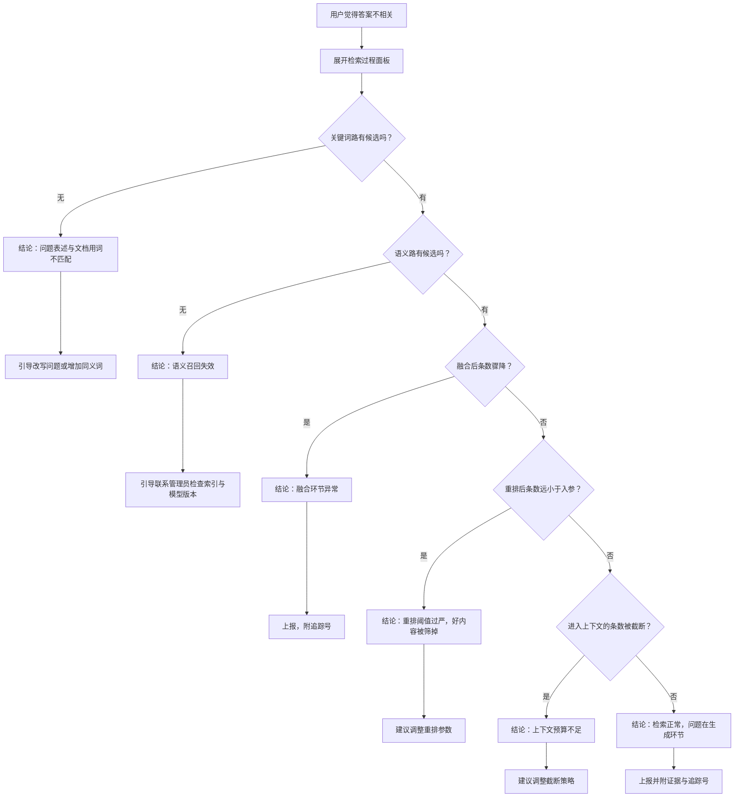
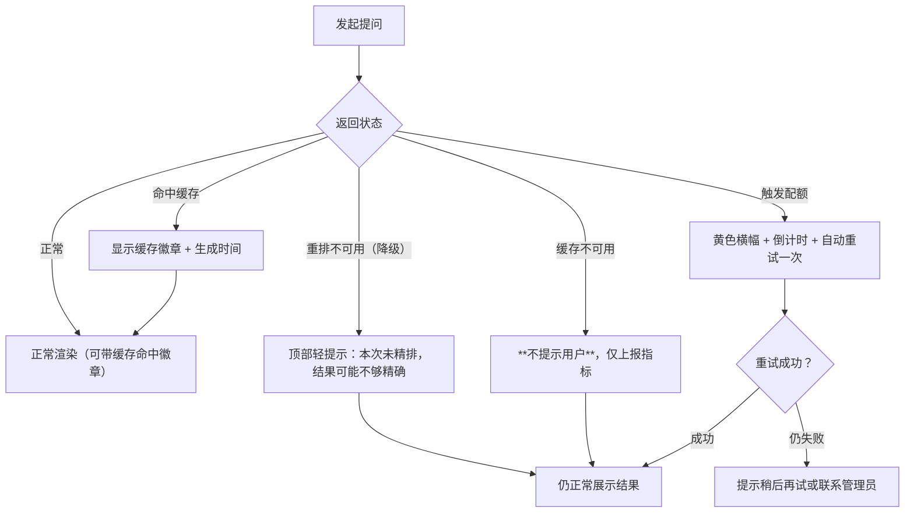

# 阶段 2 前端设计：检索过程可视化与缓存监控

> 本阶段在前端叠加 **混合检索过程可视化、缓存命中反馈、限流提示、检索参数面板**。用户第一次能"看见"系统内部在做什么。

---

## 一、页面结构（增量）

新增路由：

| 路由 | 页面 | 角色 |
| --- | --- | --- |
| `/admin/monitor` | 监控大盘 | 管理员 |
| `/admin/retrieval-config` | 检索参数配置 | 管理员 |

`/`（对话页）和 `/knowledge`（知识库管理）继续保留并叠加新功能。

---

## 二、对话页增量改动

### 2.1 检索过程可视化面板

**触发**：在 EvidenceCard 下方默认折叠一个"查看检索过程"链接，点击展开。

**展示结构**：

```
┌─────────────────────────────────────────────────┐
│  🔍 检索过程                                     │
│  ──────────────────────────────────────────────  │
│  ┌──────────────┐ ┌──────────────┐              │
│  │ BM25 候选    │ │ 向量候选     │              │
│  │ 命中: 18/20  │ │ 命中: 17/20  │              │
│  │ 耗时: 12ms   │ │ 耗时: 84ms   │              │
│  └──────────────┘ └──────────────┘              │
│  ──────────────────────────────────────────────  │
│  ↓ RRF 融合                                       │
│  ┌───────────────────────────────────────────┐  │
│  │ 融合候选 35 → gte-rerank-v2 精排 → 5     │  │
│  │ 耗时: 78ms                                 │  │
│  └───────────────────────────────────────────┘  │
│  ──────────────────────────────────────────────  │
│  缓存: 命中/未命中   限流: 正常/触发              │
└─────────────────────────────────────────────────┘
```

**视觉**：
- 浅灰背景 + 细线边框；
- 各模块用虚线分隔；
- 命中数 / 耗时用等宽数字；
- 整体作为折叠面板，不影响答案阅读。

### 2.2 缓存命中提示

**触发位置**：EvidenceCard 顶部、答案标题之后。

**视觉**：
- 命中：绿色"⚡ 来自缓存"徽章；
- 未命中：不显示（避免冗余）。

**点击行为**：弹出 tooltip，告知缓存 TTL 与命中时间。

### 2.3 限流提示

**触发位置**：当收到 429 响应时。

**视觉**：
- 全局顶部黄色横幅：`[限流] 当前租户配额已用完，X 秒后可重试`；
- 倒计时数字实时更新；
- 倒计时归零后横幅自动消失。

**重试行为**：
- 倒计时归零 → 自动重试一次；
- 仍 429 → 升级为内联错误提示，按钮"重试"。

---

## 三、监控大盘（`/admin/monitor`）

### 3.1 布局

```
┌────────────────────────────────────────────────────┐
│  监控大盘     时间范围: [近 1h ▼]   [刷新]          │
├────────────────────────────────────────────────────┤
│  指标卡片区                                       │
│  ┌──────────┐ ┌──────────┐ ┌──────────┐         │
│  │ QPS      │ │ 错误率   │ │ P95 延迟 │         │
│  │  124 ▲   │ │  0.3% ▼ │ │ 1.8s ▲  │         │
│  └──────────┘ └──────────┘ └──────────┘         │
│  ┌──────────┐ ┌──────────┐                       │
│  │ 缓存命中 │ │ LLM 调用 │                       │
│  │  42% ▲   │ │  8.2k/h  │                       │
│  └──────────┘ └──────────┘                       │
├────────────────────────────────────────────────────┤
│  趋势图区                                         │
│  ┌─────────────────────────────────────────┐    │
│  │ 请求量 & 错误率趋势                       │    │
│  │ (时间序列图)                              │    │
│  └─────────────────────────────────────────┘    │
│  ┌──────────────────┐ ┌──────────────────┐    │
│  │ 延迟 P50/P95/P99 │ │ 缓存命中率       │    │
│  └──────────────────┘ └──────────────────┘    │
├────────────────────────────────────────────────────┤
│  Top Queries 表格                                 │
│  ┌─────────────────────────────────────────┐    │
│  │ query        │ 调用数 │ 命中率 │ 平均延迟 │    │
│  │ 电池电压      │ 1.2k  │ 65%    │ 0.8s    │    │
│  │ 保修政策      │ 0.9k  │ 70%    │ 0.6s    │    │
│  └─────────────────────────────────────────┘    │
└────────────────────────────────────────────────────┘
```

### 3.2 MetricCard 组件

**Props 接口**：
- `title`: 标题
- `value`: 当前数值
- `unit`: 单位
- `trend`: 趋势方向（up/down/flat）
- `sparklineData`: 最近若干时间点的数据（用于迷你图）
- `threshold`: 阈值（可选，超阈值变色）

**视觉**：
- 大字号数值 + 小字号单位；
- 右上角趋势箭头 + 同比百分比；
- 底部迷你折线图（最近 60 个数据点）；
- 超阈值时数字变红。

### 3.3 趋势图

**技术选型**：折线图组件（按设计风格选用）。

**关键功能**：
- 时间范围选择：5m / 15m / 1h / 6h / 24h / 7d；
- 多指标叠加（双 Y 轴）；
- hover 显示具体数值 tooltip；
- 图例点击可隐藏/显示某条线；
- 异常值高亮（红色圆点 + 提示原因）。

### 3.4 Top Queries 表格

**列**：
- Query 文本（过长截断 + tooltip）；
- 调用数（按时间筛选）；
- 缓存命中率；
- 平均延迟；
- 错误率；
- 置信度分布（阶段 5 起显示）。

**交互**：
- 表头排序；
- 过滤：按错误率高 → 低、按延迟高 → 低；
- 点击行 → 弹出该 query 的所有问答样本（用于诊断）。

---

## 四、检索参数配置（`/admin/retrieval-config`）

### 4.1 页面结构

```
┌────────────────────────────────────────────────────┐
│  检索参数配置                                       │
├────────────────────────────────────────────────────┤
│  召回策略                                           │
│  ☑ 向量检索    权重 [30] %                         │
│  ☑ BM25       权重 [70] %                         │
│  ☐ 跨页融合    权重 [0] %                          │
├────────────────────────────────────────────────────┤
│  重排                                               │
│  ☑ 千问重排 (gte-rerank-v2)                        │
│  模型: [gte-rerank-v2 ▼]                           │
│  Top-K: [4] (候选 → 4 条给 LLM)                  │
├────────────────────────────────────────────────────┤
│  缓存                                               │
│  TTL: [3600] 秒                                     │
│  Salt 模型版本: [✓] 启用                            │
├────────────────────────────────────────────────────┤
│  限流                                               │
│  租户级 QPS: [60] / 分钟                            │
│  桶容量: [60]                                       │
│  [保存] [重置为默认]                                │
└────────────────────────────────────────────────────┘
```

### 4.2 表单控件

- **复选框 + 滑块组合**：权重 0~100，校验总和不超出 100；
- **数字输入**：限制正整数；
- **下拉选择**：模型列表（已注册的模型）；
- **保存前预览**：影响字段按字节不立即生效，弹窗"修改将在 5 分钟后生效"提示。

### 4.3 配置变更审计

- 每次保存记录到审计日志（阶段 9 起联动）；
- 操作人、时间、变更前后对比；
- 可在审计日志中按"操作类型 = 配置变更"过滤查看。

---

## 五、知识库管理页增量

### 5.1 检索 KPI 看板

页面顶部新增一行 KPI：

```
[索引文档数: 128] [总 Chunk 数: 4,250] [平均检索耗时: 64ms] [索引构建时间: 2h ago]
```

### 5.2 单文档检索诊断

文件行操作菜单新增"测试检索"：

- 点击 → 弹出对话框，输入测试 query；
- 返回该文档被命中的 chunk 列表（按分数降序）；
- 支持调整 `top_k` 实时看命中变化。

---

## 六、API 契约（本阶段新增）

**在阶段 1 的 `/ask` 响应上追加的字段**：

| 字段 | 类型 | 说明 |
| --- | --- | --- |
| `evidence[].score` | 浮点 | 重排后的相关度分，**仅供展示与排序**，不可跨模型比较 |
| `evidence[].source_route` | 字符串 | 证据由哪一路带回（关键词 / 语义 / 融合后命中） |
| `from_cache` | 布尔 | 是否命中缓存；为真时 `evidence` 可省略 |
| `retrieval.latency_ms` | 对象 | 分阶段耗时：关键词 / 语义 / 融合 / 重排 |
| `retrieval.candidates` | 对象 | 各路候选数（召回数 → 融合数 → 重排数 → 入上下文数） |

**新增端点**：

| 端点 | 用途 | 关键字段 |
| --- | --- | --- |
| `GET /admin/metrics/summary` | 监控大盘首屏指标 | `qps` / `error_rate` / `p95_latency_ms` / `cache_hit_rate` / `llm_calls` |
| `GET /admin/metrics/timeseries` | 趋势图数据 | 入参 `metric` / `range`；返回时间点数组 |
| `GET /admin/metrics/top-queries` | 高频查询榜 | `query` / `count` / `cache_hit_rate` / `avg_latency_ms` / `error_rate` |
| `GET /admin/retrieval-config` | 读取检索参数 | 权重 / 重排开关与模型 / 缓存 TTL / 限流参数 |
| `PUT /admin/retrieval-config` | 保存检索参数 | 返回生效时间；**不立即生效，需前端提示** |
| `POST /knowledge/{doc_id}/probe` | 单文档检索诊断 | 入参 `query` / `top_k`；返回命中块列表 |

**流式事件变化**：`evidence` 事件的载荷增加 `score` 与 `source_route`；新增 `retrieval_stats` 事件用于把分阶段耗时推送至前端（避免用户误以为"整体都很慢"）。

**错误码**：

| 错误码 | 场景 | 前端表现 |
| --- | --- | --- |
| 61xx | 触发租户配额 | 顶部黄色横幅 + 倒计时 + 自动重试一次 |
| 44xx | 重排服务不可用 | **降级提示**："本次未进行精排，结果可能不够精确"，同时仍返回结果 |
| 45xx | 缓存服务不可用 | 不提示用户（无感降级），但需上报指标 |

**降级原则**：缓存与重排属于**增强能力**，失效时应当无感或轻提示降级；限流与配额属于**保护能力**，触发时必须显式告知用户。

---

## 七、关键交互流程

### 7.1 检索过程排查流程

阶段 2 引入"检索过程可视化"后，前端多了一项新职责：**让用户和运营能自己判断"问题出在检索的哪一段"**。



**这条流程的价值在于"把模糊的不满转成具体的结论"**：用户说"答得不准"时，运营无法处理；但流程走完后得到的是"重排阈值过严"这样一条可执行的结论。**这是可观测性设计在交互层面的落地**。

### 7.2 降级与限流的交互流程



**三类处理方式的差异是本节的核心**：重排失效是**增强能力降级**，需轻提示；缓存失效用户无感知，**不应打扰**；配额触发是**保护能力生效**，必须显著告知。**把三者统一处理成"弹个错误"是常见的错误做法**。

---

## 八、视觉规范（新增）

### 8.1 检索过程色板

| 链路 | 颜色 |
| --- | --- |
| BM25 | 紫色 `#8B5CF6` |
| 向量 | 蓝色 `#3B82F6` |
| RRF 融合 | 青色 `#06B6D4` |
| Rerank | 琥珀色 `#F59E0B` |

**用法**：检索过程面板中各模块顶部用对应色条标识，hover 工具提示解释含义。

### 8.2 趋势图视觉

- **指标线**：颜色饱和，2px 线宽；
- **网格线**：浅灰 1px 虚线；
- **坐标**：仅 Y 轴数字，无 X 轴标签（hover 显示）；
- **背景**：浅色模式 `#F8FAFC`，深色模式 `#0F172A`；
- **异常点**：超出阈值的数据点用红点标注，并附带原因 tooltip。

### 8.3 指标阈值配色

| 状态 | 颜色 | 触发 |
| --- | --- | --- |
| 正常 | 绿 | 指标在基线 ±10% 内 |
| 关注 | 黄 | 偏离基线 10%~30% |
| 告警 | 红 | 偏离基线 > 30% 或越过绝对阈值 |

**指标卡片的数值必须配同比/环比箭头与百分比**——只有绝对值无法判断"这是好还是坏"。

---

## 九、可访问性

- 检索过程面板**默认折叠**，但通过 `aria-expanded` 标记；
- 监控大盘所有数值配合 `aria-label`（如 "QPS 124，环比上升 8%"）；
- 趋势图提供**表格视图切换**（键盘可达）；
- 指标卡片的趋势方向不能仅用箭头表示，必须配文字（"上升 8%"）。

---

## 十、性能预算

| 指标 | 目标 |
| --- | --- |
| 监控大盘加载 | ≤ 500ms（首屏指标卡） |
| 趋势图渲染 | ≤ 200ms（60 数据点） |
| 检索过程面板展开 | ≤ 100ms |
| 配置页保存 | ≤ 300ms（异步生效） |
| 限流倒计时刷新 | 1s（不产生明显跳动） |

---

## 十一、本阶段交付清单

- [x] 检索过程可视化（对话页折叠面板：双路候选 + 融合 + 重排 + 耗时）
- [x] 缓存命中提示（EvidenceCard 顶部徽章）
- [x] 限流提示横幅（含倒计时与自动重试）
- [x] 监控大盘（`/admin/monitor`）—— 5 个 MetricCard + 3 个趋势图 + Top Queries 表
- [x] 检索参数配置（`/admin/retrieval-config`，含"稍后生效"提示）
- [x] 知识库管理页 KPI 看板
- [x] 单文档检索诊断（测试检索弹窗）
- [x] API 契约（响应字段扩展 + 管理端点 + 降级错误码）
- [x] 指标阈值配色规范

→ 下一阶段：[`../stage-3-smart-chunking/frontend-design.md`](../stage-3-smart-chunking/frontend-design.md)