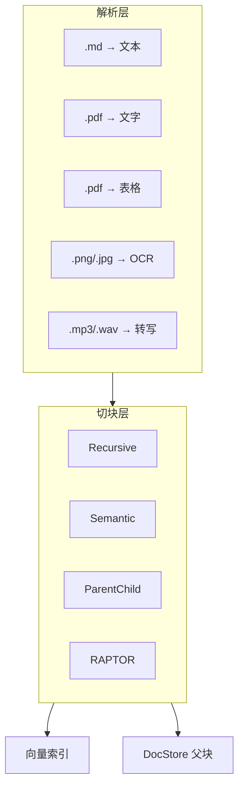
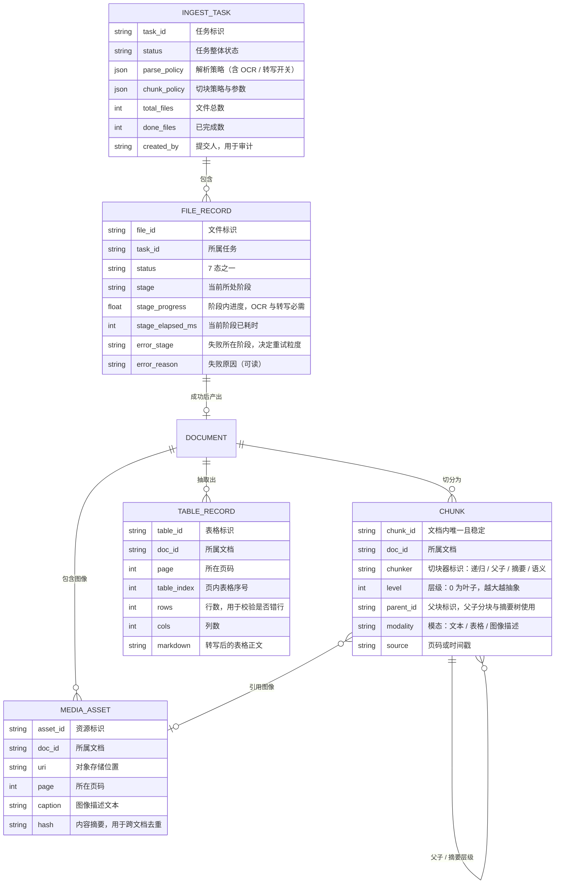
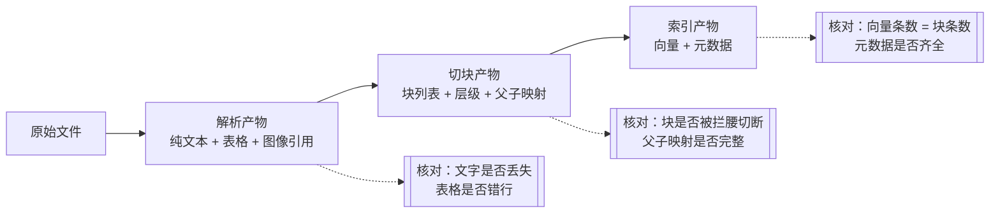
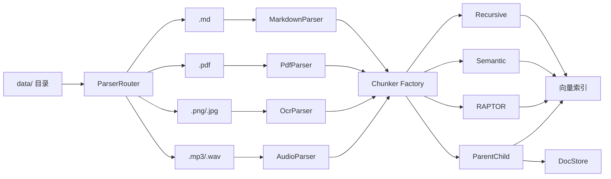
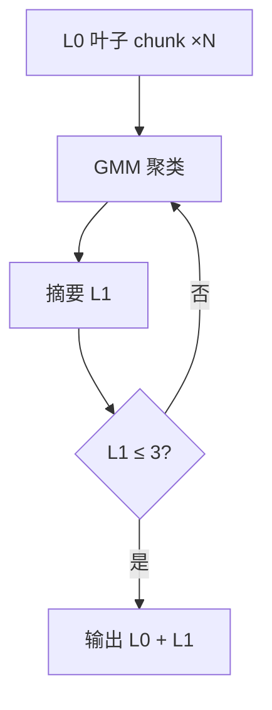
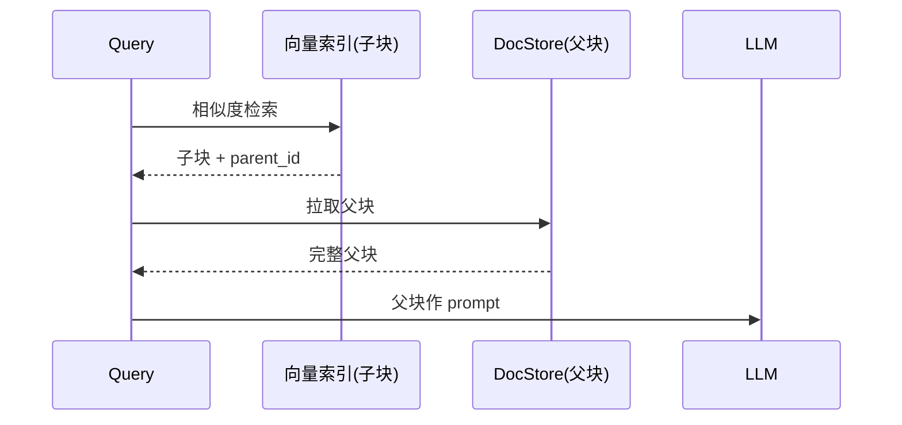

# 阶段 3：智能分块与高级检索（实现细节）

> 本阶段解决"长文档语义断裂、表格/扫描件无法入库、章节上下文丢失"三大问题。引入三种可独立启用的切块器：**递归切块、语义切块、父子分块、RAPTOR 递归摘要**，以及多模态解析层。

---

## 一、阶段定位与边界

### 1.1 业务能力范围



### 1.2 解决的核心问题

| 旧问题 | 新解法 |
| --- | --- |
| 表格被拦腰切断 | PDF 表格单独抽取 + Markdown 保留 |
| 章节上下文丢失 | 父子分块：子块检索，父块生成 |
| 跨段答案断裂 | RAPTOR 多层级摘要 |
| 扫描件无法入库 | 千问 `qwen-vl-ocr` 识别流水线 |
| 音视频无法检索 | 千问 `paraformer-v2` 语音转写 |

### 1.3 验收标准

| 指标 | 目标值 |
| --- | --- |
| 长文档（> 100 页）检索覆盖率 | ≥ 85% |
| 表格问答准确率 | ≥ 70% |
| 扫描件 OCR 准确率（中英文混合） | ≥ 90% |
| 解析吞吐量 | ≥ 5 MB/分钟/核 |

---

## 二、四种切块策略的取舍

### 2.1 策略矩阵

| 策略 | 适用场景 | 优势 | 劣势 |
| --- | --- | --- | --- |
| Recursive | 默认场景 | 简单、可预测 | 段落边界强行切断 |
| Semantic | 主题切换明显 | 保留主题完整 | 依赖 embedding 数值矩阵 |
| ParentChild | 章节结构清晰 | 召回粒度 + 上下文兼顾 | 父块需另存 |
| RAPTOR | 文档超长 (> 100 页) | 多层级摘要 | 索引构建贵 |

### 2.2 语义切块的数学原理

**核心思想**：相邻句子的语义距离超过阈值即切。

```
sentence_i 与 sentence_{i+1} 的余弦距离 = 1 - cosine(v_i, v_{i+1})
当 1 - cosine > threshold 且 buffer ≥ min_sentences → 切
```

**为什么用距离而非相似度**？

余弦相似度（cosine）范围 [-1, 1]，距离 `1 - cosine` 范围 [0, 2]。**距离越小越像，越大越不同**——和"切"的方向一致。相似度反直觉（越大越像，但阈值不直观）。

**为什么需要 min_sentences 限制**？

避免单句成块（检索粒度太细 + 上下文断裂）。**经验值 2~3**——短句不超过 3 个独块长。

**为什么需要 max_sentences 强制切**？

防止某主题内容过长时永远不切，buffer 无限膨胀。**经验值 10~15**——超过此长度上下文窗口压力大。

### 2.3 父子分块的设计取舍

**核心思路**：

- **子块**：小块（如 200 字），入向量库；
- **父块**：大块（如 1200 字），入 DocStore；
- **检索**：命中子块 → 回查父块 → 把完整父块喂给 LLM。

**为什么要分两层**？

子块粒度细 → 命中率高；父块粒度大 → 上下文完整。**只取小粒度直接喂 LLM → 上下文不足**；**只取大粒度直接检索 → 命中粗**。两层结合各取所长。

**DocStore 的存储选择**：

- 单机场景：内存字典；
- 生产场景：Redis（高速 KV）；
- 超大规模：关系数据库（可查询、可审计）。

无论哪种，DocStore 接口必须一致，**让上层代码不感知存储**。

### 2.4 RAPTOR 多层级摘要

**核心思想**：

1. 把原始 chunk 视为 L0 层；
2. 对 L0 聚类 → 每个聚类生成一个 L1 摘要；
3. 对 L1 聚类 → 每个聚类生成 L2 摘要；
4. 直到顶层节点 ≤ 3；
5. 所有层级共同进入向量索引。

**为什么需要多层级**？

- 高层摘要回答"全文主题是什么"；
- 中层聚类回答"某章节讲了什么"；
- 低层原始 chunk 回答"具体细节是什么"。

**RAPTOR 的成本**：

每层聚类 + LLM 摘要都是开销。对于 1000 个 chunk 的文档，**RAPTOR 大约多花 30~60 万 token**（每层摘要）。**只在 ingestion 阶段跑一次**，检索路径零开销。

---

## 三、多模态解析层

### 3.1 文件类型路由

```
.md / .markdown → MarkdownParser
.pdf             → PdfParser（文字 + 表格）
.png / .jpeg     → OcrParser
.mp3 / .wav      → AudioParser
```

**路由表集中在一个 Router 类中**：

- 按文件扩展名分发；
- 新增格式只需注册一个 Parser，不用改路由逻辑；
- 不支持的扩展名 → 跳过（不入库）。

**必须区分"解析库"与"模型能力"这两件事**：

| 类别 | 典型环节 | 形态 | 是否涉及模型 |
| --- | --- | --- | --- |
| **解析库** | PDF 文字抽取、表格几何识别、Markdown 切分 | 进程内的规则与几何算法 | **不涉及**，无权重、无 GPU |
| **模型能力** | 扫描件 OCR、音视频转写、图像描述、摘要生成 | **千问平台接口调用** | 是，全部走云端 |

**这条分界的意义在于**：本阶段的资源规划只需要考虑解析库的 CPU 开销，**模型能力全部由千问平台承担，不存在本地推理资源**。

### 3.2 PDF 双轨解析

**文字流**：

```
PyMuPDF 抽页面文字 → 按页生成 Document
```

**表格流**：

```
PyMuPDF find_tables → 抽成二维表 → 渲染为 Markdown 块 → 入 Document
```

**为什么表格要单独成 Document**？

表格被切块时会丢失列含义，**单独成 Document 避免被切块器破坏**。表格的 metadata 必须保留 `page`、`table_idx`，前端能精准跳转。

### 3.3 OCR 的工程考量

**扫描件识别难点**：

- 字号过小 / 倾斜 / 反白 / 多栏布局；
- 中英文混合；
- 表格线被识别成文字（噪声）。

**本项目采用千问 `qwen-vl-ocr`（阿里云百炼）**，通过接口提交页面图像并取回结构化文本，**不部署本地 OCR 模型**。这条路径带来三项直接收益：

- **免部署**：无需维护识别模型与运行环境，也就没有 GPU 资源与显存容量的规划问题；
- **版面对抗能力更强**：视觉语言模型对版面有整体理解，倾斜、多栏、反白、表格线混杂的场景比纯文字识别稳，**后处理修补的工作量显著下降**；
- **结构可保留**：可要求按阅读顺序输出并标记表格区域，从源头减少"表格线被识别成文字"这类噪声。

**仍需保留的二次清洗与保真动作**：

- 丢弃过短 token 与孤立单字符；
- 对语义不连贯的段落，**保留原始图像位置供人工核对**；
- **页码与版面坐标必须随文本一并保存**——这是后续引用跳转与人工核对的唯一依据。

**调用开销与限流**：

单页识别为秒级且计入平台调用额度，**必须走异步任务队列**（用户上传后立即返回"已入队"）。平台限流时按指数退避重试，且**重试粒度是"页"而非"文件"**——已识别完成的页不重复提交，这是大文件失败重试代价可控的关键。

### 3.4 音视频的转写策略

**转写能力采用千问 `paraformer-v2`**（阿里云百炼语音识别），通过接口提交音频并取回带时间戳的文本，**不部署本地转写模型**。

选型要点：

- **必须输出时间戳**——本阶段的核心交互是"答案跳转到视频对应位置"，**没有时间戳这个交互根本无从实现**；
- 转写质量受采样率与背景噪声影响，**入库前应先做采样率与时长检查**，不达标的音频标记为"转写质量可能不佳"而非静默入库；
- 长音频按平台时长限制切分后并行提交，**切分点应落在静音段**，避免把一句话拦腰截断；
- 音频本体进对象存储，转写文本与时间戳进元数据与向量库——**两者分开存放，与图像资源的处理方式一致**。

**转写与字幕提取**：

```
原始转写文本
    ↓
按时间戳分段："[0.0s-2.5s] 你好"
    ↓
存入 Document（metadata 含 type=audio, language=zh）
```

**时间戳的工程价值**：

用户提问"演讲在哪个时间点提到电池"——AI 检索后能把答案 + 时间戳给前端，前端跳转到视频播放器的对应位置。**这是多模态检索的独特体验**。

---

## 四、数据模型设计

本阶段引入两类全新实体（**入库任务**与**多模态资源**），并对阶段 1 的块记录做了三处扩展。

### 4.1 新增与扩展一览

| 实体 | 类型 | 作用 | 存放位置 |
| --- | --- | --- | --- |
| 入库任务 | 新增 | 描述"一批文件处理到哪一步了" | 关系库或键值存储（需可查询进度） |
| 文件记录 | 新增 | 描述"单个文件的解析状态" | 与任务同库 |
| 表格记录 | 新增 | 保留表格的行列结构与页码 | 元数据存储 + 正文进向量库 |
| 图像资源 | 新增 | 描述图像的存储位置与描述文本 | 对象存储 + 元数据存储 |
| 块记录 | **扩展** | 增加层级、父子关系、切块器标识、模态 | 向量库元数据 + 元数据存储 |
| 文档记录 | **扩展** | 状态由 2 态扩展为 7 态 | 元数据存储 |

**"任务"实体的引入是本阶段数据模型的转折点**：在它之前，入库是"一次请求一次结果"的同步操作；有了任务，入库变成**可查询、可重试、可取消、可断点续跑**的长流程。**没有任务实体，就无法向用户解释"卡在哪一步"**。

### 4.2 实体关系



### 4.3 块记录的三处扩展

| 新增字段 | 取值 | 解决的问题 |
| --- | --- | --- |
| 切块器标识 | 递归 / 父子 / 摘要 / 语义 | **同一份文档可能用不同策略重复入库，必须能区分**；前端也要按此着色 |
| 层级 | 整数，越小越具体 | 检索时可按问题抽象程度选择层级：具体问题命中叶子，概览问题命中摘要 |
| 父块标识 | 父块的标识，叶子为空 | 命中子块后**回溯父块补全上下文**，这是父子分块发挥作用的关键字段 |
| 模态 | 文本 / 表格 / 图像描述 | 前端按模态渲染不同卡片；也用于分别统计各模态的检索命中率 |

**"层级 + 父块标识"必须同时存在**：只有层级无法回溯具体父块；只有父块标识无法快速判断抽象程度。**两者缺一，父子分块与摘要树都无法真正工作**。

**表格正文以 Markdown 形式存入向量库，但行列结构另存元数据**：Markdown 让模型能直接读懂表格语义，元数据则让前端能还原成真正的表格控件——**两者服务于不同消费者，不可互相替代**。

### 4.4 状态机的字段约束

**文件记录的 7 态**：待上传 → 上传中 → 排队中 → 解析中 → 切块中 → 索引中 → 已完成，任一处理态可跳转至失败。

| 约束 | 说明 |
| --- | --- |
| 状态只能单向推进 | 不允许从"索引中"回退到"解析中"；**要重做必须新建一次任务**，否则历史进度语义会混乱 |
| 失败必须记录失败阶段 | 没有"失败阶段"就只能整批重试，代价极高；有了它才能**按阶段精准重试** |
| 阶段内进度仅在长阶段出现 | OCR 与音视频转写的耗时是分钟级，**没有阶段内进度用户会以为卡死** |
| 已完成不可取消 | 索引中及之后的阶段取消会留下半成品索引，**必须禁止**；取消只对排队与解析阶段生效 |

**"重新解析生成新版本而非覆盖"**：重新解析会改变块标识的集合，若直接在原记录上覆盖，**历史证据（引用过旧块的答案）将全部指向不存在的块**。因此重做必须产出新文档记录，旧记录标记为已下线但保留其块，供历史答案继续溯源。

### 4.5 多模态资源的建模要点

| 要点 | 做法 | 理由 |
| --- | --- | --- |
| 资源与文档分离存放 | 图像本体进对象存储，元数据进元数据库 | 图像体积大，**不能塞进数据库或向量库的元数据字段** |
| 必须保留页码 | 每张图像记录所在页 | 前端跳转与用户核对都依赖它 |
| 必须有描述文本 | 图像描述单独入库并参与检索 | 图像向量只能"以图搜图"，**要让文字问题也能命中图片，必须有描述文本** |
| 必须有内容摘要 | 记录图像内容摘要 | 同一张图在多个文档中出现时**去重入库**，避免重复占用容量与检索位 |
| 必须继承租户与权限 | 从所属文档继承 | 图像是独立的存储对象，**若不继承权限，阶段 9 的 ACL 会漏掉图像这一类** |

---

## 五、关键决策记录

### 5.1 为什么默认仍用 Recursive？

Recursive 简单、可预测、零额外开销。语义切块与 RAPTOR 都是**进阶选项**，默认开反而增加认知负担。**配置化启用**是合理选择。

### 5.2 为什么 RAPTOR 不替代 Recursive？

RAPTOR 在索引构建期耗时高，对短文档（< 50 chunk）反而降低检索粒度。**长文档才值得启用**——按"chunk 总数"阈值自动启用是更智能的做法。

### 5.3 为什么父子分块要 DocStore 而不是塞进向量库？

父子映射是**显式关系数据**，塞进向量库会污染相似度计算。**结构化数据与向量化数据应当分开存储**——这是数据建模的常识。若把父子关系编码进向量，会导致"语义上无关但父子相同的两个块"被算作相似，直接污染召回。

### 5.4 为什么表格转 Markdown 而不是 JSON？

Markdown 在 LLM 视角下与自然语言无差异，**LLM 能直接"读懂"**；JSON 需要 schema 理解，对模型压力大。但**保留原表格元数据**（行/列、页码、表格序号）是必要的，便于前端精准渲染与跳转。

### 5.5 为什么 RAPTOR 要"多层共存"而不是只保留顶层摘要？

若只留顶层摘要，则丧失细节；若只留底层块，则无法回答"全文讲了什么"。**多层共存让检索层自行选择粒度**：抽象问题命中高层，细节问题命中低层——这也是 RAPTOR 相对普通摘要的核心价值。

---

## 六、入库质量的可控性设计

阶段 3 引入了"解析 → 切块 → 索引"三段流水线，每段都会引入误差。必须在每段之后**留下可核对、可回滚的中间产物**，否则一旦下游检索效果差，无法定位是解析错、切块错还是索引错。

### 6.1 分阶段产物与核对点



### 6.2 每级的质量红线

| 阶段 | 常见误差 | 检测方法 | 红线 |
| --- | --- | --- | --- |
| 解析 | 扫描件整页识别失败、表格串行 | 比对"页数 × 平均字数"是否异常偏低；表格行列数与原 PDF 一致 | 单页文字量低于阈值即标记待复核 |
| 切块 | 块被切断、块过短/过长 | 统计块长度分布，检查超短块（< 20 字）与超长块（> 2× 目标长度）占比 | 超短块占比 > 10% 需调整切块参数 |
| 索引 | 漏块、重复块、元数据缺失 | 向量条数与块条数必须严格相等 | 不相等即**拒绝发布索引** |

### 6.3 可回滚设计

- 每次重建索引**生成新版本而非覆盖旧版本**，检索时按版本号指向；
- 新版本先以"影子模式"跑评测集，指标不退化才切换；
- 保留最近 3 个索引版本，**回滚只需切换版本号**，无需重新解析与编码。

### 6.4 解析成本与耗时的量级感知

| 文件类型 | 主要开销 | 量级参考 |
| --- | --- | --- |
| Markdown / 纯文本 | 几乎为零 | 秒级 |
| 文字型 PDF | 文字抽取 | 与页数线性 |
| 表格密集 PDF | 表格识别 | 约为文字型的 2~3 倍 |
| 扫描件（OCR） | 千问 `qwen-vl-ocr` 逐页识别 | 单页秒级，**按页计费、走异步队列** |
| 音视频 | 千问 `paraformer-v2` 转写 | 约为音频时长的 1/5~1/2，另含上传耗时 |

**异步化是硬要求**：解析与编码必须走任务队列，**用户上传后立即返回"已入队"**，前端通过任务进度页轮询。绝不能让用户在 HTTP 请求里等待 OCR 完成。

---

## 七、关键流程图

### 7.1 入库全流程



### 7.2 RAPTOR 构建



### 7.3 父子检索流程



---

## 八、与上一阶段差异

| 模块 | 阶段 2 | 阶段 3 |
| --- | --- | --- |
| 切块 | Recursive | + Semantic + ParentChild + RAPTOR |
| 解析 | Markdown / PDF 文字 | + PDF 表格 + 千问 `qwen-vl-ocr` + `paraformer-v2` 转写 |
| 索引层级 | 单层 chunk | 多层摘要 + 双层父子 |
| 检索产物 | chunk | chunk / 父块 / 摘要 |

---

## 九、本阶段遗留问题 → 下一阶段预告

| 现象 | 根因 | 下一阶段 |
| --- | --- | --- |
| 用户口语化 query 召回差 | query 与文档措辞不匹配 | 阶段 4 HyDE / RAG-Fusion |
| 多跳问题答不全 | 单 query 单检索 | 阶段 4 拆解 + 路由 |

→ 下一阶段：[`../stage-4-query-preprocessing/README.md`](../stage-4-query-preprocessing/README.md)