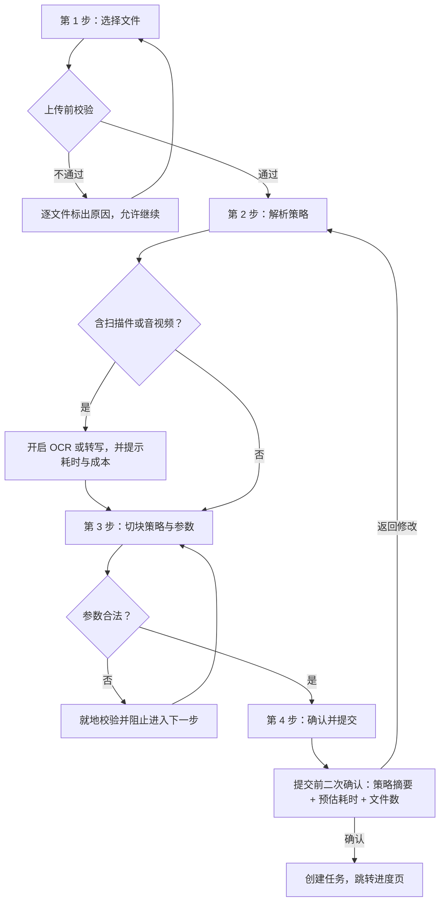
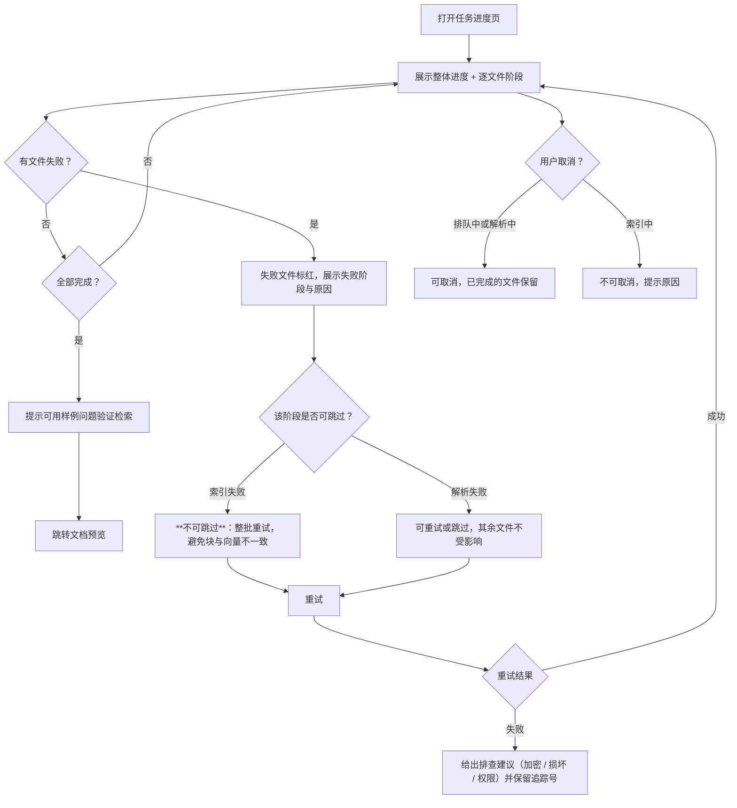
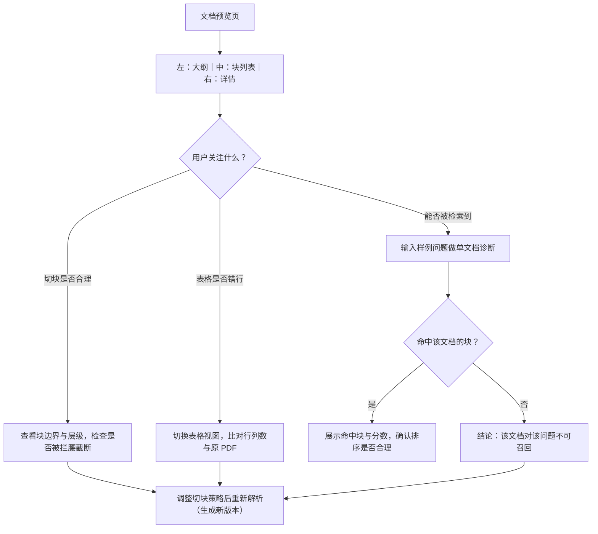

# 阶段 3 前端设计：分块可视化与多模态上传

> 本阶段在前端引入 **分块预览、文档解析过程可视化、多模态上传、表格预览**。管理员第一次能"看见"文档是怎么被处理的。

---

## 一、页面结构（增量）

| 路由 | 页面 | 角色 |
| --- | --- | --- |
| `/knowledge/upload-advanced` | 多模态上传向导 | 管理员 |
| `/knowledge/preview/:docId` | 文档解析预览 | 管理员 |

新增 `/knowledge` 中的"高级配置"按钮弹窗。

---

## 二、文档上传增量

### 2.1 多模态上传向导（`/knowledge/upload-advanced`）

**步骤式向导**，四步：

```
[1. 选择文件] → [2. 选择解析策略] → [3. 选择切块策略] → [4. 启动处理]
```

**步骤 1：选择文件**

```
┌─────────────────────────────────────────┐
│  拖拽文件到这里                           │
│  ─────────────────────────────────────  │
│  支持: .pdf, .docx, .md, .pptx,        │
│         .png, .jpg, .mp3, .wav         │
│  单文件 ≤ 50 MB                           │
│  ─────────────────────────────────────  │
│  已选择:                                 │
│  ✓ battery_manual.pdf  (2.4 MB)        │
│  ✓ specs.png           (380 KB)        │
│  [继续 →]                                │
└─────────────────────────────────────────┘
```

**关键交互**：
- 不同文件类型自动预选合适的解析策略；
- 超大文件（> 50 MB）必须给出警告但允许继续；
- 二次确认"确认继续"前的预览（仅显示文件名 + 大小）。

**步骤 2：选择解析策略**

按文件类型分栏展示：

```
PDF 类型文件
  ☑ 解法 (PyMuPDF 抽文字)
  ☑ 表格识别 (页面表格转 Markdown)
  ☐ 提取图像 (把页面图像另存)

图片文件
  ☑ OCR 识别 (千问 qwen-vl-ocr)
  语言: [中文 ▼]
  ☑ 保留版面坐标 (供引用跳转)

音频文件
  ☐ 语音转文字 (千问 paraformer-v2)
  模型: [paraformer-v2 ▼]
  ☑ 时间戳分段 (跳转到视频位置必需)
```

**步骤 3：选择切块策略**

```
切块策略
  ○ Recursive (默认)
    chunk_size: [300] overlap: [50]
  ● Semantic
    threshold: [0.4] min: [2] max: [12]
  ○ ParentChild
    parent_size: [1200] child_size: [200]
  ○ RAPTOR
    max_clusters: [4] max_top_nodes: [3]

[预览估计切块数] (根据策略推算)
```

**步骤 4：启动处理**

- 列出本次所有配置摘要（可折叠查看每条细节）；
- "提交"按钮触发后台 ingestion 任务；
- 跳转到"任务进度页"（`/knowledge/tasks/:taskId`）。

### 2.2 多模态上传的简化路径

普通 `/knowledge` 页仍提供单步上传入口：

- 拖入文件 → 后端按扩展名自动选择解析器与默认切块策略；
- 适合"先把文档塞进去再说"的高频场景。

**两条路径的关系**：简化路径 = 高级向导的"一键默认值"，二者共用同一后端任务队列与进度页，**不做两套实现**。

### 2.3 上传前校验与即时反馈

| 校验项 | 时机 | 反馈方式 |
| --- | --- | --- |
| 扩展名不受支持 | 选文件后立即 | 该文件行标红 + 说明"暂不支持 .xlsx，可先转为 CSV" |
| 单文件超限（> 50MB） | 选文件后立即 | 标黄 + "大文件解析可能需数分钟，确认继续？" |
| 批量文件数超限（> 20） | 选文件后立即 | 提示"单次最多 20 个，已自动截取前 20 个" |
| 同名文件重复 | 进入步骤 2 前 | 给出"覆盖 / 跳过 / 另存为副本"三选 |
| 同批文件类型差异大 | 进入步骤 3 前 | 提示"本批含 3 类文件，切块策略将分别应用" |

---

## 三、任务进度与失败处理

上传向导提交后进入任务进度页，本阶段的任务粒度从"文件级"细化到"阶段级"。

### 3.1 进度展示的两级结构

- **文件级**：每个文件一个折叠行，显示总体进度（排队 → 解析 → 切块 → 索引 → 完成）；
- **阶段级**：展开某文件后，显示其内部各阶段耗时与产物统计（页数、表格数、块数）。

### 3.2 失败定位与重试粒度

| 失败阶段 | 典型原因 | 重试粒度 | 是否可跳过 |
| --- | --- | --- | --- |
| 解析 | 文件损坏、加密、OCR 失败 | **单文件重试** | 可跳过该文件 |
| 切块 | 参数不合法、内容为空 | 单文件重试 | 可跳过 |
| 索引 | 编码服务不可用 | **整批重试** | 不可跳过（会造成块与向量不一致） |

**关键原则**：重试**不清空已完成产物**。已解析完成但切块失败的文件，重试时应直接进入切块阶段，而不是重新 OCR——否则大文件的失败重试代价极高。

### 3.3 任务取消语义

- 排队中取消 → 立即移出队列，无副作用；
- 执行中取消 → 完成当前最小不可分割单元后停止（如"当前页 OCR 完成"），**避免产生半成品记录**；
- 已取消的任务产物不进入索引，但保留解析产物供用户查看。

---

## 四、文档解析预览（`/knowledge/preview/:docId`）

### 4.1 布局

```
┌────────────────────────────────────────────────────┐
│ 文档名: battery_manual.pdf                [重新解析] │
├──────────┬──────────────────┬──────────────────────┤
│ 左侧:    │ 中间: 切块列表   │ 右侧: 单 chunk 详情  │
│ 文档结构 │                  │                      │
│          │ #0 "电池电压..." │ 内容:               │
│ 章节大纲 │ #1 "充电规范..." │ XB-2024 电池的标称电 │
│          │ #2 ...           │ 压为 3.7V ...         │
│ 表格索引 │                  │                      │
│          │                  │ 原文位置: 第 1 页     │
│          │                  │ 切块器: Semantic      │
│          │                  │ 父块: 跨表第 1 节     │
│          │                  │ 子块数: 4             │
│          │                  │                      │
│          │                  │ [复制] [原文预览]     │
└──────────┴──────────────────┴──────────────────────┘
```

### 4.2 左侧：文档结构

**Markdown 文档**：展示原文档的章节标题（按 # / ## 层级）。

**PDF 文档**：展示识别到的章节大纲（基于字体加粗切换检测）。

**表格索引**：所有从 PDF 抽出的表格，按页号排列。

**点击**：定位到中间列对应 chunk 并高亮。

### 4.3 中间：切块列表

**展示当前文档的所有 chunk**，每条显示：

- 序号（#0、#1...）；
- 前 50 字内容预览；
- 切块器类型（图标 + 文字）；
- 特殊 token：父块 ID、子块数、层级（RAPTOR）。

**交互**：

- 点击 → 右侧详情更新；
- 双击 → 打开"原文预览"弹窗，**高亮该 chunk 在原文中的位置**；
- 长按 → 弹出"删除该 chunk / 调整切分"操作。

### 4.4 右侧：单 chunk 详情

**字段**：
- 完整内容；
- 原文位置（页码 / 时间戳）；
- 切块器 / 父块 / 子块 / 层级；
- "复制"按钮；
- "原文预览"按钮。

### 4.5 RAPTOR 树形视图

RAPTOR 模式切块的文档，在左侧"文档结构"中显示树形：

```
📄 battery_manual (L0: 64)
│   ├── ⭐ L1 摘要-1  #0  (内含 8 个 L0)
│   │   ├── L0 #0
│   │   ├── L0 #1
│   │   └── ...
│   ├── ⭐ L1 摘要-2  #1
│   └── ⭐ L2 总览  (内含所有 L1)
└── ⭐⭐ L3 顶级摘要  #0
```

点击任意节点 → 中间列筛选显示该节点及其子节点。

### 4.6 父子分块视图

父子分块的文档，中间列显示**双层列表**：

- 父块（粗体，浅蓝背景）；
- 嵌套的子块（缩进 16px）。

点击父块 → 展开 / 折叠其子块。点击子块 → 右侧详情显示完整父块内容。

---

## 五、任务进度页布局（`/knowledge/tasks/:taskId`）

> 状态语义与重试粒度见本文档第三节，本节只描述界面布局与状态视觉。

### 5.1 布局

```
┌────────────────────────────────────────────────────┐
│ 任务 ID: t-20261001-123456                          │
│ 状态: 解析中  (文件: 3/5 完成)                     │
│ 已用: 1m 23s                                   [取消]│
├────────────────────────────────────────────────────┤
│ 文件进度                                            │
│ ✓ battery_manual.pdf 解析 1m02s   切块 23 个       │
│ ✓ specs.pdf          解析 0m58s   切块 41 个       │
│ ⏳ audio_lecture.mp3  语音转写中...                 │
│   进度: 75% (预计 0m32s)                           │
│ ⏸ product_ocr.pgm    队列中...                     │
│ ⏸ archive.zip        队列中...                     │
└────────────────────────────────────────────────────┘
```

### 5.2 状态可视化

| 状态 | 视觉 |
| --- | --- |
| 队列中 | 灰色圆点 |
| 解析中 | 蓝色旋转环 + 进度百分比 |
| 切块中 | 青色进度条 |
| 索引中 | 紫色进度条 |
| 成功 | 绿色对勾 + 耗时 |
| 失败 | 红色叉号 + hover 查看原因 |
| 已取消 | 灰色斜线 |

**关键交互**：

- 单文件"重试"按钮（仅失败状态可用）；
- 取消按钮需二次确认；
- 完成后自动跳转"解析预览"页。

---

## 六、知识库管理页增量

### 6.1 文档状态细化

阶段 1 的文件状态从 4 种细化为 **7 种**，以反映解析流水线的真实阶段：

| 状态 | 含义 | 用户可否操作 |
| --- | --- | --- |
| 待上传 | 已选择但未提交 | 可删除 |
| 上传中 | 传输中 | 可取消 |
| 排队中 | 已入队，等待处理 | 可取消 |
| 解析中 | 文字 / 表格 / OCR / 转写进行中 | 可取消 |
| 切块中 | 按所选策略切分 | 可取消 |
| 索引中 | 向量化与入库 | **不可取消**（避免半成品索引） |
| 已完成 | 可被检索 | 可重新解析 / 删除 |
| 失败 | 某阶段出错 | 可按阶段重试 / 跳过 |

### 6.2 文件行"高级操作"菜单

点击 `⋮` → 新增：

- 重新解析（使用新策略重新构建，**生成新版本而非覆盖**）；
- 查看解析详情（跳转预览页）；
- 删除索引（保留源文件，文档从检索中消失但记录仍在）；
- 删除文档（索引与源文件一并删除，需二次确认）；
- 测试检索（输入 query 看命中）。

**"删除索引"与"删除文档"必须区分**：前者用于"临时下架"（如内容待更新），后者用于彻底清理。合并成一个"删除"会让用户无法做出正确的风险判断。

---

## 七、API 契约（本阶段新增）

| 端点 | 用途 | 关键字段 |
| --- | --- | --- |
| `POST /knowledge/ingest` | 提交入库任务（向导最终提交） | 入参：文件列表 + 解析策略 + 切块策略；返回 `task_id` |
| `GET /knowledge/tasks/{id}` | 查询任务进度 | `status` / `files[]`（含各阶段状态与耗时）/ `stats` |
| `POST /knowledge/tasks/{id}/retry` | 重试 | 入参 `file_id`（可选，缺省为整批）；**返回是否清空了已完成产物** |
| `POST /knowledge/tasks/{id}/cancel` | 取消任务 | 返回 `cancelled_scope`（排队中 / 当前单元完成后停止） |
| `GET /knowledge/preview/{doc_id}` | 文档解析预览 | `outline[]` / `chunks[]` / `tables[]` / `raptor_tree` |
| `GET /knowledge/preview/{doc_id}/chunk/{chunk_id}` | 单块详情 | `content` / `position`（页码或时间戳）/ `chunker` / `parent_id` / `children[]` |
| `POST /knowledge/retrieval-probe` | 单文档检索诊断 | 入参 `doc_id` / `query` / `top_k` |

**任务进度的字段设计**：

| 字段 | 说明 |
| --- | --- |
| `files[].stage` | 当前所处阶段（七态之一） |
| `files[].stage_progress` | 当前阶段内部进度（0~1），OCR 与转写场景必需 |
| `files[].stage_elapsed_ms` | 各阶段已耗时，用于前端展示"卡在哪一步" |
| `files[].stats` | 产物统计：页数 / 表格数 / 块数 / 超短块数 |
| `files[].error_stage` | 失败时所处阶段（用于确定重试粒度） |
| `stats.estimated_remaining_ms` | 预估剩余时间，**基于已完成文件的平均速度推算** |

**错误码**：

| 错误码 | 场景 | 前端表现 |
| --- | --- | --- |
| 31xx | 文件格式不支持 | 上传前已拦截，此处为兜底 |
| 32xx | 解析失败（损坏 / 加密） | 该文件标红，展示"可跳过" |
| 36xx | 切块参数不合法 | 向导第 3 步即时校验，不应走到提交 |
| 37xx | 索引构建失败 | 整批标红，**提示不可跳过**（避免块与向量不一致） |

---

## 八、关键交互流程

### 8.1 多模态入库向导流程



**"预估耗时"必须在提交前给出**：OCR 与音视频转写可能是分钟级甚至小时级，**用户在提交前不知道要等多久，就会反复刷新或重复提交**。

### 8.2 任务进度与失败重试流程



**"索引阶段不可跳过、不可取消"是流程中必须硬编码的一条**：索引是块与向量一致性的临界区，中途放弃会留下"有块无向量"或"有向量无块"的半成品，**且这类不一致极难被察觉**。

### 8.3 文档预览与检索诊断流程



**"重新解析生成新版本"这一交互必须在界面上可感知**——用户需要知道新旧版本的关系，以及旧版本上的历史引用仍然有效。

---

## 九、视觉规范（新增）

### 9.1 切块器色板

| 切块器 | 颜色 |
| --- | --- |
| Recursive | 灰 |
| ParentChild | 蓝 |
| RAPTOR | 紫 |
| Semantic | 青 |

**用法**：chunk 列表中标签背景色与切块器颜色一致；hover tooltip 解释策略差异与适用场景。

### 9.2 RAPTOR 树形线

- 缩进线：浅灰 1px；
- 节点图标：⭐（摘要节点）/ 📄（叶子）；
- 折叠/展开：三角形 + 动画过渡；
- **层级数用缩进宽度区分**，最多缩进 3 级，更深层级折叠收纳。

### 9.3 文档状态色板

| 状态组 | 颜色 |
| --- | --- |
| 传输 / 排队（未开始处理） | 灰 |
| 解析 / 切块 / 索引（处理中） | 蓝系渐变（越靠后越深） |
| 已完成 | 绿 |
| 失败 | 红 |
| 可跳过类失败 | 橙（区别于不可跳过的红） |

---

## 十、可访问性

- 文档预览页支持**键盘方向键导航** chunk 列表；
- 表格预览必须有**表头行声明**，且**数据表与布局表要区分**（布局表不应用表格语义）；
- 任务进度通过 `aria-live="polite"` 通知屏幕阅读器，**但更新频率需节流**，避免连续播报；
- RAPTOR 树用标准树控件语义（可展开节点声明展开状态）；
- 颜色信息不能单独编码信息（必须有图标或文字辅助）。

---

## 十一、性能预算

| 指标 | 目标 |
| --- | --- |
| 上传向导响应 | ≤ 100ms（步骤切换） |
| 文档预览加载 | ≤ 1s（100 chunk 以内） |
| 任务进度页更新 | ≤ 200ms（轮询间隔） |
| RAPTOR 树渲染 | ≤ 500ms（100 节点以内） |
| 大文档（500+ 块）预览 | **必须虚拟滚动**，首屏 ≤ 800ms |

---

## 十二、本阶段交付清单

- [x] 多模态上传向导（`/knowledge/upload-advanced`，四步 + 上传前校验）
- [x] 文档解析预览（`/knowledge/preview/:docId`，三栏布局）
- [x] RAPTOR 树形视图
- [x] 父子分块双层列表
- [x] 任务进度页（两级进度 + 按阶段重试 + 取消语义）
- [x] 知识库管理页状态细化（7 态）+ 高级操作菜单（区分删除索引与删除文档）
- [x] API 契约（任务 / 预览 / 诊断端点 + 阶段统计字段）
- [x] 切块器色板与文档状态色板
- [x] 解析/切块器色板与图标系统

→ 下一阶段：[`../stage-4-query-preprocessing/frontend-design.md`](../stage-4-query-preprocessing/frontend-design.md)