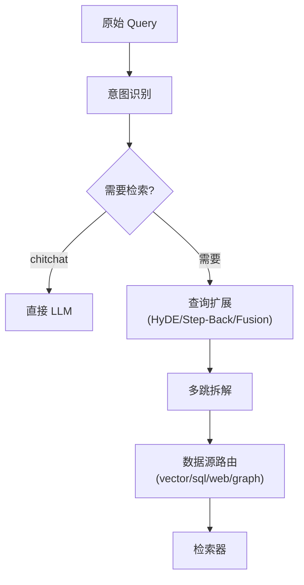
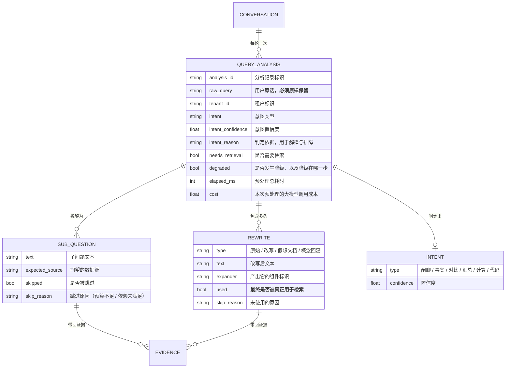
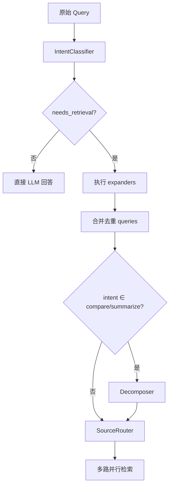
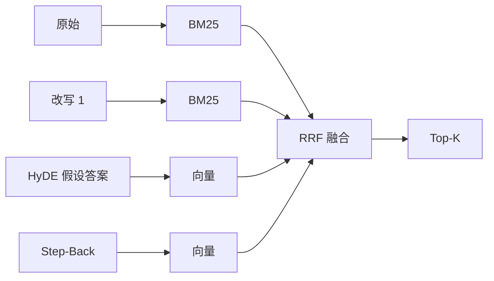
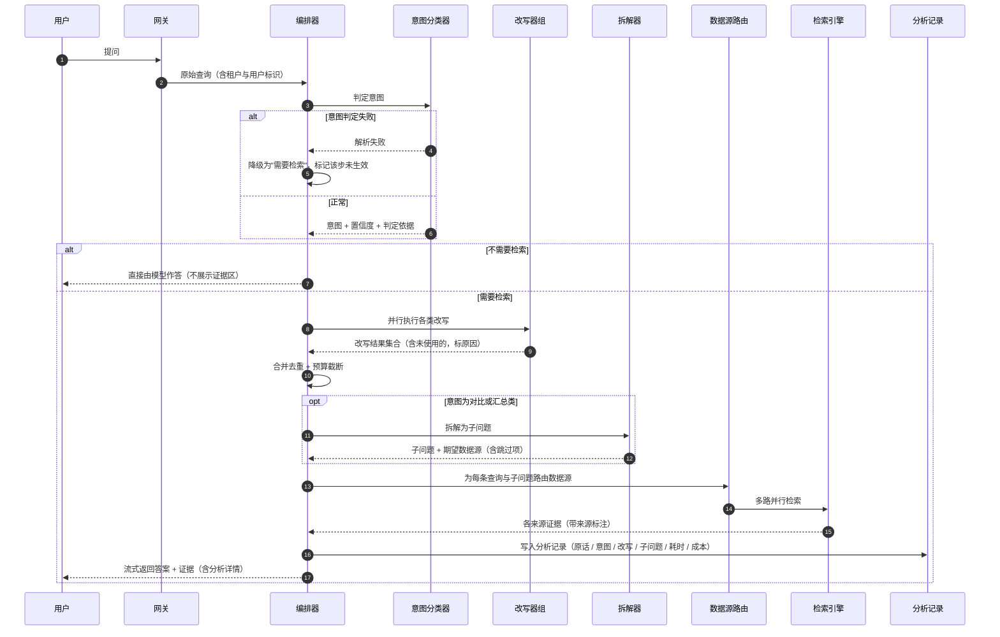

# 阶段 4：Query 理解与前置智能处理（实现细节）

> 本阶段在检索之前插入一层 **Query 处理层**——意图识别、查询改写、问题拆解、数据源路由。让用户口语化提问、复合意图问题也能精准命中。

---

## 一、阶段定位与边界

### 1.1 业务能力范围



### 1.2 解决的核心问题

| 旧问题 | 新解法 |
| --- | --- |
| 用户口语化提问召不回 | HyDE 假设答案 + Fusion 改写 |
| 用户提问太抽象 | Step-Back 抽象问题 |
| 复合问题（对比、汇总）答不全 | 多跳拆解 |
| 单一数据源不够 | 多源路由 |
| 闲聊请求浪费检索 | 意图识别 + 短路 |

### 1.3 验收标准

| 指标 | 目标值 |
| --- | --- |
| 模糊 query 召回率提升 | ≥ 20% |
| 闲聊请求检索节省率 | ≥ 30% |
| 拆解准确率（人工评估） | ≥ 85% |
| 路由准确率（人工评估） | ≥ 90% |

---

## 二、Query 预处理的整体设计

### 2.1 五步流水线

```
① 意图识别 (Intent)
② 查询改写 (Expansion)
③ 多跳拆解 (Decompose)
④ 数据源路由 (Routing)
⑤ 检索执行 (Retrieval)
```

**为什么必须先意图识别**？

闲聊与事实问答的处理路径完全不同：
- 闲聊直接 LLM，节省检索成本；
- 事实问答才走完整检索链路。

**意图识别错**的代价不大（最多浪费一次检索），**漏掉意图识别**会让闲聊请求也走完整检索，浪费严重。

### 2.2 各步骤的失败容忍

| 步骤 | 失败时如何兜底 |
| --- | --- |
| 意图识别 | 默认视为"需要检索" |
| 查询改写 | 失败则用原 query |
| 多跳拆解 | 失败则视为单跳（一个子问题） |
| 数据源路由 | 默认仅 vector |

**兜底原则**：每一步出错都不能阻塞主链路，**降级到最朴素的检索**。

---

## 三、各组件的实现细节

### 3.1 意图识别

**意图分类体系**：

```
chitchat   - 闲聊问候，与知识库无关
fact_qa    - 事实型问答
compare    - 多对象对比
summarize  - 文档总结
calc       - 涉及计算统计
code       - 代码相关
routing    - 操作工具
```

**实现方式**：

- Prompt 工程：要求千问 `qwen-turbo` 输出 JSON `{"intent": "...", "needs_retrieval": true/false, "reasoning": "..."}`；
- 字段解析：自定义 `parse_json()` 函数从模型输出提取（处理 markdown 围栏、杂文本前缀）。

**意图识别为什么用 `qwen-turbo` 而不是默认档**：

意图分类是**每次提问都会触发**的轻量判定，输入短、任务简单、对时延敏感。用最高档模型做这件事，成本与耗时都不划算；而**意图判错的代价是可控的**——本阶段已把它设计成可降级步骤。**把最频繁、最简单的一次调用压到最低档，是预处理环节最重要的成本控制**。

**为什么不用 `with_structured_output`**？

依赖厂商 function calling 能力。**用提示词 + 自定义解析更通用**——即便后续更换平台或模型档位，解析逻辑也不用改，便于横向切换。

### 3.2 HyDE（Hypothetical Document Embeddings）

**核心思想**：让千问 `qwen-plus` **先想象一个理想答案**，再用 `text-embedding-v3` 把假设答案编码成向量去检索。

**为什么假设答案的向量能匹配**？

假设答案虽然不是真实文档，但**使用的词汇、句式与真实文档接近**（同主题会用相同术语）。向量空间中，假设答案与真实文档的相似度 > 原始 query 与真实文档的相似度。

**HyDE 的局限**：

- 强依赖于模型对该主题的"先验知识"；
- 对小众、冷门领域收益小；
- 对通用领域（百科、新闻）提升显著。

**HyDE 与 Fusion 的取舍**：

不要同时使用——HyDE 把 query 变成假设答案，Fusion 又改写 query，**互相稀释**。通常二选一。

### 3.3 Step-Back Prompting

**核心思想**：把具体问题抽象成"概念性、原则性"问题，先检索抽象概念，再结合具体对象。

**典型 case**：

```
具体问题: "XB-2024 电池能用多久？"
抽象问题: "锂电池的循环寿命一般是多少？"
```

**Step-Back 的价值**：

- 检索背景知识（如"锂电池循环寿命"）→ 找到通用参数；
- 结合具体对象（如"XB-2024 是锂电池"）→ 给出具体答案。

**何时用**：

- "为什么"、"原理"类问题；
- 通用知识 + 特定对象的复合问题；
- 不适合纯事实型（"XB-2024 的序列号是多少"）。

### 3.4 RAG-Fusion 多查询改写

**核心思想**：把 query 改写成 N 个语义等价但措辞不同的版本，每个版本分别检索，融合结果。

**为什么需要多个改写**：

- 用户口语化提问 → 文档措辞规范；
- 一个改写版本可能恰好命中特殊术语；
- 多路并发检索比单路深度深。

**改写数量 N**：

- 太少（1-2）：改写质量决定上限，效果有限；
- 太多（5+）：成本高，且改写之间差异小（边际递减）；
- **经验值 N=3~4**。

**融合策略**：

各路改写的检索结果 → **RRF 融合**（阶段 2 已实现）→ 统一候选集 → `gte-rerank-v2` 精排 → Top-K。

### 3.5 多跳问题拆解

**核心思想**：复杂问题 → 多个子问题 → 分别检索 → 汇总。

**典型 case**：

```
复杂问题: "对比 A 和 B 的故障率"
子问题 1: "A 的故障率是多少"
子问题 2: "B 的故障率是多少"
子问题 3: "A 和 B 的共同指标如何比较"
```

**拆解的边界**：

不是所有问题都需要拆解。**判断标准**：
- 是否涉及多个对象 / 多段事实 / 多步骤？
- 简单问题（"电池电压多少"）不必拆解，反而浪费 LLM 调用。

**只在特定意图触发拆解**：

```
compare     - 必须拆解（每对象一个子问题）
summarize   - 通常拆解（多份文档分别摘要）
fact_qa     - 通常不拆
calc        - 通常不拆
```

### 3.6 数据源路由

**可路由的数据源**：

```
vector   - 文档知识库（默认）
sql      - 业务数据库（数字、统计）
web      - 联网搜索（时效信息）
graph    - 知识图谱（实体关系）
```

**路由决策**：

每个子问题自带 `expected_source`（拆解时 LLM 推荐），路由层采纳并去重；**特殊意图强制加入某源**：

```
intent=calc → 强制加入 sql
intent 中提及 "最新" / "今天" → 强制加入 web
```

**兜底**：

如果拆解为空或所有 source 未知，至少包含 vector（不能让所有请求都"无源可查"）。

---

## 四、JSON 解析的容错设计

LLM 输出 JSON 经常"不干净"：

```
1. 包在 markdown 围栏里: ```json {...} ```
2. 前后杂文本: "分类结果：{...} 以上。"
4. 注释偶尔错位
```

**容错策略**：

1. 剥离 markdown 围栏（正则提取 ``` 之间的内容）；
2. 找到第一个 `{` 或 `[`，到最后一个 `}` 或 `]` 截取；
3. JSON 解析；
4. pydantic 校验。

**解析失败的处理**：

- 重试（计数器错位少见，重试常成功）；
- 多次失败 → 降级到最朴素路径（用默认答案继续）。

---

## 五、数据模型设计

本阶段引入的核心实体是**查询分析记录**——它把"用户原话到检索输入"之间的全部加工过程固化下来，使这段过去是"黑盒"的逻辑变得可观测、可复盘、可回归。

### 5.1 新增实体一览

| 实体 | 作用 | 存放位置 | 生命周期 |
| --- | --- | --- | --- |
| 查询分析记录 | 记录一次提问的完整理解结果 | 分析历史表 / 日志（抽样留存） | 按审计策略滚动 |
| 改写条目 | 一条改写的类型与文本 | 内嵌于分析记录 | 随分析记录 |
| 子问题 | 拆解产物及其路由结果 | 内嵌于分析记录 | 随分析记录 |
| 意图判定 | 意图类型与置信度 | 内嵌于分析记录 | 随分析记录 |

**把改写与子问题"内嵌"而非独立成表**，是因为它们**只能依附于某次分析存在**，不存在跨分析复用的场景。独立成表会带来无意义的连接开销；而当阶段 9 需要统计"哪类改写更有效"时，从分析记录中聚合即可。

### 5.2 实体关系



### 5.3 关键字段的约束

**查询分析记录**：

| 字段 | 约束 | 说明 |
| --- | --- | --- |
| 原话 | **原样保留，不得规范化** | 一旦对原话做去噪、纠错，就无法复盘"用户到底问了什么"；**纠错结果应作为一条改写体现，而非覆盖原话** |
| 降级标记 | 必须能表达"哪一步降级了" | 只用一个布尔表示"是否降级"不够——前端与运营都要知道**是意图识别、改写还是拆解失效** |
| 耗时与成本 | 必须记录 | 预处理会额外调用模型，**这是最容易被忽略的成本项**：一次提问多花两三次调用，成本可能翻倍 |

**改写条目**：

| 字段 | 约束 | 说明 |
| --- | --- | --- |
| 是否被真正使用 | 必填 | 生成了改写但未用于检索的情况很常见（预算截断、去重合并）。**不区分"生成"与"使用"，会高估改写的收益，也会掩盖预算设置过紧的问题** |
| 未使用原因 | 使用为假时必填 | 排查"为什么这条改写没生效"的唯一线索 |

**子问题**：

| 字段 | 约束 | 说明 |
| --- | --- | --- |
| 期望数据源 | 必填 | 决定路由到哪一路检索；**缺失会导致所有子问题都走默认路，路由设计形同虚设** |
| 跳过标记与原因 | 必填（默认不跳过） | 拆解出的子问题因预算或依赖被跳过时，**必须如实记录**——否则用户会认为系统"漏答"了某一部分 |

**证据（本阶段扩展）**：

| 新增字段 | 语义 | 用途 |
| --- | --- | --- |
| 来源标注 | 该证据由哪条改写或哪个子问题带回（含类型与文本摘要） | 前端按来源分组展示；**出现"某条改写召回的全是无关内容"时能立刻定位并关闭该改写** |

**来源标注是双向定位的支点**：从证据能回溯到改写，从改写也能聚合出它贡献了哪些证据。**没有这层关联，"哪条改写有用"就只能靠猜**。

### 5.4 数据保留的特殊考量

| 数据 | 敏感度 | 保留建议 |
| --- | --- | --- |
| 原话 | **高**（含用户真实输入） | 与对话记录同策略，按最小化原则留存的期限一致 |
| 改写与子问题 | 中（由模型生成） | 可抽样留存用于回归评测，无需全量 |
| 意图判定 | 低 | 全量保留用于统计，不含原文即可 |

**抽样留存的两个用途**：一是构建"真实查询集"用于回归——**从线上真实提问里抽样，比人工编评测集更贴近实际**；二是复盘典型失败案例。全量留存既无必要，也放大了个人信息风险。

### 5.5 建模带来的一个额外收益

把预处理结果结构化之后，**"预处理"从一段代码变成了可回放的数据**。这带来两项能力：

1. **离线回放**：用历史分析记录重跑，可验证"换了改写策略后，召回是否真的变好"，而不必等线上流量；
2. **定向回归**：挑选出错的分析记录单独重放，**这是排查预处理问题最快的方式**——比在线上反复试错成本低得多。

**代价是必须保证记录的可回放性**：因此记录里必须带上**当时的策略版本**，否则用新策略回放旧记录，结论没有意义。

---

## 六、关键决策记录

### 6.1 为什么不用 LangChain QueryAnalysis 类？

LangChain 的 QueryAnalysis 是单一模型驱动的硬编码实现，**自定义能力受限**。本阶段自定义五个独立模块（IntentClassifier、HydeExpander 等），**每个都可注入、可测试、可替换**。

### 6.2 为什么拆解是 optional？

强制拆解会让简单问题消耗 2-3 倍 LLM 调用。**默认不拆，按需拆**是工程上的平衡。

### 6.3 为什么不一次性扩展 8 个改写？

边际效益递减 + 延迟增长。**N=3 是经验最优点**，配合 RRF 融合能让召回率提升 ≥ 20%。

### 6.4 路由 SQL 是否安全？

SQL 是结构化数据库的入口，**必须受限于 ORM 或受限语法**。本阶段路由 SQL 仅指"自然语言转 SQL 后查询"，**不开放自由 SQL**，避免注入。

---

## 七、关键流程图

### 7.1 编排器决策流



### 7.2 多路改写 → RRF



### 7.3 预处理端到端时序

时序图关注的是**"谁在什么时候调用了谁、失败时怎么走"**，补充上面两张图缺失的时序与降级信息。



**降级路径在图中的位置说明了设计意图**：意图判定失败后被降级——**这是一条与主链路平行的分支，而不是异常出口**。整条链路上没有"因为预处理失败而中断请求"的分支，这是本阶段最重要的流程约定。

---

## 八、与上一阶段差异

| 模块 | 阶段 3 | 阶段 4 |
| --- | --- | --- |
| 检索入口 | 原 query | 预处理后的 query 集 |
| query 数 | 1 | 1+N |
| 闲聊处理 | 也走检索 | 短路直答 |
| 复合问题 | 单 query | 拆解多跳 |
| 数据源 | 仅向量 | 路由多源 |

---

## 九、本阶段遗留问题 → 下一阶段预告

| 现象 | 根因 | 下一阶段 |
| --- | --- | --- |
| 证据不足仍硬答 | 无生成前评估 | 阶段 5 CRAG |
| 答案与证据矛盾不自知 | 无幻觉自检 | 阶段 5 自检 + 重生成 |

→ 下一阶段：[`../stage-5-self-reflection/README.md`](../stage-5-self-reflection/README.md)