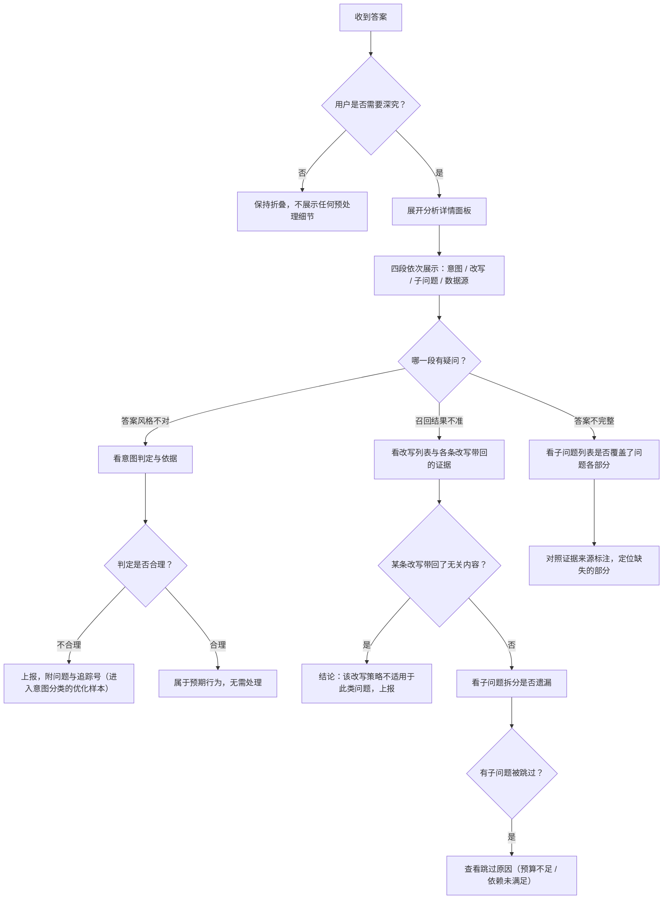
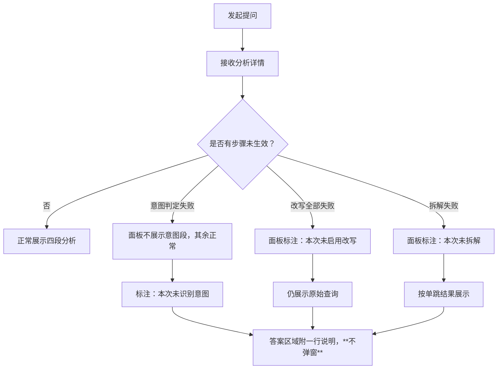

# 阶段 4 前端设计：Query 改写预览与意图标签

> 本阶段在前端引入 **意图识别展示、查询改写预览、子问题拆解可视化、数据源路由状态**。用户第一次能看到"系统对我的问题做了什么处理"。

---

## 一、页面结构（增量）

| 路由 | 页面 | 角色 | 变更类型 |
| --- | --- | --- | --- |
| `/` | 对话页 | 全部用户 | **增强**：新增"分析详情"折叠面板 |
| `/knowledge/query-analysis` | Query 分析历史 | 管理员 | **新增**：查看改写与路由记录 |
| `/knowledge` | 知识库管理 | 管理员 | **增强**：新增 Query 模式分析卡片 |

本阶段**不新增独立的一级导航**，所有前端能力都附着在已有的对话页与知识库页上——这与"每阶段只暴露该阶段必要复杂度"的原则一致。

---

## 二、对话页增量改动

### 2.1 顶部状态栏

```
┌──────────────────────────────────────────────────────┐
│ 当前对话                              ⚙ 分析详情      │
└──────────────────────────────────────────────────────┘
```

每次问答响应后，**顶部出现一条折叠的"分析详情"条**，点击展开。

### 2.2 分析详情面板

```
┌─────────────────────────────────────────────────────────┐
│  🔍 Query 分析                                           │
│  ─────────────────────────────────────────────────────  │
│  原始问题:                                               │
│  "那个老王说的红头文件到底在哪？"                          │
│                                                         │
│  意图识别: [对比] [需检索]                  置信度 92%  │
│                                                         │
│  查询改写:                                              │
│  → [原始] 那个老王说的红头文件到底在哪？                  │
│  → [改写1] 红头文件存档位置                                │
│  → [改写2] 内部规章 文件 路径                              │
│  → [改写3] 文档库 红头文件 位置                            │
│  → [Step-Back] 文件档案管理的通用原则                      │
│  → [HyDE] 红头文件通常存放在公司文档中心的归档柜 ...      │
│                                                         │
│  多跳拆解:                                              │
│  ├── [子问题 1] 老王是谁？                          [vector]│
│  ├── [子问题 2] 红头文件是什么？                    [vector]│
│  └── [子问题 3] 文件当前位置？                      [sql]   │
│                                                         │
│  数据源路由:                                            │
│  ✓ vector  ✓ sql                                       │
└─────────────────────────────────────────────────────────────────┘
```

### 2.3 改写前后对比 (QueryRewriteDiff)

**视觉**：
- 原始 query 一行（粗体）；
- 每个改写一行，前缀箭头（→）；
- **每个改写**右侧有"小"展开样式按钮：点击展开完整文本（如果是 HyDE 可能很长）；
- **改写颜色**对应到后续"哪一路检索命中"——前端按改写 type 上色：
  - 原始 = 灰
  - 改写 = 蓝
  - HyDE = 紫
  - Step-Back = 琥珀

**交互**：
- 鼠标悬停改写 → 显示"由哪个 Expander 生成";
- 点击改写 → 在 EvidenceCard 列表中**只高亮该改写命中的证据**（让用户看清"这个改写有没有用"）；
- 双击改写 → 弹出"复制到剪贴板"。

### 2.4 意图标签 (IntentBadge)

**视觉**：

- 圆形胶囊，背景色按意图类型：
  - `chitchat` = 灰
  - `fact_qa` = 蓝
  - `compare` = 紫
  - `summarize` = 青
  - `calc` = 绿
  - `code` = 琥珀
- 文字白色，`font-weight: 500`；
- 右侧"需检索 / 短路"小红点 / 灰点。

**交互**：

- 鼠标悬停 → 显示"判断依据（reasoning 字段）"。

### 2.5 子问题列表 (SubQuestionList)

**视觉**：

- 树状结构，每个子问题独立行；
- 缩进对齐展示；
- 右侧"数据源标签"（vector / sql / web / graph 各自图标 + 颜色）。

**交互**：

- 点击子问题 → 展开该子问题的检索详情（独立 EvidenceCard 列表）；
- 子问题被 LLM 标注"跳过"（如 chitchat）→ 灰色斜体 + 折叠。

---

## 三、检索证据列表分组化

**触发**：在 EvidenceCard 列表中，每条证据需显示它是从哪一路检索命中。

```
[证据卡片 1]
  来源: 改写1 (BM25 检索)
  分数: 0.92
  
[证据卡片 2]
  来源: HyDE (向量检索)
  分数: 0.87
  
[证据卡片 3]
  来源: 子问题 2 - "红头文件是什么" (向量检索)
  分数: 0.85
```

**视觉**：

- 每条证据左上角小标签，注明来源路径；
- 颜色与改写列表对应。

**交互**：

- 鼠标悬停 → 路径 tooltip；
- 点击来源标签 → 在分析详情面板中**滚动到对应改写/子问题并高亮**。

---

## 四、Query 分析历史（`/knowledge/query-analysis`）

### 4.1 布局

```
┌────────────────────────────────────────────────────────┐
│ Query 分析历史      时间: [近 1h ▼]  [过滤]            │
├────────────────────────────────────────────────────────┤
│ 表格:                                                 │
│ 时间       │ 用户   │ 意图  │ 改写数 │ 子问题数 │ 耗时 │
│ 12:34:56  │ alice  │ 对比 │ 3     │ 3       │ 2.4s │
│ 12:34:45  │ bob    │ 闲聊 │ 0     │ 0       │ 0.8s │
│ ...                                                    │
├────────────────────────────────────────────────────────┤
│ 点击行 → 展开详情：原始 query / 改写列表 / 路由结果     │
└────────────────────────────────────────────────────────┘
```

### 4.2 列说明

- **时间**：精确到秒；
- **用户**：租户主键（脱敏展示）；
- **意图**：IntentBadge；
- **改写数**：N 个 query 扩展；
- **子问题数**：拆解出的子问题数；
- **耗时**：从 question 端到答案端。

### 4.3 详情展开

点击行 → 在表格下方展开，显示：
- 完整字段（raw query、改写列表、子问题、路由结果）；
- 命中证据数 / 总证据数；
- 缓存命中状态。

### 4.4 过滤

按：
- 租户；
- 意图类型；
- 是否检索（needs_retrieval = true/false）；
- 时间范围。

---

## 五、知识库管理页增量

### 5.1 Query 模式分析

新增一个分析卡片：

```
┌──────────────────────────────────────┐
│ Query 模式分析                         │
│ ──────────────────────────────────── │
│ 占比  |  意图                          │
│ 42%   |  [fact_qa] 事实问答          │
│ 18%   |  [compare] 对比              │
│ 15%   |  [chitchat] 闲聊（短路）      │
│ 12%   |  [calc] 计算                 │
│  8%   |  [summarize] 总结          │
│  5%   |  其他                        │
└──────────────────────────────────────┘
```

**用途**：帮助管理员了解知识库的"被提问模式"，识别**闲聊占比异常**（可能知识库语义不清）或**计算占比异常**（需要 SQL 接入）。

---

## 六、API 契约（本阶段新增）

**响应字段扩展（挂在已有的问答响应上）**：

| 字段 | 类型 | 说明 |
| --- | --- | --- |
| `analysis.intent` | 枚举 | 意图类型 |
| `analysis.intent_confidence` | 浮点 | 意图判定置信度 |
| `analysis.needs_retrieval` | 布尔 | 是否走检索；为假时前端**不展示证据区** |
| `analysis.intent_reason` | 文本 | 判定依据（用于 tooltip，**默认折叠**） |
| `analysis.rewrites[]` | 数组 | 每条含 `type`（原始 / 改写 / HyDE / Step-Back）、`text`、`expander` |
| `analysis.sub_questions[]` | 数组 | 每条含 `text`、`expected_source`、`skipped`、`skip_reason` |
| `analysis.sources[]` | 数组 | 最终使用的数据源集合 |
| `evidence[].origin` | 对象 | 该证据由哪条改写或哪个子问题带回（用于分组与双向定位） |

**新增端点**：

| 端点 | 用途 | 关键字段 |
| --- | --- | --- |
| `GET /knowledge/query-analysis` | 分析历史列表 | 入参：时间范围 / 意图 / 是否检索；返回 `raw_query` / `intent` / `rewrite_count` / `sub_question_count` / `elapsed_ms` |
| `GET /knowledge/query-analysis/{id}` | 单条详情 | 完整字段（改写列表、子问题、路由结果、命中证据数） |
| `GET /knowledge/query-patterns` | 意图分布统计 | `intent` / `ratio` / `count` / `avg_latency_ms` |

**错误码**：

| 错误码 | 场景 | 前端表现 |
| --- | --- | --- |
| 46xx | 意图识别失败（模型输出不可解析） | **静默降级**为"需要检索"，前端不展示分析面板的意图部分，其余正常 |
| 47xx | 查询改写全部失败 | 降级为使用原始查询，分析面板标注"未启用改写" |
| 48xx | 拆解失败 | 降级为单跳（单个子问题），分析面板标注"未拆解" |

**降级是本节的核心契约**：前置处理的每一步失败都**不能中断主链路**，且必须在前端**如实标注"本步未生效"**——否则用户会误以为系统做了改写而给出错误归因。

---

## 七、关键交互流程

### 7.1 分析详情的查看流程

前置处理是"隐形的"，用户只有主动展开才能看到。因此**前端的关键在于"让用户在想深究时能找到，但不打扰日常使用"**。



**"某条改写是否带回证据"这个观察点是本阶段最有价值的交互**：它把"改写有没有用"从主观判断变成了可观察的事实。**只展示改写文本而不展示它带来的证据，用户无法判断改写的价值**。

### 7.2 降级状态的交互流程



**降级的提示强度必须克制**：降级影响的是"理解质量"而非"能否使用"，因此用**面板内的标注 + 答案区一行说明**即可。**弹窗会使用户高估问题的严重性**，而完全不提示又会让用户在错误归因下排查（以为是自己问得不好）。

---

## 八、视觉规范（新增）

### 8.1 改写类型色板

| 类型 | 颜色 | 图标 |
| --- | --- | --- |
| 原始 | `#64748B` | 💬 |
| 改写 | `#3B82F6` | ✏️ |
| HyDE | `#8B5CF6` | 🔮 |
| Step-Back | `#F59E0B` | ⬆ |

### 8.2 数据源色板

| 源 | 颜色 | 图标 |
| --- | --- | --- |
| vector | `#3B82F6` | 📚 |
| sql | `#10B981` | 🗄 |
| web | `#06B6D4` | 🌐 |
| graph | `#EC4899` | 🔗 |

**用法**：标签背景浅色（10% 透明度），文字深色（前色）。

### 8.3 意图色板

| 意图 | 颜色 |
| --- | --- |
| chitchat | 灰 |
| fact_qa | 蓝 |
| compare | 紫 |
| summarize | 青 |
| calc | 绿 |
| code | 琥珀 |

**约束**：意图色板与数据源色板**不得复用同一组颜色**——两者经常同时出现在一个面板中，同色会造成误读。

---

## 九、可访问性

- 改写列表提供**键盘上下方向键**快速浏览（**不使用 Ctrl 组合键**，避免与浏览器快捷键冲突）；
- 展开/折叠分析详情用 `aria-expanded`；
- 子问题列表用标准树控件语义（可展开节点声明展开状态）；
- 数据源标签必须有 `aria-label`（图标本身不足以表达含义）；
- 意图标签与数据源标签除颜色外必须有文字。

---

## 十、性能预算

| 指标 | 目标 |
| --- | --- |
| 分析详情面板展开 | ≤ 100ms |
| 改写列表渲染 | ≤ 200ms（10 行内） |
| Query 分析历史加载 | ≤ 500ms（首屏） |
| 子问题列表渲染 | ≤ 150ms（20 项内） |

---

## 十一、本阶段交付清单

- [x] 对话页"分析详情"折叠面板（意图 / 改写 / 子问题 / 路由四段）
- [x] QueryRewriteDiff 组件（改写前后对比 + 按类型着色）
- [x] IntentBadge（意图标签 + 判定依据 tooltip）
- [x] SubQuestionList（子问题列表 + 数据源标签 + 跳过态）
- [x] 数据源路由标签
- [x] 证据列表按来源分组（每条证据标注改写或子问题来源，支持双向定位）
- [x] Query 分析历史（`/knowledge/query-analysis`）
- [x] 知识库管理页 Query 模式分析卡片
- [x] API 契约（分析字段扩展 + 历史查询端点 + 三步降级语义）

→ 下一阶段：[`../stage-5-self-reflection/frontend-design.md`](../stage-5-self-reflection/frontend-design.md)