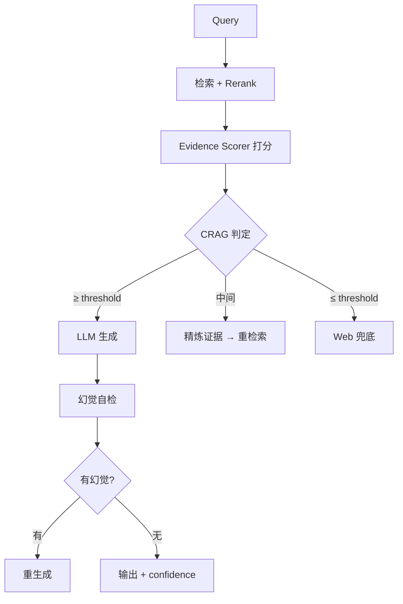
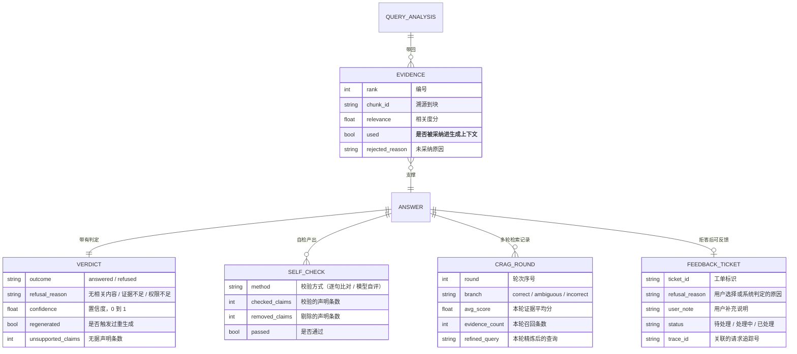
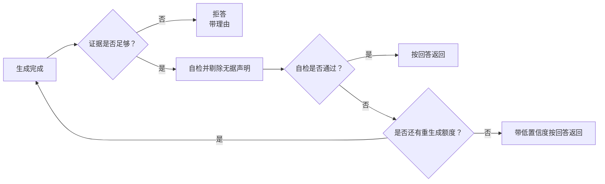
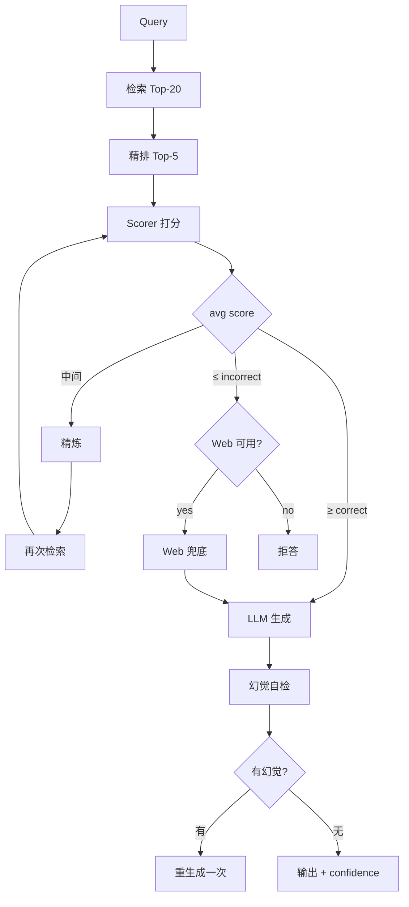
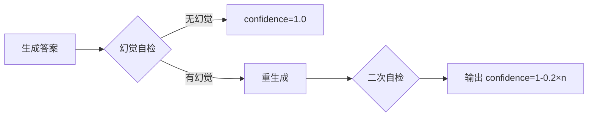
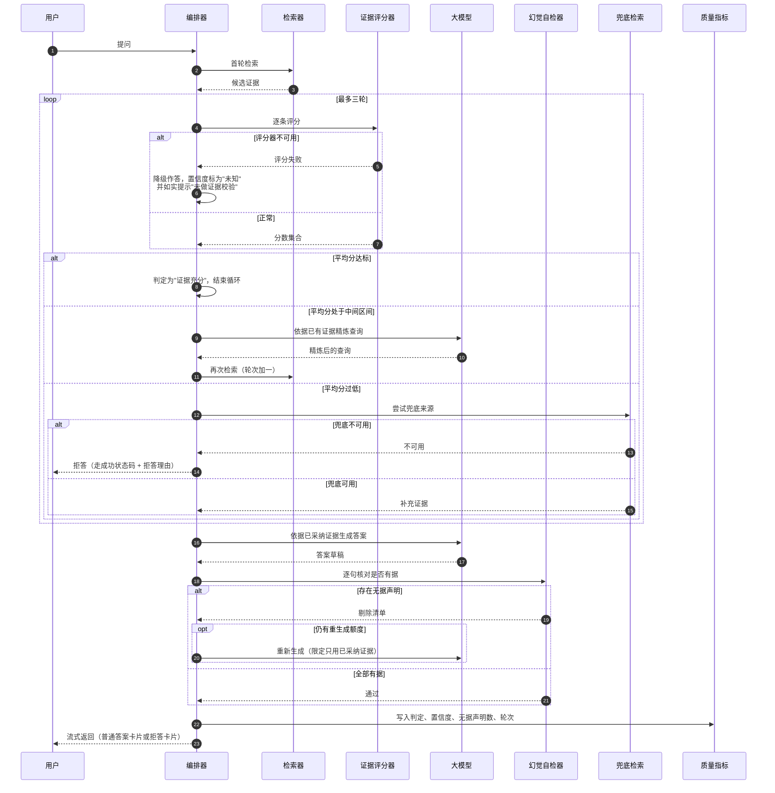

# 阶段 5：自反思 Self-RAG 与 CRAG（实现细节）

> 本阶段解决"LLM 在证据不足时仍强行作答、答案与证据矛盾"两大幻觉风险。引入 **CRAG 三分支路由器、证据评分器、幻觉自检器、受限重生成、显式拒答**。

---

## 一、阶段定位与边界

### 1.1 业务能力范围



### 1.2 解决的核心问题

| 旧问题 | 新解法 |
| --- | --- |
| 检索 Top-K 全噪声仍硬答 | CRAG incorrect 触发 Web/拒答 |
| 证据部分相关被强行拼凑 | CRAG ambiguous 触发精炼 + 重检索 |
| 答案与证据矛盾不自知 | 幻觉自检 |
| LLM 编造引用 | 引用编号强制绑定 |
| 单一置信度难辨 | 0.0~1.0 confidence 显式输出 |

### 1.3 验收标准

| 指标 | 目标值 |
| --- | --- |
| Faithfulness（答案-证据一致性） | ≥ 0.85 |
| 幻觉率 | ≤ 8% |
| 拒答准确率（应拒即拒） | ≥ 85% |
| 不必要的二次检索 | ≤ 20% |

---

## 二、Self-RAG 与 CRAG 的范式选择

### 2.1 两种范式的取舍

**Self-RAG**（Asai et al., 2023）：
- 训练 LLM 输出"反思 Token"（Retrieve、IsRel、IsSup、IsUse）；
- 优势：原生集成、推理时无额外 LLM 调用；
- 劣势：必须重训模型、跨厂商不可用。

**CRAG**（Yan et al., 2024）：
- 使用外挂评分器做"是否需要新检索"的二分类；
- 优势：训练无关、可插件化、跨厂商可用；
- 劣势：评分器本身是另一个 LLM 调用。

**本阶段选 CRAG**：

- 工程友好：评分器可调用平台重排接口，也可换成更轻量的判定方式；
- 可调节：阈值来自离线评测集；
- 可降级：评分器故障时回退到无评分模式。

### 2.2 Self-RAG 反思 Token 的工程化实现

虽然我们用 CRAG 的形式，但保留 Self-RAG 的反思 Token 语义——通过 Prompt 让 LLM 输出结构化字段：

```
{
  "evidence_score": 0.85,
  "next_action": "continue | replan | answer",
  "reasoning": "证据已经覆盖了用户的问题，可以生成答案。"
}
```

**这样既不重训模型**，又保留了 Self-RAG 的"显式决策"语义。

---

## 三、CRAG 三分支路由器

### 3.1 三分支语义

| 分支 | 平均分范围 | 行动 |
| --- | --- | --- |
| **correct** | ≥ correct_th | 直接生成答案 |
| **ambiguous** | incorrect_th < avg < correct_th | 精炼证据 + 重检索 |
| **incorrect** | ≤ incorrect_th | Web 兜底 / 拒答 |

### 3.2 阈值选择

阈值不能拍脑袋，必须基于**离线评测集**的分数分布反推：

1. 准备 150~200 条样本，其中一半是"知识库确实有答案"的问题，一半是"知识库无答案、应当拒答"的问题；
2. 对每条样本跑一遍检索与评分，记录其证据平均分；
3. 把两组平均分画成直方图，观察各自的位置与重叠区；
4. 上阈值取"有答案组"平均分的 25% 分位数——保证 **75% 的正常问题能直接作答**；
5. 下阈值取"无答案组"平均分的 75% 分位数——保证 **75% 的噪声问题会被判为不合格**。

**经验值**：上阈值约 0.7，下阈值约 0.3。真正的取值必须落到自己的评测集上——**不同领域（法规文本 vs 技术手册）的分数分布差异极大**，直接套用他人阈值是常见的失败来源。

**两个阈值的取舍方向相反**：

- 上阈值调高 → 更多问题落入"中间区"走二次检索，**质量上升但时延与成本上升**；
- 上阈值调低 → 更多问题直接生成，**快但幻觉风险上升**；
- 下阈值调高 → 更多问题被判不合格走兜底或拒答，**保守但可能误拒**；
- 下阈值调低 → 更多噪声证据进入生成，**看似"能答"实则更容易编**。

### 3.3 三分支的后续动作

| 分支 | 后续动作 | 是否消耗 LLM 调用 | 是否可能拒答 |
| --- | --- | --- | --- |
| **correct** | 直接进入生成环节 | 是（生成 1 次） | 否 |
| **ambiguous** | 精炼查询 → 重新检索 → 重新评分，形成循环 | 是（每次循环 +1 次评分/精炼） | 是（达到循环上限后） |
| **incorrect** | 若接入外部检索则用外部结果兜底生成；否则直接拒答 | 视配置 | 是 |

**循环上限是必需的**：若无上限，模糊问题会在"精炼—检索—仍模糊"之间无限循环。上限建议取 2——**第二次仍不达阈值意味着问题不在检索措辞，而在知识库本身没有相关内容**，继续精炼只是空烧成本。

**兜底来源的选择原则**：优先使用**受控的内部来源**（如另一知识库、结构化数据库），最后才考虑外部检索。原因有四：内部来源可信度与合规性更可控；外部结果需要额外的可信度评估；引入外部依赖会拉长时延；一旦外部不可用必须能优雅降级到拒答。**任何兜底都要有超时与失败回退**。

### 3.4 精炼证据 (Refine) 的本质

**精炼产物不是给用户的，而是给下一轮检索的查询线索**。看一个具体例子：

| 环节 | 内容 |
| --- | --- |
| 原始问题 | "电池能用多久" |
| 本轮命中的片段 | "……循环寿命为 500 次……" |
| 精炼后的查询 | "锂电池循环寿命的通用参数与影响因素" |

下一轮检索使用"锂电池循环寿命"作为查询，**更容易命中通用原理类资料**；而用户的原始口语表述在文档中根本不会出现，继续用原查询重检一百次也是同样结果。

**这就是 CRAG 与"反复问同一个问题"的本质区别**：CRAG 的每一轮都在**改变提问角度**，而不是重复提问。

**这是 CRAG 与"反复问同一个问题"的本质区别**。

---

## 四、幻觉自检器

### 4.1 自检的本质

```
证据: [文档 A、文档 B、文档 C]
答案: "电池电压 5V，容量 5000mAh。"
自检: 每条事实声明是否能在证据中找到字面支持？
  - "电压 5V" → 证据中无 → unsupported
  - "容量 5000mAh" → 证据中有 → supported
```

**输出**：

```
{
  "is_hallucination": true,
  "unsupported_claims": ["电压 5V"],
  "reasoning": "证据中未提及 5V"
}
```

### 4.2 重生成的边界

**只重生成一次**——避免"自检-重生成"无限循环。

**重生成的策略**：

- 把 unsupported_claims 显式列给 LLM；
- 强制 LLM 删除或改写这些声明；
- 二次自检：如仍有声明无据 → 如实输出，并同步下调置信度，**不允许掩饰或反复"修"到看起来没问题**。

### 4.3 自检的失败模式

**LLM-as-judge 不保证 100% 正确**：

- 证据中字面找不到但语义支持的情况（自检误判）；
- 证据完整但 LLM 看错了（自检误报）；
- 自检失效时**不应完全依赖它**——它是"二次校验信号"，不是"唯一真理"。

---

## 五、评分器的设计与选型

CRAG 与幻觉自检都依赖"给一段文本打分"的能力。这个能力可以有不同的实现档次，它们的**成本、时延、稳定性**差别很大，必须按业务量级选择。

### 5.1 三种评分类实现

| 实现 | 原理 | 时延量级 | 相对成本 | 适用场景 |
| --- | --- | --- | --- | --- |
| **平台重排接口** | 调用千问 `gte-rerank-v2`，返回相关度分 | 百毫秒/批 | 低（按调用量计费） | 对证据相关度打分，**首选** |
| **轻量判别模型** | 以规则或统计特征在向量相似度上判定 | 十毫秒级 | 极低 | 海量请求、对精度要求中等 |
| **大模型判定** | 提示千问 `qwen-plus` / `qwen-turbo` 输出结构化判定 | 秒级 | 高（按 token 计费） | 幻觉自检、需要解释理由的场景 |

**分工建议**（也是本阶段的设计）：

- **证据相关度**用 `gte-rerank-v2` —— 快、便宜，且与阶段 2 的重排复用同一模型与同一口径；
- **答案是否忠于证据**用 `qwen-plus` 判定 —— 需要语义理解与理由说明，重排模型做不了；
- **中间区间的精炼查询**用大模型 —— 需要生成能力。

### 5.2 评分器的三条工程约束

1. **评分必须可复现**：同一输入多次评分结果应一致或误差极小。若使用大模型判定，需固定采样温度并记录所用模型版本，否则离线评测与线上表现不可比。
2. **评分器故障必须可降级**：评分器不可用时，**不能整条链路失败**。降级策略是"跳过评分、按原始排序生成、并把置信度标为未知"，而不是返回错误。
3. **批处理优先**：对同一问题的多个候选片段应**合并成一次评分调用**，而不是逐条调用——逐条调用在高并发下会成为时延瓶颈。

### 5.3 评分口径的一致性陷阱

| 陷阱 | 后果 | 规避方法 |
| --- | --- | --- |
| 重排接口分数与大模型判定分数混用 | 阈值失去意义 | 三分支阈值只用**同一种**评分器的分数分布来定 |
| 评分时正则化/截断与检索时不一致 | 分数整体漂移 | 评分与检索共用同一套文本预处理 |
| 训练/投产用了不同版本的评分模型 | 阈值突然失效 | 模型版本纳入配置，升级时重跑阈值标定 |
| 只用一个领域的样本定阈值 | 跨领域大面积误拒 | 阈值按**知识库/领域分别标定** |

---

## 六、confidence 字段的设计

### 6.1 confidence 的计算

置信度由**无据声明的条数**折算，采用截断线性折减：

- 无无据声明 → 1.0；
- 1 条 → 0.8；
- 2 条 → 0.6；
- 3 条 → 0.4；
- 4 条 → 0.2；
- 5 条及以上 → 0（下界截断，不出现负值）。

**为什么选 0.2 这个折减步长**：它使"1 条无据声明"仍能落在 0.8 的"高可信"区间——**单条轻微偏离不应把整条答案打入冷宫**；而一旦达到 3 条，分数即跌入 0.4 以下，触发前端的"必须核对原文"提示。折减步长的本质是**在"宽容"与"警示"之间选一个分界点**。

**必须明确的三点局限**：

1. confidence **只反映"答案与证据的一致性"**，不反映"证据本身是否来自正确文档"；
2. confidence **不是概率**，不能解读为"87% 的可能性是对的"；
3. 自检本身由大模型完成，**存在漏检**，高置信度不等于零幻觉。

### 6.2 confidence 的可视化

| 区间 | 颜色 | 含义 |
| --- | --- | --- |
| 0.85-1.0 | 绿 | 高可信，直接用 |
| 0.5-0.85 | 青 | 一般可信，建议人工核对 |
| 0-0.5 | 橙 | 低可信，必须人工核对 |

**前端必须按区间显示颜色**，不能仅显示数字。

---

## 七、显式拒答的设计

### 7.1 何时拒答

| 触发条件 | 拒答语 |
| --- | --- |
| CRAG incorrect + 无 Web | "知识库中没有足够证据回答该问题" |
| ambiguous 达到 max_iterations | 同上 |
| 用户查询涉及敏感词 | "抱歉，回答触发敏感词" |

### 7.2 拒答是一等公民，不是异常

**拒答必须返回 200 OK**：

```
{
  "answer": "知识库中没有足够证据回答该问题",
  "confidence": 0.0,
  "verdict": "refused",
  "evidence": []
```

而不是抛 500。**前端按 `verdict == "refused"` 渲染拒答卡片**，保持用户预期一致。

---

## 八、数据模型设计

本阶段为"回答是否可信"这件事建立了完整的数据记录。核心变化是：**答案从"一段文本"升级为"带判定结论的记录"，证据从"被召回的片段"升级为"带评分与采纳状态的记录"**。

### 8.1 新增与扩展一览

| 实体 | 类型 | 作用 | 存放位置 |
| --- | --- | --- | --- |
| 证据评分 | 扩展（证据上的字段） | 记录每条证据的分数与采纳状态 | 随响应返回；抽样落库 |
| 答案判定 | 扩展（答案上的字段） | 记录回答了还是拒答、理由、置信度 | 随响应返回 + 质量指标聚合 |
| 自检结果 | 新增 | 记录幻觉自检的结论与剔除清单 | 随响应返回 |
| 路由轮次记录 | 新增 | 记录每一轮的分支判定与精炼后的查询 | 随响应返回 + 抽样落库 |
| 拒答反馈工单 | 新增 | 用户对拒答的反馈闭环 | 关系库（需有状态流转） |

**"答案判定"是本阶段最重要的建模决策**：一旦答案带上了"回答了 / 拒答了"这个显式字段，质量统计才有了分母与分子（拒答率、拒答准确率、该拒未拒率），而没有这个字段时，"没回答问题"和"回答得很差"在数据上无法区分。

### 8.2 实体关系



### 8.3 关键字段的约束

**证据的采纳状态**：

| 字段 | 约束 | 说明 |
| --- | --- | --- |
| 是否采纳 | 必填 | **未采纳的证据也必须返回**——用户需要看到"检索到了但没用"，否则会误判为"没有检索到"，进而怀疑检索能力 |
| 未采纳原因 | 未采纳时必填 | 原因应可归入有限几类（分数不足 / 与已采纳内容重复 / 超上下文预算 / 被权限过滤），**可归类才能统计** |
| 相关度分 | 必填 | 与阶段 2 的重排分**同口径**；若本阶段另换评分器，必须标注评分器版本，**不同评分器的分数不可比较** |

**答案判定的状态机**：



| 约束 | 说明 |
| --- | --- |
| **拒答必须走成功状态码** | 拒答是业务结果而非系统错误。用错误码表达会导致前端只能当异常处理，**无法渲染引导卡片，也无法与真正的故障区分统计** |
| 拒答理由必须可归因 | 至少区分"知识库无相关内容""证据不足""权限不足"三类；**三类对应完全不同的产品动作**（补知识 / 换问法 / 申请权限） |
| 重生成次数必须记录 | 它是**成本指标**：重生成率上升往往意味着证据质量下降 |
| 置信度必须可解释 | 置信度不是模型直接吐出的数字，而是由"证据分数 + 无据声明数"折算出来的；**折算规则必须记录，否则该数字无法被信任或调优** |

### 8.4 拒答反馈工单的生命周期

| 状态 | 触发 | 后续动作 |
| --- | --- | --- |
| 待处理 | 用户提交反馈 | 进入人工或自动复核队列 |
| 处理中 | 运营认领 | 判断是"知识缺失"还是"检索失准" |
| 已处理 | 给出结论 | 若为知识缺失 → 补文档；若为检索失准 → 进入评测集 |

**工单必须与追踪号绑定**：没有追踪号，运营无法复现这次拒答，反馈就变成了"用户说不好用"这类无从下手的输入。**追踪号是把用户感受转化为可修复问题的唯一桥梁**。

### 8.5 数据保留与合规

| 数据 | 敏感度 | 保留建议 |
| --- | --- | --- |
| 证据评分与采纳状态 | 中 | 抽样留存，用于调优评分器阈值 |
| 答案判定 | 中 | **全量聚合为指标**，明细抽样留存 |
| 自检结果 | 中 | 抽样留存，重点保留"剔除过声明"的样本用于回归 |
| 拒答反馈工单 | **高**（含用户原话与备注） | 按工单生命周期保留，处理后按最小化原则清理 |

**"剔除过声明的样本"是最有价值的训练与调优素材**：它们直接暴露了模型在什么时候会编造内容。**只保留通过自检的样本，会让自检能力永远无法改进**。

---

## 九、关键决策记录

### 9.1 为什么 CRAG 是三分支而不是二分支？

二分支（只分对/错）会把大量"中等可信"案例错分类。三分支**给中等可信案例一次重检索的机会**，提高整体召回。

### 9.2 评分器必须是重排接口吗？

不是。生产可选：

- 千问 `gte-rerank-v2` 重排接口（精度高、免部署，**与阶段 2 复用同一口径**）；
- 千问 `qwen-turbo` 输出结构化判定（成本更低、可附加理由）；
- 在文本向量相似度上做统计判别（极致优化时，但**精度风险需自评**）。

**统一评分器抽象**，便于切换。需要注意：**不同评分器的分数尺度不可直接比较**，切换后必须重新标定 CRAG 的三段阈值。

### 9.3 为什么不每次都拒答？

拒答是兜底，**不是追求**。频繁拒答会让用户觉得系统无用。**目标是最大化"答案正确 + 拒答准确"**。

### 9.4 重生成与重检索的区别？

- **重检索**：检索效果不佳，更换 query 或数据源；
- **重生成**：检索有效但生成有幻觉，更换 LLM 调用。

两者职责不同，**不能混淆**。本阶段的重生成仅限于"答案-证据一致性"问题，不动检索。

---

## 十、关键流程图

### 10.1 完整决策流



### 10.2 自检闭环



### 10.3 校验闭环端到端时序

这张图补充"校验发生在生成之前"这一关键性质在时序上的体现，以及各环节失败时的走向。



**三个值得注意的时序细节**：

1. **评分循环在生成之前全部完成**——模型只在"证据已筛干净"之后才被调用，这从流程上排除了"模型看到噪声证据后编造内容"的最主要诱因；
2. **拒答出现在三个不同位置**（证据不足、兜底不可用、自检后仍不达标），但**对外只有一种表现形态**：成功状态码 + 拒答理由；
3. **降级不是异常出口而是平行分支**——评分器或自检器失效时，请求继续走完主链路，只是标记为"未校验"。**把降级画成异常出口，会让实现者倾向于直接抛出错误，这正是要避免的**。

---

## 十一、与上一阶段差异

| 模块 | 阶段 4 | 阶段 5 |
| --- | --- | --- |
| 检索次数 | 固定 1 次 | 最多 max_iterations 次 |
| 证据质量 | 不过滤 | Scorer + CRAG 三分支 |
| 生成后 | 直接返回 | 幻觉自检 + 受限重生成 |
| 拒答 | 无 | 显式拒答 |
| 响应字段 | answer + evidence | + confidence + verdict + regenerated |

---

## 十二、本阶段遗留问题 → 下一阶段预告

| 现象 | 根因 | 下一阶段 |
| --- | --- | --- |
| 多跳问题线性执行僵硬 | 流程是固定代码 | 阶段 6 LangGraph |
| 工具选择靠 if-else | 无 Agent 自主决策 | 阶段 6 ReAct + 工具注册 |
| 无多轮对话状态 | 每次 ask 无记忆 | 阶段 6 Checkpointer |

→ 下一阶段：[`../stage-6-agentic-rag/README.md`](../stage-6-agentic-rag/README.md)