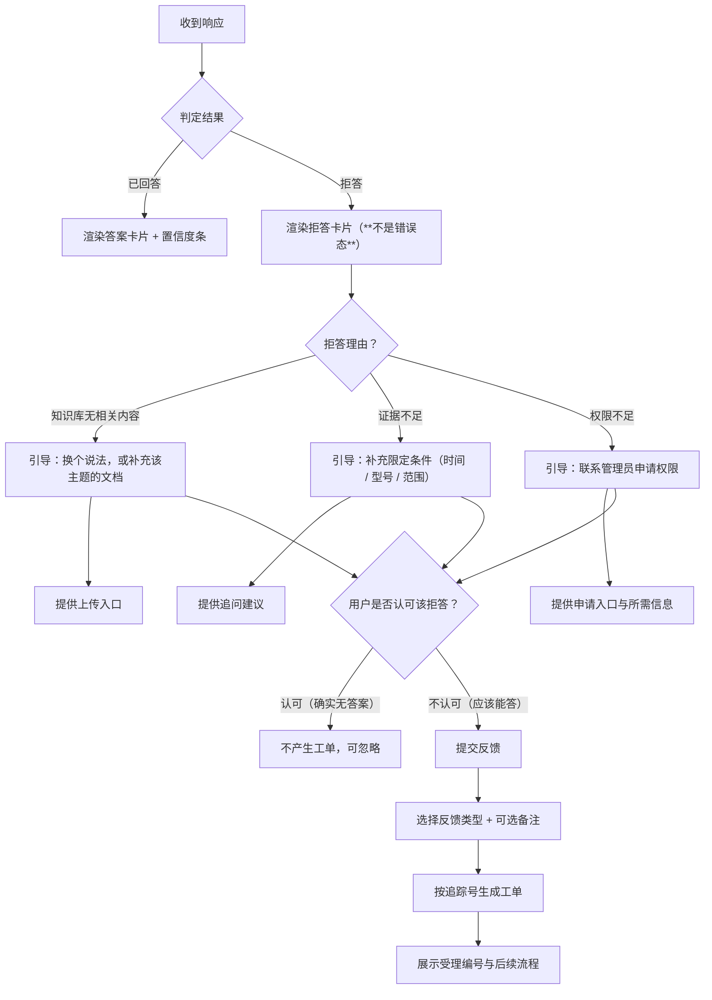
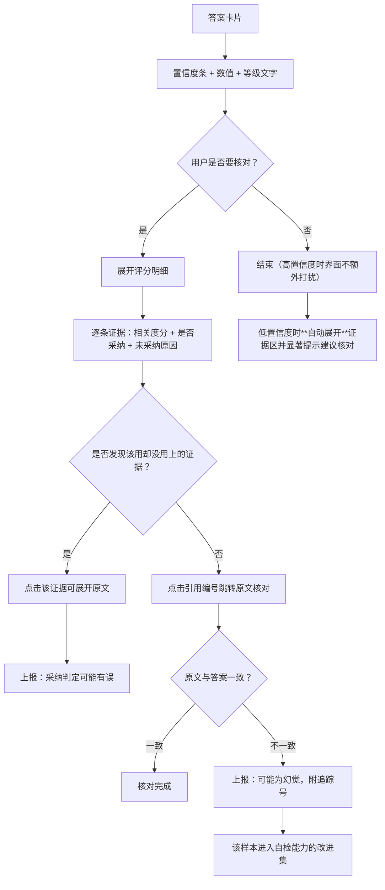
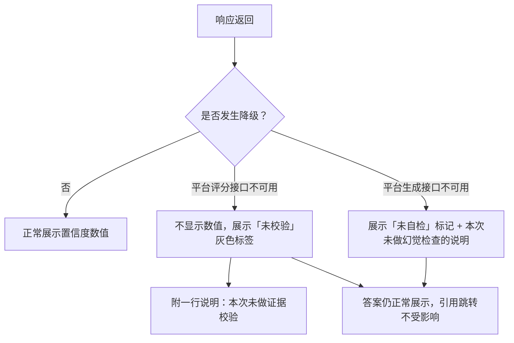

# 阶段 5 前端设计：自检可视化与拒答引导

> 本阶段在前端引入 **置信度展示、证据评分明细、幻觉声明标识、拒答卡片与引导**。用户第一次能看到"系统对答案的可信度判断"。

---

## 一、新增组件：置信度与证据可视化

> 本阶段前端的所有新增能力都附着在**已有的答案卡片与证据卡片**上，不新增页面。这保证了用户在阶段 1~4 形成的操作习惯不被破坏。

### 1.1 置信度条 (ConfidenceBar)

**触发位置**：答案卡片标题之后、答案正文之前。

**视觉**：

```
┌─────────────────────────────────────────────────────────────┐
│ 答案                                  [correct | confidence 0.87] │
│ ─────────────────────────────────────────────────────── │
│ ████████████████████████████░░░░░░░ 87%                         │
│ 证据评分: 文档 A 0.92 / 文档 B 0.85 / 文档 C 0.81             │
│ 幻觉检查: 无/有（低置信度声明已自动剔除）                      │
└─────────────────────────────────────────────────────────────┘
```

**视觉细节**：

- 进度条背景渐变：绿（高）→ 青（中）→ 橙（低）；
- 数字字号 16px，主色（绿色/青色/橙色）按区间；
- 鼠标悬停数字 → tooltip 显示区间含义。

**判色规则**：

| 区间 | 颜色 | 含义 |
| --- | --- | --- |
| 0.85-1.0 | 绿 | 高可信，直接用 |
| 0.5-0.85 | 青 | 一般可信，建议核对 |
| 0-0.5 | 橙 | 低可信，必须核对 |

### 1.2 证据评分明细 (EvidenceScoreTable)

**触发位置**：证据卡片列表中，每条证据卡片显示评分。

**视觉**：

```
┌──────────────────────────────────────────────┐
│ [#1] 电池电压 3.7V                          │
│ 来源: battery_manual.md (第 1 页)            │
│ 评分: ████████████░░░ 0.92  [高]            │
│ 评估: 答案中"电池电压 3.7V" 有据              │
└──────────────────────────────────────────────┘
```

**每条证据可能的状态**：

- **高 / 中 / 低**：与置信度色板一致；
- **未使用**：仅显示分值，不参与答案生成（兜底证据）。

**交互**：

- 鼠标悬停评分条 → tooltip 显示该分的具体判定依据；
- 点击评分 → 弹出"该证据对答案的贡献分析"。

### 1.3 幻觉声明剔除提示

**触发**：当答案生成经过"重生成"时。

**视觉**：

```
┌──────────────────────────────────────────────────────┐
│ 答案                                            🔄  │
│ ───────────────────────────────────────────────── │
│   "电池电压 3.7V，容量 5000mAh。"                  │
│                                                     │
│   [ℹ️ 系统检测到一条无据陈述（"X 号组件支持 5G"），已自动剔除] │
│                                                     │
│   ████████████████████████ 87%  重生成 1 次       │
└──────────────────────────────────────────────────────┘
```

**关键细节**：

- 拒绝把被剔除的声明用删除线显示（用户问的是答案，不要给"被删的内容"）；
- 仅以提示形式告知"系统做了什么"。

## 二、拒答卡片与恢复引导

### 2.1 拒答卡片 (RefusalCard)

**触发**：verdict = "refused"。

**视觉**：

```
┌──────────────────────────────────────────────────────┐
│   🛑 知识库无足够证据                                │
│                                                     │
│   原因: 当前检索未找到高度相关内容                   │
│   ───────────────────────────────────────────────── │
│   您可以尝试:                                       │
│   • 换个表述重新提问                                │
│   • 上传相关文档到知识库                            │
│   • 联系管理员授权访问更多资料                       │
│                                                     │
│   [重新提问] [反馈此问题]                          │
└──────────────────────────────────────────────────────┘
```

**视觉规则**：

- 主色为 error 红色（边框 + 图标）；
- 内容卡片背景浅灰（避免红色刺眼）；
- "重新提问"按钮：预填原始 query；
- "反馈此问题"按钮：弹出反馈表单（管理员用）。

### 2.2 拒答的三种成因与差异化引导

拒答不能只有一句"没找到"。前端需按后端返回的拒答原因展示**不同的下一步建议**：

| 拒答原因 | 意味着 | 前端建议 |
| --- | --- | --- |
| 知识库无相关内容 | 检索分数全域偏低 | "换个表述" / "上传相关文档" |
| 检索有结果但证据不足 | 中间区间循环耗尽 | "补充更具体的限定条件（时间、型号、部门）" |
| 超出访问权限 | 命中的文档无权限 | "联系管理员申请权限"（**不暴露文档名**） |

**安全细节**：因权限导致的拒答，**不得提示"你无权访问《XX 文档》"**——这会泄漏文档存在性。统一回退为"当前账号权限下未找到相关内容"。

### 2.3 反馈闭环

用户在拒答卡片上的反馈应进入运营侧可见的队列：

- 反馈内容：拒答原因分类（用户视角）+ 可选备注；
- 提交后返回一个可追踪编号，用户可在右上角查看处理状态；
- 运营侧按"高频被反馈的问题"优先补充知识库——**这是知识库迭代的最直接输入**。

---

## 三、检索过程面板增量（CRAG 分支展示）

阶段 2 的检索过程面板在 CRAG 模式下扩展为"多轮 + 分支"的形态：

```
┌────────────────────────────────────────────────────────┐
│  🔍 检索过程                                          │
│ ─────────────────────────────────────────────────── │
│ ┌──────────┐ ┌──────────┐                            │
│ │ BM25     │ │ 向量     │                            │
│ │ 命中 18  │ │ 命中 17  │                            │
│ └──────────┘ └──────────┘                            │
│ ─────────────────────────────────────────────────── │
│ ↓ 证据评分 (avg 0.41)                                  │
│ ┌─────────────────────────────────────────────────┐ │
│ │ 分支: AMBIGUOUS (中间区间)                    │ │
│ │ → 触发精炼证据                                │ │
│ └─────────────────────────────────────────────────┘ │
│ ─────────────────────────────────────────────────── │
│ 第 2 轮检索 (使用精炼 query "锂电池循环寿命"):    │
│ ... 命中 ... 评分 ... 0.85 → CORRECT              │
└────────────────────────────────────────────────────────┘
```

**关键细节**：

- 触发分支时**整段用对应颜色高亮**（correct=绿、ambiguous=青、incorrect=橙）；
- 精炼过程以"标注对比"形式展开（精炼前 vs 精炼后）。

---

## 四、监控大盘增量（`/admin/monitor`）

### 4.1 新增指标

| 指标卡片 | 含义 |
| --- | --- |
| Faithfulness | 答案-证据一致性均值（自建指标） |
| 拒答率 | refused / 总请求 |
| 平均重生成次数 | 重生成 / 尝试生成 |
| CRAG 分支占比 | correct / ambiguous / incorrect 各占多少 |

### 4.2 仪表板分区图

```
CRAG 分支占比
  correct:   65%
  ambiguous: 25%  → 触发精炼 + 重检索
  incorrect: 10%  → 拒答 / Web 兜底
```

**用途**：

- ambiguous 高 → 检索质量差，需调整切块或 Embedding；
- incorrect 高 → 知识库覆盖不足，需补文档。

---

## 五、API 契约（本阶段新增）

**响应字段扩展**：

| 字段 | 类型 | 说明 |
| --- | --- | --- |
| `verdict` | 枚举 | `answered` / `refused` —— 前端据此决定渲染普通答案卡片还是拒答卡片 |
| `refusal_reason` | 枚举 | 拒答成因（无相关内容 / 证据不足 / 权限不足），**驱动差异化引导** |
| `confidence` | 浮点 | 0~1，答案与证据的一致性折算值 |
| `regenerated` | 布尔 | 是否触发过重生成 |
| `unsupported_claims_count` | 整数 | 无据声明条数（用于说明置信度如何得出） |
| `evidence[].score` | 浮点 | 该证据的相关度分 |
| `evidence[].used` | 布尔 | 是否被采纳进生成上下文（**未采纳的也要返回**，便于用户判断有无遗漏） |
| `crag.branch` | 枚举 | `correct` / `ambiguous` / `incorrect` |
| `crag.rounds[]` | 数组 | 每轮的分支判定、平均分、精炼后的查询 |

**新增端点**：

| 端点 | 用途 | 关键字段 |
| --- | --- | --- |
| `POST /feedback/refusal` | 拒答反馈 | 入参：拒答原因分类 + 备注 + 追踪号；返回 `ticket_id` |
| `GET /feedback/{ticket_id}` | 反馈状态 | `status` / `handled_at` / `resolution` |
| `GET /admin/metrics/quality` | 质量指标 | `faithfulness` / `refusal_rate` / `avg_regeneration` / `crag_branch_ratio` |

**流式事件扩展**：

| 事件 | 载荷 | 前端动作 |
| --- | --- | --- |
| `crag_branch` | `branch` / `avg_score` / `round` | 检索过程面板高亮当前分支 |
| `refine` | `before` / `after` | 展示精炼前后的查询对比 |
| `confidence` | `score` / `unsupported_claims_count` | 渲染置信度条 |
| `refused` | `reason` / `trace_id` | 终止流式，切换到拒答卡片渲染 |

**错误码与状态**：

| 状态 / 错误码 | 场景 | 前端表现 |
| --- | --- | --- |
| `verdict=refused` | 证据不足拒答 | 渲染拒答卡片（**仍为成功状态码**，不是错误） |
| 49xx | 平台重排/评分接口不可用（限流或超时） | 降级作答，置信度标为"未知"，并提示"本次未做证据校验" |
| 4Axx | 幻觉自检不可用 | 同样降级，**不阻断答案返回**，但必须显式提示 |

**关键约定：拒答不是错误**。`refused` 必须走成功状态码 + 业务字段表达，**不允许用 4xx/5xx 表达拒答**——否则前端只能把它当异常处理，无法渲染引导卡片，也无法在指标中区分"系统性错误"与"正常的无法回答"。

---

## 六、关键交互流程

### 6.1 拒答的处理流程

拒答是本阶段最重要的新交互形态。**它的难点不在展示，而在于"让用户知道下一步该做什么"**。



**三类拒答理由对应三条完全不同的引导路径**，这正是"拒答理由必须可归因"在前端的价值。**如果只有一句"无法回答"，用户唯一能做的就是重复提问**。

### 6.2 置信度的查看与核对流程



**"未采纳的证据也要能看到"这条设计在流程上的体现就是第 E 步**——用户能看到"检索到了什么、系统为什么没用"，从而判断是检索问题还是采纳判定问题。**隐藏未采纳证据会让这条排查路径彻底断掉**。

### 6.3 降级态的交互流程



**"降级时不显示数值"是一条硬规则**：若展示一个凭空给出的置信度，用户会把"系统打的分"当成真实可信度。**宁可不给数字，也不能给假数字**。

---

## 七、视觉规范（新增）

### 7.1 置信度色板

| 区间 | 颜色 | 适用文本 |
| --- | --- | --- |
| 0.85-1.0 | `#16A34A` 绿 | 高可信 |
| 0.5-0.85 | `#0891B2` 青 | 一般可信 |
| 0-0.5 | `#D97706` 橙 | 低可信 |

### 7.2 评分明细数字字号

- 评分数值：等宽 12px；
- 进度条高 6px；
- "高/中/低"标签字号 11px。

### 7.3 CRAG 分支色板

| 分支 | 颜色 | 含义 |
| --- | --- | --- |
| correct | 绿 | 证据充分，直接作答 |
| ambiguous | 青 | 需精炼后重检索 |
| incorrect | 橙 | 证据不足，兜底或拒答 |

**约束**：分支色板与置信度色板**共用语义方向（绿=好、橙=差）**，但**不做完全相同**——避免用户把"分支判定"和"答案置信度"两个不同概念混为一谈。

---

## 八、交互细节

### 8.1 拒答的引导

**触发**：用户看到拒答卡片时。

**应该出现的引导**：

- "您可以尝试：换个说法 / 上传相关文档 / 联系管理员"——三条建议可视；
- "重新提问"自动预填原 query；
- "反馈"表单：
  - 必填：拒答原因（多选：知识不足 / 表述不清 / 不应拒答）；
  - 可选：备注（文本）；
  - 提交后生成 ticket-id，可在前端右上角查看状态。

### 8.2 拒绝把置信度当真理展示

**重要**：

- **不要给"系统评分 0.92 = 完全可信"的用户引导**；
- 数字旁必须有"建议人工核对原文"的提示；
- 高置信度答案**仍允许用户点击引用溯源**——可信赖 ≠ 不可核验；
- 置信度条的 tooltip 必须写明"该分值反映答案与证据的一致性，不代表事实正确性"。

### 8.3 置信度的展示边界

| 场景 | 展示方式 |
| --- | --- |
| 高置信度 | 绿色数值 + 色条，**不额外弹窗提示**（避免打扰） |
| 中置信度 | 青色数值 + 一行"建议核对原文" |
| 低置信度 | 橙色数值 + 显著提示 + 证据区自动展开 |
| 未做校验（降级） | 灰色"未校验"文字，**不显示数值**，避免用假分数误导 |

---

## 九、可访问性

- 置信度条必须有标准进度条语义（当前值 / 最小值 / 最大值），并附带文字描述"87%，高可信"；
- 拒答卡片的建议列表用标准列表语义；
- 评分明细用真实表格语义并带标题说明；
- **"高/中/低"不能用颜色单独表达**，必须有文字标签。

---

## 十、性能预算

| 指标 | 目标 |
| --- | --- |
| 置信度条渲染 | ≤ 20ms |
| 评分明细展开 | ≤ 200ms |
| 拒答卡片渲染 | ≤ 100ms |
| 多轮分支面板渲染 | ≤ 300ms（3 轮内） |

---

## 十一、本阶段交付清单

- [x] ConfidenceBar 组件（区间配色 + 未校验态）
- [x] EvidenceScoreTable（每条证据评分 + 是否采纳）
- [x] 幻觉声明剔除提示
- [x] RefusalCard（拒答卡片 + 按成因差异化引导 + 反馈闭环）
- [x] 检索过程面板 CRAG 分支高亮 + 精炼前后对比
- [x] 置信度展示边界规范（含"降级不显示数值"）
- [x] API 契约（verdict / refusal_reason / crag 字段 + 拒答走成功状态码的约定）
- [x] 监控大盘新增 4 个质量指标
- [x] 监控大盘新增 4 个指标（Faithfulness / 拒答率 / 重生成 / CRAG 占比）

→ 下一阶段：[`../stage-6-agentic-rag/frontend-design.md`](../stage-6-agentic-rag/frontend-design.md)