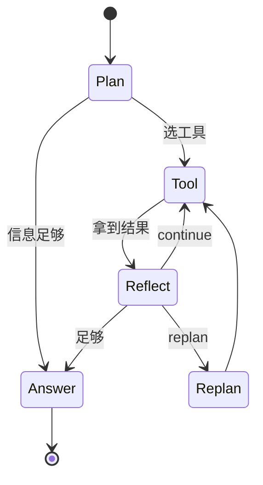
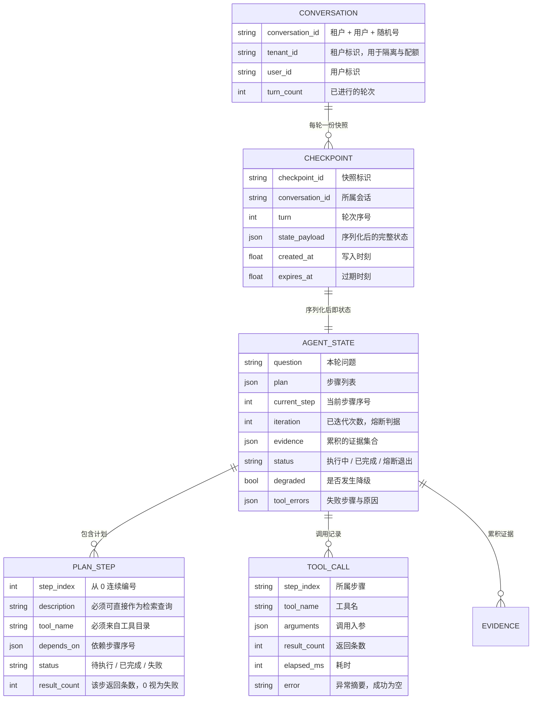
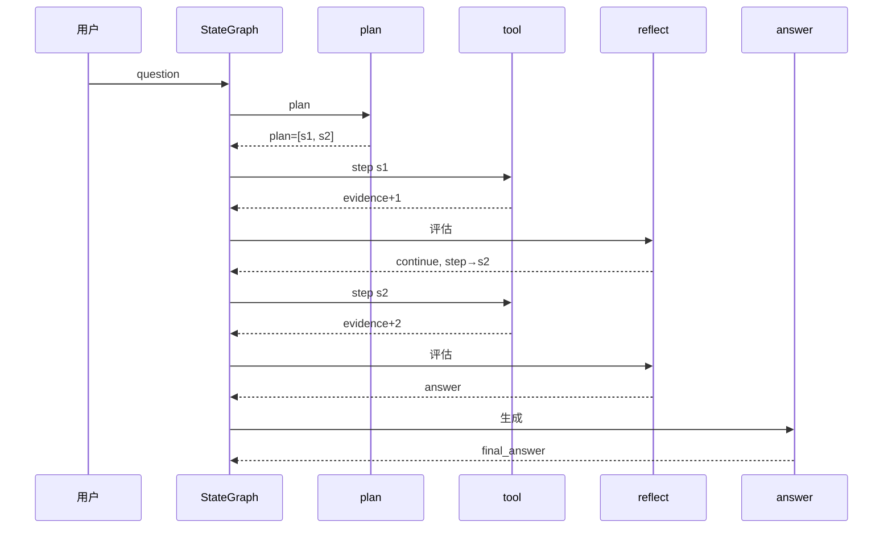
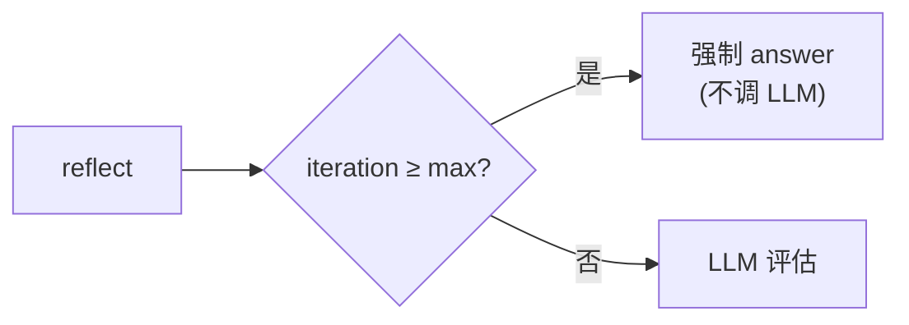

# 阶段 6：Agentic RAG 核心与 LangGraph 编排（实现细节）

> 本阶段把"线性流水线"升级为**有状态、可循环、可规划的状态机**。Agent 自主决定"检索几次、是否调用工具、什么时候停止"。

---

## 一、阶段定位与边界

### 1.1 业务能力范围



### 1.2 解决的核心问题

| 旧问题 | 新解法 |
| --- | --- |
| 单轮检索答不全多跳问题 | 显式 Plan → 多个 Tool → Reflect |
| 工具选择缺乏通用接口 | ToolRegistry + 标准化 Schema |
| 无 Agent 自主决策 | LLM 决策 `next_action` |
| 多轮对话状态丢失 | Checkpointer + thread_id |
| 无熔断，循环失控 | `max_iterations` 硬上限 |

### 1.3 验收标准

| 指标 | 目标值 |
| --- | --- |
| 多跳问题 EM（人工评测） | ≥ 0.6 |
| 工具调用准确率 | ≥ 90% |
| 平均迭代次数 | ≤ 3 |
| 循环失控次数 | 0 |

---

## 二、Agentic 范式的核心思想

### 2.1 范式对比

| 范式 | 特点 | 适用场景 |
| --- | --- | --- |
| ReAct | Thought→Act→Observe 循环 | 中等复杂、工具少 |
| Plan-and-Execute | 先规划、再逐步执行 | 多跳、复杂任务 |
| Reflexion | ReAct + 长期记忆 + 自我反思 | 长任务、需自我纠错 |
| LangGraph StateGraph | 任意 DAG + Checkpoint | 企业生产首选 |

**本阶段选 LangGraph**：

- 与其他 Agent 框架（LangChain Agent、LlamaIndex）兼容；
- 节点函数化设计，便于测试；
- Checkpointer 抽象多存储（Memory/Postgres/Redis）。

### 2.2 Agent 的核心循环

Agent 的运行是一个**带终止条件的四步循环**，每一轮依次经过"规划 → 执行 → 反思 → 决策"：

| 步骤 | 输入 | 输出 | 是否会调用外部能力 |
| --- | --- | --- | --- |
| ① 规划 | 用户问题 + 可用工具目录 | 有序的步骤列表（每步含描述与拟用工具） | 是（1 次模型调用） |
| ② 执行 | 当前步骤 | 该步骤带回的证据 | 是（调用对应工具） |
| ③ 反思 | 目前累计的全部证据 | 证据充分度分数 + 下一步决策 | 是（1 次模型调用） |
| ④ 决策 | 反思结论 | 三选一：**作答 / 继续下一步 / 重新规划** | 否（纯逻辑分支） |

**循环终止的四种情形**（必须全部显式处理）：

1. 反思判定证据已充分 → 进入作答；
2. 步骤列表已跑完但证据仍不足 → 重新规划；
3. 迭代次数达到上限 → **强制作答**（用现有证据尽力回答）；
4. 任意步骤发生不可恢复的错误 → 终止并返回错误说明。

**四个步骤的模型档位（千问平台）**：

| 步骤 | 使用的模型 | 理由 |
| --- | --- | --- |
| ① 规划 | `qwen-plus` | 需理解工具目录、判断步骤依赖，**档位过低会规划出无效或重复步骤** |
| ③ 反思 | `qwen-plus` | 需判断"证据是否充分"，属于需要一定推理能力的判定 |
| ④ 决策 | **不用模型** | 纯逻辑分支；**交给模型只会引入不确定性，且让循环无法复现** |
| ② 执行 | 工具（内部再调向量与重排接口） | 检索类工具自身会触发 `text-embedding-v3` 与 `gte-rerank-v2` |

**降档的前提是熔断已就位**：把规划降到更低档位能省成本，但会产出更多无效步骤。**在迭代上限与无效进展熔断尚未生效之前，不要为了省钱降档**——省下的一次调用可能换来两轮无效循环。

### 2.3 状态机的设计

**状态必须显式声明字段**，而不是把所有信息揉进一段对话历史。推荐的字段清单：

| 字段 | 类型 | 作用 | 跨轮语义 |
| --- | --- | --- | --- |
| `question` | 文本 | 用户原始问题 | 覆盖 |
| `plan` | 步骤列表 | 本轮规划出的步骤 | 覆盖（重规划时替换） |
| `current_step` | 整数 | 当前执行到第几步 | 覆盖 |
| `evidence` | 证据列表 | 累计证据 | **追加合并** |
| `executed_steps` | 整数集合 | 已执行过的步骤号（防重复执行） | 追加合并 |
| `iteration` | 整数 | 已迭代轮数 | 覆盖 |
| `max_iterations` | 整数 | 迭代上限 | 覆盖 |
| `evidence_score` | 浮点 | 最近一次反思的充分度 | 覆盖 |
| `next_action` | 枚举 | 作答 / 继续 / 重规划 | 覆盖 |
| `final_answer` | 文本 | 最终答案 | 覆盖 |
| `skip_retrieval` | 布尔 | 是否短路（闲聊场景） | 覆盖 |

**"覆盖 vs 追加"必须按字段分别声明**，这是状态机的核心语义：

- 证据、已执行步骤这类**累积型字段必须追加合并**——否则多轮之间会互相覆盖，表现为"第一轮检索到的东西，第二轮一问就没了"；
- 结论类字段（分数、决策、答案）必须覆盖——保留历史决策没有任何意义，还会污染当前判断；
- **合并规则写错是最隐蔽的 bug**：图能跑通、单轮测试也过，但多轮会话时证据莫名减少。因此合并规则必须在状态定义处集中声明，不允许散落在各节点内部。

---

## 三、工具注册机制

### 3.1 工具的接口化

**每个工具必须有**：

- `name`: 工具唯一标识；
- `description`: 给 Planner 看懂的"用途描述"；
- `run(query)`: 执行逻辑。

**为什么 description 重要**：

LLM 选择哪个工具"靠看了 description"——description 含糊 → Planner 选错 → 检索失败。**description 是 Plan 质量的根源**。

### 3.2 工具注册的目录语义

**ToolRegistry 提供给 Planner 的工具目录**：

```
vector_search: 在文档知识库中检索与 query 相关的文本片段
sql_search: 将自然语言问题转为 SQL 并查询业务数据库
web_search: 联网搜索（时效信息）
calculator: 数学表达式求值
graph_search: 在知识图谱中查询实体关系（阶段 7 引入）
image_search: 以文搜图（阶段 7 引入）
```

**目录必须随 Agent 状态变化**：

- chitchat 场景 → 仅留 LLM 直答工具；
- 多模态场景 → 加入 image_search。

### 3.3 工具名幻觉兜底

**LLM 幻觉工具名**（如 planner 输出 `oracle_search` 而注册表只有 `vector_search`）时：

```
兜底到注册表的第一个工具 + 日志告警
```

**为什么不能直接抛错**：

抛错会让整个流水线崩。**降级而非崩溃**是 Agent 系统的工程纪律。

---

## 四、节点函数的设计

### 4.1 节点是纯函数

**每个节点函数**：

- 输入：state（dict）；
- 输出：state patch（dict）。

**节点不直接修改 state**，而是返回 patch —— 由 LangGraph reducer 决定如何合并。

**好处**：

- 节点可独立测试（无需启动 StateGraph）；
- 节点可替换（同一接口的不同实现）；
- 节点可复用（不同图配置）。

### 4.2 Plan 节点

**职责**：根据 question + 可用工具，生成多步骤 plan。

**LLM 输入**：

- 用户问题；
- 工具清单（name + description）；
- 输出格式约束（JSON）。

**输出**：一份有序步骤列表，每步包含四项——**步骤序号、自然语言描述、拟调用的工具名、以及该步与其它步的依赖关系**。

| 字段 | 示例 | 约束 |
| --- | --- | --- |
| 步骤序号 | 0、1、2 | 从 0 连续编号；后续"继续/重规划"都靠它定位 |
| 描述 | "查询 A 产品线故障率" | 必须是**可直接作为检索查询**的具体表述，不能写成"了解 A 的情况"这类模糊目标 |
| 工具 | `vector_search` | 必须来自工具目录，**不存在的工具名要在解析时纠偏** |
| 依赖 | 依赖步骤 0 | 无依赖为空；有依赖的步骤不能与之并行 |

**Plan 质量的三个判定标准**（也是调优 prompt 的抓手）：

1. **可执行**：每一步都能对应到一次真实的工具调用，没有"分析一下"这类无法落地的步骤；
2. **不冗余**：两步不会检索同一件事——冗余步骤既浪费又会让反思阶段误判"证据已充分"；
3. **无环依赖**：依赖关系构成有向无环图，否则调度会死锁。

### 4.3 Tool 节点

**职责**：执行当前步骤，把结果并入证据集合。

**关键细节**：

- 工具返回的内容以「证据」形式并入，**并带上来源步骤号**，便于前端做轨迹与证据的双向定位；
- 该步骤在计划中标记为已完成，避免被重复执行；
- 迭代计数加一，用于熔断判断；
- **单个工具返回的条数应有上限**——无节制地把工具的原始输出全部塞进证据，会直接引爆上下文。

**工具返回的三种情况都要处理**：

| 情况 | 处理 |
| --- | --- |
| 有结果 | 并入证据，继续下一步 |
| 无结果（0 条） | 视为"该步失败"，**不重试同一查询**（重复查询必然还是 0 条），直接进入反思判断 |
| 工具超时或异常 | 标记该步失败，**不中断整个流程**，由反思决定是否换工具或重规划 |

### 4.4 Reflect 节点

**职责**：评估当前证据是否足够，决定 next_action。

**三道防线**：

1. **熔断**：iteration ≥ max_iterations → 强制 next_action = "answer"（不调 LLM，省钱）；
2. **低分纠正**：evidence_score < answer_threshold 且 next_action = "answer" → 纠正为 continue；
3. **步骤耗尽升级**：想 continue 但无下一步 → 升级为 replan。

### 4.5 Replan 节点

**职责**：当前 plan 全部失败，重新规划。

**实现要点**：

- 把"此前检索不充分，请换个角度"附加到 question；
- 生成的新 plan 接到原 plan 尾部（不清空历史）。

### 4.6 Answer 节点

**职责**：把 evidence 拼成 prompt，调 LLM 生成最终答案。

**输出**：state.final_answer。

---

## 五、熔断保护的设计

### 5.1 三层熔断

熔断必须**分层设计**，因为不同的失控形态需要不同的刹车方式。

| 层次 | 触发条件 | 刹车动作 | 解决哪类失控 |
| --- | --- | --- | --- |
| **第一层：总轮数上限** | 迭代次数达到上限 | 强制进入作答 | 模型陷入"总觉得证据不够"的保守循环 |
| **第二层：无效进展熔断** | 连续 3 轮决策为"继续"，但证据总量没有增加 | 强制进入作答 | 模型反复检索同一内容、原地打转 |
| **第三层：单步超时** | 单次工具调用超过 30 秒 | 标记该步失败并跳过 | 某个外部依赖（数据库、联网）挂起拖死整条链路 |

**上限值取多少**：总轮数 = 计划步骤数 + 2 轮重规划余量。计划步骤数是动态的，所以**上限不能写成固定常数**——否则一个 10 步的复杂问题会在第 6 轮被强行截断，而一个 1 步的简单问题却允许跑到第 6 轮（纯浪费）。

**第二层熔断最容易漏做**：多数团队只设了总轮数上限，结果表现为"复杂问题偶发地把轮数跑满，时延飙到十几秒"，日志里看不出任何异常——因为每一轮都"合法"，只是没有进展。**判断依据必须是"证据是否增加"，而不是"轮数是否增加"**。

### 5.2 熔断不是错误，是正常分支

熔断触发后系统**必须仍然给出回答**，只是回答的性质不同：

- 若已有若干证据 → 基于现有证据**尽力作答**，并显式标注"由于检索轮次限制，本答案可能不完整"；
- 若证据几乎为空 → 走**兜底话术**（"信息不足，无法回答"）；
- **无论哪种，都应返回成功状态而非报错**——熔断是设计内的行为，不是异常。

**为什么不能报错**：用户视角的"系统崩了"与"系统尽力了但信息不足"是完全不同的体验。熔断属于后者，前端应展示"已达执行上限"的黄色提示而非红色错误。同时，熔断次数必须计入运营指标——**熔断率上升往往先于答案质量下降出现**，是重要的预警信号。

---

## 六、Checkpointer 与多轮会话

### 6.1 会话存档的作用

会话存档保存**每一轮结束时的完整状态**，下一次提问时加载并与新一轮状态合并。

举例说明其价值：用户在第一轮问"XB-2024 的参数是多少"，系统检索到参数文档；第二轮追问"那它的质保政策呢"——**第二轮只需检索质保相关内容，第一轮的参数证据仍然保留在上下文中**，因此可以回答"参数是 3.7V，质保期为 2 年"这类**跨轮汇总**的问题。若没有会话存档，第二轮只有孤立的质保证据，模型不知道"它"指谁。

**存档还承担两项职责**：

- **断点续跑**：Agent 执行到一半用户关闭页面，下次进入可继续；
- **可追溯**：每一次执行的状态快照都被保留，便于复盘"当时为什么这样答"。

### 6.2 存储选择

| 场景 | 存储方案 | 取舍 |
| --- | --- | --- |
| 开发与单机 | 进程内存 | 重启即丢，**仅限本地** |
| 单实例小规模 | 内存 + 定期落盘 | 重启可恢复，但多副本会不一致 |
| 多实例生产 | 关系数据库或键值存储 | **必须外部化**，否则同一用户被路由到不同副本时会话断裂 |
| 高并发大规模 | 键值存储 | 读写快、可设自动过期，适合会话这类"短期活跃"的数据 |

**会话存档必须设自动过期**：会话数据包含用户提问内容，属于需要最小化留存的个人信息。过期时间应与业务承诺一致（如 30 天）。

### 6.3 会话标识的设计

会话标识由三段拼接——**租户标识、用户标识、随机会话号**：

| 组成 | 作用 | 缺失后果 |
| --- | --- | --- |
| 租户标识 | 多租户隔离 | 跨租户串会话，属于严重越权 |
| 用户标识 | 归属判定 | 无法校验"这个会话是不是你的" |
| 随机会话号 | 防猜测 | 顺序号可被枚举，攻击者能遍历他人会话 |

**校验必须在服务端完成**：仅凭会话标识不能直接读取会话，**必须同时校验该会话属于当前认证主体**。前端传入的会话标识一律视为不可信输入。

---

## 七、数据模型设计

本阶段引入两类全新数据：**Agent 状态**（图执行的唯一事实来源）与**会话快照**（状态的持久化形态）。此外，工具调用记录成为一等实体。

### 7.1 新增实体一览

| 实体 | 作用 | 存放位置 | 生命周期 |
| --- | --- | --- | --- |
| Agent 状态 | 图执行期间的全部上下文 | 执行期内存 | 单次执行 |
| 会话快照 | 状态在每轮结束时的持久化形态 | 键值存储（生产必须外部化） | 30 天自动过期 |
| 工具调用记录 | 每一次工具调用的输入输出与耗时 | 随状态保存 + 指标聚合 | 随快照 |
| 会话标识 | 跨轮定位同一段对话 | 由"租户 + 用户 + 随机号"组成 | 与快照同生命周期 |

**状态与会话快照是"同一份数据的两种形态"**：状态是执行期的可变对象，快照是轮次边界的只读副本。**这个区分决定了并发语义**——同一会话的两个并发请求会各自持有独立状态，但会争抢同一份快照，因此**同一会话必须串行处理**。

### 7.2 实体关系



### 7.3 状态字段的约束

| 字段 | 约束 | 说明 |
| --- | --- | --- |
| 迭代次数 | 单调递增，**不因重规划而清零** | 熔断依据；若重规划清零，**Agent 可以通过不断重规划绕过熔断**，导致无限循环 |
| 证据集合 | 追加而非覆盖，且**去重** | 多步检索常返回同一块；不去重会让上下文迅速膨胀并让"证据是否充分"的判断失真 |
| 工具失败记录 | 必须保留失败步骤与原因 | 用于区分"没有相关信息"与"工具坏了"——**这两种情况对用户的解释完全不同** |
| 状态标记 | 必须有显式的终态 | 要有"已完成""熔断退出""失败"三种终态，**只用一个"结束"会让前端无法区分正常完成与被强行中断** |
| 降级标记 | 必须记录降级点 | 工具不可用降级、模型降级都要留痕，否则用户无法判断答案的可信度基线 |

### 7.4 会话快照的约束

| 约束 | 说明 |
| --- | --- |
| **必须外部化** | 多副本部署时若存在进程内，同一用户被路由到不同副本即会话断裂 |
| **必须有自动过期** | 快照含用户提问原文，属于需最小化留存的个人信息；过期时长应与业务承诺一致 |
| **必须能跨版本读取** | 状态结构随阶段演进会加字段，**旧快照必须能被新版本读取**（缺字段按默认值处理），否则一次发布就会让所有进行中的会话失效 |
| **写入必须带轮次号** | 防止旧轮次的延迟写入覆盖新轮次的快照（乱序写入） |
| **同一会话串行** | 并发请求会争抢同一份快照；应在会话维度加锁或拒绝并发，**否则会出现状态互相覆盖** |

**"跨版本读取"是最容易被忽略的一条**：状态里塞入内部对象或类实例时，旧快照在新版本上会直接反序列化失败。**因此状态必须是"仅含基础类型与可扩展字典"的纯数据结构**，这也是各阶段新增状态字段时都能平滑兼容的原因。

### 7.5 保留与清理

| 数据 | 保留 | 理由 |
| --- | --- | --- |
| 会话快照 | 30 天自动过期 | 与业务对"对话历史"的承诺一致 |
| 工具调用明细 | 随快照过期 | 属于会话内容的一部分 |
| 指标化统计 | 长期 | 只保留计数与耗时分布，**不含问题原文，合规风险低** |

**用户主动删除会话时，快照与工具调用明细必须一并删除**——只删对话记录而留下快照，等于"用户以为删了，实际上原文还在"。

---

## 八、关键决策记录

### 8.1 为什么 Plan 节点不是 ReAct 的 Thought 步骤？

ReAct 的 Thought 是隐式（LLM 推理中），**没有可审计的计划**。显式 Plan 让用户和系统都能看见"系统在做什么"——便于调试、纠错、追溯。

### 8.2 为什么 reflect 节点要纠正 next_action = "answer"？

LLM 有时给出高分数但 next_action = "answer"，但 score 不够——这是 LLM 的"自信幻觉"。**纠正为 continue 防止低质 answer 漏网**。

### 8.3 为什么 answer 节点的 Prompt 不含中间证据？

answer 节点只读 evidence（最终入选的证据），**不读 plan / reflect 中间结果**——避免 LLM 被"系统决策逻辑"干扰。

### 8.4 为什么不用 LangGraph 内置的 `MessageGraph`？

`MessageGraph` 把所有状态压成 messages 列表，**多轮会话证据累积易丢失结构**。本阶段用 TypedDict + Annotation reducer 更可控。

---

## 九、关键流程图

### 9.1 端到端时序



### 9.2 熔断保护



---

## 十、与上一阶段差异

| 模块 | 阶段 5 | 阶段 6 |
| --- | --- | --- |
| 流程形态 | 固定 Python 流程 | LangGraph 状态机 |
| 决策 | 代码 if-else | LLM 驱动 next_action |
| 工具 | 硬编码调用 | ToolRegistry 动态选择 |
| 多轮会话 | 无状态 | Checkpointer + thread_id |

---

## 十一、本阶段遗留问题 → 下一阶段预告

| 现象 | 根因 | 下一阶段 |
| --- | --- | --- |
| 实体链式问题答不出 | 工具只有向量检索 | 阶段 7 graph_search |
| 图文问题答不出 | 工具无跨模态 | 阶段 7 image_search |

→ 下一阶段：[`../stage-7-graph-multimodal/README.md`](../stage-7-graph-multimodal/README.md)