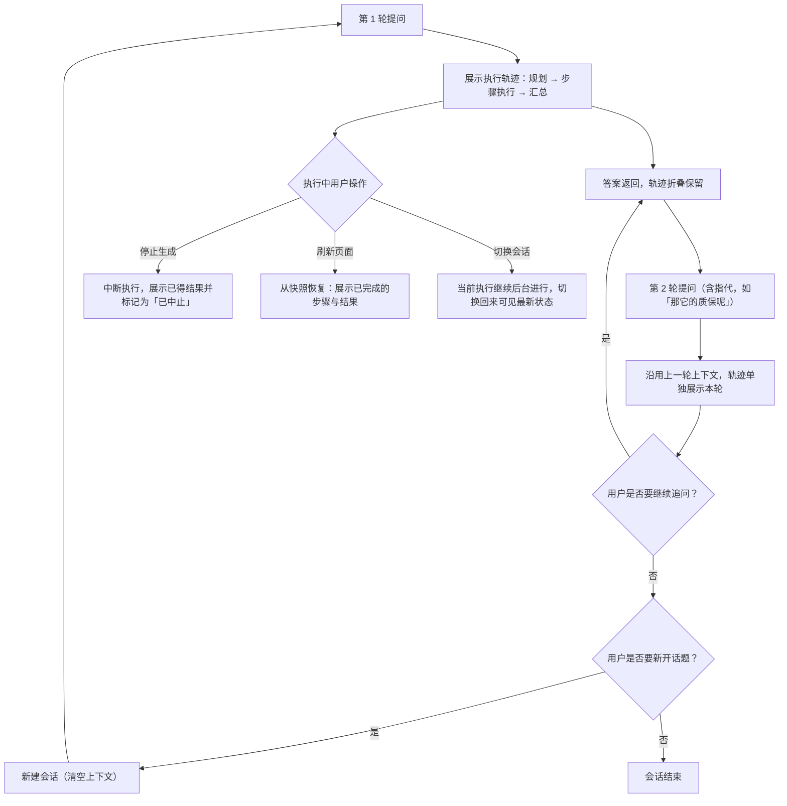
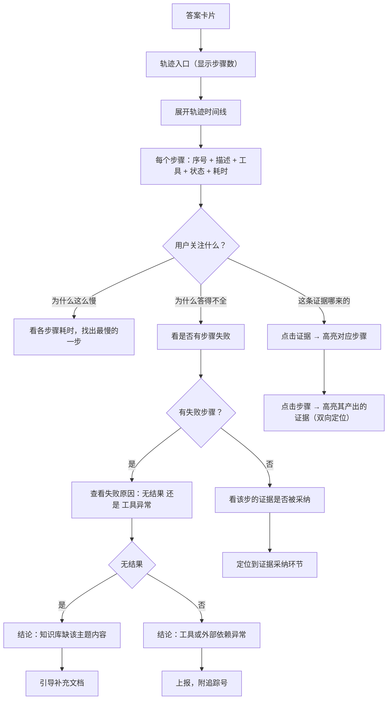
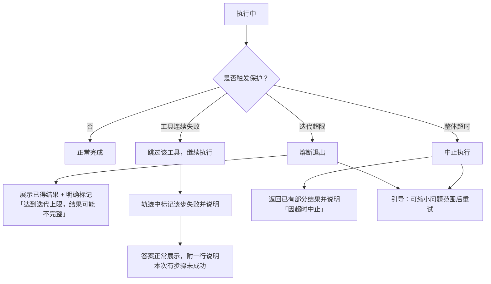

# 阶段 6 前端设计：Agent 执行轨迹可视化

> 本阶段在前端引入 **Agent 执行轨迹、工具调用详情、循环计数、多轮会话**。用户第一次能"看见"系统决策的全过程。

---

## 一、对话页增量改动

### 1.1 Agent 轨迹时间轴 (AgentTraceTimeline)

**触发位置**：分析详情面板内，与改写、子问题并列。

**视觉**：

```
┌──────────────────────────────────────────────────────┐
│ 🤖 Agent 执行轨迹                                    │
│ ───────────────────────────────────────────────── │
│  ① [plan]  生成 2 步骤计划                          │
│     计划: [查 A 故障率, 查 B 故障率]                 │
│  ② [tool]  vector_search  "查 A 故障率"             │
│     返回: 命中 3 条 (耗时 84ms)                      │
│  ③ [reflect]  评估证据                                │
│     evidence_score: 0.45  next_action: continue     │
│  ④ [tool]  vector_search  "查 B 故障率"             │
│     返回: 命中 2 条 (耗时 78ms)                      │
│  ⑤ [reflect]  评估证据                                │
│     evidence_score: 0.91  next_action: answer       │
│  ⑥ [answer]  生成最终答案                            │
│     重生成: 0 次                                      │
│  ───────────────────────────────────────────────── │
│  总迭代: 6 步     总耗时: 2.4s                       │
└──────────────────────────────────────────────────────┘
```

**关键交互**：

- 点击每一步 → 展开该步骤的完整 prompt 与返回内容；
- hover → 显示工具描述、目标 ID；
- 步骤高亮：当前正在执行的步骤有"动画"效果（流式时）；
- 错误步骤用红色边框。

### 1.2 工具调用卡片 (ToolCallCard)

**触发位置**：AgentTraceTimeline 内每个 tool 节点。

**视觉**：

```
┌──────────────────────────────────────────────────────┐
│ 🔧 vector_search                                    │
│ 输入: "查 A 故障率"                                  │
│ 耗时: 84ms                                           │
│ ───────────────────────────────────────────────── │
│ 输出:                                                │
│   ① A 产品线 故障率 2% (来源: quality.md)          │
│   ② ...                                             │
│ 命中: 3 条  截断: Top-5                              │
└──────────────────────────────────────────────────────┘
```

**视觉细节**：

- 工具 icon 配 tool 描述色板（vector=蓝、sql=绿、web=青、graph=粉）；
- 命中数与截断数用等宽数字；
- 输出过长可折叠。

### 1.3 循环计数 (IterationCounter)

**触发位置**：答案卡片底部、引用跳转条之前。

**视觉**：

```
┌──────────────────────────────────────────────────────┐
│  答案  🔄 重生成 0 次  🔁 循环 2 轮  ✓ 完成          │
└──────────────────────────────────────────────────────┘
```

**触发条件**：

- `regenerated = true` 时显示"重生成 1 次"；
- `iteration > 2` 时显示"循环 N 轮"（N > 阈值时高亮）；
- 熔断触发时显示"⚠ 已达上限"。

## 二、多轮会话与上下文管理

### 2.1 会话侧边栏

**触发**：会话列表点击切换。

**视觉**（左侧会话侧边栏）：

```
┌─────────────────────────────┐
│ 新对话 +                      │
│ ───────────────────────── │
│  ● [对比 A 和 B 的故障率]   │
│    2 条消息 · 2 分钟前       │
│  ● [电池电压参数]                 │
│    4 条消息 · 1 小时前       │
│  ● [闲聊]                      │
│    1 条消息 · 昨天          │
└─────────────────────────────┘
```

**交互**：

- 当前会话左侧蓝色竖条；
- 鼠标悬停 → 出现"重命名 / 删除"操作；
- 移动端 → 会话列表移入 Drawer。

**会话同步**：

- 切换会话不丢失证据（从会话存档加载）；
- 多轮之间证据可累积（新证据追加而非覆盖旧证据）；
- 删除会话 → 二次确认 → **同时删除会话存档**（避免残留数据与隐私问题）。

### 2.2 上下文膨胀的治理

多轮会话最大的风险是**上下文无限膨胀**——每轮都可能新增证据，几轮之后提示词会超出模型窗口，表现为"越聊越笨"。

| 治理手段 | 做法 | 副作用 |
| --- | --- | --- |
| 证据条数上限 | 每个会话保留的最新 N 条证据，旧的按相关性淘汰 | 早期细节可能丢失 |
| 证据去重 | 同一 chunk 在多轮被反复命中时只保留一份 | 无 |
| 摘要压缩 | 对更早轮次做一次摘要，只保留结论 | 损失细节，需谨慎 |
| 提示词预算控制 | 组装提示时按**优先级**裁剪：本轮证据 > 历史证据 > 历史对话 | 无 |

**默认策略**：证据上限 + 去重 + 提示词预算裁剪三者同时启用；**摘要压缩默认关闭**（需要业务明确接受细节损失才开）。

### 2.3 会话生命周期

| 阶段 | 行为 |
| --- | --- |
| 创建 | 用户点击"新对话"或首次提问时生成会话标识 |
| 活跃 | 每次提问追加一轮，证据累积；前端显示在侧边栏顶部 |
| 空闲 | 超过保留期（如 30 天）自动归档，侧边栏折叠到"更早"分组 |
| 删除 | 用户主动删除或归档超期，**同时清理会话存档与关联的中间状态** |

---

## 三、交互状态与流式表现

Agent 执行是**多步、长时间**的过程，前端必须让用户感知"正在进行哪一步"，而不是转圈等待。

### 3.1 执行中的状态序列

| 状态 | 触发 | 界面表现 | 用户可做 |
| --- | --- | --- | --- |
| 规划中 | 收到"开始规划"事件 | 轨迹区出现第 1 个占位节点 | 停止 |
| 工具执行中 | 收到工具调用开始事件 | 该节点显示运行态动画 + 已耗时 | 停止 |
| 反思中 | 收到评分事件 | 该节点显示分数与下一步决策 | 停止 |
| 生成中 | 收到首个 token | 答案区开始流式渲染 | 停止 / 复制 |
| 熔断终止 | 达到迭代上限 | 轨迹末节点标黄 + "已达上限" | 重新提问 |
| 失败 | 收到错误事件 | 出错节点标红 + 重试 | 重试 / 复制追踪号 |

### 3.2 停止生成的三层语义

用户点击"停止"时，系统应**尽量少浪费**：

1. **已完成步骤保留**：已检索到的证据不丢弃，仍然展示；
2. **正在进行的最小单元完成后再停**：不产生半截工具结果；
3. **停止后提供"继续执行"入口**：用户可基于当前证据直接生成，或让系统继续检索。

### 3.3 轨迹与答案的联动

- 点击轨迹中的某个工具节点 → 证据区**只显示该步带回的证据**；
- 再次点击 → 恢复显示全部证据；
- 点击某个证据卡片 → 轨迹中对应的工具节点高亮，形成**双向定位**。

---

## 四、监控大盘增量

### 4.1 Agent 执行指标

| 指标卡片 | 含义 |
| --- | --- |
| 平均迭代次数 | 反映任务复杂度 |
| 平均重生成率 | 反映答案质量 |
| 熔断触发率 | iteration ≥ max 的占比 |
| 工具调用分布 | 各工具调用占比 |

### 4.2 工具调用分布

```
工具调用占比（近 1h，本阶段可用工具）：
  vector_search  ██████████████████ 70%
  sql_search     █████ 20%
  web_search     ██ 7%
  calculator     █ 3%
```

> `graph_search` / `image_search` 在阶段 7 引入后才会出现在此分布中。

### 4.3 异常 Agent 执行列表

```
最近 1h 异常：
  12:34  session-123  iteration ≥ max  (refused)
  12:33  session-456  tool call failed  (sql timeout)
```

---

## 五、API 契约（本阶段新增）

| 端点 | 用途 | 关键字段 |
| --- | --- | --- |
| `GET /sessions` | 拉取会话列表 | `session_id` / `title` / `message_count` / `updated_at` |
| `POST /sessions` | 新建会话 | 返回 `session_id` |
| `DELETE /sessions/{id}` | 删除会话 | 同时清理会话存档 |
| `POST /ask` | 带会话继续提问 | 比阶段 5 增加 `session_id` |

**流式事件（在阶段 1 的四类事件上追加）**：

| 事件 | 载荷 | 前端动作 |
| --- | --- | --- |
| `plan` | `steps[]`（步骤序号 + 描述 + 拟用工具） | 渲染轨迹骨架 |
| `tool_start` | `step_id` / `tool` / `input` | 节点置为运行态 + 计时 |
| `tool_end` | `step_id` / `elapsed_ms` / `hit_count` / `evidence[]` | 节点置为完成态 + 追加证据 |
| `reflect` | `evidence_score` / `next_action` | 渲染评分与决策 |
| `iteration` | `current` / `max` | 更新循环计数 |
| `token` | `content` | 追加答案文本（与阶段 1 相同） |
| `done` | `trace_id` / `iterations` / `regenerated` | 冻结轨迹，展示总耗时 |
| `error` | `code` / `step_id` | 标记出错节点 + 展示重试 |

**新增错误码**：

| 错误码 | 场景 | 前端表现 |
| --- | --- | --- |
| 41xx | 达到迭代上限 | 轨迹末节点标黄，提示"已达执行上限" |
| 42xx | 工具执行失败 | 该工具节点标红，其余步骤继续 |
| 43xx | 会话不存在或已过期 | 提示"会话已失效，已为你开启新对话" |

---

## 六、关键交互流程

### 6.1 多轮会话流程

智能体的执行不再是"一问一答"，而是**有中间步骤、可中断、可续跑**的过程。前端的核心职责是**让这个过程可见且可控**。



**"中断后的状态必须显式标记"**：用户点了停止之后，界面若仍显示为正常完成，用户会误以为系统漏答了一部分。**"已中止"与"已完成"必须视觉可区分**。

**"刷新后能从快照恢复"是快照机制在前端的价值体现**：用户在网络不稳或误刷新时不必从头重问，但**恢复后必须让用户知道"这是恢复的结果，不是重新执行的"**。

### 6.2 执行轨迹的查看流程



**轨迹与证据的双向定位是本阶段交互的关键设计**：单向定位（只能从证据找步骤）会让"某一步到底产出了什么"无法回答。**多步检索的调试几乎完全依赖这条双向链路**。

### 6.3 熔断与降级的交互流程



**熔断与超时的结果不能表现为"错误"，而应表现为"不完整的成功"**——因为用户确实拿到了部分有价值的内容。**把它渲染成错误页会让用户丢弃本来可用的结果**。

---

## 七、视觉规范（新增）

### 7.1 Agent 节点色板

| 节点 | 颜色 | 图标 |
| --- | --- | --- |
| plan | 紫 | 🧭 |
| tool | 蓝 | 🔧 |
| reflect | 琥珀 | 🔍 |
| answer | 绿 | ✅ |
| replan | 红 | 🔄 |

### 7.2 时间轴动画

- 执行中当前步骤 **背景渐变流动**（紫 → 蓝 → 琥珀），渐变周期 2s；
- 完成后**保留 1 秒高亮**，随后转为静态；
- 步骤超过 5 个时，时间轴**自动滚动到当前步骤**；
- 用户手动滚动后**暂停自动滚动 10 秒**，避免与用户操作抢焦点。

---

## 八、可访问性

- 时间轴节点必须可被 **Tab 到达**，回车展开详情；
- 工具调用卡片输出必须有 `<pre>` 保留格式；
- 多轮会话切换支持 `Ctrl+上下` 快速切换。

---

## 九、性能预算

| 指标 | 目标 |
| --- | --- |
| Agent 轨迹渲染 | ≤ 300ms（10 步内） |
| 工具调用卡片展开 | ≤ 100ms |
| 会话切换加载 | ≤ 500ms |

---

## 十、本阶段交付清单

- [x] AgentTraceTimeline 组件（时间轴 + 终止/失败节点状态）
- [x] ToolCallCard（工具调用详情 + 命中数与耗时）
- [x] IterationCounter（循环计数 + 熔断标识）
- [x] 多轮会话侧边栏（列表 + 切换 + 重命名 + 删除 + 归档分组）
- [x] 上下文膨胀治理（证据上限 / 去重 / 提示预算裁剪）
- [x] 执行中五态（规划中 / 工具执行中 / 反思中 / 生成中 / 终止）
- [x] 停止生成的三层语义 + "继续执行"入口
- [x] 轨迹与证据双向定位
- [x] 流式事件扩展（plan / tool_start / tool_end / reflect / iteration）
- [x] 监控大盘 Agent 指标（4 卡片 + 工具分布 + 异常列表）

→ 下一阶段：[`../stage-7-graph-multimodal/frontend-design.md`](../stage-7-graph-multimodal/frontend-design.md)