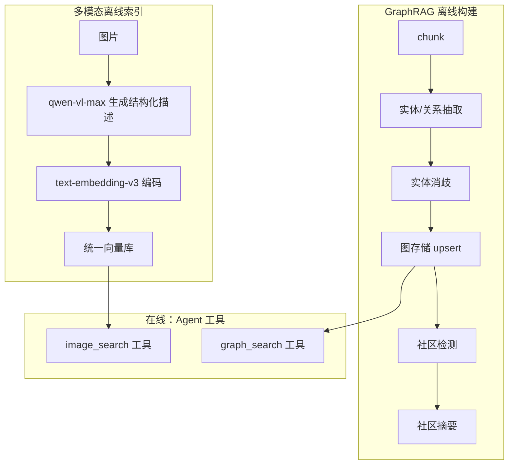
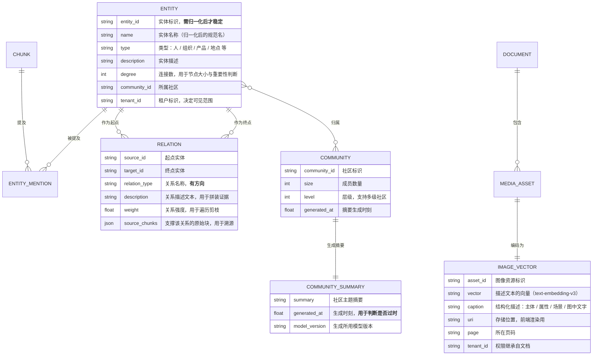
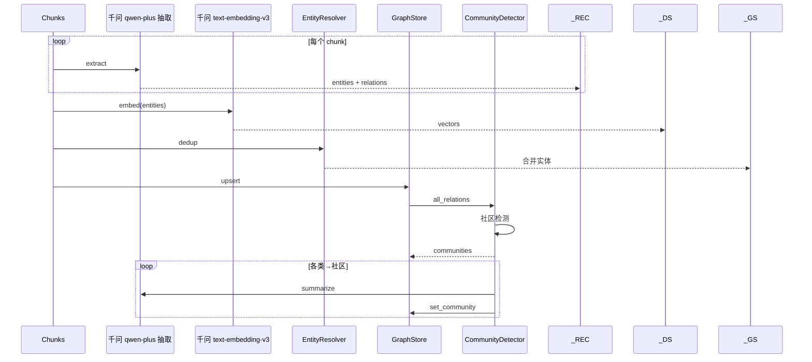
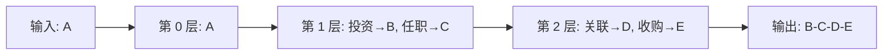
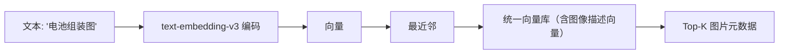

# 阶段 7：GraphRAG 与多模态 RAG（实现细节）

> 本阶段引入两个**全新能力**——**GraphRAG（实体关系推理）与多模态 RAG（跨模态检索）**。两个能力挂入阶段 6 的 ToolRegistry，Agent 可自主选择调用。

---

## 一、阶段定位与边界

### 1.1 业务能力范围



### 1.2 解决的核心问题

| 旧问题 | 新解法 |
| --- | --- |
| 实体链式问题答不出 | graph_search 实体 → BFS 关系路径 |
| 表格 / 图片答不出 | image_search 文本 → 相似图片 |
| 文档间隐含关联挖掘不出 | 实体抽取 + 关系抽取 |
| 实体分散在不同文档 | 实体消歧 |

### 1.3 验收标准

| 指标 | 目标值 |
| --- | --- |
| 实体链式问题 EM | ≥ 0.65 |
| 跨模态检索命中率 | ≥ 0.6 |
| 实体消歧 F1 | ≥ 0.9 |
| 图谱查询 P95 延迟 | ≤ 200ms |

---

## 二、GraphRAG 的全链路

### 2.1 实体与关系抽取

**模型层**：

- 用千问 `qwen-plus` 从每个 chunk 抽取 `{entities, relations}`——**通过平台接口调用，不部署本地抽取模型**；
- 关系必须附原文引用（evidence），保证可溯源；
- 模型输出 JSON，由自定义解析器做结构校验（**平台侧不支持强约束 JSON 时必须自行校验并重试**）。

**抽取的语义边界**：

- 实体类型：**Person / Org / Product / Concept / Event** 五类；
- 关系类型：**投资 / 任职 / 收购 / 关联 / 位于 / 影响** 等领域相关；
- 不需要预设完整 schema，**让 LLM 根据领域自适应**。

**抽取成本**：

每 chunk 抽取约 1k-3k token。**1 万 chunk 的文档约 15-30M token**，**这是 GraphRAG 构建的主要成本**。

### 2.2 实体消歧的本质问题

**消歧的核心矛盾**：同一实体在不同 chunk 中可能用不同表达：

```
chunk 1: "Acme 公司投资了..."
chunk 2: "该公司 CEO..."
chunk 3: "Acme Inc. 的财报..."
```

三个 chunk 中同一个 entity (`Acme`)，**应当指向同一个图节点**。

**消歧算法**：

1. 把每个 entity name 用千问 `text-embedding-v3` 转成向量；
2. 按出现顺序遍历；
3. 对每个新实体，与已有代表实体的向量相似度 ≥ 阈值（如 0.85）→ 合并；
4. 否则视为新实体。

**消歧阈值的影响**：

- 阈值过低（如 0.5）：不同实体被错误合并（图谱稀疏）；
- 阈值过高（如 0.95）：同名实体被错误分离（图谱碎片）；
- **经验值 0.85**，需基于自有数据调优。

### 2.3 图存储的设计

**三类实现并存**：

| 实现 | 用途 |
| --- | --- |
| 内存图（邻接表） | 测试 / 单机演示 |
| Redis 图（数据结构套嵌） | 小规模生产 |
| Neo4j | 中大规模生产 |

**接口抽象**：

```
BaseGraphStore:
  upsert_entity(entity)
  upsert_relation(rel)
  neighbors(name, depth=2) → [rel]
  all_relations() → [rel]
  set_community(name, id, summary)
```

**为什么需要接口**：

- 测试不依赖 Neo4j 安装；
- 不同规模可渐进式升级；
- 单元测试可针对性验证 BFS 算法正确性。

### 2.4 社区检测与摘要

**社区检测算法选择**：

| 算法 | 优势 | 劣势 |
| --- | --- | --- |
| 连通分量 | 简单、零依赖 | 粒度粗 |
| Louvain | 模块度最优 | 需 `python-louvain` |
| Leiden | Louvain 改进，社区内部更紧凑 | 需 `leidenalg` (C 扩展) |

**社区检测算法的取舍原则**：

- **算法可替换必须落在接口上**——不同规模、不同部署环境（是否允许 C 扩展、是否需要多机并行）会选不同算法；
- **默认用零依赖的实现**保证可跑通，生产环境再切换为质量更优的实现；
- **社区编号必须稳定**——同一份图重复跑出的社区编号若不稳定，会导致"摘要挂在错误社区上"。若算法本身不确定，需在使用前对节点排序做归一化。

**摘要的层级**：

- 每个社区生成一份摘要，作为该社区的"主题描述"挂到社区上，供检索时命中；
- 摘要内容回答"这个社区涉及什么主题、有哪些关键实体"；
- 摘要与原始实体**共存于同一个检索空间**，形成类似 RAPTOR 的多级结构——抽象问题命中摘要，具体问题命中实体。

**社区摘要的成本**：摘要是大模型调用，成本与社区数量线性相关。**社区数量应做上限控制**（如合并过小社区），否则图规模一大，摘要成本会超过实体抽取本身。

---

## 三、图检索的执行方式

图构建完成后，如何"用"图决定了 GraphRAG 的实际效果。

### 3.1 从问题到种子实体

图检索的第一步不是遍历，而是**确定从哪个实体出发**。这一步的质量直接决定后续所有遍历是否有意义。

| 方式 | 做法 | 适用 | 风险 |
| --- | --- | --- | --- |
| 直接命中 | 问题中的实体名与图中实体精确匹配 | 问题中明确出现实体名 | 表述差异导致漏匹配 |
| 别名归一 | 先做实体识别与归一，再匹配 | 同一实体的多种叫法 | 归一错误会指向错误实体 |
| 向量召回实体 | 用问题向量在实体向量空间中召回候选 | 问题未出现确切实体名 | 可能召回语义相近但无关的实体 |
| 混合 | 前三种取并集后去重 | **默认策略** | 需要控制候选数量 |

**种子实体的数量要设上限**：种子过多会导致遍历出的子图爆炸，最终拼进提示词的内容远超预算。建议 **Top-3 种子**，并对每个种子的遍历深度做限制。

### 3.2 遍历策略

| 策略 | 特点 | 何时用 |
| --- | --- | --- |
| 广度优先（逐层展开） | 先近后远，符合人的提问直觉 | **默认**——用户问"A 投资了谁"，先看到直接投资对象 |
| 深度优先 | 沿一条关系链走到底 | 追查链条型问题（"A 的上游供应商的上游是谁"） |
| 带权重的最短路 | 优先走强关系 | 图中存在"弱关联噪声"时 |
| 社区内聚合 | 不展开个体，直接用社区摘要 | 问题指向"某领域整体情况" |

**遍历深度不能无限**：深度 2 通常足够回答绝大多数实体关系问题，深度 3 以上会迅速引入大量弱相关节点，**收益下降而噪声剧增**。默认深度 2，个别场景放开到 3。

### 3.3 图谱结果与向量结果的协同

图谱检索与向量检索是**互补关系**，两者必须在同一次回答中协同：

| 问题类型 | 主力 | 辅助 |
| --- | --- | --- |
| 事实型（"电池电压是多少"） | 向量检索 | — |
| 实体关系型（"A 和 C 是什么关系"） | 图谱检索 | 向量检索补充细节 |
| 多跳链条型（"A 投资的公司里谁在负责研发"） | 图谱检索（多跳） | — |
| 主题概览型（"这个行业有哪些玩家"） | 社区摘要 | 向量检索补齐 |
| 混合型（"A 的产品 B 有什么质量问题"） | 二者并列 | 交叉验证 |

**协同的关键在于"证据去重与归并"**：图谱返回的是"关系三元组文本"，向量返回的是"原文片段"，两者格式不同但信息可能重叠。归并时应**保留来源标注**（来自图谱还是来自原文），便于前端分类展示与用户判断可信度。

### 3.4 图谱检索的失败模式

| 失败模式 | 表现 | 根因 | 应对 |
| --- | --- | --- | --- |
| 实体未命中 | 图谱返回空 | 问题中的说法与图中实体名不一致 | 回退到向量检索，**不允许直接判为无答案** |
| 子图过大 | 证据条数暴涨、时延升高 | 种子过多或深度过深 | 限制种子数与深度，并对关系按权重截断 |
| 关系方向错误 | 答案把"A 投资 B"说成"B 投资 A" | 关系为有向但展示时未标注方向 | 展示时**必须带方向**，不可只给无向的关联描述 |
| 社区摘要过时 | 摘要内容与现实不符 | 图更新后未重算社区 | 图更新触发社区重算，摘要带生成时间戳 |

---

## 四、多模态 RAG

### 4.1 跨模态检索的本质

**跨模态检索的目标是让"用文字找图"和"用图找文字"都变成最近邻搜索问题**：

- 文本"一只猫" 编码为向量 T；
- 图像 cat.jpg 经过处理后也进入同一个向量空间，得到向量 I；
- 二者距离足够近 → 以文搜图即可命中。

**这就是跨模态检索的全部原理**——不存在"图像理解"这类魔法，本质仍是向量相似度。**真正的分歧点在于"图像怎么进入文本的向量空间"**，这正是下面两条路线的差别。

**跨模态向量有两条技术路线，本项目选择第二条**：

| 路线 | 做法 | 优点 | 代价 |
| --- | --- | --- | --- |
| **双塔对比模型**（CLIP / BGE-VL 系） | 图像与文本各由一个编码器映射到同一向量空间 | 向量天然对齐，可直接以图搜图 | **需另行部署两套编码器**，并维护第二个向量空间、第二条失效链 |
| **生成式描述 + 文本向量**（本项目） | 先用 `qwen-vl-max` 为图像生成结构化描述文本，再用 `text-embedding-v3` 编码该描述 | **与全系列文本向量完全同空间，不引入第二套模型**；描述文本本身可被检索、可被引用、可被审阅 | 检索精度依赖描述质量；纯"以图搜图"需先转成描述再检索 |

**为什么选第二条**：向量能力已在阶段 1 统一到千问 `text-embedding-v3`。若为图像另起一套双塔模型，就要同时维护两个向量空间、两套索引与两条失效链——**系统的复杂度会翻倍，而收益只在"以图搜图"这一条路径上**。用描述文本折中的代价是一次图像理解调用，收益是**整个系统只有一个向量空间**。

**选型的三条硬约束**：

1. **图像描述必须由同一模型生成**——更换 `qwen-vl-max` 的档位或版本会使描述文本的分布漂移，**历史向量与新向量不再可比，必须全量重编码**；
2. **描述文本必须用与正文相同的向量模型**——即 `text-embedding-v3`，**不允许图像另起一套向量空间**；
3. **描述必须结构化**——固定输出"主体 + 属性 + 场景 + 图中文字"四段，自由格式的描述会让检索命中率不可控，**也无法按字段做过滤或排序**。

### 4.2 统一向量库与图像元数据

**本项目不为图像另起索引**，图像描述向量与正文向量**存放在同一个库里**：

1. **同一库内混合存放**文本与图像描述向量——不另起索引，避免跨库归并与分数不可比的复杂度；
2. **元数据是必需品而非可选**——检索结果必须能让前端把图片**显示出来**。

**每条图像向量必须携带的元数据**：

| 字段 | 用途 | 缺失后果 |
| --- | --- | --- |
| 存储路径 / 资源标识 | 前端渲染图片 | 检索到却无法展示 |
| 结构化描述文本 | 前端展示与可访问性；也是"以图搜文"的桥梁 | 结果卡片只有一张图，**无法解释为何命中，也无法人工核对描述是否失真** |
| 来源文档与页码 | 溯源跳转 | 用户无法核对原始出处 |
| 所属租户与权限标记 | 阶段 9 的 ACL 过滤 | 造成越权，**属于严重安全问题** |
| 描述生成模型与版本 | 判断描述是否需重建 | 换模型后无法识别哪些向量已过时 |

**"描述生成模型与版本"这条容易被忽略**：图像描述是模型产物而非原始数据，**它是会过时的**。不记录生成版本，就无法在升级 `qwen-vl-max` 后精确地只重建受影响的向量。

### 4.3 Agent 工具的封装

**两个新工具**：

| 工具 | 用途 | 输入 | 输出 |
| --- | --- | --- | --- |
| `graph_search` | 实体 → BFS 关系 | 实体名 | 关系路径文本 |
| `image_search` | 文本 → 相似图片 | 自然语言描述 | 图片元数据列表 |

**ToolRegistry 中注册后**，Agent 在 plan 阶段会自动看到这两个工具的 description，**自主决定是否调用**。

---

## 五、数据模型设计

本阶段引入**图模型**（实体、关系、社区）与**多模态资源向量**两类全新数据，并为证据增加"类型"维度。

### 5.1 新增实体一览

| 实体 | 作用 | 存放位置 | 生命周期 |
| --- | --- | --- | --- |
| 实体节点 | 图的最小单元，代表一个具体对象 | 图存储或内存图结构 | 随文档入库更新 |
| 关系边 | 描述两个实体之间的有向关联 | 与实体同在图中 | 同上 |
| 社区 | 实体的聚类分组 | 图存储 | 每次全量重算时重建 |
| 社区摘要 | 社区的主题描述，参与检索 | 向量库 + 元数据 | 随社区重算 |
| 图像向量 | 图像的跨模态向量 | 与文本共用向量库 | 随文档入库 |
| 图像元数据 | 路径、描述、页码、权限 | 元数据存储 | 同上 |

**图数据与向量数据的存放必须分开**：向量的操作是"近邻搜索"，图的操作是"多跳遍历"，**两者的存储引擎优化方向完全相反**。把它们塞进同一个存储，会同时损失两边的性能。

### 5.2 实体关系



### 5.3 图模型的关键约束

| 约束 | 说明 |
| --- | --- |
| **实体名必须归一化** | 同一实体的不同叫法（全称 / 简称 / 别名）必须归并到同一实体。**不归一化会得到一张"同一对象被拆成多个节点"的图，多跳检索必然断链** |
| **关系必须带方向** | "A 投资 B"与"B 投资 A"是两回事。**方向丢失会让答案出现事实性错误**，且这类错误极难被用户察觉 |
| **关系必须能溯源到块** | 每条关系都要记录"由哪些块抽取而来"，否则用户无法核对"这条关系是从哪来的" |
| **关系必须带强度** | 遍历时需要按强度剪枝；**没有强度就只能按数量截断，会优先保留高频但无关的关系** |
| **社区必须有层级** | 大规模图需要多级社区；单层社区在节点数上万后会退化为"一个大社区 + 一堆小社区" |
| **社区编号必须稳定** | 同一份图重复计算得到的社区编号若不稳定，**摘要会挂到错误的社区上**；不稳定的算法必须先用节点排序做归一化 |

### 5.4 实体归一化的数据设计

归一化是图质量的命门，因此需要专门的映射数据：

| 数据 | 作用 | 关键点 |
| --- | --- | --- |
| 规范名 | 一个实体的唯一名称 | 用于去重与展示 |
| 别名集合 | 指向同一实体的其它写法 | 抽取时先查别名表再决定是新建还是合并 |
| 实体类型 | 限制归一化的范围 | **只在同类型之间合并**——不同类型即使同名也不应合并（如"苹果"公司与人名） |

**"只在同类型间合并"是一条硬约束**：把同名的公司与产品合并，会在图上产生完全错误的连接，且这类错误会通过多跳检索被放大。

### 5.5 图像数据的约束

| 约束 | 说明 |
| --- | --- |
| 图像描述必须由同一模型生成 | 换 `qwen-vl-max` 档位或版本会使描述分布漂移，历史向量与新向量不可比，需全量重编码 |
| 描述文本必须用与正文相同的向量模型 | 即 `text-embedding-v3`，**不允许图像另起一套向量空间** |
| 必须携带描述文本 | 图像向量支持"以图搜图"，**要让文字问题命中图像，描述文本必须单独入库并参与检索** |
| 必须携带权限字段 | 图像是独立存储对象，**不继承权限会导致阶段 9 的 ACL 在图像上出现漏洞** |
| 必须有内容摘要 | 同一图像在多个文档中出现时去重入库，节省容量与检索位 |

### 5.6 图数据的更新与一致性

| 问题 | 处理方式 |
| --- | --- |
| 文档更新后实体过时 | 记录每个实体、每条关系与来源块的关联，**按块删除后重建相关部分** |
| 社区摘要过时 | 摘要带生成时刻；超过设定时长或图规模变化超过阈值即触发重算 |
| 孤立实体堆积 | 定期统计无任何关系的实体占比，**占比过高说明关系抽取质量下降** |
| 跨文档同实体 | 通过归一化合并为同一节点，并保留来自不同文档的溯源信息 |

**图的一致性无法做到强一致**，因为一次文档更新会波及实体、关系、社区、摘要四类数据。可行做法是**以"块"为最小更新单位**：块变了，就删除该块贡献的实体与关系，再重新抽取。**这比"整图重建"代价低得多，也避免了全量重算期间图不可用**。

---

## 六、关键决策记录

### 6.1 为什么 GraphRAG 不替代向量检索？

GraphRAG 擅长实体关系，**但不是所有问题都是关系问题**——很多问题纯文本匹配就够。**GraphRAG 与向量检索是互补关系**，不能相互替代。

### 6.2 为什么 BFS 而不是 DFS？

BFS（广度优先）保证"先访问近的、再访问远的"，**符合人类思维模式**——用户问"A 投资了谁"，自然期望先看到 A 直接投资的对象，再看间接的。

### 6.3 为什么图存储要抽象？

直接绑死 Neo4j 会让：
- CI 环境安装复杂；
- 单机演示成本高；
- 单元测试难写。

**抽象接口后，生产用 Neo4j、测试用内存图**，互不污染。

### 6.4 为什么多模态不替代文本检索？

多模态描述对纯文本的检索效果 **不如直接编码原文**——图像描述终究是"对图像的转述"，会丢失细节。因此本项目的多模态路径是**图像先转描述、再走与正文相同的 `text-embedding-v3` 向量与检索链路**，而不是用一个通用多模态向量覆盖全部文本。**多模态是补充，不是替代**。

---

## 七、关键流程图

### 7.1 GraphRAG 构建



### 7.2 图检索 BFS



### 7.3 多模态检索



---

## 八、与上一阶段差异

| 模块 | 阶段 6 | 阶段 7 |
| --- | --- | --- |
| 工具集 | vector / sql / web / calc | + graph_search + image_search |
| 检索范式 | 文本向量 | 向量 + 图谱 + 图像描述向量 |
| 索引资产 | 文本向量 | + 知识图谱 + 图像描述向量（同一向量空间） |
| 问题覆盖 | 文档片段 | + 实体关系 + 图文 |

---

## 九、本阶段遗留问题 → 下一阶段预告

| 现象 | 根因 | 下一阶段 |
| --- | --- | --- |
| 长报告任务上下文爆炸 | 单 Agent 串行 | 阶段 8 多智能体 |
| 无质量审阅环节 | 单角色输出 | 阶段 8 Critic Agent |

→ 下一阶段：[`../stage-8-multi-agent/README.md`](../stage-8-multi-agent/README.md)