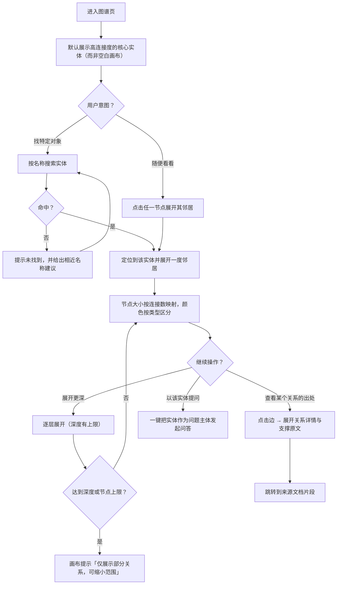
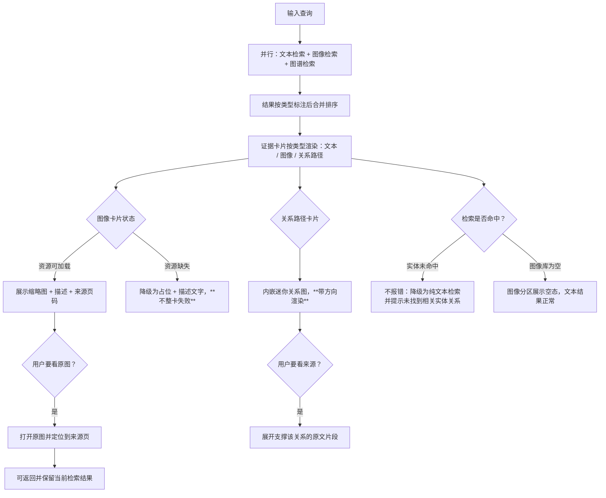

# 阶段 7 前端设计：图谱可视化与跨模态检索

> 本阶段在前端引入 **知识图谱浏览器、跨模态检索结果混排、实体卡片**。用户能"看到"实体间的关系网络。

---

## 一、新增页面

| 路由 | 页面 | 角色 |
| --- | --- | --- |
| `/graph` | 图谱浏览器 | 全部用户 |
| `/graph/entity/:name` | 实体详情 | 全部用户 |

对话页增量：图/文检索结果以新形态呈现。

---

## 二、图谱浏览器（`/graph`）

### 2.1 整体布局

```
┌────────────────────────────────────────────────────────┐
│ 知识图谱             搜索: [输入实体名 ▼]    [过滤]    │
├────────────┬───────────────────────────────┬──────────┤
│  左侧:      │  中央: 图谱画布              │  右侧:    │
│ 实体列表   │                              │ 选中详情  │
│            │     [节点 节点]                │          │
│ 类型过滤   │       /   |                    │ 实体名    │
│            │     [节点]——[节点]              │ 描述      │
│ 关系过滤   │       |    /                    │ 入边关系 │
│            │     [节点]  [节点]              │ 出边关系 │
│            │                              │          │
│            │                              │          │
└────────────┴───────────────────────────────┴──────────┘
```

### 2.2 实体列表（左侧）

**搜索框**：

- 输入部分名称 → 自动补全（前端本地索引）；
- 输入后回车 → 图谱画布聚焦到该实体。

**类型过滤**：

```
☑ Person
☑ Org
☑ Product
☑ Concept
☑ Event
```

**关系过滤**：

```
☑ 投资
☑ 任职
☑ 收购
☑ 关联
☑ 位于
☑ 影响
```

**交互**：每选/取消一项 → 图谱画布立即过滤更新。

### 2.3 图谱画布（中央）

**节点视觉**：

| 实体类型 | 颜色 | 形状 |
| --- | --- | --- |
| Person | 蓝 | 圆 |
| Org | 紫 | 方 |
| Product | 青 | 圆角矩形 |
| Concept | 绿 | 六边形 |
| Event | 琥珀 | 三角 |

**边视觉**：

| 关系类型 | 颜色 | 线型 |
| --- | --- | --- |
| 投资 | 红 | 实线 |
| 任职 | 蓝 | 实线 |
| 收购 | 紫 | 实线 |
| 关联 | 灰 | 虚线 |
| 位于 | 青 | 虚线 |
| 影响 | 琥珀 | 虚线 |

**边标注**：

- 鼠标悬停 → 显示关系名称 + evidence（来源原文）；
- 双向边用两个箭头表示。

**画布交互**：

- **滚轮**：缩放（范围 0.5x ~ 3x）；
- **拖拽空白**：平移；
- **点击节点**：右侧显示详情；
- **拖拽节点**：调整布局；
- **双击节点**：展开其所有邻居节点（力导向布局自动调整）。

**布局算法**：

- 节点位置由力导向算法确定（避免重叠、缩短边长）；
- 中心节点默认布局在画布中心。

**性能优化**：

- 节点超过 200 个时**自动切换**为分层布局；
- 仅显示当前过滤范围内的节点 + 一度邻居（默认深度 1）。

### 2.4 实体详情（右侧）

**布局**：

```
┌──────────────────────────────────────┐
│ [Org] Acme 公司                      │
│ ──────────────────────────────────── │
│ 类型: Org                            │
│ 描述: 总部位于旧金山的科技公司        │
│ 社区: 主题-科技行业 (#1)             │
│ 社区摘要: ...                        │
│ ──────────────────────────────────── │
│ 入边关系:                           │
│   ← 投资 - TechCapital              │
│   ← 任职 - 张三 (CEO)              │
│ 出边关系:                           │
│   投资 → Beta 创业                  │
│   收购 → Gamma 股份                  │
└──────────────────────────────────────┘
```

**交互**：

- 点击入/出边中的实体 → 图谱画布聚焦该实体；
- 点击"加入查询"按钮 → 实体名作为 query 传给对话页（自动跳转）；
- 点击"社区摘要" → 弹出浮层显示完整摘要。

---

## 三、实体详情页（`/graph/entity/:name`）

**单独的实体详情页**，左侧图谱小窗（聚焦实体）+ 右侧完整详情。

```
┌────────────────────────────────────────────────────────┐
│ < 返回   Acme 公司                                   │
├─────────────────┬──────────────────────────────────────┤
│ 局部图谱:        │ 完整信息                              │
│                  │ 类型: Org                            │
│   [Acme 公司]    │ 描述: ...                            │
│   /    \         │ 社区摘要: ...                         │
│ [投资]  [收购]    │                                      │
│  |       |       │ 出边关系:                            │
│ [Beta]  [Gamma]  │  - 投资 → Beta 创业                  │
│                  │  - 收购 → Gamma 股份                  │
│                  │                                      │
│                  │ 入边关系:                            │
│                  │  - 任职 ← 张三                       │
│                  │  - 投资 ← TechCapital               │
└─────────────────┴──────────────────────────────────────┘
```

---

## 四、对话页增量：跨模态结果

### 4.1 多模态检索结果混排

**触发**：image_search 工具被调用。

**视觉**：

```
┌────────────────────────────────────────────────────────┐
│ 答案                                                │
│ ─────────────────────────────────────────────────── │
│   "电池组装示意见 [#1]..."                              │
│   ──────────────────────────────────────────  │
│   证据:                                              │
│   [#1] 📷 battery_assembly.png                       │
│        描述: 电池组装工艺示意图                       │
│        来源: manual.pdf 第 12 页                     │
│        相似度: 0.89                                   │
│   [#2] [文本片段] ...                                │
└────────────────────────────────────────────────────────┘
```

**图片证据卡片**与文本证据卡片**结构一致**，仅头部用"📷"标记。

### 4.2 图片大图查看器

**触发**：点击"📷"证据卡片。

**行为**：弹出大图查看器，**保留溯源信息**：

- 图片居中放大展示；
- 顶部显示来源（pdf 第 X 页 / 文件名）；
- 底部"原文位置"按钮 → 跳转原文档对应位置。

### 4.3 多模态检索过程

在 AgentTraceTimeline 中，image_search 步骤的 ToolCallCard 显示：

```
🔧 image_search
输入: "电池组装图"
耗时: 56ms
输出:
  图1 score=0.89 path=battery_assembly.png desc=电池组装工艺
  图2 score=0.82 path=circuit.png desc=电路图
命中: 2 张
```

---

## 五、监控大盘增量

### 5.1 图谱指标

| 指标 | 含义 |
| --- | --- |
| 实体总数 | 知识图谱节点数 |
| 关系总数 | 边数 |
| 社区数 | Leiden 社区数 |
| graph_search 调用率 | 反映实体链问答性能 |

### 5.2 多模态指标

| 指标 | 含义 |
| --- | --- |
| 图片库规模 | 图像描述向量数 |
| image_search 命中率 | Top-1 命中相关性 |
| 图像检索响应耗时 | 含描述向量化 + 检索耗时 |
| 描述生成失败率 | qwen-vl-max 调用失败或输出不可解析的比例 |

### 5.3 图谱健康度告警项

| 告警 | 阈值建议 | 含义 |
| --- | --- | --- |
| 孤立实体占比 | > 20% | 大量实体没有任何关系，说明关系抽取质量差 |
| 社区数骤降 | 环比 -30% | 图更新后聚类异常，社区摘要可能失真 |
| 图谱检索空返回率 | > 15% | 种子实体匹配失败率过高，需检查实体识别 |

---

## 六、API 契约（本阶段新增）

| 端点 | 用途 | 关键字段 |
| --- | --- | --- |
| `GET /graph/entities` | 实体列表（支持搜索与过滤） | `name` / `type` / `degree`（连接数） |
| `GET /graph/entity/{name}` | 实体详情 | `name` / `type` / `description` / `community` / `in_edges[]` / `out_edges[]` |
| `GET /graph/subgraph` | 拉取子图（画布渲染用） | 入参 `seed` / `depth`；返回 `nodes[]` / `links[]` |
| `GET /graph/communities` | 社区列表与摘要 | `community_id` / `summary` / `size` |
| `POST /search/media` | 以文搜图 | 返回 `items[]`（含 `path` / `desc` / `source` / `score`） |

**`GET /graph/subgraph` 的字段设计要点**：

| 字段 | 类型 | 说明 |
| --- | --- | --- |
| `nodes[].id` | 字符串 | 实体唯一标识，前端据此做去重与定位 |
| `nodes[].type` | 枚举 | 决定节点形状与颜色（见第七节） |
| `nodes[].degree` | 整数 | 连接数，用于节点大小映射 |
| `links[].source` / `target` | 字符串 | 起止节点 id |
| `links[].relation` | 字符串 | 关系名称，前端需**带方向渲染** |
| `links[].direction` | 枚举 | `forward` / `backward` |
| `truncated` | 布尔 | **子图是否被截断**——为真时画布必须提示"仅展示部分关系" |

**流式事件（本阶段新增两类证据）**：

| 事件 | 载荷 | 前端动作 |
| --- | --- | --- |
| `evidence` | 增加 `kind` 字段：`text` / `image` / `graph` | 按 `kind` 渲染不同形态的证据卡片 |
| `graph_path` | `nodes[]` / `links[]` | 在证据卡片下方内嵌迷你关系路径图 |

**错误码**：

| 错误码 | 场景 | 前端表现 |
| --- | --- | --- |
| 33xx | 图片资源不存在 | 该证据卡片降级为"图片不可用"占位 + 描述文字 |
| 34xx | 实体未在图谱中 | 不报错，**降级为纯文本检索结果**，并提示"未找到相关实体关系" |
| 35xx | 子图过大被截断 | 画布顶部黄色提示"仅展示前 N 个关系，可缩小范围" |

---

## 七、关键交互流程

### 7.1 图谱探索流程

图谱页面与其他页面最大的差别是：**用户不知道"图里有什么"，因此不能只提供一个搜索框**。流程必须从"可探索的入口"开始。



**"默认展示核心实体而非空白画布"是体验上的关键决定**：空白画布让用户无从下手，而"图里有什么"本身就是用户想了解的信息。**用高连接度实体作为默认视图，等于用图自身的结构回答了这个疑问**。

**"子图被截断必须提示"**：截断而不提示，用户会误以为"关系就这么少"，从而得到错误的结论。

### 7.2 跨模态检索流程



**"实体未命中不报错、降级为纯文本检索"是本流程的核心**：图谱只是补充能力，**它失效不应导致整次提问失败**。

**"关系必须带方向渲染"**：省略方向会让用户把"A 投资 B"理解成"B 投资 A"，**这是不可接受的事实性错误**。

---

## 八、视觉规范（新增）

### 8.1 实体色板

| 类型 | 主色 | 形状 |
| --- | --- | --- |
| Person | `#3B82F6` 蓝 | 圆形 |
| Org | `#8B5CF6` 紫 | 方形 |
| Product | `#06B6D4` 青 | 圆角矩形 |
| Concept | `#10B981` 绿 | 六边形 |
| Event | `#F59E0B` 琥珀 | 三角形 |

### 8.2 关系色板

| 关系 | 颜色 | 线型 |
| --- | --- | --- |
| 投资 | `#DC2626` 红 | 实线 2px |
| 任职 | `#3B82F6` 蓝 | 实线 2px |
| 收购 | `#8B5CF6` 紫 | 实线 2px |
| 关联 | `#94A3B8` 灰 | 虚线 1px |
| 位于 | `#06B6D4` 青 | 虚线 1px |
| 影响 | `#F59E0B` 琥珀 | 虚线 1px |

### 8.3 图谱画布性能：节点超过 200 切换

- 200 个以下：力导向自由布局；
- 200 个以上：自动切换**分层布局**（树状）；
- 切回自由布局按钮在画布右上角。

---

## 九、可访问性

- 实体详情必须用语义化标签（`<dl>` 描述列表）；
- 关系列表用 `<ul role="list">`；
- 图谱画布必须有"切换为表格视图"功能（键盘可达）。

---

## 十、性能预算

| 指标 | 目标 |
| --- | --- |
| 图谱加载 | ≤ 1s（200 节点） |
| 节点拖拽流畅度 | ≥ 30 fps |
| 多模态检索响应 | ≤ 200ms |

---

## 十一、本阶段交付清单

- [x] 图谱浏览器（`/graph`）：实体列表 + 画布 + 详情
- [x] 实体详情页（`/graph/entity/:name`）
- [x] 对话页多模态证据卡片（图片型）
- [x] 图片大图查看器
- [x] AgentTraceTimeline 多模态步骤展示
- [x] 监控大盘图谱 + 多模态指标卡片

→ 下一阶段：[`../stage-8-multi-agent/frontend-design.md`](../stage-8-multi-agent/frontend-design.md)