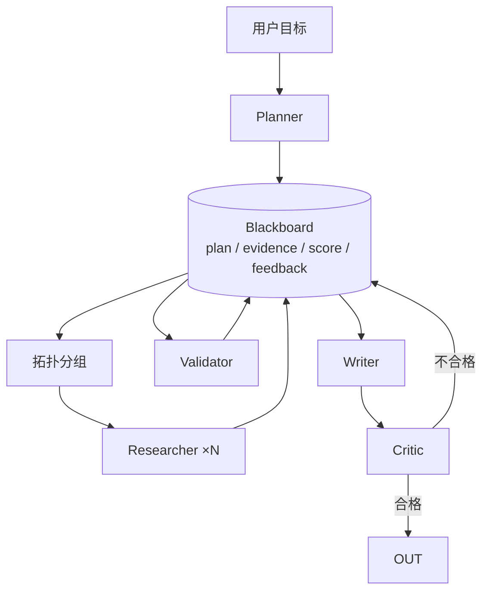
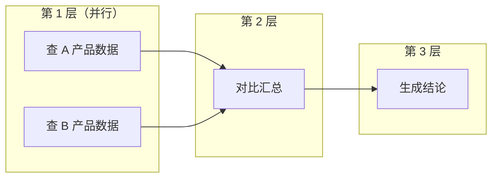
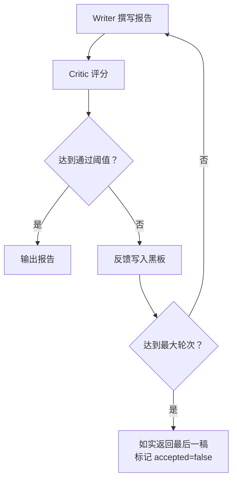
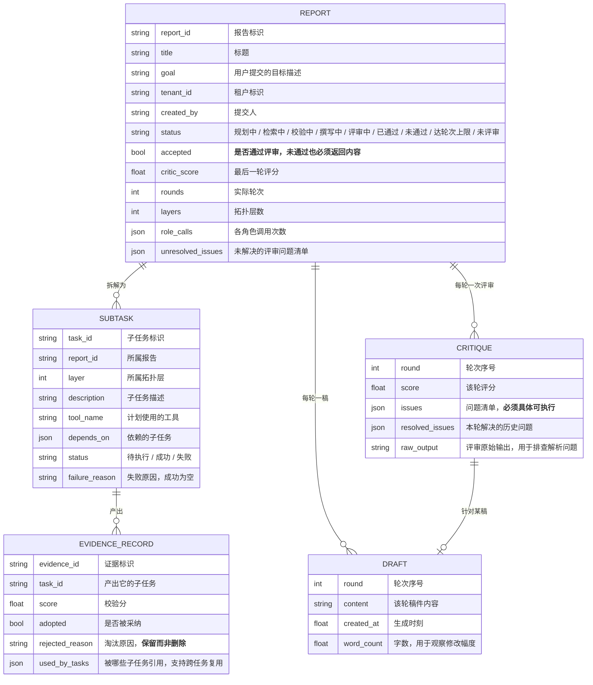
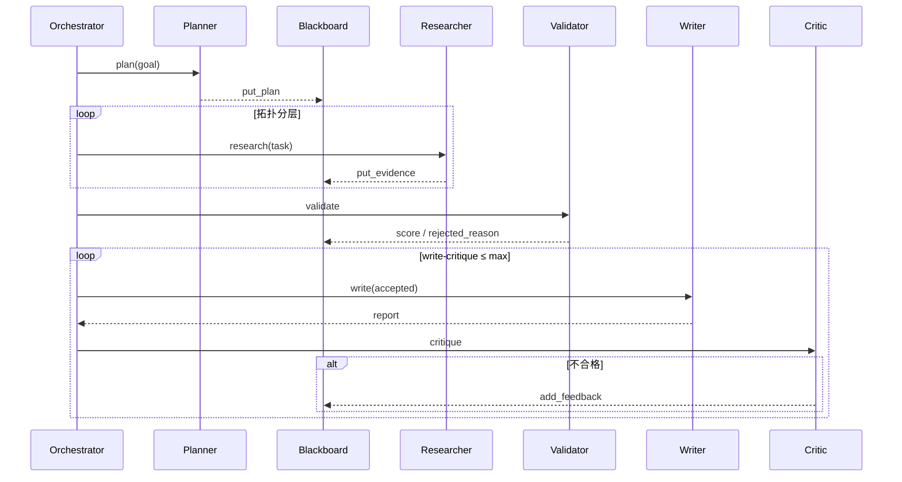
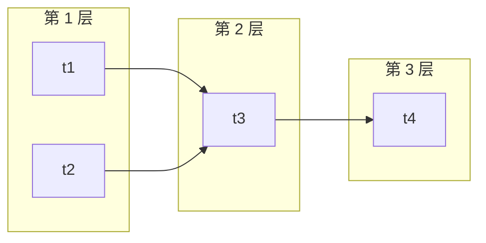

# 阶段 8：多智能体协同（实现细节）

> 本阶段把单一 Agent 扩展为 **Planner / Researcher / Validator / Writer / Critic** 五角色协同框架。通过 **Blackboard（黑板）共享证据、拓扑分组并行执行、Writer↔Critic 评分循环**保证报告质量。

---

## 一、阶段定位与边界

### 1.1 业务能力范围

### 1.2 解决的核心问题

| 旧问题 | 新解法 |
| --- | --- |
| 单 Agent 上下文爆炸 | 角色分工 + 共享证据池 |
| 长报告任务无法拆解 | Planner 拆子任务 + 拓扑分层 |
| 答案质量单一视角 | Critic 评分循环 |
| 多步骤任务串行慢 | 同层并行 |

### 1.3 验收标准

| 指标 | 目标值 |
| --- | --- |
| 报告 completeness | ≥ 0.85 |
| 报告 faithfulness | ≥ 0.9 |
| Critic 一次通过率 | ≥ 0.7 |
| 平均耗时（10 个子任务） | ≤ 15s |

---

## 二、五角色职责划分

### 2.1 角色矩阵

| 角色 | 输入 | 输出 | 工具 |
| --- | --- | --- | --- |
| Planner | 用户目标 | Plan（subtasks + 依赖） | LLM |
| Researcher | subtask | Evidence | 检索/工具调用 |
| Validator | goal + evidence | 评分 + 淘汰标记 | 评分器 |
| Writer | accepted evidence | 报告 | LLM |
| Critic | goal + 报告 | score + issues | LLM |

**五个角色对应的千问平台能力（全部为平台接口调用，无本地模型）**：

| 角色 | 平台模型 | 档位选择的理由 |
| --- | --- | --- |
| Planner | `qwen-plus` | 拆解质量决定整个任务的成败，**这是最不该省成本的一步** |
| Researcher | 检索工具（内含 `text-embedding-v3` / `gte-rerank-v2`） | 不直接调用生成模型，以工具结果为准 |
| Validator | `gte-rerank-v2` | 与阶段 5 的证据评分复用同一口径，**避免多角色之间出现两套分数标准** |
| Writer | `qwen-max` | 报告是最终交付物，长文组织与术语一致性对档位最敏感 |
| Critic | `qwen-plus` | 评估需要理解力，但不必用最强档；**多轮循环下档位差异会被轮次放大** |

**档位与轮次的成本关系必须提前算清**：Writer 与 Critic 会执行多轮，**若两轮循环，成本就是单轮的 5~6 倍**。因此把 Critic 放在 `qwen-plus` 而非 `qwen-max`，是"多轮机制"与"成本可控"之间的必要平衡。

**为什么这样切**：

- Planner 与 Writer / Critic 都用 LLM 但职责不同——Planner 关注"拆"，Writer 关注"写"，Critic 关注"评"；
- Researcher 与 Validator 都涉及"评估"——但 Researcher 关注"找到证据"，Validator 关注"证据好不好"。

**角色之间必须共享同一套模型口径**：Validator 的分数要能被 Critic 与运营横向比较，**一旦某个角色换用不同评分器，跨角色的分数就不可比，阈值也就失去意义**。

### 2.2 角色的"独立 prompt"

每个角色有独立 System Prompt：

- Planner：观察全局、列出方案、给出依赖；
- Researcher：执行子任务、按工具拿证据；
- Validator：评分、淘汰、标记原因；
- Writer：整合证据、输出报告；
- Critic：多维度评估、给出改进建议。

**为什么 System Prompt 不能太短**：

LLM 的"角色感"由 prompt 建立。**短 prompt 让 LLM 退化为通用助手，跨任务行为**。

---

## 三、Blackboard 架构

### 3.1 为什么需要 Blackboard

**多 Agent 间共享证据有三种方式**：

| 方式 | 问题 |
| --- | --- |
| 消息传递 | 每个 Agent 都接收全量 evidence，context 易爆 |
| 函数调用 | 紧耦合，难并行 |
| Blackboard | Agent 间共享结构化状态，并行友好 |

**Blackboard 让 Agent 间只传递 ID/指令，证据放在结构化存储**。

### 3.2 黑板必须提供的六类操作

黑板的能力边界由六个操作构成，**多一个不必要，少一个就不够用**：

| 操作 | 作用 | 谁调用 |
| --- | --- | --- |
| 写入计划 | 保存规划结果与依赖关系 | 规划者 |
| 读取计划 | 获取待执行子任务列表（含已完成的过滤） | 调度器、检索者 |
| 追加证据 | 写入一条证据并返回其标识 | 检索者 |
| 列出证据 | 按条件列出证据（全部 / 仅采纳 / 按任务） | 校验者、书写者、前端 |
| 更新证据 | 回填评分或淘汰原因（**不删除**） | 校验者 |
| 追加评审意见 | 保存每一轮的评审结论 | 评审者；由书写者读取 |

**"更新而非删除"是黑板的硬约束**：证据一旦写入就有历史价值——它记录了"当时检索到了什么"，是排查检索质量问题唯一的原始依据。删除操作会让黑板退化为"只剩最终结论"，丧失可追溯性。

**并发写入必须保证不冲突**：同一层内多个检索者会同时追加证据，因此"追加并返回标识"这一操作必须是原子的。若黑板基于键值存储实现，应使用服务端原子追加而非"先读后写"，否则并发写会互相覆盖、造成证据丢失。

### 3.3 Blackboard 的存储选择

| 场景 | 存储 |
| --- | --- |
| 测试 | 内存 dict |
| 单机生产 | 内存 + 启动时从持久化加载 |
| 分布式生产 | Redis（task 粒度 key） |
| 高合规 | PostgreSQL（带审计日志） |

### 3.4 证据记录必须携带的字段

黑板上的每条证据记录都需包含以下七项。**少任何一项都会在后面某一环节出问题**：

| 字段 | 含义 | 缺失后果 |
| --- | --- | --- |
| 证据标识 | 全局唯一的记录号 | 无法在前端定位或做增量更新 |
| 任务标识 | 该证据由哪个子任务产出 | 无法回答"这条证据是谁找的" |
| 内容 | 证据正文 | — |
| 来源工具 | 由哪种检索/工具产出 | 前端无法标注证据类型 |
| 质量分 | 校验者给出的评分，未评分为空 | 书写者无法判断该采信哪条 |
| 淘汰原因 | 被判为不合格时的原因文本 | 无法审计"为什么这条被弃用" |
| 时间戳 | 写入时刻 | 无法排查时序问题 |

**为什么需要"淘汰原因"而非直接删除低分证据**：

低分证据被删除后，出现三种难以排查的现象：一是无法复盘"当时为什么没用这条"；二是重复检索时又被找回来、又被打低分，白白浪费算力；三是无法统计"哪类证据经常不合格"，失去了优化检索的直接线索。**保留并标注，比删除更有价值**。

**淘汰是标记而非物理删除**，因此校验环节在写入淘汰原因后，证据仍留在黑板上，只是不再进入书写者的输入集合。

---

## 四、拓扑分层与并行执行

### 4.1 为什么必须先分层

子任务之间存在**依赖关系**：只有"各产品销量"拿到之后，才能做"销量对比汇总"。若不加区分地全部串行执行，一个 5 子任务的问题要等 5 倍时间；若全部并行，则依赖没满足的子任务会拿到空输入，产出错误结论。

**分层（拓扑排序）是唯一正确的做法**：把子任务按依赖关系分成若干层，同层内并行、跨层串行。

### 4.2 分层的执行语义

| 规则 | 说明 |
| --- | --- |
| 同层并行 | 层内子任务同时发起，总耗时取决于最慢的一个 |
| 跨层串行 | 下一层必须等上一层**全部完成或全部失败**后才开始 |
| 失败不阻塞 | 某子任务失败时，**标记为失败并继续**，不中断整层——由校验环节判断"缺了它是否还能写报告" |
| 层内超时 | 层内任何子任务超过单步超时时间即视为失败，避免一个慢任务拖垮整层 |

### 4.3 层数与并行的取舍

| 情况 | 表现 | 调整方向 |
| --- | --- | --- |
| 层数过多（> 4） | 串行等待累积，总时延高 | 重新规划，把可合并的子任务合并 |
| 单层任务过多（> 8） | 并行度过高，外部资源被打满 | 加并发上限，队列化执行 |
| 层数为 1（全部并行） | 通常意味着规划器忽略了依赖 | **警惕**：可能存在"用了未就绪数据"的隐患 |

**实践中的判断信号**：如果一个多跳问题的规划结果全部落在同一层，大概率是规划器没有正确识别依赖关系，应在规划提示中强化"什么信息必须在什么信息之后才能得到"的说明。

### 4.4 并发控制

并行必须设置上限，否则会瞬间打满向量库、数据库或外部检索的承载力，导致整体超时率上升。推荐做法是**按外部依赖分别设并发上限**（如向量检索并发 8、数据库查询并发 4），并让超出上限的任务排队等待而不是直接失败。

---

## 五、Writer ↔ Critic 评分循环

### 5.1 循环的设计

轮次上限的取值与失败语义见下两节。

### 5.2 反馈的可见性

**书写者在第二轮必须能看到上一轮的评审意见**——这是循环有效的唯一关键。

若看不到意见，书写者每次都从零开始盲写，循环十次也只是十次独立尝试，**不会收敛到更好的结果**。因此评审意见必须落进黑板，且书写者的输入集合必须包含"本轮之前的所有评审意见"。

**反馈必须具体可执行**——"写得不够好"这类意见无法指导修改。评审意见应落到**可验证的条目**上，例如"缺少 B 产品近三年趋势对比"、"第 3 段的数据没有标注来源"。

### 5.3 轮次上限与失败语义

**默认最多 3 轮**，理由如下：

| 轮次 | 典型情况 |
| --- | --- |
| 第 1 轮 | 多数任务已能产出可接受的报告 |
| 第 2 轮 | 少数需要按意见补充对比维度、补全引用 |
| 第 3 轮及以后 | **问题通常已不在写作，而在数据层**——知识库里根本没有相关内容，再写十遍也不会有 |

**达到上限后的行为必须诚实**：

- 返回**最后一稿**（不返回更差的早期版本）；
- 明确标记为**未通过**，并带上最后一轮的评分；
- 附带未解决的评审意见清单，让用户知道差在哪里。

**绝对不允许"伪装通过"**——把未达标的报告标记为达标，会让用户对整套系统的所有评分失去信任。**一个能被信任的"未通过"标记，比一个不可信的"通过"更有价值**。

**另一种情况也要处理**：评审过程本身失败（评审角色调用异常）。此时不能把"评审失败"等同于"未通过"，而应标记为"未评审"并返回报告，同时告警——**把评审失效与质量不达标混为一谈，会掩盖真正的问题**。

---

## 六、数据模型设计

本阶段的核心实体是**报告**与它的四个附属实体。黑板上的证据记录字段已在 3.4 节给出，本节补充**与报告相关的实体及它们之间的关系**。

### 6.1 新增实体一览

| 实体 | 作用 | 存放位置 | 生命周期 |
| --- | --- | --- | --- |
| 报告 | 一次长任务的最终产物与状态 | 关系库（需按用户维度查询） | 长期，随用户管理 |
| 子任务 | 报告的拆解产物 | 与报告同库（内嵌或独立表） | 随报告 |
| 证据记录 | 黑板上的一条证据 | 与报告同库，**可被多个子任务复用** | 随报告 |
| 评审记录 | 每一轮的评分与问题清单 | 与报告同库 | 随报告，**不可覆盖** |
| 草稿版本 | 每一轮的稿件快照 | 对象存储或大字段 | 随报告，可设置保留轮数 |

**草稿必须"每轮一份"而非"只留最新"**：只留最新稿会让"评审前后的差异"无法对比，运营无法判断"评审到底起了什么作用"——**这是评估该机制是否值得保留的唯一依据**。

### 6.2 实体关系

### 6.3 关键字段的约束

**报告**：

| 字段 | 约束 | 说明 |
| --- | --- | --- |
| 状态 | 至少九态 | 需要区分"未通过（评审完成但不达标）"与"未评审（评审环节本身失败）"——**混为一谈会掩盖真正的问题** |
| 是否通过 | 与状态保持一致 | 未通过时**仍要返回内容**，只是标记不同；**禁止伪装通过** |
| 未解决问题清单 | 未通过时必填 | 这是用户最需要的信息（"差在哪"），也是后续人工补足的依据 |
| 各角色调用次数 | 必填 | 用于观察角色活跃度与成本分布；**某个角色调用次数异常偏高往往意味着规划或校验出了问题** |

**子任务**：

| 字段 | 约束 | 说明 |
| --- | --- | --- |
| 所属层 | 必填 | 由依赖关系推导；**层数异常（如全落在一层）是规划器未识别依赖的信号** |
| 失败原因 | 失败时必填 | 用于区分"没有相关信息"与"工具不可用" |
| 状态 | 三态 | 失败不阻塞同层其它任务，但必须留痕，由校验环节判断"缺它是否还能写报告" |

**证据记录**：

| 字段 | 约束 | 说明 |
| --- | --- | --- |
| 淘汰原因 | 未采纳时必填 | **证据保留不删除**——删除会让"当时检索到了什么"永久丢失 |
| 被引用任务 | 数组 | 支持同一证据被多个子任务复用；**复用是长任务降低成本的关键，但必须记清来源，避免溯源混乱** |

**评审记录**：

| 字段 | 约束 | 说明 |
| --- | --- | --- |
| 轮次序号 | 唯一，不可覆盖 | 保留历史轮次才能观察"评审是否在收敛" |
| 问题清单 | 必须落到可验证条目 | "写得不够好"无法指导修改；应落到"缺少某项对比""某段数据无来源" |
| 已解决问题 | 与历史问题清单对照 | **这是衡量评审有效性的直接指标**；若多轮问题清单高度重合，说明评审没有产生实际改进 |
| 评审原始输出 | 必填 | 评审输出解析失败时，**只有靠原始输出才能定位是提示问题还是解析问题** |

### 6.4 数据保留与成本

| 数据 | 保留建议 | 理由 |
| --- | --- | --- |
| 报告与评审记录 | 长期保留 | 是用户资产，也是评估多智能体机制价值的依据 |
| 草稿版本 | 保留最近若干轮 | 全量保留占用空间大，**但至少要保留首稿与终稿**，以便对比评审带来的变化 |
| 证据记录 | 随报告保留 | 体量可控，且是溯源链的落点 |

**长任务是成本最集中的场景**：一次报告可能触发数十次模型调用。因此**每一轮的成本必须可归集到报告**，否则无法回答"这类任务值不值得做"。

---

## 七、关键决策记录

### 7.1 为什么需要 Validator，Critic 不能一起评吗？

- Validator 关注 **单个 evidence** 的质量（与 query 相关）；
- Critic 关注 **整体报告** 的质量（结构、完整、可信）。

粒度不同，**职责清晰胜过职责融合**。

### 7.2 Planner 为什么不直接是 LLM ReAct？

ReAct 是逐步决策，**没有全局规划**。长任务需要先看到全局，才能发现"哪些子任务可并行"、"哪些依赖不可缺"。

### 7.3 Blackboard 不是消息队列吗？

- **消息队列**（Kafka/RabbitMQ）：适合异步任务、流量削峰；
- **Blackboard**（本研究）：适合同步协同、明确领域结构。

**Blackboard 是状态共享，消息队列是事件流**，目标不同。

### 7.4 为什么不并行所有任务？

依赖关系是"必须串行"的——比如"汇总销量"必须先有"各产品销量"。**盲目并行会产生错误结果**。拓扑分组是科学的折中。

---

## 八、关键流程图

### 8.1 端到端时序

### 8.2 拓扑分组

---

## 九、与上一阶段差异

| 模块 | 阶段 7 | 阶段 8 |
| --- | --- | --- |
| Agent 数 | 1 | 5 角色 |
| 状态共享 | messages | Blackboard |
| 任务调度 | LLM 逐步决策 | Planner 显式 DAG |
| 质量控制 | reflect 节点 | Writer↔Critic 循环 |
| 产出 | 答案 | 结构化报告 |

---

## 十、本阶段遗留问题 → 下一阶段预告

| 现象 | 根因 | 下一阶段 |
| --- | --- | --- |
| 所有 Agent 看到全部证据 | 无权限边界 | 阶段 9 ACL |
| 谁问了什么无法追溯 | 无审计 | 阶段 9 审计 |
| 效果好坏凭感觉 | 无系统评测 | 阶段 9 RAGAS |

→ 下一阶段：[`../stage-9-enterprise/README.md`](../stage-9-enterprise/README.md)