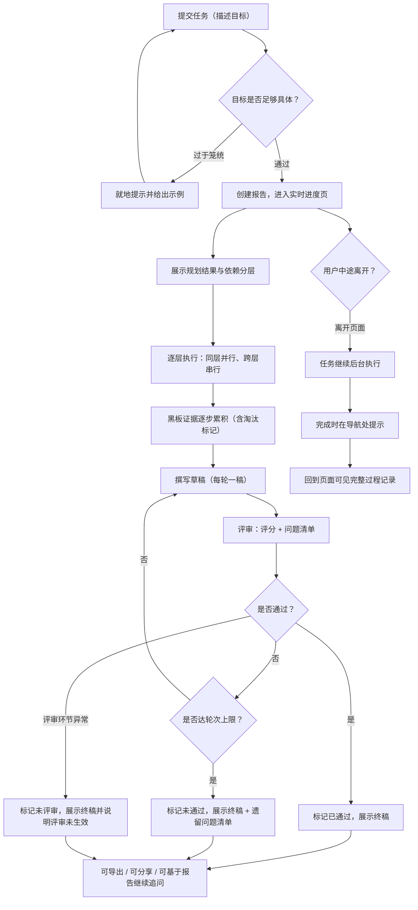
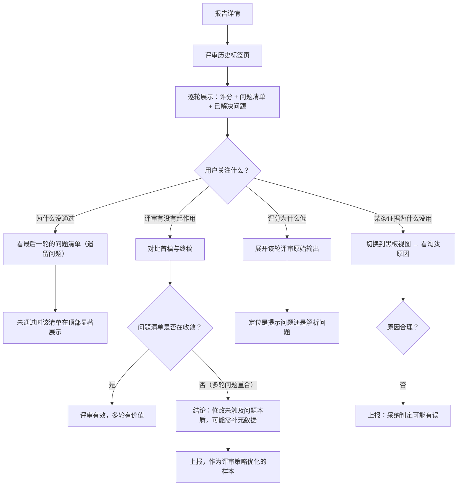
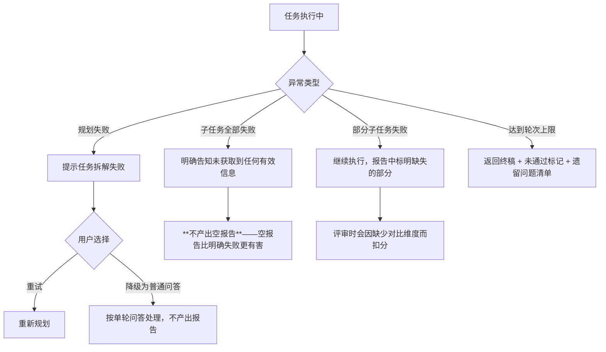

# 阶段 8 前端设计：多智能体协同可视化

> 本阶段在前端引入 **Agent 角色标签、Blackboard 状态面板、Critic 评分历史、报告生成过程**。用户能看到"专家怎么分工"的细节。

---

## 一、新增页面

| 路由 | 页面 | 角色 |
| --- | --- | --- |
| `/reports` | 报告中心 | 全部用户 |

对话页大幅增强；分析详情面板扩展。

---

## 二、对话页增量改动

### 2.1 Agent 角色标签 (AgentRoleBadge)

**触发位置**：AgentTraceTimeline 内每个步骤前。

**视觉**：

```
┌────────────────────────────────────────────────────────┐
│ 👑 Planner                                            │
│ 🎓 Researcher ×3 (并行)                              │
│ ✓ Validator                                           │
│ 📝 Writer                                             │
│ 🔍 Critic  (评分 8/10)                              │
└────────────────────────────────────────────────────────┘
```

**角色色板**：

| 角色 | 颜色 | 图标 |
| --- | --- | --- |
| Planner | 紫 | 👑 |
| Researcher | 蓝 | 🎓 |
| Validator | 青 | ✓ |
| Writer | 琥珀 | 📝 |
| Critic | 红 | 🔍 |

### 2.2 Blackboard 状态面板 (BlackboardPanel)

**触发位置**：分析详情面板内。

**视觉**：

```
┌────────────────────────────────────────────────────────┐
│ 📋 Blackboard 状态                                    │
│ ─────────────────────────────────────────────────── │
│ Plan:                                                │
│   t1 [vector_search] 查 A 产品故障率    ✓ done       │
│   t2 [vector_search] 查 B 产品故障率    ✓ done       │
│   t3 [writer]       汇总对比           ✓ done       │
│                                                         │
│ Evidence:  (6 条 / 5 已采纳)                          │
│   e1 t1 A 产品故障率 2%   [✓] score=0.91              │
│   e2 t1 销量 1200 万     [✓] score=0.85              │
│   e3 t2 B 产品故障率 5%   [✓] score=0.92              │
│   e4 t2 销量 800 万      [✓] score=0.88              │
│   e5 t1 旧数据           [✗] score=0.15 低于阈值     │
│                                                         │
│ Feedback:                                             │
│   R1: 缺少 B 产品历年趋势对比                       │
│   R2: 缺少销量增长曲线                            │
└────────────────────────────────────────────────────────┘
```

**视觉细节**：

- 已采纳证据 ✓ 绿色背景；未采纳 ✗ 灰色 + 删除线；
- EvidenceID 与 taskID 配对可见，方便追踪"哪条 evidence 来自哪个任务"。

### 2.3 Critic 评分历史 (CriticScoreHistory)

**触发位置**：Writer 步骤之后。

**视觉**：

```
┌────────────────────────────────────────────────────────┐
│ 🔍 Critic 评分历史                                    │
│ ─────────────────────────────────────────────────── │
│ 第 1 轮: 6/10  ❌ 不合格                              │
│   问题: 数据陈旧 / 缺少对比维度 / 无引用编号          │
│ 第 2 轮: 8/10  ✅ 通过                                │
│   改进: 数据已更新 / 已补充对比维度 / 引用完整        │
│                                                         │
│ 最终评分: 8/10                                        │
│ 报告字数: 1,250 字                                    │
│ 引用编号: 12 个                                       │
└────────────────────────────────────────────────────────┘
```

**关键交互**：

- 点击"问题"或"改进" → 跳到 Critic 评分详情；
- 评分图表（柱状图）按轮次可视化。

---

## 三、报告中心（`/reports`）

### 3.1 报告列表

```
┌────────────────────────────────────────────────────────┐
│ 报告中心                            [新建报告]          │
├────────────────────────────────────────────────────────┤
│ 报告名 │ 状态   | 评分 | 子任务 | 轮次 | 创建时间     │
│ Q3 分析│ ✅ 通过 │ 8/10 │ 5     | 2    | 昨天 12:34  │
│ 竞品对比│ 🔄 进行│ -    │ 3/5   | -    | 今天 09:15  │
│ 失败样本│ ❌ 拒答│ -    │ 2/3   | -    | 昨天 09:00  │
└────────────────────────────────────────────────────────┘
```

**状态枚举**：

| 状态 | 视觉 |
| --- | --- |
| `planning` | 灰 + 加载动画 |
| `researching` | 蓝 + 进度条 |
| `validating` | 青 + 进度条 |
| `writing` | 琥珀 + 进度条 |
| `critiquing` | 紫 + 进度条 |
| `accepted` | 绿色 ✓ |
| `rejected` | 红色 ✗ |
| `capped` | 橙 ⚠（达到最大轮次） |

### 3.2 报告详情页

**布局**：

```
┌────────────────────────────────────────────────────────┐
│ 报告: Q3 分析报告          评分: 8/10   状态: 通过    │
├────────────────────────────────────────────────────────┤
│ 元数据:                                               │
│   目标: "分析 Q3 销售额..."                          │
│   Planner 拆解: 5 个子任务                          │
│   工具调用: vector ×3, sql ×2                        │
│   Evidence 采纳: 12 条                                │
│   Critic 轮次: 2                                     │
│   创建时间: 2026-10-01 12:34:56                      │
├────────────────────────────────────────────────────────┤
│ 标签: [plan] [researcher×5] [validate] [write] [critic×2] │
├────────────────────────────────────────────────────────┤
│ Tab 切换:                                             │
│  [最终报告] [Plan] [Evidence] [Critic] [元数据]    │
│                                                         │
│  当前: 最终报告                                      │
│  ──────────────────────────────── │
│  Q3 销售额总计 5000 万，A 产品线贡献 1200 万...       │
│  [#1][#2][#3]...                                  │
└────────────────────────────────────────────────────────┘
```

**Tab 内容**：

| Tab | 内容 |
| --- | --- |
| 最终报告 | 渲染好的 Markdown 报告 |
| Plan | 子任务列表 + 依赖图 |
| Evidence | 所有 evidence 列表（含未采纳） |
| Critic | Critic 历次评分与问题 |
| 元数据 | 完整运行信息 |

### 3.3 实时进度

**生成中的报告** 显示：

- 当前正在执行的子任务（高亮）；
- Blackboard 状态实时更新；
- 步骤动画（流式指示）。

---

## 四、对话页增量：报告入口

**触发**：当用户提出"帮我写一份报告"类需求时。

**视觉**：在答案卡片底部出现：

```
┌────────────────────────────────────────────────────────┐
│ 答案                                                │
│ ─────────────────────────────────────────────────── │
│   "我已启动报告生成，您可继续对话等待结果..."          │
│                                                         │
│   [📊 查看实时报告]  [🔔 完成后通知]                │
└────────────────────────────────────────────────────────┘
```

**交互**：

- 实时报告 → 跳转到 `/reports/:id`（生成中状态）；
- 完成后通知 → 浏览器通知 + 站内信。

---

## 五、监控大盘增量

### 5.1 多智能体指标

| 指标卡片 | 含义 |
| --- | --- |
| 平均 Planner 子任务数 | 任务拆解粒度 |
| Critic 通过率 | 一次过审占比 |
| 平均 Critic 轮次 | 重写频率 |
| 拓扑深度分布 | 第 1/2/3 层任务占比 |

### 5.2 角色活跃度

```
近 24h 各角色调用占比：
  Planner：12%
  Researcher：45%
  Validator：8%
  Writer：15%
  Critic：20%
```

### 5.3 失败模式

| 节点失败 | 占比 | 含义与处置方向 |
| --- | --- | --- |
| Planner 拆解失败 | 占比 | 规划输出不可解析 → 检查规划提示的约束强度 |
| Researcher 工具失败 | 占比 | 单个子任务的外部依赖异常 → 检查对应工具的健康度 |
| 评审不通过（达到轮次上限） | 占比 | 通常是**知识库内容不足**而非写作能力问题 |
| 评审环节本身失败 | 占比 | 评审角色调用异常 → 需与"未通过"严格区分统计 |

**统计红线**：**"评审失败"与"评审未通过"必须分开计数**。混在一起会导致"评审服务坏了"被误读成"报告质量下降"，从而把排查方向引向错误的一侧。

---

## 六、API 契约（本阶段新增）

**新增端点**：

| 端点 | 用途 | 关键字段 |
| --- | --- | --- |
| `POST /reports` | 提交报告任务 | 入参：目标描述；返回 `report_id` |
| `GET /reports` | 报告列表 | `report_id` / `title` / `status` / `critic_score` / `rounds` / `created_at` |
| `GET /reports/{id}` | 报告详情 | 见下表 |
| `GET /reports/{id}/plan` | 计划视图 | `tasks[]`（含 `task_id` / `description` / `tool` / `depends_on[]` / `layer`） |
| `GET /reports/{id}/evidence` | 黑板证据视图 | `records[]`（含采纳状态与淘汰原因） |
| `GET /reports/{id}/critique` | 评审历史 | `rounds[]`（评分 + 问题清单 + 改进说明） |

**报告详情的关键字段**：

| 字段 | 说明 |
| --- | --- |
| `status` | 规划中 / 检索中 / 校验中 / 撰写中 / 评审中 / 已通过 / 未通过 / 已达轮次上限 |
| `accepted` | **是否通过评审**——未通过也必须返回内容，只是标记不同 |
| `critic_score` | 最后一轮评分 |
| `rounds` | 实际评审轮次 |
| `layers` | 拓扑层数（前端用于展示依赖关系） |
| `role_calls` | 各角色的调用次数（前端用于展示角色活跃度） |
| `unresolved_issues[]` | **未通过的遗留问题清单**——未通过时最需要展示的信息 |

**流式事件**：

| 事件 | 载荷 | 前端动作 |
| --- | --- | --- |
| `plan_ready` | `tasks[]` / `layers` | 渲染计划与依赖图 |
| `task_start` / `task_end` | `task_id` / `tool` / `status` | 更新任务节点状态 |
| `evidence_added` | 证据摘要 + 任务标识 | 追加黑板条目 |
| `validate_done` | 采纳数 / 淘汰数 | 更新黑板统计 |
| `draft_ready` | `round` | 新增一稿草稿入口 |
| `critique_done` | `round` / `score` / `issues[]` | 追加评审历史，未通过时高亮问题 |
| `finished` | `accepted` / `rounds` / `score` | 冻结界面并展示最终状态 |

**错误码**：

| 错误码 | 场景 | 前端表现 |
| --- | --- | --- |
| 81xx | 规划失败 | 提示"任务拆解失败"，提供重试与**改为普通问答**的降级入口 |
| 82xx | 子任务全部失败 | 明确告知"未获取到任何有效信息"，**不产出空报告** |
| 83xx | 评审达到轮次上限 | 正常展示报告 + **未通过标记** + 遗留问题清单 |
| 84xx | 评审环节异常 | 报告正常展示，标记为"**未评审**"（区别于未通过） |

**核心契约**：`accepted=false` **不是错误**，必须走成功状态码返回，前端据此渲染"未通过"状态而非报错——这与阶段 5 的拒答约定一致。

---

## 七、关键交互流程

### 7.1 报告任务全流程

长任务的交互与问答最大的区别是**"异步"**：提交后不等待，完成时通知。**因此流程必须处理"用户离开页面后回来"的情形**。



**三种终态必须视觉可区分**：已通过（绿）、未通过（橙，但**不是错误**）、未评审（灰）。**把"未通过"渲染成红色错误，等于告诉用户"系统坏了"，而实际上系统工作正常，只是结果不达标**。

**"中途离开→完成时提示→回来可见全过程"是异步任务的基本要求**：报告类任务常需数分钟，要求用户全程盯着页面并不现实。

### 7.2 评审历史的对照查看流程



**"首稿与终稿对比"这个功能值得专门提供**：它是评估多智能体机制是否值得保留的唯一客观依据。**没有这个对比，评审循环就是一个无法被验证的机制**。

### 7.3 异常与降级流程



**"不产出空报告"是一条硬约束**：一份没有实质内容却格式完整的报告，会被用户误认为"系统分析过了，确实没有可用信息"，从而放弃继续查找。**明确的失败远好于伪装的完成**。

---

## 八、视觉规范（新增）

### 8.1 角色色板

| 角色 | 主色 | 浅背景 |
| --- | --- | --- |
| Planner | `#8B5CF6` 紫 | 紫 10% |
| Researcher | `#3B82F6` 蓝 | 蓝 10% |
| Validator | `#06B6D4` 青 | 青 10% |
| Writer | `#F59E0B` 琥珀 | 琥珀 10% |
| Critic | `#EF4444` 红 | 红 10% |

### 8.2 评分视觉

| 区间 | 颜色 | 用途 |
| --- | --- | --- |
| 8-10 | 绿 | 通过 |
| 5-7 | 黄 | 待改进 |
| 0-4 | 红 | 不合格 |
| 无评分 | 灰 | **未评审**——与"不合格"必须视觉区分 |

### 8.3 证据采纳状态视觉

| 状态 | 表现 |
| --- | --- |
| 已采纳 | 正常文字 + 绿色对勾 |
| 已淘汰 | **保留但降权展示**（灰色 + 删除线）+ 淘汰原因 tooltip |
| 未校验 | 正常文字 + 灰色问号标记 |

**约束**：淘汰证据**不能直接隐藏**——用户与运营都需要看到"检索到了什么、为什么没用"，这是排查检索质量问题的最直接线索。

---

## 九、可访问性

- 角色标签必须有可读的职责说明（仅靠颜色与图标不足以表达角色差异）；
- 黑板证据列表用语义化的描述列表结构，并明确标注采纳状态文字；
- 评审历史每轮独立成带标题的区块，评分同时提供数字与文字等级；
- 报告标签页用标准标签页控件语义，并支持键盘左右切换。

---

## 十、性能预算

| 指标 | 目标 |
| --- | --- |
| Blackboard 面板渲染 | ≤ 300ms（100 条证据） |
| 报告详情加载 | ≤ 500ms |
| 实时进度更新 | ≤ 200ms（轮询间隔） |
| 计划依赖图渲染 | ≤ 400ms（20 个任务内） |
| 长报告渲染 | **必须分块或虚拟滚动**，首屏 ≤ 600ms |

---

## 十一、本阶段交付清单

- [x] AgentRoleBadge 组件（角色标签 + 职责说明）
- [x] BlackboardPanel 组件（计划 / 证据 / 反馈三段，含淘汰原因）
- [x] CriticScoreHistory 组件（评分历史 + 问题清单 + 改进对照）
- [x] 报告中心（`/reports`）：列表 + 详情 + 五标签页 + 实时进度
- [x] 对话页报告入口（实时跳转 + 完成通知）
- [x] 监控大盘多智能体指标（含"评审失败"与"评审未通过"分开统计）
- [x] API 契约（报告任务 / 计划 / 证据 / 评审端点 + accepted=false 的成功语义）
- [x] 角色色板 / 评分色板 / 证据采纳状态视觉

→ 下一阶段：[`../stage-9-enterprise/frontend-design.md`](../stage-9-enterprise/frontend-design.md)