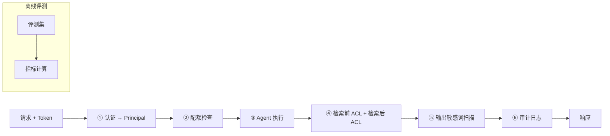
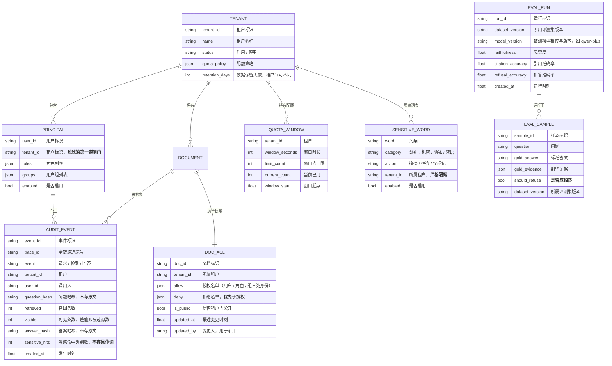
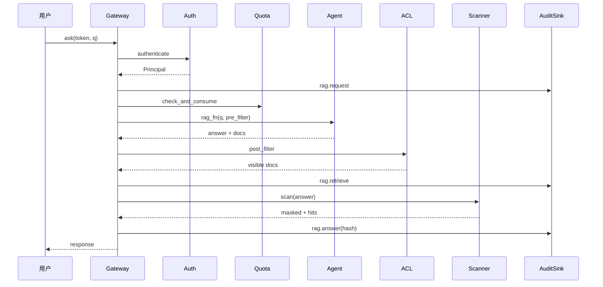
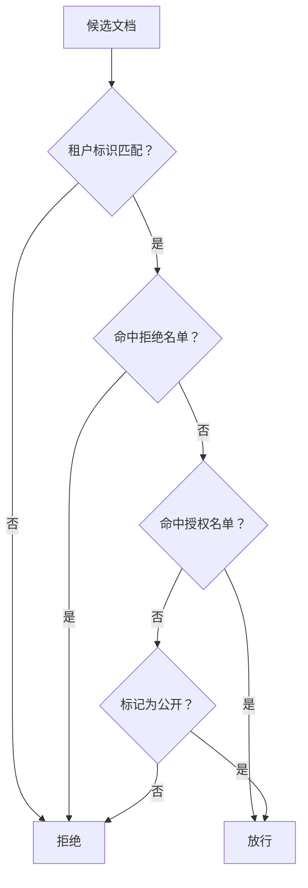

# 阶段 9：企业级能力 — 权限 / 安全 / 审计 / 评测（实现细节）

> 本阶段把"能跑通"升级为"能上线"——补齐 **认证、ACL、多租户隔离、审计日志、敏感词拦截、配额管理、自动评测** 五大企业护栏。

---

## 一、阶段定位与边界

### 1.1 业务能力范围

### 1.2 解决的核心问题

| 旧问题 | 新解法 |
| --- | --- |
| HR 文档被销售看到 | 文档级 ACL 默认拒绝 |
| 跨租户数据互通 | tenant_id 强制隔离 |
| 合规审计无据可查 | 审计日志全链路 |
| 模型效果退化无人知 | RAGAS 自动回归 |
| 输出敏感词泄漏 | 输出侧敏感词扫描 |
| 单租户把服务压垮 | 滑动窗口配额 |

### 1.3 验收标准

| 指标 | 目标值 |
| --- | --- |
| ACL 默认拒绝 100% 命中 | 所有测试用例 |
| 审计无敏感信息泄漏 | 答案只存 hash |
| 敏感词 100% 拦截 | 词表内词不漏 |
| RAGAS Faithfulness | ≥ 0.85 |
| 配额 100% 生效 | 超额必 429 |

---

## 二、认证架构

### 2.1 调用主体模型

**认证成功后产出的调用主体至少包含四个要素**：

| 要素 | 含义 | 用途 |
| --- | --- | --- |
| 用户标识 | 是谁在调用 | 审计归属、个人配额 |
| 租户标识 | 属于哪个租户 | **一切数据过滤的第一道闸门** |
| 角色列表 | 具备哪些职能身份（如人事、财务、管理员） | 角色级 ACL 匹配 |
| 用户组列表 | 属于哪些组织单元（如某个项目组、某个委员会） | 组级 ACL 匹配 |

**关键点：ACL 匹配的不是"用户标识"这个字符串，而是由用户标识、角色、用户组共同构成的"身份集合"**。举例：某文档授权给"人事角色"，则任何具备人事角色的用户都命中；授权给"某项目组"，则该组全部成员命中。

| 匹配方式 | 命中条件 | 适用粒度 |
| --- | --- | --- |
| 用户级 | 文档授权名单包含该用户标识 | 精确到人（如"仅张三可见"） |
| 角色级 | 文档授权名单包含该用户任一角色 | 按职能（如"人事都能看"） |
| 组级 | 文档授权名单包含该用户任一组 | 按组织（如"该项目组可见"） |

**三种粒度取并集**：只要命中任意一种即视为授权通过。这使权限配置可以粗可细——日常用角色/组批量授权，例外情况单独按人授权。

### 2.2 认证能力必须可替换

**认证逻辑必须抽象为可替换的提供者**，入参是调用方携带的凭证，出参是上节的调用主体。

| 实现档次 | 使用场景 | 特点 |
| --- | --- | --- |
| 静态凭证表 | 本地开发、内部演示 | 配置即生效，**严禁用于生产** |
| 自签令牌 | 单系统生产 | 签发与校验同一套密钥，实现简单 |
| 标准令牌（第三方签发） | 企业生产 | 由统一认证中心签发，本系统只校验签名与声明 |

**生产环境的两条硬要求**：

1. **签发方与校验方解耦**——本系统不应负责签发凭证，只校验；这样吊销、轮换、单点登录都由认证中心统一管理；
2. **令牌必须短时效**——配合刷新机制使用。长时效令牌一旦泄漏，攻击窗口会非常大。

**生产环境的 JWT 要求**：

- 签发方（Authorization Server）与资源方（RAG 服务）解耦；
- JWT 包含 tenant_id、user_id、roles、groups；
- 短期有效期（如 1 小时）+ refresh token。

---

## 三、ACL 设计

### 3.1 默认拒绝 (Deny by Default)

**核心原则**：没有显式 allow 标记的文档不可见。

**ACL 判定顺序**（短路设计，任一步命中即返回，不再往下判断）：

1. **租户标识不匹配** → 直接拒绝（跨租户一律不可见）；
2. **命中拒绝名单** → 直接拒绝；
3. **命中授权名单**（用户级 / 角色级 / 组级任一命中）→ 放行；
4. **文档标记为租户内公开** → 放行；
5. **以上都不满足** → **拒绝**（默认拒绝）。

**deny 优先于 allow**：

用户被显式拉黑时，**角色授权不能救回来**。这是企业级安全要求。

### 3.2 ACL 标签

**每个文档入库时必须携带四项 ACL 元数据**：

| 字段 | 含义 | 示例语义 |
| --- | --- | --- |
| 所属租户 | 该文档归属于哪个租户 | 租户 A |
| 授权名单 | 允许访问的身份集合 | 人事角色、某执行委员会 |
| 拒绝名单 | 显式禁止访问的身份集合 | 某个具体用户 |
| 是否租户内公开 | 是否对同租户全体成员开放 | 否 |

**入库时的硬校验**：

- **租户字段缺失 → 拒绝入库**（不允许出现"无主文档"，否则无法隔离）；
- 授权名单与拒绝名单可同时非空，此时按前节的判定顺序，**拒绝优先**；
- "租户内公开"只对同租户生效，**跨租户永不因该标记而可见**。

**Identity 类型**：

- `user:<id>` — 用户级授权；
- `role:<role>` — 角色级授权；
- `group:<group>` — 用户组授权。

**ACL 匹配**：检查 identities 集合与 acl_allow / acl_deny 的交集。

### 3.3 检索前后双过滤

**检索前过滤**：

把 tenant_id 等条件推到向量库的 metadata filter，**降低候选集后再做权限校验**。

**检索后过滤**：

向量库 filter 是按"完全等于"语义，**复杂 ACL（deny / 多字段）必须在应用层做**。

**双保险的意义**：

- 检索前 filter 防召回失败时的越权（"召回错的文档"成本高）；
- 检索后 filter 防配置漂移（向量库 filter 改坏仍能兜底）。

### 3.4 ACL 配置的工程要点

**文档入库时设置 ACL**：

- 整文档级 ACL：所有 chunk 共用 ACL；
- 段落级 ACL：罕见（如某文档内某些段落敏感）；
- 默认值：拒绝所有（除了 acl_public）。

**租户隔离**：

**所有文档必须含 tenant_id**——没有 tenant_id 的文档不入库（硬性校验）。

---

## 四、审计日志

### 4.1 审计的合规价值

**审计解决三个问题**：

1. **追溯**：谁问了什么、得到什么答案；
2. **调查**：出问题时的可调查性；
3. **合规**：满足 GDPR、SOC2、ISO 27001 等要求。

**审计事件类型**：

| event | 含义 | 字段 |
| --- | --- | --- |
| `rag.request` | 收到用户请求 | question |
| `rag.retrieve` | 检索完成 | retrieved, visible |
| `rag.answer` | 答案生成 | answer_hash, sensitive_hits |

### 4.2 审计不存原文

**只存答案 hash**：

- 答案可能含敏感信息（用户输入的内部数据）；
- 哈希值足以追溯到具体答案（但不可读）；
- **生产合规红线**——审计日志必须可被人类可读，但**不含敏感信息**。

**hash 的长度**：

- 16 位 hex（约 64 位）足够；
- 不会因字符太长导致索引膨胀。

### 4.3 审计与 trace_id

**追踪号串联同一次请求的全部事件**：三个事件共享同一个追踪号，从而能被聚合成一条完整链路。以"用户 A 提问某问题"为例：

| 事件 | 携带信息 | 该条记录能回答的问题 |
| --- | --- | --- |
| 请求事件 | 追踪号、调用主体、问题原文 | 谁在什么时候问了什么 |
| 检索事件 | 追踪号、召回条数、可见条数 | 检索到了多少、被权限过滤掉多少 |
| 回答事件 | 追踪号、答案摘要哈希、脱敏命中数 | 返回了什么（不可逆）、是否触发脱敏 |

**追踪号必须从入口贯穿到出口**：网关生成、下游透传、每条审计记录携带。缺少追踪号的日志在排查时价值极低——**无法确定哪几条记录属于同一次请求**。

**注意事件与实际执行并非严格一一对应**：一次请求可能触发多轮检索（阶段 5 的循环、阶段 6 的多步），因此检索事件可能出现多条，前端与审计查询**都按追踪号聚合后展示时序**，而不是假设"一次请求三条记录"。

---

## 五、敏感词扫描

### 5.1 输出侧扫描 vs 输入侧检索

**输入侧**：

用户问的内容含敏感词（如内部编号）→ **可以检索**（答案也含），反而是用户主动查询。

**输出侧**：

答案里出现敏感词 → 必须扫描 + 替换/掩码。

**本阶段只做输出侧**——输入侧在业务层处理。

### 5.2 词表设计

| 设计要点 | 做法 | 原因 |
| --- | --- | --- |
| **长词优先** | 匹配时按词条长度从长到短 | 否则短词会抢先命中长词的前缀，导致掩码不完整（掩掉 "ABC" 却暴露了 "123"） |
| **外置可热更** | 词表独立于代码，支持不重启更新 | 合规词表常常需要紧急追加 |
| **分类分桶** | 按合规类型（机密 / 隐私 / 禁语）分桶 | 不同类别不同处置动作，也便于统计各类命中量 |
| **词形覆盖** | 除原词外考虑常见变形（大小写、全半角、分隔符插入） | 否则绕过成本极低 |

**性能量级**：词表在千条量级时，每千字符文本的扫描开销在毫秒级，**可以放在请求路径上同步执行**。若词表规模上万，需改为多模式匹配算法或预编译索引。

### 5.3 扫描后的处置动作

| 动作 | 效果 | 适用 |
| --- | --- | --- |
| **掩码替换** | 命中片段替换为占位符 | **默认动作**——保留答案可读性，只遮蔽敏感片段 |
| **整体拒答** | 整个答案替换为拒答话术 | 命中最高密级词时 |
| **仅标记** | 保留原文，但打上标记并可告警 | 灰度观察期，先摸清命中情况再决定策略 |
| **按部门差异化** | 不同租户/部门使用不同词表与动作 | 集团型企业，各业务线合规口径不同 |

**无论哪种动作，都必须回报结构化的扫描结果**：是否安全、命中了哪些类别（**不回传命中的具体词**，避免日志本身成为泄漏源）、处置动作是什么。这三项是审计与告警的输入。

**隔离要求**：不同租户的词表必须严格隔离。**跨租户共用词表会导致 A 租户的敏感词规则泄漏给 B 租户**——词表内容本身就是敏感信息。

---

## 六、配额管理

### 6.1 滑动窗口 vs 令牌桶

| 算法 | 特性 | 适用 |
| --- | --- | --- |
| 滑动窗口 | 严格按时间窗口计数 | 流量平稳 |
| 令牌桶 | 允许突发 | 偶发高峰 |

**本阶段用滑动窗口**：RAG 业务**流量平稳是常态**，滑动窗口更适合。

### 6.2 配额维度

**按租户 ID**（不是按用户）：

- 一个租户多个用户共享 KB；
- 按用户限流会被共享账号绕过；
- 按租户更符合业务场景。

**配额维度组合**：

| 维度 | 配额 |
| --- | --- |
| 租户级 | QPS、每日调用次数、**每日 token 消耗** |
| 用户级 | QPS |
| 全局 | 总 QPS、CPU 利用率、**平台侧额度余量** |

**必须区分"平台侧配额"与"应用侧配额"，二者职责不同**：

| 类型 | 约束对象 | 超限表现 | 治理手段 |
| --- | --- | --- | --- |
| **平台侧配额** | 整个账号对千问平台的调用总量与速率 | 平台返回限流 / 配额错误，**影响所有租户** | 账号级额度规划、告警、多 Key 分流 |
| **应用侧配额** | 单个租户 / 用户 | 应用返回 429，**只影响该租户** | 本节的滑动窗口与维度组合 |

**平台侧配额是应用侧配额的上游约束**：应用侧配额算得再精细，也无法阻止账号维度被平台限流。因此**必须把"平台侧额度余量"纳入全局监控**——它是唯一能提前预警"整个系统即将不可用"的指标，而这一点在本地部署模型的方案里并不存在（本地只受算力限制）。

### 6.3 配额窗口的滚动

滑动窗口的语义分三步：

1. **定义窗口**：以当前时刻为右端点，向前取固定时长（如 60 秒）构成统计窗口；
2. **清理过期记录**：把落在窗口左端点之前的历史请求记录剔除；
3. **计数判定**：统计窗口内的请求数，达到上限即拒绝。

**为什么要剔除窗口外的事件**：

窗口外的旧请求不应继续占用配额，**这正是滑动窗口与固定窗口的本质区别**。固定窗口按自然分钟切分，会出现"上一分钟末尾与下一分钟开头各打满一次"的双倍突刺；滑动窗口则始终保证"任意 60 秒内不超过上限"。

**实现上需要注意的三点**：

- **计数与判定必须是原子的**：并发请求下若"先查后加"，会同时放行超额请求；
- **窗口状态必须跨副本共享**：否则实际放行量等于配置值乘以副本数；
- **过期清理要有上限**：高频场景下不能每次请求都全量清理，应按时间分桶存储并整桶淘汰。

### 6.4 拒绝的语义

- HTTP 429；
- Retry-After 头携带下次可重试时间；
- 前端展示倒计时 + 自动重试。

---

## 七、自动评测

### 7.1 为什么需要自动评测

**人工评测的局限**：

- 不可重复（每次问都得人手）；
- 不可批量（1000 条样本要多少天）；
- 难以追踪版本（升级后没历史基线）。

**自动评测的价值**：

- CI 中跑（PR 必过）；
- 评测集覆盖核心指标；
- 版本对比可追溯。

### 7.2 评测集的设计

**每条评测样本必须包含四个字段**：

| 字段 | 作用 | 缺失后果 |
| --- | --- | --- |
| 问题 | 输入 | — |
| 标准答案 | 判定答案正确性的基准 | 无法计算答案质量指标 |
| 期望证据 | 判定检索质量的基准 | **无法区分"检索没找到"与"生成写错了"** |
| 是否应拒答 | 标记该问题在知识库中本无答案 | 无法计算拒答准确率，会把"该拒未拒"当作正确 |

**"期望证据"是最容易被省略、但最有价值的字段**：只比对最终答案时，一旦质量下降，无法定位问题出在检索还是生成——是"根本没收上来"还是"收上来了但没用好"，这两种情况的修复方向完全不同。

**"是否应拒答"必须显式标注**：若评测集只包含有答案的问题，模型学会的是"永远回答"，拒答能力会被系统性高估。

**评测集规模**：

- 起步 50-100 条；
- 半年后累计 500+ 条；
- 覆盖不同意图（事实、对比、总结、计算）；
- 覆盖不同业务场景（技术、合同、产品）。

### 7.3 评测指标

**核心指标**：

| 指标 | 含义 | 计算 |
| --- | --- | --- |
| Faithfulness | 答案与证据一致 | 答案句子中能被证据支持的占比 |
| Citation Coverage | 引用编号有效性 | 引用编号在合理范围内的比例 |
| Refusal Accuracy | 应拒即拒 | 应拒样本中模型确实拒答的比例 |
| Coverage | 证据被引用的比例 | 引用的 gold_evidence / 总 gold_evidence |

### 7.4 评测时机

**CI 中（每次 PR）**：

- 跑评测集子集（50 条）；
- 关键指标不达标 → PR 被拒。

**Nightly**：

- 全量评测集；
- 与 baseline 对比，看是否退化；
- 报告归档。

**每次评测结果必须同时绑定"评测集版本 + 模型档位与版本"**：本项目使用千问平台模型，**平台侧的模型升级由平台方发起，应用侧无法拒绝**。若不记录运行时的模型版本，一次平台升级就会让前后两次评测失去可比性——**指标突然变化时，无法判断是我们的改动导致，还是平台换版导致**。

**由此推出一条运维约定**：平台发布模型变更时，**应先跑一次全量评测再决定是否跟进**。这也是把"评测"放在阶段 9 而非更晚的原因——它是云端模型方案下唯一的质量锚点。

**版本发布前**：

- 新版本在 canary 上跑一遍评测集；
- 与生产版本对比；
- 不退化 → 推全量。

---

## 八、数据模型设计

本阶段是全系列数据模型**改动面最广**的一次：几乎所有既有实体都要补齐租户维度，同时新增六个治理类实体。调用主体、ACL 元数据、审计事件的字段已在前文给出，本节把它们**放进统一的模型视图**，并补充配额、词表与评测三类实体。

### 8.1 新增实体一览

| 实体 | 作用 | 存放位置 | 生命周期 |
| --- | --- | --- | --- |
| 租户 | 一切数据归属与隔离的根 | 关系库 | 长期 |
| 调用主体 | 认证后的身份集合 | 短期缓存（令牌有效期） | 随令牌 |
| 文档权限 | 文档级可见范围 | 关系库，**与文档同事务写入** | 随文档 |
| 审计事件 | 请求 / 检索 / 回答三类事件 | 审计库（**只追加，不可改删**） | 按合规要求保留 |
| 配额记录 | 租户的调用计数 | 支持原子计数的存储 | 滑动窗口，过期即失效 |
| 敏感词条 | 合规词表 | 配置库，支持热更新 | 长期，按租户隔离 |
| 评测样本 | 回归基准 | 关系库或版本化文件 | 长期，**需版本管理** |
| 评测运行 | 一次评测的汇总结果 | 关系库 | 长期 |

**审计事件是唯一"只追加不可改"的实体**：任何修改或删除都会破坏其证据价值。因此**审计库必须独立于业务库**，且业务侧只持有写入权限，不持有修改与删除权限。

### 8.2 实体关系

### 8.3 三类身份的建模

ACL 匹配的不是用户标识字符串，而是**由用户标识、角色、用户组共同构成的身份集合**。因此授权名单与拒绝名单里存的是"身份表达式"：

| 身份类型 | 表达式形式 | 适用粒度 | 变更影响 |
| --- | --- | --- | --- |
| 用户级 | 用户标识 | 精确到人 | 仅影响该人 |
| 角色级 | 角色标识 | 按职能 | **批量生效，影响面可能很大** |
| 组级 | 组标识 | 按组织单元 | 同上 |

**前端在保存 ACL 时必须拿到"影响人数"**（见前端文档的权限变更风险提示），这个数字由后端根据三类身份反查得出——**所以授权名单必须能高效反查成员，这也是它需要结构化存储而非纯文本的原因**。

### 8.4 审计事件的三条硬约束

| 约束 | 说明 | 违反后果 |
| --- | --- | --- |
| **不存原文** | 问题与答案都只存哈希 | 审计库会成为最大的个人信息泄露面 |
| **不存命中词** | 敏感词只记录类别与数量 | 词表内容即敏感信息，写进日志等于二次泄漏 |
| **只追加** | 业务侧无修改删除权限 | 审计失去证据效力 |

**"哈希而非原文"带来的一个必然代价**：无法通过审计日志复现用户当时问的原话。**这是有意的取舍**——合规要求"可追溯谁在什么时候查了什么类别"，但不需要"能读出每个人问了什么"。若业务确实需要复现，应通过用户主动授权的反馈渠道（如阶段 5 的拒答工单）获取，而非常态化留存。

### 8.5 配额、词表与评测的建模要点

**配额记录**：

| 要点 | 说明 |
| --- | --- |
| 计数必须原子 | 并发请求下"先查后加"会同时放行超额请求 |
| 状态必须跨副本共享 | 否则实际放行量等于配置值乘以副本数 |
| 窗口必须可滚动 | 固定窗口会造成双倍突刺（见 6.3 节） |

**敏感词条**：**不同租户的词表严格隔离**，跨租户共用会让 A 租户的规则泄漏给 B 租户。词条按长度倒序匹配，并按类别分桶以便差异化处置。

**评测样本与运行**：样本必须**版本化**——评测集本身在演进，不记录版本就无法比较"两次评测结果的差异是模型变好了还是题目变了"。运行记录必须同时绑定**评测集版本与模型版本**，两者缺一，结论都不可信。

### 8.6 租户维度的补齐范围

本阶段必须检查**每一个既有实体是否带上了租户字段**。遗漏点通常在"派生数据"上：

| 易漏实体 | 为什么容易漏 | 后果 |
| --- | --- | --- |
| 块与图像向量 | 看起来继承了文档 | 检索时无法一次完成过滤，**且存在越权风险** |
| 检索缓存 | 键里没有租户 | **跨租户命中同一缓存 → 直接数据泄漏**，属最严重级别 |
| 会话快照 | 看似只与用户相关 | 用户换租户时会读到旧租户上下文 |
| 图谱实体与关系 | 图天然"全局" | 关系遍历会跨租户连边，**泄漏他方实体关系** |
| 指标与日志 | 被认为"只是数字" | 高基数标签会把租户名泄漏到监控系统 |

**"缓存键必须含租户"是本阶段最容易出事的一处**：缓存是跨请求共享的，一旦键的构成漏掉租户，就会把 A 租户的答案返回给 B 租户，而且现象隐蔽（只在两个租户问同样问题时出现）。

---

## 九、关键决策记录

### 9.1 为什么 ACL 默认拒绝？

"默认配置 = 容错"是开发期友好的，**但安全语境下是灾难**。一旦忘记配置 ACL，"默认容错"就等于"所有用户都能访问所有文档"。**默认拒绝把"忘记配置"这个最常见错误的影响压到最小**。

### 9.2 为什么不存原始答案？

GDPR、SOC2 等合规要求 **最小化数据留存**。答案含敏感信息（用户的内部数据），**审计不能成为新的泄漏源**。Hash 足以追溯，不能逆向。

### 9.3 为什么用 RAGAS 而不是自建评测？

RAGAS 是工业标准，**跨项目、跨论文可比**。但 RAGAS 是 LLM 评分依赖，**有不确定性**——所以本阶段用 RAGAS 跑 Nightly（接受不确定性），用自建轻量指标跑 CI（保证速度）。

### 9.4 为什么不在前 8 个阶段加这些？

企业护栏在 RAG 不成熟时反而是"束缚"——**没东西可保护时，护栏就是空架子**。**先有业务再上护栏**，避免过早设计。

---

## 十、关键流程图

### 10.1 网关全链路

### 10.2 ACL 判定树

**判定顺序不可调换**，尤其是"拒绝优先于授权"这一条：若先判授权，则被显式拉黑的用户只要拥有相应角色就会重新获得访问权——**黑名单会被角色授权架空**。

---

## 十一、与上一阶段差异

| 模块 | 阶段 8 | 阶段 9 |
| --- | --- | --- |
| 调用入口 | 直接执行业务流程 | 统一安全网关（先认证、再配额、后执行） |
| 数据可见性 | 全部文档可见 | 租户隔离 + 文档级 ACL 双层过滤 |
| 检索过滤时机 | 无 | **检索前过滤 + 检索后过滤**双保险 |
| 输出 | 原文直接返回 | 敏感词扫描并掩码后返回 |
| 追溯能力 | 无 | 三事件审计（请求 / 检索 / 回答），答案只存摘要哈希 |
| 过载保护 | 无 | 按租户的滑动窗口配额，超限返回重试提示 |
| 质量度量 | 评审者主观评分 | Faithfulness / Citation / Refusal 三类客观指标 |

---

## 十二、本阶段遗留问题 → 下一阶段预告

| 现象 | 根因 | 下一阶段 |
| --- | --- | --- |
| 无法上线 | 无镜像/manifest/灰度 | 阶段 10 部署运维 |
| 向量库拍脑袋选型 | 无横向对比 | 阶段 10 选型矩阵 |

→ 下一阶段：[`../stage-10-deployment/README.md`](../stage-10-deployment/README.md)