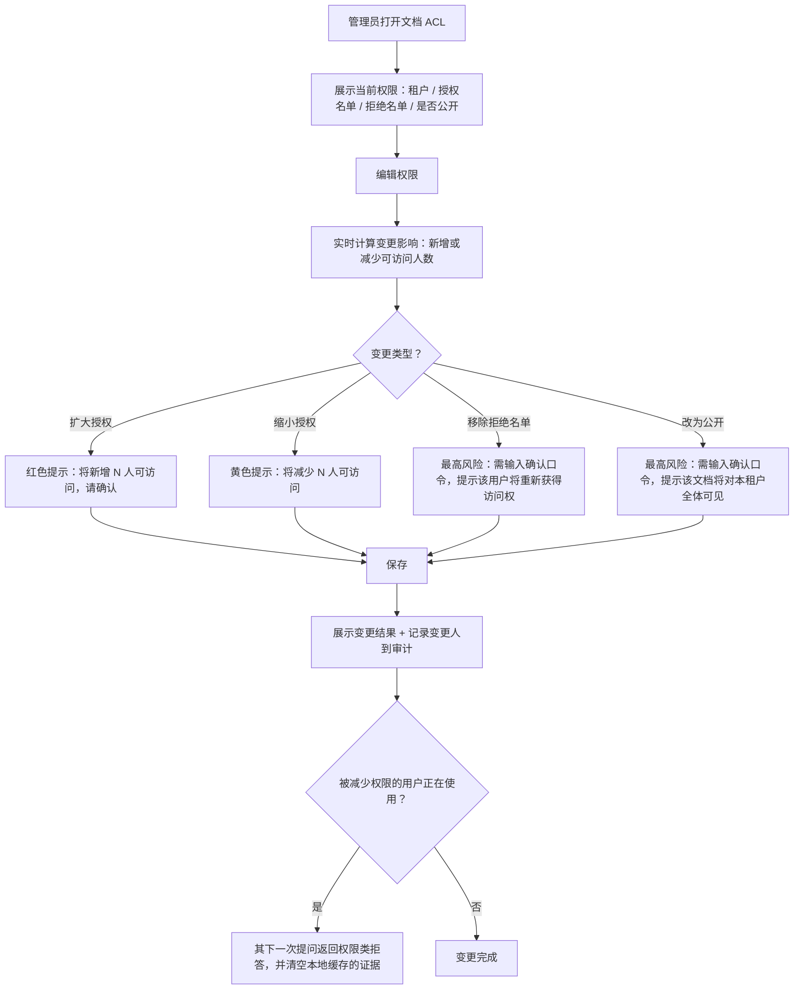
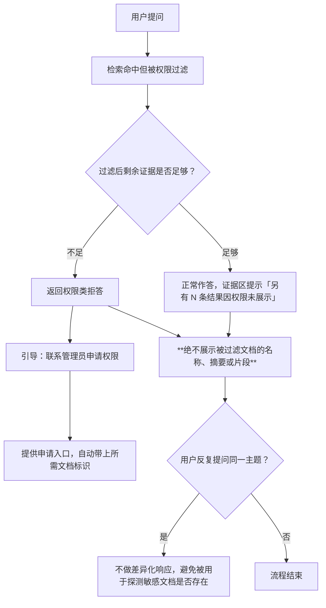
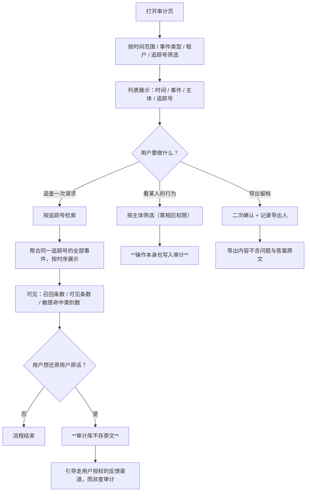

# 阶段 9 前端设计：企业护栏面板与评测系统

> 本阶段在前端引入 **权限管理、审计日志、敏感词管理、配额监控、RAGAS 评测系统**。运维者第一次能"管理"整个系统的安全边界。

---

## 一、新增页面

| 路由 | 页面 | 角色 |
| --- | --- | --- |
| `/admin/users` | 用户与权限 | 管理员 |
| `/admin/acl` | 文档 ACL 管理 | 管理员 |
| `/admin/audit` | 审计日志 | 管理员 / 审计员 |
| `/admin/eval` | 评测平台 | 管理员 |
| `/admin/quota` | 配额管理 | 管理员 |
| `/admin/sensitive` | 敏感词管理 | 管理员 |

---

## 二、用户与权限（`/admin/users`）

### 2.1 用户列表

```
┌──────────────────────────────────────────────────────────┐
│ 用户管理                          [新增用户]              │
├──────────────────────────────────────────────────────────┤
│ 姓名 │ 租户 │ 角色 │ 组 │ 状态 │ 操作                   │
│ 张三 │ A   │ hr  │ -  │ 启用  │ ⋮ ⋮                                                         │
│ 李四 │ A   │ sales│ -  │ 启用  │ ⋮                                                          │
│ 王五 │ B   │ hr  │ exec│ 禁用  │ ⋮                                                          │
└──────────────────────────────────────────────────────────┘
```

### 2.2 用户编辑

**字段**：

- 姓名、邮箱（登录账号）；
- 租户（下拉选择）；
- 角色（多选：hr / sales / finance / admin / ...）；
- 组（多选）；
- 启用状态；
- 备注（可选，1-2 行说明）。

**视觉**：

- 表单分两栏（基本信息 + 权限）；
- 保存前预览变更影响范围。

### 2.3 角色矩阵

```
┌────────────────────────────────────────┐
│ 角色权限矩阵                            │
│ ────────────────────────────────────── │
│              │ 提问 │ 看自己 │ 看全员 │
│             │     │ 数据   │ 数据  │
│ role:hr     │ ✓  │ ✓     │ ✓     │
│ role:sales  │ ✓  │ ✓     │ ✗     │
│ role:finance│ ✓  │ ✓     │ ✓     │
└────────────────────────────────────────┘
```

---

## 三、文档 ACL 管理（`/admin/acl`）

### 3.1 文档 ACL 列表

```
┌──────────────────────────────────────────────────────────┐
│ 文档 ACL 管理                                             │
├──────────────────────────────────────────────────────────┤
│ 文档名         │ 租户 │ allow │ deny │ public │ 操作     │
│ hr_handbook.md │ A   │ hr   │ -    │ ✗     │ ⋮     │
│ finance_rules.md │ B │ finance│ -  │ ✗     │ ⋮     │
│ public_announce.md│ A │ -    │ -   │ ✓     │ ⋮     │
└──────────────────────────────────────────────────────────┘
```

### 3.2 ACL 编辑

**字段**：

- 文档（自动填当前选中）；
- 租户（下拉选择，可锁定）；
- allow（多选用户 / 角色 / 组）；
- deny（多选用户 / 角色 / 组）；
- 公开访问开关。

**预览变更影响**：

```
变更前:
  allow: role:hr (10 人可访问)
变更后:
  allow: role:hr, role:finance
  → 新增 5 人可访问
  → 新增人员列表：[李四, 王五, ...]
```

**保存需二次确认**（影响范围较大时）。

### 3.3 权限变更的风险提示

ACL 变更的危险性在于**"放开容易、收回难"**——权限一旦放开，信息可能已被查看，事后收回无法挽回。因此前端必须在保存前给出风险提示：

| 变更类型 | 风险等级 | 前端提示 |
| --- | --- | --- |
| 扩大授权范围 | 高 | 红色提示"本次将新增 N 人可访问，请确认" |
| 缩小授权范围 | 低 | 黄色提示"本次将减少 N 人的访问权限" |
| 移除拒绝名单 | **最高** | 需二次输入确认，提示"移除黑名单后该用户将重新获得访问权" |
| 改为公开 | **最高** | 需二次输入确认，并展示"该文档将对本租户全体可见" |

**必须给出"变更影响人数"**，而不是只让管理员盲选角色——管理员往往不清楚某角色实际覆盖多少人。

---

## 四、权限行为在对话页的体现

权限过滤发生在检索环节，用户**看不到被过滤掉的文档**。若不加以说明，用户会遇到两种困惑，必须在前端明确处理。

### 4.1 两种需要解释的场景

| 场景 | 用户感受 | 前端处理 |
| --- | --- | --- |
| 命中结果被权限过滤后不足以作答 | "明明有这个文档，为什么说不存在" | 走**权限类拒答**，建议"联系管理员申请权限" |
| 命中结果部分被过滤 | 答案比预期简略 | 在证据区显示"另有 N 条结果因权限未展示" |

**安全红线**：**不得展示被过滤文档的名称、摘要、片段或数量之外的任何元信息**。只可以告知"存在未展示的结果"，不可告知"是哪一份"。否则攻击者可以通过反复提问**探测出知识库里有哪些敏感文档**。

### 4.2 权限状态对交互的影响

| 权限状态 | 前端表现 |
| --- | --- |
| 有权限访问知识库 | 正常问答与引用跳转 |
| 无权限访问该知识库 | 知识库在列表中不可见；直接访问路由时展示"无权限或不存在"的**统一提示**（不区分二者，避免探测） |
| 权限即将过期 | 顶部提示剩余天数，并给出续期入口 |
| 权限被收回（会话中） | 下一次提问返回权限类拒答，且**清空本地缓存的证据内容** |

---

## 五、审计日志（`/admin/audit`）

### 5.1 日志列表

```
┌──────────────────────────────────────────────────────────┐
│ 审计日志         时间: [近 1h ▼]   事件: [全部 ▼]   用户: [全部 ▼]   │
├──────────────────────────────────────────────────────────┤
│ 时间       │ trace_id │ 用户     │ 事件   │ 摘要              │
│ 12:34:56  │ t-001    │ A:zhang  │ request│ 提问: 电池电压      │
│ 12:34:57  │ t-001    │ A:zhang  │ retrieve│ 召回 5 条可见 3 条│
│ 12:34:58  │ t-001    │ A:zhang  │ answer │ hash: a1b2c3... │
│ ...                                                          │
└──────────────────────────────────────────────────────────┘
```

### 5.2 事件详情

点击行 → 弹出浮层显示完整事件：

```
┌────────────────────────────────────────┐
│ 事件详情                                │
│ ────────────────────────────────────── │
│ trace_id: t-001                         │
│ actor: A:zhang                          │
│ event: rag.answer                        │
│ ts: 2026-10-01 12:34:58                │
│ ────────────────────────────────────── │
│ payload:                                │
│   answer_hash: a1b2c3d4...            │
│   sensitive_hits: 0                   │
│   prompt_tokens: 234                  │
│   completion_tokens: 56                │
│ ────────────────────────────────────── │
│ 关联: trace t-001 的其他事件 ↓         │
└────────────────────────────────────────┘
```

### 5.3 过滤与导出

**过滤**：

- 时间范围；
- 事件类型（request / retrieve / answer）；
- 用户 / 租户；
- trace_id 搜索（输入完整 trace_id）。

**导出**：

- 选定时间范围 → CSV 下载；
- 注意：**导出内容也不含答案原文**（仅含 hash + 元数据）。

---

## 六、评测平台（`/admin/eval`）

### 6.1 评测集列表

```
┌──────────────────────────────────────────────────────────┐
│ 评测集           [新建评测集]                              │
├──────────────────────────────────────────────────────────┤
│ 评测集   │ 样本数 │ 最新跑分 │ Faithfulness │ Refusal │ 操作 │
│ baseline │ 50     │ v1.0.0  │ 0.85        │ 0.92    │ ⋮    │
│ v1-set  │ 120    │ v1.2.0  │ 0.88        │ 0.94    │ ⋮    │
│ edge-case│ 30     │ v1.2.0  │ 0.76        │ 0.88    │ ⋮    │
└──────────────────────────────────────────────────────────┘
```

### 6.2 单条评测详情

点击行 → 跳转到评测结果详情页：

```
┌────────────────────────────────────────────────────────┐
│ 评测集: baseline      版本: v1.2.0 vs v1.0.0        │
├────────────────────────────────────────────────────────┤
│ 指标对比:                                              │
│             v1.0     v1.2.0     变化               │
│ Faithfulness 0.85    0.88      ↑ +3.5%             │
│ Citation   0.92    0.94      ↑ +2.2%             │
│ Refusal    0.92    0.94      ↑ +2.2%             │
├────────────────────────────────────────────────────────┤
│ 失败样本: 5 条                                         │
│   - Q: "..."  Gold: "..."   实际: "..."  (下降)     │
│   - Q: "..."  Gold: "..."   实际: "..."  (新错误)   │
│   ...                                                  │
└────────────────────────────────────────────────────────┘
```

### 6.3 跑评测

**步骤**：

1. 选择评测集（含评测集版本）；
2. 选择被测版本：业务代码版本 + **千问模型档位与版本**（如 `qwen-plus`）；两者必须同时记录，**只记其一都无法解释指标变化**；
3. 点"运行"；
4. 实时显示进度；
5. 完成后归档到历史列表。

**视觉**：

- 进度条 + 当前样本号；
- 完成后自动跳到结果详情页。

---

## 七、配额管理（`/admin/quota`）

### 7.1 配额总览

```
┌────────────────────────────────────────────────────────┐
│ 配额管理                                                │
├────────────────────────────────────────────────────────┤
│ 租户    │ QPS 限制 │ 当前 QPS │ 今日调用 │ 状态       │
│ A      │ 60/min  │ 24      │ 12.3k   │ 🟢 正常    │
│ B      │ 60/min  │ 12      │ 5.6k    │ 🟢 正常    │
│ C      │ 60/min  │ 75      │ 28.1k   │ 🔴 超额    │
└────────────────────────────────────────────────────────┘
```

### 7.2 单租户配额配置

**字段**：

- QPS（每分钟）；
- 每日调用次数上限；
- 配额生效时间；
- 超额动作（429 / 软警告）。

---

## 八、敏感词管理（`/admin/sensitive`）

### 8.1 词表

```
┌────────────────────────────────────────────────────────┐
│ 敏感词表                                  [导入] [导出] │
├────────────────────────────────────────────────────────┤
│ 词条    │ 类别     │ 动作 │ 操作                     │
│ 绝密   │ 机密    │ 替换 │ ⋮                          │
│ 内部薪酬│禁止    │ 替换 │ ⋮                          │
│ 客户名单│隐私    │ 拒答 │ ⋮                          │
└────────────────────────────────────────────────────────┘
```

### 8.2 词条编辑

- 词条（必填，不超过 50 字符）；
- 类别（机密 / 隐私 / 禁止 / 内部）；
- 动作（替换 / 拒答 / 标记）；
- 备注。

### 8.3 批量导入

**支持**：

- 文本逐行导入；
- Excel 模板上传；
- 历史版本对比。

---

## 九、API 契约（本阶段新增）

**管理类端点**（均需管理员角色）：

| 端点 | 用途 | 关键字段 |
| --- | --- | --- |
| `GET /admin/users` | 用户列表 | `user_id` / `tenant_id` / `roles[]` / `groups[]` / `enabled` |
| `PUT /admin/users/{id}` | 编辑用户 | 角色、组、启用状态 |
| `GET /admin/documents/acl` | 文档 ACL 列表 | `doc_id` / `tenant_id` / `allow[]` / `deny[]` / `is_public` |
| `PUT /admin/documents/{id}/acl` | 修改 ACL | 返回 `affected_users`（**影响人数，用于前端风险提示**） |
| `GET /admin/audit` | 审计日志查询 | 入参：时间范围 / 事件类型 / 租户 / 追踪号；返回分页列表 |
| `GET /admin/quota` | 配额总览 | `tenant_id` / `limit` / `current` / `status` |
| `GET /admin/sensitive` | 敏感词表 | `word` / `category` / `action` |
| `POST /admin/eval/run` | 触发评测 | 返回 `run_id`；结果异步 |

**审计事件的返回字段**：

| 字段 | 说明 | 注意事项 |
| --- | --- | --- |
| `trace_id` | 全链路追踪号 | 同一请求的三个事件共享同一值，前端据此聚合 |
| `event` | 事件类型（请求 / 检索 / 回答） | 前端按时序展示 |
| `actor` | 租户 + 用户标识 | 用于归属展示 |
| `payload.answer_hash` | 答案摘要哈希 | **不返回答案原文**，前端只能展示哈希 |
| `payload.retrieved` / `payload.visible` | 召回数 / 可见数 | 两者之差即被权限过滤的数量 |
| `payload.sensitive_hits` | 敏感命中类别数 | **不返回命中的具体词** |

**错误码**：

| 错误码 | 场景 | 前端表现 |
| --- | --- | --- |
| 11xx | 未认证或凭证过期 | 跳转登录；**清空本地缓存** |
| 12xx | 无权限（文档 / 知识库） | 统一提示"无权限或不存在"，**不区分二者** |
| 13xx | 权限被收回 | 提示重新登录并刷新权限 |
| 61xx | 配额超限 | 展示倒计时与自动重试 |
| 62xx | 每日调用次数用尽 | 提示次日恢复或联系管理员扩容 |

---

## 十、关键交互流程

### 10.1 权限变更流程

权限变更是**本阶段风险最高的交互**——"放开容易、收回难"。流程必须在保存前就把影响摆清楚。



**"影响人数"必须由后端反查得出，而非让管理员凭角色名称猜测**——管理员通常不清楚某个角色实际覆盖多少人。**没有这个数字，风险提示就是空话**。

**"移除拒绝名单"被列为最高风险**：它的效果是"重新放权"，而管理员往往会低估这一动作的后果。

### 10.2 权限类拒答的处理流程



**"不做差异化响应"是本流程的安全底线**：如果系统对"存在但无权"和"根本不存在"给出不同反馈，攻击者就能通过反复提问**探测出知识库里有哪些敏感文档**。因此**两种情况必须给出完全一致的提示**。

### 10.3 审计查询流程



**"审计查询的操作本身也要被审计"是一条必须落实的约束**：否则拥有审计权限的人可以任意查看他人行为而不留痕，**审计体系会从"监督手段"退化为"新的风险点"**。

---

## 十一、视觉规范（新增）

### 11.1 安全色板

| 用途 | 颜色 |
| --- | --- |
| 安全 / 已授权 | 绿 |
| 警告 / 部分授权 | 黄 |
| 危险 / 拒答 | 红 |
| 中性 | 灰 |

### 11.2 配额状态色板

| 状态 | 颜色 |
| --- | --- |
| 正常 | `#16A34A` 绿 |
| 临近上限（>80%） | `#D97706` 橙 |
| 超额 | `#DC2626` 红 |

---

## 十二、可访问性

- 表格所有列可排序（语义化 `aria-sort`）；
- 过滤面板与列表独立键盘可达；
- 导出动作需二次确认（避免误触）；
- 权限矩阵用真实的表格语义（行列表头），**不依赖颜色区分"可/不可"**，必须同时有文字或图标。

---

## 十三、性能预算

| 指标 | 目标 |
| --- | --- |
| 审计日志加载 | ≤ 500ms（1000 条内） |
| 评测结果详情 | ≤ 800ms |
| 配额总览 | ≤ 200ms |
| ACL 变更影响人数计算 | ≤ 300ms |

---

## 十四、本阶段交付清单

- [x] 用户与权限管理（`/admin/users`）
- [x] 文档 ACL 管理（`/admin/acl`，含变更影响预览与风险分级提示）
- [x] 权限行为在对话页的体现（权限类拒答 / 未展示结果提示）
- [x] 审计日志（`/admin/audit`）：列表 + 详情 + 过滤 + 导出
- [x] 评测平台（`/admin/eval`）：评测集 + 结果对比 + 运行
- [x] 配额管理（`/admin/quota`）：总览 + 单租户配置
- [x] 敏感词管理（`/admin/sensitive`）：词表 + 编辑 + 导入
- [x] API 契约（管理类端点 + 审计字段脱敏规则 + 权限错误码）
- [x] 安全色板与配额状态色板

→ 下一阶段：[`../stage-10-deployment/frontend-design.md`](../stage-10-deployment/frontend-design.md)