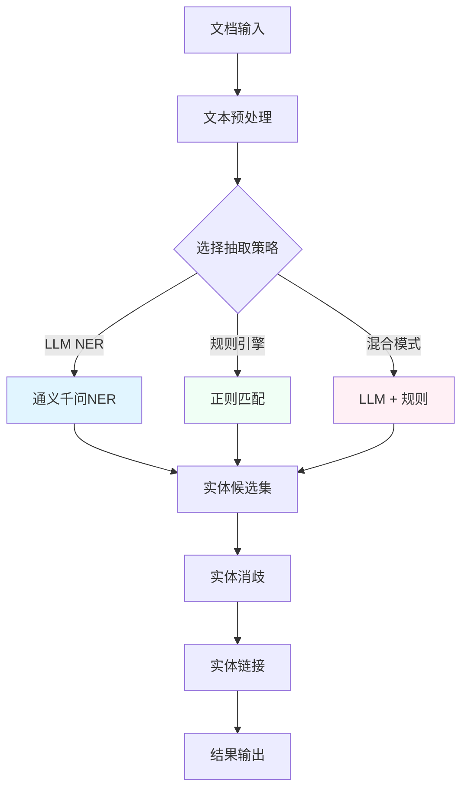
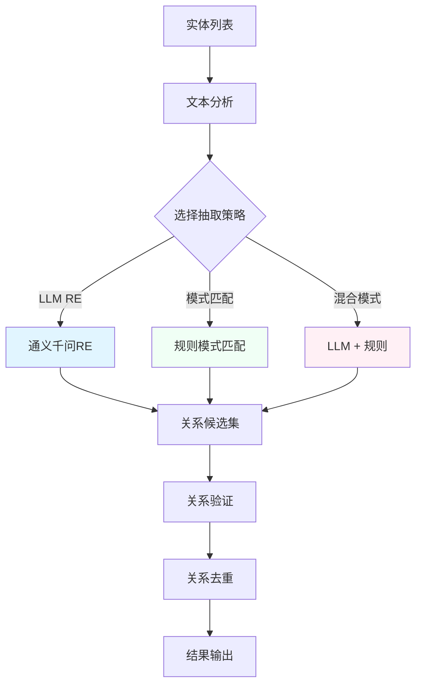
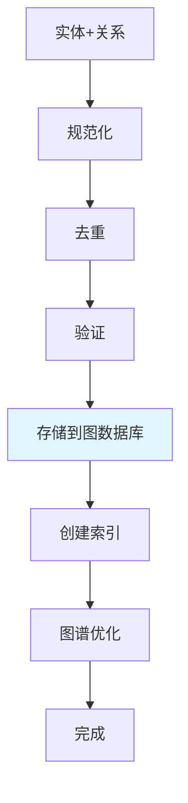
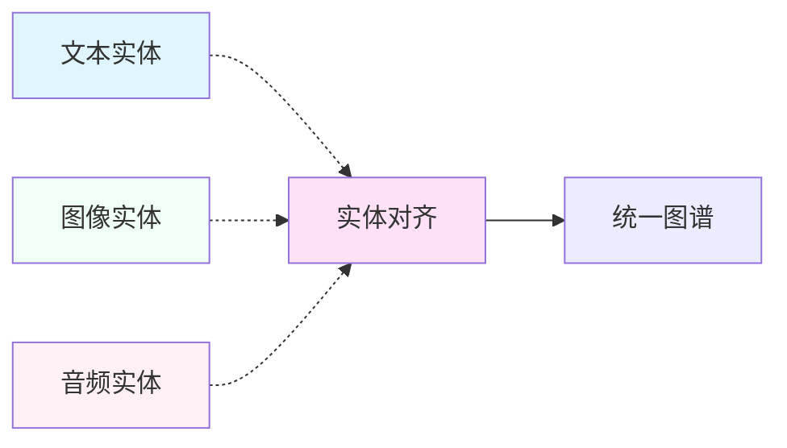
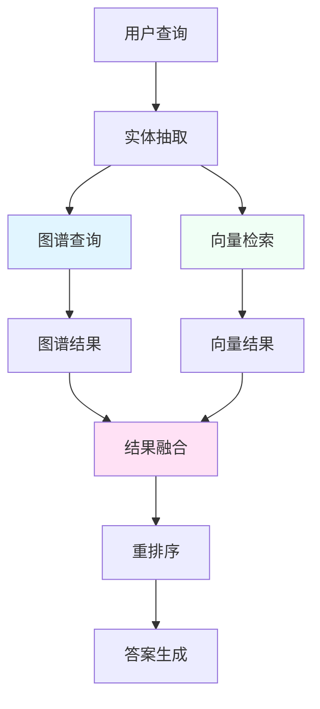

# KQuery Pro 知识图谱架构设计

> **最后更新**: 2026-07-19  
> **项目版本**: v3.0.0  
> **架构层级**: L4 业务服务层  
> **实现状态**: 全部核心功能已实现（含思维导图生成）

## 目录

- [1. 概述](#1-概述)
- [2. 设计目标](#2-设计目标)
- [3. 核心概念](#3-核心概念)
- [4. 实体类型系统](#4-实体类型系统)
- [5. 关系类型系统](#5-关系类型系统)
- [6. 图数据库Schema设计](#6-图数据库schema设计)
- [7. 实体抽取服务架构](#7-实体抽取服务架构)
- [8. 关系抽取服务架构](#8-关系抽取服务架构)
- [9. 图谱构建服务架构](#9-图谱构建服务架构)
- [10. 图谱查询服务架构](#10-图谱查询服务架构)
- [11. 多模态图谱集成](#11-多模态图谱集成)
- [12. 与RAG系统融合](#12-与rag系统融合)
- [13. 技术选型](#13-技术选型)
- [14. 性能优化策略](#14-性能优化策略)
- [15. 安全性考虑](#15-安全性考虑)
- [16. 从知识图谱生成思维导图（拓展能力）](#16-从知识图谱生成思维导图拓展能力)

---

## 1. 概述

### 1.0 架构定位

本知识图谱系统归属于 **7层架构中的 L4 业务服务层**。在智能销售助手场景中，知识图谱承担以下核心角色：

- **客户关系图谱**：构建客户、联系人、商机、订单之间的关联网络
- **产品知识库**：将产品规格、参数、销售话术组织为图结构，支持精准检索
- **竞品分析**：通过实体关系建模，支撑销售场景中的竞品对比和优劣势分析
- **销售关联推理**：基于图谱关系进行多跳推理，帮助销售员发现交叉销售和向上销售机会

### 1.1 目标

构建一个强大的知识图谱系统，与现有RAG系统深度融合，实现：

- **实体关联**：自动识别和关联文档中的实体
- **智能推理**：基于图谱关系进行多跳查询和推理
- **语义增强**：结合图谱结构提升检索准确性
- **多模态融合**：支持文本、图像、视频中的实体关联

### 1.2 核心价值

| 价值点 | 描述 |
|--------|------|
| **实体消歧** | 通过图谱上下文消除同名实体的歧义 |
| **关系挖掘** | 发现实体间隐藏的关系路径 |
| **知识补全** | 基于图谱推理补全缺失的知识 |
| **精准检索** | 结合实体关系提升检索精度 |
| **可视化探索** | 直观展示实体关系网络 |

### 1.3 实现状态

| 任务 | 状态 | 实现文件 | 代码规模 |
|------|------|----------|----------|
| Neo4j 图数据库集成 | 已完成 | `repositories/graph/neo4j_connector.py` | — |
| 知识图谱 Schema 定义 | 已完成 | `repositories/graph/schema.py` | — |
| 实体抽取服务 | 已完成 | `services/graph/entity_extraction.py` | 1086 行 |
| 关系抽取服务 | 已完成 | `services/graph/relation_extraction.py` | — |
| 图谱构建服务 | 已完成 | `services/graph/graph_builder.py` | — |
| 图谱查询服务 | 已完成 | `services/graph/graph_query.py` | — |
| 知识图谱 API 端点 | 已完成 | `api/knowledge_graph.py` | — |
| 文档处理流程集成 | 已完成 | Celery 异步任务集成 | — |
| GraphRAG 混合检索 | 已完成 | `services/graphrag/graphrag_engine.py` | 1583 行 |
| 智能问答增强 | 已完成 | `services/graphrag/qa_service.py` | — |
| 图谱可视化数据接口 | 已完成 | `services/graphrag/visualization_service.py` | — |

---

## 2. 设计目标

### 2.1 功能目标

1. **自动实体识别**
   - 支持中文和英文实体识别
   - 覆盖10+种实体类型
   - 实体链接到知识库

2. **智能关系抽取**
   - 自动识别实体间关系
   - 支持20+种关系类型
   - 关系验证和去重

3. **高效图谱存储**
   - 支持百万级节点和边
   - 毫秒级查询响应
   - 自动索引优化

4. **图谱查询能力**
   - 多跳关系查询
   - 路径发现
   - 子图提取
   - 实体推荐

5. **RAG增强**
   - 向量检索 + 图谱检索融合
   - 实体上下文增强
   - 推理能力提升

### 2.2 性能目标

| 指标 | 目标值 |
|------|--------|
| 实体抽取延迟 | < 500ms/文档 |
| 关系抽取延迟 | < 300ms/文档 |
| 图谱构建吞吐 | > 1000文档/秒 |
| 实体查询延迟 | < 50ms |
| 关系查询延迟 | < 100ms |
| 多跳查询延迟 | < 200ms（3跳） |

### 2.3 可扩展性目标

- 支持分布式部署
- 支持热插拔实体/关系类型
- 支持自定义抽取规则
- 支持多租户隔离

---

## 3. 核心概念

### 3.1 实体（Entity）

定义：知识图谱中的基本单元，代表现实世界中的对象。

**示例**：
- 张三（人名）
- 腾讯公司（组织）
- 北京（地点）
- 深度学习（技术）
- 2024年（时间）

### 3.2 关系（Relation）

定义：连接两个实体的边，表示实体间的关联。

**示例**：
- 张三 -[CEO_OF]-> 腾讯公司
- 腾讯公司 -[LOCATED_IN]-> 北京
- 深度学习 -[RELATED_TO]-> 人工智能

### 3.3 图谱（Graph）

定义：由实体和关系组成的网络结构。

**特点**：
- 有向图（大多数关系是有方向的）
- 带属性（节点和边都支持属性）
- 可多层嵌套（支持子图）

### 3.4 多模态实体

定义：来自不同模态（文本、图像、音频、视频）的实体。

**关联方式**：
- 文本实体 <-> 图像实体
- 文本实体 <-> 音频实体
- 跨模态关系标注

---

## 4. 实体类型系统

### 4.1 核心实体类型

```python
class EntityType(Enum):
    """实体类型枚举"""
    
    # ========== 基础实体 ==========
    PERSON = "person"                    # 人名（张三、李四）
    ORGANIZATION = "organization"          # 组织（腾讯公司、清华大学）
    LOCATION = "location"                # 地点（北京、上海、纽约）
    PRODUCT = "product"                  # 产品（iPhone、微信、ChatGPT）
    TECHNOLOGY = "technology"            # 技术（深度学习、React、Kubernetes）
    CONCEPT = "concept"                  # 概念（人工智能、云计算）
    EVENT = "event"                     # 事件（2024奥运会、ChatGPT发布）
    
    # ========== 数值实体 ==========
    TIME = "time"                       # 时间（2024年1月、Q3季度）
    NUMBER = "number"                    # 数值（100万、5.2%、3年经验）
    MONEY = "money"                      # 金额（1亿、500万）
    PERCENTAGE = "percentage"             # 百分比（20%、50%）
    
    # ========== 文档相关 ==========
    DOCUMENT = "document"                # 文档（项目报告、技术文档）
    SECTION = "section"                  # 章节（第1章、附录）
    PARAGRAPH = "paragraph"             # 段落
    
    # ========== 多模态实体 ==========
    VISUAL_OBJECT = "visual_object"      # 视觉物体（汽车、建筑、人物）
    SCENE = "scene"                     # 场景（会议室、城市街道、海边）
    AUDIO_CONTENT = "audio_content"      # 音频内容（背景音乐、人声）
    
    # ========== 技术实体 ==========
    CODE = "code"                       # 代码（函数名、类名）
    API = "api"                        # API（REST API、GraphQL）
    DATABASE = "database"                # 数据库（SQLite、PostgreSQL）
    FRAMEWORK = "framework"              # 框架（React、FastAPI）
    
    # ========== 其他 ==========
    EMAIL = "email"                     # 邮箱
    PHONE = "phone"                     # 电话
    URL = "url"                        # 网址
    FILE = "file"                       # 文件
```

### 4.2 实体属性

每个实体都包含以下基础属性：

```python
@dataclass
class Entity:
    """实体类"""
    
    # ========== 标识属性 ==========
    id: str                              # 实体唯一ID
    name: str                             # 实体名称
    type: EntityType                       # 实体类型
    aliases: List[str]                    # 别名（如"腾讯"、"腾讯公司"、"Tencent"）
    
    # ========== 来源属性 ==========
    source_document_id: str               # 来源文档ID
    source_modality: str                 # 来源模态（text/image/audio/video）
    mention_count: int = 0              # 提及次数
    confidence: float = 1.0             # 抽取置信度 [0,1]
    
    # ========== 时间属性 ==========
    created_at: datetime                 # 创建时间
    updated_at: datetime                 # 更新时间
    first_mentioned_at: datetime          # 首次提及时间
    
    # ========== 关系属性 ==========
    neighbor_count: int = 0              # 邻居数量
    relationship_count: int = 0         # 关系数量
    
    # ========== 自定义属性 ==========
    properties: Dict[str, Any] = field(default_factory=dict)
```

### 4.3 实体示例

**人名实体**：
```json
{
  "id": "entity_zhang_san_001",
  "name": "张三",
  "type": "person",
  "aliases": ["张先生", "Zhang San"],
  "source_document_id": "doc_123",
  "source_modality": "text",
  "mention_count": 15,
  "confidence": 0.95,
  "properties": {
    "age": 35,
    "gender": "male",
    "occupation": "软件工程师"
  }
}
```

**组织实体**：
```json
{
  "id": "entity_tencent_001",
  "name": "腾讯公司",
  "type": "organization",
  "aliases": ["腾讯", "Tencent", "腾讯科技"],
  "source_document_id": "doc_456",
  "properties": {
    "founded": 1998,
    "headquarters": "深圳",
    "industry": "互联网"
  }
}
```

---

## 5. 关系类型系统

### 5.1 核心关系类型

```python
class RelationType(Enum):
    """关系类型枚举"""
    
    # ========== 层级关系 ==========
    PART_OF = "part_of"                # A是B的一部分（部门 -[PART_OF]-> 公司）
    CONTAINS = "contains"               # A包含B（公司 -[CONTAINS]-> 部门）
    SUBCLASS_OF = "subclass_of"         # A是B的子类（CNN -[SUBCLASS_OF]-> 深度学习）
    SUPERCLASS_OF = "superclass_of"     # A是B的父类（深度学习 -[SUPERCLASS_OF]-> CNN）
    
    # ========== 属性关系 ==========
    HAS_PROPERTY = "has_property"         # A具有属性B（产品 -[HAS_PROPERTY]-> 价格）
    HAS_VALUE = "has_value"             # A具有值B（年龄 -[HAS_VALUE]-> 30）
    DEFINED_BY = "defined_by"           # A由B定义（概念 -[DEFINED_BY]-> 文档）
    IMPLEMENTED_BY = "implemented_by"     # A由B实现（接口 -[IMPLEMENTED_BY]-> 类）
    
    # ========== 关联关系 ==========
    RELATED_TO = "related_to"           # A与B相关（React -[RELATED_TO]-> Vue）
    SIMILAR_TO = "similar_to"           # A与B相似（产品A -[SIMILAR_TO]-> 产品B）
    COMPARED_WITH = "compared_with"      # A与B比较（方案A -[COMPARED_WITH]-> 方案B）
    
    # ========== 时间关系 ==========
    BEFORE = "before"                    # A在B之前（2023 -[BEFORE]-> 2024）
    AFTER = "after"                     # A在B之后（2024 -[AFTER]-> 2023）
    DURING = "during"                   # A在B期间（事件A -[DURING]-> 2024）
    SIMULTANEOUS_WITH = "simultaneous_with" # A与B同时
    
    # ========== 因果关系 ==========
    CAUSES = "causes"                   # A导致B（错误 -[CAUSES]-> 故障）
    CAUSED_BY = "caused_by"               # A由B导致（故障 -[CAUSED_BY]-> 错误）
    PREVENTS = "prevents"                # A防止B（备份 -[PREVENTS]-> 数据丢失）
    
    # ========== 依赖关系 ==========
    DEPENDS_ON = "depends_on"            # A依赖于B（模块A -[DEPENDS_ON]-> 模块B）
    REQUIRED_BY = "required_by"           # A被B需要（模块B -[REQUIRED_BY]-> 模块A）
    IMPORTS = "imports"                   # A导入B（文件A -[IMPORTS]-> 模块B）
    USED_IN = "used_in"                   # A在B中使用（组件 -[USED_IN]-> 页面）
    
    # ========== 组织关系 ==========
    EMPLOYEE_OF = "employee_of"          # A是B的员工（张三 -[EMPLOYEE_OF]-> 腾讯）
    CEO_OF = "ceo_of"                   # A是B的CEO（马化腾 -[CEO_OF]-> 腾讯）
    FOUNDER_OF = "founder_of"          # A是B的创始人（马云 -[FOUNDER_OF]-> 阿里）
    MEMBER_OF = "member_of"              # A是B的成员（张三 -[MEMBER_OF]-> 团队）
    PARTNER_OF = "partner_of"            # A是B的合作伙伴（公司A -[PARTNER_OF]-> 公司B）
    
    # ========== 位置关系 ==========
    LOCATED_IN = "located_in"            # A位于B（公司 -[LOCATED_IN]-> 城市）
    NEAR = "near"                       # A在B附近（餐厅A -[NEAR]-> 餐厅B）
    CONTAINS_LOCATION = "contains_location" # A包含位置B（城市 -[CONTAINS_LOCATION]-> 街道）
    
    # ========== 产品/技术关系 ==========
    BUILT_WITH = "built_with"             # A用B构建（应用 -[BUILT_WITH]-> React）
    USES = "uses"                      # A使用B（服务 -[USES]-> 数据库）
    ALTERNATIVE_TO = "alternative_to"     # A是B的替代方案（方案A -[ALTERNATIVE_TO]-> 方案B）
    REPLACES = "replaces"                # A替代B（新技术 -[REPLACES]-> 旧技术）
    
    # ========== 文档关系 ==========
    MENTIONED_IN = "mentioned_in"         # A在文档B中被提及（实体 -[MENTIONED_IN]-> 文档）
    CITED_IN = "cited_in"               # A在文档B中被引用
    REFERENCES = "references"             # A引用B（文档A -[REFERENCES]-> 文档B）
    SECTION_OF = "section_of"            # A是B的章节
    
    # ========== 多模态关系 ==========
    VISUALIZED_AS = "visualized_as"     # A在图像B中被可视化（概念 -[VISUALIZED_AS]-> 图片）
    MENTIONED_IN_AUDIO = "mentioned_in_audio" # A在音频B中被提及
    SHOWN_IN_VIDEO = "shown_in_video"   # A在视频B中展示
    SAME_AS_VISUAL = "same_as_visual"   # A与视觉实体B相同
    
    # ========== 推理关系 ==========
    INFERS = "infers"                  # A推断B（事实A -[INFERS]-> 结论B）
    DERIVED_FROM = "derived_from"        # A派生自B（概念A -[DERIVED_FROM]-> 概念B）
    EVIDENCE_FOR = "evidence_for"       # A是B的证据（数据 -[EVIDENCE_FOR]-> 结论）
```

### 5.2 关系属性

每个关系都包含以下基础属性：

```python
@dataclass
class Relation:
    """关系类"""
    
    # ========== 标识属性 ==========
    id: str                              # 关系唯一ID
    source_entity_id: str                 # 源实体ID
    target_entity_id: str                 # 目标实体ID
    relation_type: RelationType           # 关系类型
    
    # ========== 来源属性 ==========
    source_document_id: str               # 来源文档ID
    source_modality: str                 # 来源模态
    mention_count: int = 0              # 提及次数
    confidence: float = 1.0             # 抽取置信度
    
    # ========== 时间属性 ==========
    created_at: datetime                 # 创建时间
    updated_at: datetime                 # 更新时间
    
    # ========== 方向属性 ==========
    direction: str = "directed"          # directed（有向）/undirected（无向）
    weight: float = 1.0                 # 关系权重（用于排序和推荐）
    
    # ========== 自定义属性 ==========
    properties: Dict[str, Any] = field(default_factory=dict)
```

### 5.3 关系示例

**雇佣关系**：
```json
{
  "id": "rel_emp_001",
  "source_entity_id": "entity_zhang_san_001",
  "target_entity_id": "entity_tencent_001",
  "relation_type": "employee_of",
  "source_document_id": "doc_123",
  "confidence": 0.9,
  "properties": {
    "position": "软件工程师",
    "department": "技术部",
    "start_date": "2020-01-01"
  }
}
```

**依赖关系**：
```json
{
  "id": "rel_dep_001",
  "source_entity_id": "entity_service_a",
  "target_entity_id": "entity_db_sqlite",
  "relation_type": "depends_on",
  "confidence": 1.0,
  "properties": {
    "dependency_type": "database",
    "critical": true
  }
}
```

---

## 6. 图数据库Schema设计

### 6.1 Neo4j Schema设计

#### 6.1.1 节点标签（Labels）

```cypher
// ========== 实体节点 ==========
CREATE CONSTRAINT entity_id_unique IF NOT EXISTS 
FOR (e:Entity) REQUIRE e.id IS UNIQUE;

CREATE INDEX entity_type_index IF NOT EXISTS 
FOR (e:Entity) ON (e.type);

CREATE INDEX entity_name_index IF NOT EXISTS 
FOR (e:Entity) ON (e.name);

CREATE INDEX entity_source_index IF NOT EXISTS 
FOR (e:Entity) ON (e.source_document_id);

CREATE FULLTEXT INDEX entity_name_fulltext IF NOT EXISTS 
FOR (e:Entity) ON EACH [e.name, e.aliases];

// ========== 为高频实体类型创建专用索引 ==========
CREATE INDEX person_name_index IF NOT EXISTS 
FOR (p:Person) ON (p.name);

CREATE INDEX org_name_index IF NOT EXISTS 
FOR (o:Organization) ON (o.name);
```

#### 6.1.2 关系类型

```cypher
// ========== 核心关系 ==========
// Entity-[PART_OF]->Entity
// Entity-[CONTAINS]->Entity
// Entity-[EMPLOYEE_OF]->Entity
// Entity-[CEO_OF]->Entity
// Entity-[DEPENDS_ON]->Entity
// Entity-[RELATED_TO]->Entity
// 等60+种关系类型

// ========== 为高频关系创建索引 ==========
CREATE INDEX relation_type_index IF NOT EXISTS 
FOR ()-[r:EMPLOYEE_OF]->() ON (r.source_document_id);

CREATE INDEX relation_created_at IF NOT EXISTS 
FOR ()-[r]->() ON (r.created_at);
```

#### 6.1.3 完整Schema示例

```cypher
// 创建Person节点
CREATE (p:Person {
    id: 'entity_zhang_san_001',
    name: '张三',
    type: 'person',
    aliases: ['张先生', 'Zhang San'],
    source_document_id: 'doc_123',
    mention_count: 15,
    confidence: 0.95,
    created_at: datetime(),
    properties: {
        age: 35,
        gender: 'male',
        occupation: '软件工程师'
    }
});

// 创建Organization节点
CREATE (o:Organization {
    id: 'entity_tencent_001',
    name: '腾讯公司',
    type: 'organization',
    aliases: ['腾讯', 'Tencent'],
    properties: {
        founded: 1998,
        headquarters: '深圳',
        industry: '互联网'
    }
});

// 创建关系
CREATE (p)-[r:EMPLOYEE_OF {
    id: 'rel_emp_001',
    confidence: 0.9,
    weight: 1.0,
    created_at: datetime(),
    properties: {
        position: '软件工程师',
        department: '技术部'
    }
}]->(o);
```

### 6.2 NebulaGraph Schema设计（备选方案）

```ngql
// ========== 创建图空间 ==========
CREATE SPACE IF NOT EXISTS knowledge_graph (
    partition_num = 10,
    replica_factor = 1,
    vid_type = FIXED_STRING(32),
    charset = utf8,
    collate = utf8_bin
);

// ========== 创建实体Tag ==========
CREATE TAG IF NOT EXISTS entity(
    id string(32) NOT NULL,
    name string(100),
    type string(20),
    aliases string,
    source_document_id string(32),
    source_modality string(20),
    mention_count int,
    confidence double,
    created_at timestamp,
    properties string
) DEFAULT CHARSET utf8;

CREATE TAG INDEX IF NOT EXISTS entity_name_index ON entity(name(100));
CREATE TAG INDEX IF NOT EXISTS entity_type_index ON entity(type(20));

// ========== 创建关系Edge ==========
CREATE EDGE IF NOT EXISTS relation(
    id string(32) NOT NULL,
    relation_type string(30),
    source_document_id string(32),
    confidence double,
    weight double,
    created_at timestamp,
    properties string
) DEFAULT CHARSET utf8;

CREATE EDGE INDEX IF NOT EXISTS relation_type_index ON relation(relation_type(30));
```

### 6.3 Schema管理策略

1. **版本化Schema**
   - 使用Git管理Schema变更
   - 支持Schema迁移和回滚
   - 记录变更日志

2. **增量更新**
   - 不影响现有数据
   - 支持在线Schema变更
   - 自动索引优化

3. **多租户隔离**
   - 为每个租户创建独立图空间
   - 支持跨租户查询（可选）
   - 租户级权限控制

---

## 7. 实体抽取服务架构

### 7.1 服务架构图



### 7.2 核心服务设计

```python
class EntityExtractionService:
    """实体抽取服务"""
    
    def __init__(
        self,
        llm_client: LLMClient,           # LLM客户端（通义千问）
        rule_engine: RuleEngine,           # 规则引擎
        entity_linker: EntityLinker,       # 实体链接器
        cache_client: CacheClient,         # 缓存客户端
    ):
        self.llm_client = llm_client
        self.rule_engine = rule_engine
        self.entity_linker = entity_linker
        self.cache_client = cache_client
    
    async def extract_entities(
        self,
        text: str,
        entity_types: List[EntityType] = None,
        strategy: ExtractionStrategy = ExtractionStrategy.HYBRID
    ) -> List[Entity]:
        """从文本中抽取实体
        
        Args:
            text: 输入文本
            entity_types: 目标实体类型列表（None表示抽取所有类型）
            strategy: 抽取策略（LLM/RULE/HYBRID）
        
        Returns:
            实体列表
        """
        # 步骤1: 文本预处理
        processed_text = self._preprocess_text(text)
        
        # 步骤2: 根据策略抽取
        if strategy == ExtractionStrategy.LLM:
            entities = await self._extract_with_llm(processed_text, entity_types)
        elif strategy == ExtractionStrategy.RULE:
            entities = self._extract_with_rules(processed_text, entity_types)
        else:  # HYBRID
            entities = await self._extract_hybrid(processed_text, entity_types)
        
        # 步骤3: 实体消歧
        entities = self._disambiguate_entities(entities, processed_text)
        
        # 步骤4: 实体链接
        entities = await self._link_entities(entities)
        
        # 步骤5: 实体规范化
        entities = self._normalize_entities(entities)
        
        return entities
    
    async def _extract_with_llm(
        self,
        text: str,
        entity_types: List[EntityType]
    ) -> List[Entity]:
        """使用LLM抽取实体"""
        prompt = self._build_ner_prompt(text, entity_types)
        
        response = await self.llm_client.chat_completion(
            prompt=prompt,
            temperature=0.3,
            max_tokens=2000
        )
        
        return self._parse_llm_entities(response)
    
    def _extract_with_rules(
        self,
        text: str,
        entity_types: List[EntityType]
    ) -> List[Entity]:
        """使用规则引擎抽取实体"""
        entities = []
        
        # 规则1: 时间抽取
        if not entity_types or EntityType.TIME in entity_types:
            entities.extend(self.rule_engine.extract_time(text))
        
        # 规则2: 数值抽取
        if not entity_types or EntityType.NUMBER in entity_types:
            entities.extend(self.rule_engine.extract_numbers(text))
        
        # 规则3: 邮箱/电话/URL抽取
        if not entity_types or EntityType.EMAIL in entity_types:
            entities.extend(self.rule_engine.extract_emails(text))
        
        # 更多规则...
        
        return entities
    
    async def _extract_hybrid(
        self,
        text: str,
        entity_types: List[EntityType]
    ) -> List[Entity]:
        """混合模式：LLM + 规则"""
        # 并行执行
        llm_entities, rule_entities = await asyncio.gather(
            self._extract_with_llm(text, entity_types),
            self._run_async(self._extract_with_rules, text, entity_types)
        )
        
        # 合并和去重
        entities = self._merge_entities(llm_entities, rule_entities)
        
        return entities
    
    def _disambiguate_entities(
        self,
        entities: List[Entity],
        context: str
    ) -> List[Entity]:
        """实体消歧
        
        策略：
        1. 同名消歧：根据上下文选择最合适的实体
        2. 指代消歧：解析"他"、"她"等指代
        3. 缩写消歧：识别全称和缩写的对应关系
        """
        disambiguated = []
        
        # 同名消歧
        entity_groups = self._group_by_name(entities)
        for name, group in entity_groups.items():
            if len(group) > 1:
                # 根据上下文相似度选择最合适的
                best = self._select_best_entity(group, context)
                disambiguated.append(best)
            else:
                disambiguated.append(group[0])
        
        return disambiguated
    
    async def _link_entities(
        self,
        entities: List[Entity]
    ) -> List[Entity]:
        """实体链接
        
        将抽取的实体链接到知识库中已有的实体
        """
        linked_entities = []
        
        for entity in entities:
            # 查询知识库
            existing = await self.entity_linker.find_entity(entity)
            
            if existing:
                # 链接到已有实体
                entity.id = existing.id
                entity.aliases.extend(existing.aliases)
                entity.mention_count += existing.mention_count
                linked_entities.append(entity)
            else:
                # 新实体
                linked_entities.append(entity)
        
        return linked_entities
```

### 7.3 LLM NER提示词设计

```python
def _build_ner_prompt(
    self,
    text: str,
    entity_types: List[EntityType]
) -> str:
    """构建NER提示词"""
    
    if not entity_types:
        entity_types = [
            EntityType.PERSON,
            EntityType.ORGANIZATION,
            EntityType.LOCATION,
            EntityType.PRODUCT,
            EntityType.TECHNOLOGY
        ]
    
    type_descriptions = {
        EntityType.PERSON: "人名（如张三、李四、马化腾）",
        EntityType.ORGANIZATION: "组织/公司名称（如腾讯、阿里、清华大学）",
        EntityType.LOCATION: "地名（如北京、上海、纽约）",
        EntityType.PRODUCT: "产品名称（如iPhone、微信、ChatGPT）",
        EntityType.TECHNOLOGY: "技术名称（如深度学习、React、Kubernetes）",
    }
    
    types_str = "\n".join([
        f"- {e.value}: {type_descriptions.get(e, '')}"
        for e in entity_types
    ])
    
    prompt = f"""你是一个专业的命名实体识别（NER）系统。请从给定的文本中抽取实体。

文本类型：
{types_str}

要求：
1. 从文本中识别所有符合上述类型的实体
2. 返回JSON格式的结果
3. 包含实体的精确位置（起始和结束位置）
4. 对于有多个含义的实体，根据上下文选择最合适的
5. 实体名称必须是原文中的精确字符串

输出格式：
```json
{{
  "entities": [
    {{
      "text": "实体原文",
      "type": "实体类型",
      "start": 起始位置,
      "end": 结束位置,
      "confidence": 置信度
    }}
  ]
}}
```

待分析文本：
{text}

请开始识别实体。"""
    
    return prompt
```

### 7.4 性能优化策略

1. **批量处理**
   - 支持批量文档抽取
   - 合并相似文档的处理
   - 批量调用LLM API

2. **缓存策略**
   - 缓存常见实体的抽取结果
   - 缓存LLM响应
   - TTL: 24小时

3. **并行处理**
   - 多文档并行抽取
   - LLM和规则引擎并行执行
   - 异步I/O

4. **增量更新**
   - 只处理新增内容
   - 增量更新实体
   - 避免全量重建

---

## 8. 关系抽取服务架构

### 8.1 服务架构图



### 8.2 核心服务设计

```python
class RelationExtractionService:
    """关系抽取服务"""
    
    def __init__(
        self,
        llm_client: LLMClient,           # LLM客户端
        rule_engine: RuleEngine,           # 规则引擎
        relation_validator: RelationValidator,  # 关系验证器
    ):
        self.llm_client = llm_client
        self.rule_engine = rule_engine
        self.relation_validator = relation_validator
    
    async def extract_relations(
        self,
        text: str,
        entities: List[Entity],
        relation_types: List[RelationType] = None,
        strategy: ExtractionStrategy = ExtractionStrategy.HYBRID
    ) -> List[Relation]:
        """从文本中抽取实体间的关系
        
        Args:
            text: 输入文本
            entities: 已识别的实体列表
            relation_types: 目标关系类型列表
            strategy: 抽取策略
        
        Returns:
            关系列表
        """
        # 步骤1: 构建实体上下文
        entity_contexts = self._build_entity_contexts(text, entities)
        
        # 步骤2: 根据策略抽取
        if strategy == ExtractionStrategy.LLM:
            relations = await self._extract_with_llm(
                text, entities, relation_types
            )
        elif strategy == ExtractionStrategy.RULE:
            relations = self._extract_with_rules(
                entity_contexts, relation_types
            )
        else:  # HYBRID
            relations = await self._extract_hybrid(
                text, entities, relation_types
            )
        
        # 步骤3: 关系验证
        relations = self._validate_relations(relations, entities)
        
        # 步骤4: 关系去重
        relations = self._deduplicate_relations(relations)
        
        return relations
    
    async def _extract_with_llm(
        self,
        text: str,
        entities: List[Entity],
        relation_types: List[RelationType]
    ) -> List[Relation]:
        """使用LLM抽取关系"""
        prompt = self._build_re_prompt(text, entities, relation_types)
        
        response = await self.llm_client.chat_completion(
            prompt=prompt,
            temperature=0.2,
            max_tokens=3000
        )
        
        return self._parse_llm_relations(response)
    
    def _extract_with_rules(
        self,
        entity_contexts: List[EntityContext],
        relation_types: List[RelationType]
    ) -> List[Relation]:
        """使用规则模式匹配抽取关系"""
        relations = []
        
        for ctx in entity_contexts:
            # 模式1: "A是B的CEO"
            if not relation_types or RelationType.CEO_OF in relation_types:
                relations.extend(
                    self.rule_engine.match_ceo_pattern(ctx)
                )
            
            # 模式2: "A位于B"
            if not relation_types or RelationType.LOCATED_IN in relation_types:
                relations.extend(
                    self.rule_engine.match_location_pattern(ctx)
                )
            
            # 更多模式...
        
        return relations
    
    def _validate_relations(
        self,
        relations: List[Relation],
        entities: List[Entity]
    ) -> List[Relation]:
        """验证关系的合理性"""
        valid_relations = []
        
        for relation in relations:
            # 验证1: 实体存在
            if not self._entities_exist(relation, entities):
                continue
            
            # 验证2: 关系类型合法性
            if not self._relation_type_valid(relation):
                continue
            
            # 验证3: 语义合理性
            if not self.relation_validator.is_semantically_valid(relation):
                continue
            
            # 验证4: 方向合理性
            if not self._direction_valid(relation):
                continue
            
            valid_relations.append(relation)
        
        return valid_relations
```

### 8.3 LLM RE提示词设计

```python
def _build_re_prompt(
    self,
    text: str,
    entities: List[Entity],
    relation_types: List[RelationType]
) -> str:
    """构建关系抽取提示词"""
    
    if not relation_types:
        relation_types = [
            RelationType.EMPLOYEE_OF,
            RelationType.LOCATED_IN,
            RelationType.DEPENDS_ON,
            RelationType.RELATED_TO
        ]
    
    # 构建实体列表
    entities_str = "\n".join([
        f"{i+1}. {e.name} (类型: {e.type.value})"
        for i, e in enumerate(entities)
    ])
    
    # 构建关系类型说明
    relation_descriptions = {
        RelationType.EMPLOYEE_OF: "雇佣关系（A是B的员工）",
        RelationType.CEO_OF: "CEO关系（A是B的CEO）",
        RelationType.LOCATED_IN: "位置关系（A位于B）",
        RelationType.DEPENDS_ON: "依赖关系（A依赖于B）",
        RelationType.RELATED_TO: "关联关系（A与B相关）",
    }
    
    relations_str = "\n".join([
        f"- {r.value}: {relation_descriptions.get(r, '')}"
        for r in relation_types
    ])
    
    prompt = f"""你是一个专业的实体关系抽取系统。请从给定的文本中识别实体之间的关系。

实体列表：
{entities_str}

关系类型：
{relations_str}

要求：
1. 识别文本中实体间的关系
2. 只使用给定的关系类型
3. 关系必须有明确的文本证据
4. 返回JSON格式的结果
5. 包含关系的精确位置和置信度

输出格式：
```json
{{
  "relations": [
    {{
      "subject": "主语实体名称",
      "object": "宾语实体名称",
      "relation_type": "关系类型",
      "evidence": "文本证据",
      "confidence": 置信度
    }}
  ]
}}
```

待分析文本：
{text}

请开始识别关系。"""
    
    return prompt
```

---

## 9. 图谱构建服务架构

### 9.1 服务架构图



### 9.2 核心服务设计

```python
class GraphConstructionService:
    """图谱构建服务"""
    
    def __init__(
        self,
        graph_client: GraphClient,         # 图数据库客户端
        index_manager: IndexManager,        # 索引管理器
        graph_optimizer: GraphOptimizer,     # 图谱优化器
    ):
        self.graph_client = graph_client
        self.index_manager = index_manager
        self.graph_optimizer = graph_optimizer
    
    async def build_graph(
        self,
        entities: List[Entity],
        relations: List[Relation],
        collection_name: str,
        incremental: bool = True
    ) -> GraphBuildResult:
        """构建知识图谱
        
        Args:
            entities: 实体列表
            relations: 关系列表
            collection_name: 知识库名称（多租户隔离）
            incremental: 是否增量更新
        
        Returns:
            构建结果统计
        """
        # 步骤1: 实体规范化
        entities = self._normalize_entities(entities)
        
        # 步骤2: 实体去重
        entities = self._deduplicate_entities(entities)
        
        # 步骤3: 关系规范化
        relations = self._normalize_relations(relations)
        
        # 步骤4: 关系去重
        relations = self._deduplicate_relations(relations)
        
        # 步骤5: 验证图谱一致性
        self._validate_graph_consistency(entities, relations)
        
        # 步骤6: 存储到图数据库
        if incremental:
            await self._incremental_update(entities, relations, collection_name)
        else:
            await self._full_replace(entities, relations, collection_name)
        
        # 步骤7: 创建和优化索引
        await self.index_manager.create_indexes(collection_name)
        
        # 步骤8: 图谱优化
        await self.graph_optimizer.optimize(collection_name)
        
        return GraphBuildResult(
            entity_count=len(entities),
            relation_count=len(relations),
            collection_name=collection_name
        )
    
    async def _incremental_update(
        self,
        entities: List[Entity],
        relations: List[Relation],
        collection_name: str
    ):
        """增量更新图谱
        
        只添加新的实体和关系，不删除已有数据
        """
        # 批量插入实体
        await self.graph_client.batch_insert_entities(
            entities, collection_name
        )
        
        # 批量插入关系
        await self.graph_client.batch_insert_relations(
            relations, collection_name
        )
        
        # 更新统计信息
        await self.graph_client.update_collection_stats(
            collection_name
        )
    
    def _normalize_entities(
        self,
        entities: List[Entity]
    ) -> List[Entity]:
        """实体规范化
        
        统一实体格式和属性
        """
        normalized = []
        
        for entity in entities:
            # 统一实体名称（去除多余空格、标点）
            entity.name = self._clean_name(entity.name)
            
            # 统一实体类型
            entity.type = self._normalize_type(entity.type)
            
            # 规范化属性
            entity.properties = self._normalize_properties(
                entity.properties
            )
            
            normalized.append(entity)
        
        return normalized
    
    def _validate_graph_consistency(
        self,
        entities: List[Entity],
        relations: List[Relation]
    ):
        """验证图谱一致性
        
        检查：
        1. 实体ID唯一性
        2. 关系端点存在性
        3. 循环依赖检测
        4. 属性完整性
        """
        entity_ids = {e.id for e in entities}
        
        for relation in relations:
            # 检查1: 端点实体存在
            if relation.source_entity_id not in entity_ids:
                raise GraphConsistencyError(
                    f"关系端点不存在: {relation.source_entity_id}"
                )
            
            if relation.target_entity_id not in entity_ids:
                raise GraphConsistencyError(
                    f"关系端点不存在: {relation.target_entity_id}"
                )
            
            # 检查2: 自环检测（不允许）
            if relation.source_entity_id == relation.target_entity_id:
                logger.warning(f"检测到自环: {relation.id}")
                continue
```

---

## 10. 图谱查询服务架构

### 10.1 查询类型

| 查询类型 | 描述 | 使用场景 |
|----------|------|----------|
| **实体查询** | 根据名称/类型查询实体 | "查找张三"、"查找所有公司" |
| **邻居查询** | 查询实体的直接邻居 | "查找腾讯公司的员工" |
| **路径查询** | 查找实体间路径 | "张三和马化腾有什么关系" |
| **子图查询** | 提取局部子图 | "查找AI相关实体及其关系" |
| **最短路径** | 查找最短路径 | "A到B的最短路径" |
| **社区发现** | 发现实体社区 | "发现相关实体群组" |
| **中心性计算** | 计算实体重要性 | "找出最重要的实体" |
| **推理查询** | 基于图谱推理 | "谁是CEO的同事" |

### 10.2 核心服务设计

```python
class GraphQueryService:
    """图谱查询服务"""
    
    def __init__(
        self,
        graph_client: GraphClient,
        query_cache: QueryCache,
        query_optimizer: QueryOptimizer
    ):
        self.graph_client = graph_client
        self.query_cache = query_cache
        self.query_optimizer = query_optimizer
    
    async def query_entity(
        self,
        entity_name: str,
        entity_type: Optional[EntityType] = None,
        collection_name: str = "default",
        fuzzy: bool = True
    ) -> List[Entity]:
        """查询实体
        
        Args:
            entity_name: 实体名称
            entity_type: 实体类型过滤
            collection_name: 知识库名称
            fuzzy: 是否模糊匹配
        
        Returns:
            实体列表
        """
        # 缓存查询
        cache_key = f"entity:{entity_name}:{entity_type}:{fuzzy}"
        cached = await self.query_cache.get(cache_key)
        if cached:
            return cached
        
        if fuzzy:
            # 模糊匹配（使用全文索引）
            entities = await self.graph_client.fuzzy_search(
                entity_name,
                entity_type,
                collection_name
            )
        else:
            # 精确匹配
            entities = await self.graph_client.exact_search(
                entity_name,
                entity_type,
                collection_name
            )
        
        # 缓存结果
        await self.query_cache.set(cache_key, entities, ttl=3600)
        
        return entities
    
    async def query_neighbors(
        self,
        entity_id: str,
        relation_types: Optional[List[RelationType]] = None,
        direction: str = "both",  # inbound/outbound/both
        depth: int = 1,
        limit: int = 10,
        collection_name: str = "default"
    ) -> Graph:
        """查询实体邻居
        
        Args:
            entity_id: 实体ID
            relation_types: 关系类型过滤
            direction: 方向
            depth: 深度（跳数）
            limit: 结果数量限制
            collection_name: 知识库名称
        
        Returns:
            子图（包含节点和边）
        """
        # 查询邻居
        neighbors = await self.graph_client.get_neighbors(
            entity_id,
            relation_types,
            direction,
            depth,
            limit,
            collection_name
        )
        
        # 构建图结构
        graph = self._build_graph(neighbors)
        
        return graph
    
    async def query_path(
        self,
        source_entity_id: str,
        target_entity_id: str,
        max_depth: int = 3,
        relation_types: Optional[List[RelationType]] = None,
        collection_name: str = "default"
    ) -> List[Path]:
        """查询实体间路径
        
        Args:
            source_entity_id: 源实体ID
            target_entity_id: 目标实体ID
            max_depth: 最大深度
            relation_types: 关系类型过滤
            collection_name: 知识库名称
        
        Returns:
            路径列表（按长度排序）
        """
        # 查找所有路径
        paths = await self.graph_client.find_all_paths(
            source_entity_id,
            target_entity_id,
            max_depth,
            relation_types,
            collection_name
        )
        
        # 按路径长度排序
        paths.sort(key=lambda p: len(p.nodes))
        
        return paths
    
    async def reasoning_query(
        self,
        query: str,
        max_hops: int = 3,
        collection_name: str = "default"
    ) -> QueryResult:
        """推理查询
        
        基于自然语言查询进行图谱推理
        
        Args:
            query: 自然语言查询（如"谁是CEO的同事"）
            max_hops: 最大跳数
            collection_name: 知识库名称
        
        Returns:
            查询结果
        """
        # 步骤1: 解析查询意图
        intent = await self._parse_query_intent(query)
        
        # 步骤2: 识别查询实体
        entities = await self._extract_query_entities(query)
        
        # 步骤3: 执行图谱查询
        if intent.type == "path_query":
            result = await self.query_path(
                entities[0].id,
                entities[1].id,
                max_hops,
                collection_name=collection_name
            )
        elif intent.type == "neighbor_query":
            result = await self.query_neighbors(
                entities[0].id,
                intent.relation_types,
                max_depth=max_hops,
                collection_name=collection_name
            )
        # 更多查询类型...
        
        return QueryResult(
            query=query,
            intent=intent,
            entities=entities,
            result=result
        )
```

### 10.3 Cypher查询示例

#### 10.3.1 实体查询

```cypher
// 模糊查询实体
MATCH (e:Entity)
WHERE e.name CONTAINS '腾讯'
RETURN e
LIMIT 10;

// 精确查询实体
MATCH (e:Entity {name: '腾讯公司'})
RETURN e;

// 按类型查询
MATCH (e:Entity)
WHERE e.type = 'organization'
RETURN e
LIMIT 20;
```

#### 10.3.2 邻居查询

```cypher
// 查询1跳邻居
MATCH (e:Entity {id: $entity_id})-[r]-(neighbor:Entity)
RETURN e, r, neighbor;

// 查询2跳邻居
MATCH (e:Entity {id: $entity_id})-[*1..2]-(neighbor:Entity)
RETURN e, neighbor;

// 按关系类型过滤
MATCH (e:Entity {id: $entity_id})-[r:EMPLOYEE_OF|CEO_OF]-(neighbor:Entity)
RETURN e, r, neighbor;
```

#### 10.3.3 路径查询

```cypher
// 最短路径
MATCH path = shortestPath(
  (start:Entity {id: $source_id})-[*]-(end:Entity {id: $target_id})
)
RETURN path;

// 所有路径（最大3跳）
MATCH path = (start:Entity {id: $source_id})-[*1..3]-(end:Entity {id: $target_id})
RETURN path
ORDER BY length(path) ASC;
```

---

## 11. 多模态图谱集成

### 11.1 跨模态实体关联



### 11.2 多模态实体对齐策略

```python
class MultimodalEntityAlignment:
    """多模态实体对齐服务"""
    
    async def align_entities(
        self,
        text_entities: List[Entity],
        image_entities: List[Entity],
        audio_entities: List[Entity]
    ) -> List[Entity]:
        """对齐多模态实体
        
        识别不同模态中的相同实体并合并
        """
        aligned = []
        
        # 步骤1: 文本-图像对齐
        for text_entity in text_entities:
            for img_entity in image_entities:
                similarity = await self._calculate_similarity(
                    text_entity, img_entity
                )
                if similarity > 0.8:  # 相似度阈值
                    # 合并实体
                    merged = self._merge_entities(
                        text_entity, img_entity, similarity
                    )
                    aligned.append(merged)
        
        # 步骤2: 文本-音频对齐
        for text_entity in text_entities:
            for audio_entity in audio_entities:
                similarity = await self._calculate_similarity(
                    text_entity, audio_entity
                )
                if similarity > 0.8:
                    merged = self._merge_entities(
                        text_entity, audio_entity, similarity
                    )
                    aligned.append(merged)
        
        # 步骤3: 添加未对齐的实体
        aligned.extend(self._get_unaligned_entities(...))
        
        return aligned
    
    async def _calculate_similarity(
        self,
        entity1: Entity,
        entity2: Entity
    ) -> float:
        """计算实体相似度
        
        策略：
        1. 名称相似度（Jaccard相似度）
        2. 类型相似度（相同类型+1分）
        3. 上下文相似度（共同邻居）
        """
        # 名称相似度
        name_sim = self._jaccard_similarity(
            entity1.name, entity2.name
        )
        
        # 类型相似度
        type_sim = 1.0 if entity1.type == entity2.type else 0.0
        
        # 上下文相似度（使用嵌入）
        context_sim = await self._context_similarity(
            entity1, entity2
        )
        
        # 加权平均
        similarity = (
            name_sim * 0.5 +
            type_sim * 0.2 +
            context_sim * 0.3
        )
        
        return similarity
```

### 11.3 跨模态关系

```python
class MultimodalRelationBuilder:
    """跨模态关系构建服务"""
    
    async def build_cross_modal_relations(
        self,
        entities: List[Entity]
    ) -> List[Relation]:
        """构建跨模态关系
        
        创建文本-图像、文本-音频等跨模态关系
        """
        relations = []
        
        # 按来源模态分组
        text_entities = [e for e in entities if e.source_modality == "text"]
        image_entities = [e for e in entities if e.source_modality == "image"]
        audio_entities = [e for e in entities if e.source_modality == "audio"]
        video_entities = [e for e in entities if e.source_modality == "video"]
        
        # 文本-图像关系
        for text_entity in text_entities:
            for img_entity in image_entities:
                if self._is_related(text_entity, img_entity):
                    relation = Relation(
                        id=self._generate_relation_id(),
                        source_entity_id=text_entity.id,
                        target_entity_id=img_entity.id,
                        relation_type=RelationType.VISUALIZED_AS,
                        confidence=0.7,
                        properties={
                            "relationship_type": "text_to_image",
                            "evidence": "图像中包含文本描述的场景"
                        }
                    )
                    relations.append(relation)
        
        # 文本-音频关系
        for text_entity in text_entities:
            for audio_entity in audio_entities:
                if self._is_related(text_entity, audio_entity):
                    relation = Relation(
                        id=self._generate_relation_id(),
                        source_entity_id=text_entity.id,
                        target_entity_id=audio_entity.id,
                        relation_type=RelationType.MENTIONED_IN_AUDIO,
                        confidence=0.7,
                        properties={
                            "relationship_type": "text_to_audio",
                            "evidence": "音频中提及了文本实体"
                        }
                    )
                    relations.append(relation)
        
        # 更多跨模态关系...
        
        return relations
```

---

## 12. 与RAG系统融合

### 12.1 GraphRAG架构



### 12.2 GraphRAG服务设计

```python
class GraphRAGService:
    """图谱增强的RAG服务"""
    
    def __init__(
        self,
        rag_service: RAGService,
        graph_query_service: GraphQueryService,
        entity_extractor: EntityExtractor,
        reranker: Reranker
    ):
        self.rag_service = rag_service
        self.graph_service = graph_query_service
        self.entity_extractor = entity_extractor
        self.reranker = reranker
    
    async def query_with_graph(
        self,
        query: str,
        collection_name: str,
        top_k: int = 5,
        enable_graph: bool = True,
        enable_hyde: bool = True
    ) -> QueryResult:
        """图谱增强检索
        
        Args:
            query: 用户查询
            collection_name: 知识库名称
            top_k: 返回结果数量
            enable_graph: 是否启用图谱
            enable_hyde: 是否启用HyDE
        
        Returns:
            查询结果（融合图谱和向量检索）
        """
        results = []
        
        # 步骤1: 从查询中抽取实体
        query_entities = await self.entity_extractor.extract_entities(
            query,
            entity_types=[EntityType.PERSON, EntityType.ORGANIZATION]
        )
        
        # 并行执行图谱查询和向量检索
        graph_task = None
        vector_task = None
        
        if enable_graph and query_entities:
            # 图谱查询：查询实体的邻居和路径
            graph_task = self._graph_retrieval(
                query_entities,
                collection_name,
                top_k
            )
        
        # 向量检索：基于查询文本进行向量搜索
        vector_task = self.rag_service.query_documents(
            query=query,
            collection_name=collection_name,
            top_k=top_k,
            enable_hyde=enable_hyde
        )
        
        # 等待并行任务完成
        if graph_task and vector_task:
            graph_results, vector_results = await asyncio.gather(
                graph_task, vector_task
            )
        elif vector_task:
            vector_results = await vector_task
            graph_results = []
        else:
            graph_results = await graph_task
            vector_results = []
        
        # 步骤2: 结果融合
        fused_results = self._fuse_results(
            graph_results,
            vector_results,
            query_entities
        )
        
        # 步骤3: 重排序
        reranked_results = await self.reranker.rerank(
            query, fused_results
        )
        
        return QueryResult(
            query=query,
            results=reranked_results[:top_k],
            collection_name=collection_name,
            graph_enabled=enable_graph,
            query_entities=query_entities
        )
    
    def _graph_retrieval(
        self,
        query_entities: List[Entity],
        collection_name: str,
        top_k: int
    ) -> List[RetrievalResult]:
        """图谱检索"""
        results = []
        
        for entity in query_entities:
            # 查询实体的邻居
            neighbors = asyncio.run(self.graph_service.query_neighbors(
                entity_id=entity.id,
                depth=1,
                limit=top_k,
                collection_name=collection_name
            ))
            
            # 转换为检索结果格式
            for neighbor in neighbors.nodes:
                result = RetrievalResult(
                    id=neighbor.id,
                    text=neighbor.name,
                    score=0.8,  # 图谱相关度得分
                    metadata={
                        "source": "graph",
                        "entity_type": neighbor.type,
                        "relation_path": self._get_relation_path(
                            entity.id, neighbor.id
                        )
                    }
                )
                results.append(result)
        
        return results
    
    def _fuse_results(
        self,
        graph_results: List[RetrievalResult],
        vector_results: List[RetrievalResult],
        query_entities: List[Entity]
    ) -> List[RetrievalResult]:
        """融合图谱和向量检索结果
        
        融合策略：
        1. 优先返回与查询实体相关的结果
        2. 图谱结果给予额外加分
        3. 去除重复结果
        
        融合公式：
        final_score = vector_score * 0.6 + graph_score * 0.4
        """
        fused = []
        seen_ids = set()
        
        # 步骤1: 处理图谱结果（优先）
        for result in graph_results:
            entity_id = result.metadata.get("entity_id")
            if entity_id and entity_id in seen_ids:
                continue
            
            # 检查是否与查询实体相关
            is_related = any(
                self._is_result_related_to_entity(
                    result, entity
                )
                for entity in query_entities
            )
            
            if is_related:
                # 提升相关结果的分数
                result.score *= 1.2
            
            fused.append(result)
            seen_ids.add(entity_id)
        
        # 步骤2: 处理向量结果
        for result in vector_results:
            entity_id = result.metadata.get("entity_id")
            if entity_id and entity_id in seen_ids:
                # 结果已存在，合并分数
                existing = next(
                    r for r in fused if r.id == entity_id
                )
                existing.score = (
                    existing.score * 0.4 + result.score * 0.6
                )
            else:
                fused.append(result)
                seen_ids.add(entity_id)
        
        # 步骤3: 按分数排序
        fused.sort(key=lambda r: r.score, reverse=True)
        
        return fused
```

---

## 13. 技术选型

### 13.1 图数据库对比

| 特性 | Neo4j | NebulaGraph | TigerGraph |
|------|--------|-------------|-----------|
| **开源** | 社区版免费 | 完全开源 | 开源版免费 |
| **查询语言** | Cypher | nGQL | GSQL |
| **分布式** | 企业版支持 | 原生支持 | 原生支持 |
| **图算法** | 丰富 | 丰富 | 丰富 |
| **性能** | 高 | 很高 | 很高 |
| **学习曲线** | 中等 | 较陡 | 较陡 |
| **社区** | 非常活跃 | 活跃 | 活跃 |
| **Python支持** | 官方驱动 | 第三方驱动 | 官方驱动 |

**推荐选择**：Neo4j（社区版）
- 原因：
  1. 学习曲线相对平缓
  2. Cypher查询语言易用
  3. 社区非常活跃，资源丰富
  4. Python生态成熟
  5. 文档完善

### 13.2 依赖包

```python
# requirements.txt 新增依赖

# 图数据库客户端
neo4j>=5.14.0                      # Neo4j官方驱动

# 图算法
networkx>=3.2.1                      # 图算法库

# 实体关系抽取
spacy>=3.7.0                         # NLP库（可选）
jieba>=0.42.1                        # 中文分词（可选）

# 缓存
cachetools>=5.3.0                     # 缓存工具

# 数据处理
pandas>=2.1.0                         # 数据处理（可选）
```

---

## 14. 性能优化策略

### 14.1 图数据库优化

1. **索引优化**
   - 为常用查询模式创建专用索引
   - 使用全文索引加速模糊查询
   - 定期重建索引

2. **查询优化**
   - 使用参数化查询（避免注入）
   - 批量查询合并
   - 限制返回结果数量
   - 使用PROFILE分析查询性能

3. **缓存策略**
   - 缓存热点实体和关系
   - 缓存常用查询结果
   - TTL: 1-4小时

4. **连接池管理**
   - 配置合适的连接池大小
   - 连接复用
   - 连接超时设置

### 14.2 并发优化

```python
# 批量并行抽取实体
async def batch_extract_entities(
    self,
    documents: List[str],
    batch_size: int = 10
) -> List[List[Entity]]:
    """批量并行抽取实体"""
    results = []
    
    for i in range(0, len(documents), batch_size):
        batch = documents[i:i + batch_size]
        
        # 并行处理一个批次
        batch_results = await asyncio.gather(*[
            self.extract_entities(doc)
            for doc in batch
        ])
        
        results.extend(batch_results)
    
    return results
```

### 14.3 内存优化

1. **流式处理**
   - 不一次性加载全部数据
   - 使用生成器处理大数据集
   - 及时释放不再使用的对象

2. **数据结构优化**
   - 使用更高效的数据结构
   - 避免重复存储
   - 使用__slots__减少内存占用

---

## 15. 安全性考虑

### 15.1 数据安全

1. **敏感信息处理**
   - 实体抽取时过滤敏感信息
   - 日志中脱敏处理
   - 图谱数据加密存储

2. **访问控制**
   - 多租户隔离
   - RBAC权限控制
   - 审计日志

### 15.2 查询安全

1. **注入防护**
   - 参数化查询
   - 输入验证
   - 查询长度限制

2. **速率限制**
   - 基于IP的速率限制
   - 基于用户的速率限制
   - 复杂查询限流

### 15.3 隐私保护

1. **数据脱敏**
   - 个人信息实体特殊处理
   - 符合GDPR/个人信息保护法
   - 数据匿名化选项

2. **数据删除**
   - 彻底删除请求
   - 包括实体和关系
   - 备份清理

---

## 16. 从知识图谱生成思维导图（对标 ima，已实现）

> 该能力已落地，对应 `app/api/mindmap_router.py`（前缀 `/api/v1/mindmap`）。ima 的「AI 问答 → 一键生成思维导图」体验，KQuery Pro 基于已有 Neo4j 知识图谱直接生成结构化思维导图，无需每次重新调用 LLM 抽取，复用度高、成本低。已提供端点：`GET /mindmap/from-entity/{entity_id}`、`POST /mindmap/from-text`、`POST /mindmap/from-note/{note_id}`、`GET /mindmap/export/{entity_id}`。

### 16.1 两种生成路径

| 路径 | 输入 | 生成方式 | 适用场景 |
|------|------|----------|----------|
| **图谱驱动** | `kb_id` + 中心实体 | 从 Neo4j 抽取 N 跳子图 → 转为树状层级 | 已有知识库、追求一致性 |
| **LLM 驱动** | 自由文本 / 对话上下文 | LLM 抽取层级主题树 | 临时笔记、跨库归纳 |

### 16.2 图谱驱动流程

```
Step 1. 选择中心实体（center_entity）与深度 depth（默认 2）
Step 2. GraphQueryService.query_neighbors(center_entity, depth) 取子图
Step 3. 子图 → 树：以中心实体为根，按 relation_type 分桶为分支
Step 4. 过长分支剪枝（degree 阈值）+ 叶子去重
Step 5. 输出 MindMap 结构：{ root, branches: [{ label, children }] }
        └─ 实现: app/api/mindmap_router.py（复用 services/graph/graph_query.py）
```

### 16.3 输出格式

- `mermaid`：前端直接渲染 mindmap 语法
- `json`：供自定义渲染 / 导出

```json
{
  "root": "腾讯公司",
  "branches": [
    { "label": "员工", "children": ["张三", "马化腾"] },
    { "label": "产品", "children": ["微信", "QQ"] },
    { "label": "总部", "children": ["深圳"] }
  ]
}
```

### 16.4 与主干复用

- 复用 `GraphQueryService`、`Neo4jConnector`、`QueryCache`（TTL 1h）
- 多租户隔离沿用 `kb_id` 维度，避免跨库串图
- Feature Flag：`MINDMAP_ENABLED`（可灰度开关）

---

## 17. 总结

本架构设计文档详细定义了KQuery Pro知识图谱系统的完整架构，包括：

1. **实体类型系统**：10+种实体类型，支持多模态
2. **关系类型系统**：60+种关系类型，覆盖复杂场景
3. **图数据库Schema**：Neo4j Schema设计，支持高效查询
4. **实体抽取服务**：LLM + 规则混合策略
5. **关系抽取服务**：支持复杂关系识别
6. **图谱构建服务**：规范化、验证、优化
7. **图谱查询服务**：多种查询类型支持
8. **多模态集成**：跨模态实体关联
9. **RAG融合**：GraphRAG混合检索策略
10. **技术选型**：Neo4j图数据库
11. **性能优化**：索引、缓存、并发优化
12. **安全性考虑**：数据安全、查询安全、隐私保护

该架构设计为后续实施提供了完整的技术指导和最佳实践。
