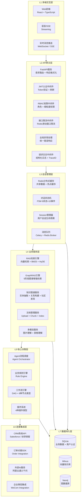
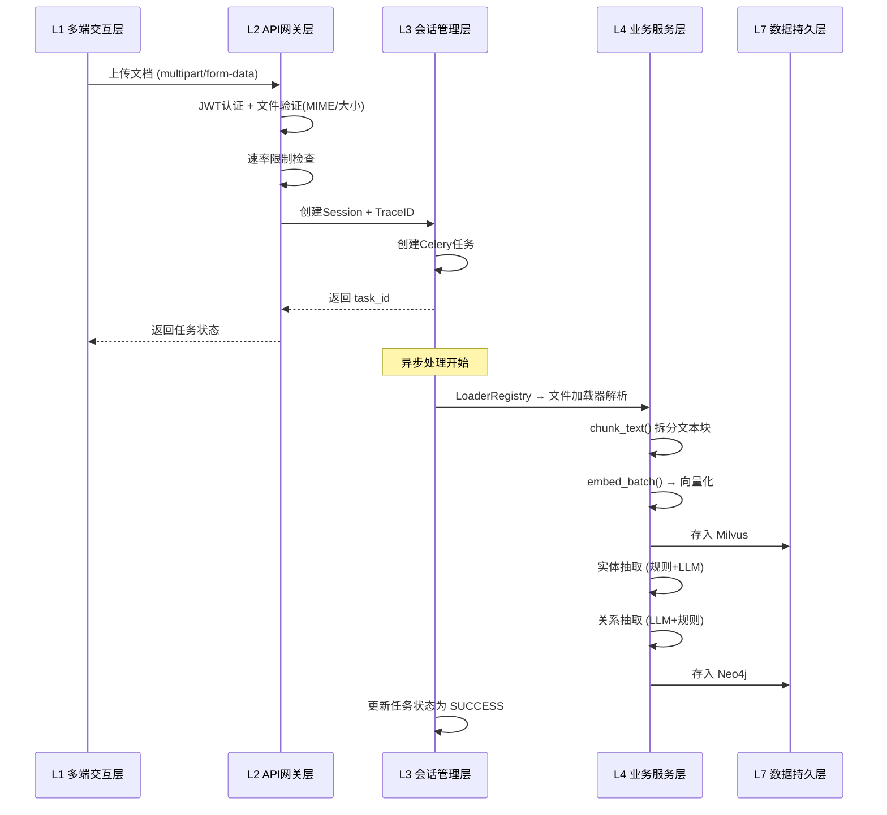
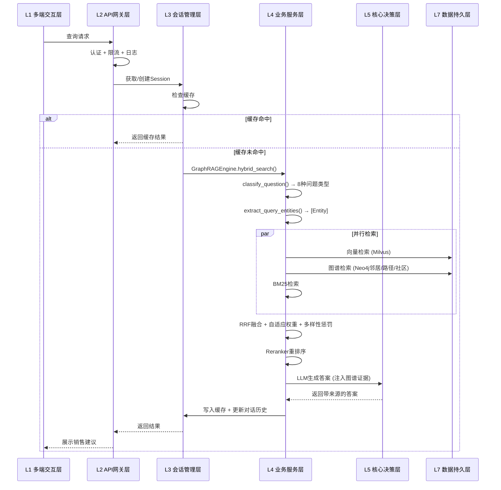

# KQuery Pro — 企业级智能销售助手平台 · 系统架构文档

> **最后更新**: 2026-07-19  
> **项目版本**: v3.0.0  
> **实现状态**: 7 层架构分层思想已全面落地；原"能力拓展路线"（多模型、写作笔记、思维导图、联网搜索、语音、长期记忆、任务式 Agent、共享知识库、Skills）均已实现并作为独立路由对外提供服务

本文档整合了原 `项目架构文档.md` 和 `改进架构设计.md`，保留目录结构、详细模块列表、设计原则、架构图（Mermaid）、代码示例、缓存/安全/多租户等子架构设计。

---

## 目录

- [1. 项目概述与技术栈](#1-项目概述与技术栈)
- [2. 架构演进](#2-架构演进)
- [3. 核心设计原则](#3-核心设计原则)
- [4. 七层架构总览](#4-七层架构总览)
- [5. 目录结构](#5-目录结构)
- [6. 七层架构详解](#6-七层架构详解)
- [7. 模块依赖关系](#7-模块依赖关系)
- [8. 缓存架构设计](#8-缓存架构设计)
- [9. 安全架构设计](#9-安全架构设计)
- [10. 知识图谱集成架构](#10-知识图谱集成架构)
- [11. 消息队列架构](#11-消息队列架构)
- [12. 监控可观测性架构](#12-监控可观测性架构)
- [13. 多租户架构](#13-多租户架构)
- [14. 数据流架构与执行流程](#14-数据流架构与执行流程)
- [15. 扩展性设计](#15-扩展性设计)
- [16. 实现状态](#16-实现状态)
- [17. 项目亮点](#17-项目亮点)
- [18. 能力拓展路线（对标腾讯 ima）](#18-能力拓展路线对标腾讯-ima)

---

## 1. 项目概述与技术栈

### 1.1 项目简介

KQuery Pro 是面向企业销售场景的 **AI Sales Agent 平台**，以智能销售对话与决策支持为核心目标。平台基于 GraphRAG 架构，在传统 RAG 能力之上深度集成**知识图谱**与**多模态理解**，为销售顾问提供从"产品知识检索"到"智能销售对话"的完整赋能。通过**多端交互**、**会话管理**、**业务服务**、**核心决策引擎**、**外部系统集成**七层架构，实现客户接待、智能问答、销售话术推荐、竞品分析、客户关系图谱分析等 AI 销售助手能力。

### 1.2 技术栈

| 层级 | 技术选型 |
|------|---------|
| **后端框架** | FastAPI + Uvicorn |
| **向量数据库** | Milvus 2.6+（pymilvus） |
| **图数据库** | Neo4j 5.15+ Community |
| **关系数据库** | SQLite（aiosqlite） |
| **缓存层** | Redis 7（L1内存LRU + L2 Redis多级缓存） |
| **消息队列** | Celery + Redis |
| **文本嵌入模型** | Qwen3-Embedding-8B（4096维） |
| **重排序模型** | Qwen3-Reranker-8B |
| **图像理解** | 阿里云通义千问视觉模型（qwen-vl-plus） |
| **实体抽取/关系抽取** | 通义千问NER/RE + 规则引擎双模式 |
| **图算法** | NetworkX + Neo4j GDS |
| **社区发现** | 自研 Leiden 算法（CPM质量函数） |
| **LLM Agent** | LangGraph Agent |
| **国际化** | zh_CN / en_US 双语言包（ContextVar） |
| **日志/监控** | Prometheus + Grafana + 结构化JSON日志 + Jaeger链路追踪 |
| **前端** | React 19 + Vite + TypeScript + Tailwind CSS |
| **UI组件库** | shadcn/ui + Radix UI（19个组件） |
| **状态管理** | Zustand（7个Store） |
| **路由** | React Router v6（懒加载 + 路由守卫） |
| **图谱可视化** | D3.js / G6 / Cytoscape |
| **后端包管理** | uv |
| **部署** | Docker + docker-compose（环境部署/项目部署两层） |
| **Python 版本** | Python 3.12+ |

---

## 2. 架构演进

```
v1.x (单体)              v2.x (微服务+图谱)          v3.0 (7层架构)
───────                   ───────────────            ──────────────
单体RAG系统               GraphRAG混合检索            7层全栈架构
无安全机制                完整的安全体系               JWT+RBAC+多租户
无缓存策略                多级智能缓存                 分布式会话+缓存
无异步处理                消息队列异步处理              事件驱动+工作流
单一LLM调用               多模态Provider抽象           核心决策引擎+Agent调度
简陋前端                  React SPA                   多端交互层(Web/WS/SSE/语音)
```

---

## 3. 核心设计原则

### 3.1 SOLID 原则

| 原则 | 应用 |
|------|------|
| **单一职责（SRP）** | 每层只负责一项核心职责；EntityExtractionService 只负责实体抽取 |
| **开闭原则（OCP）** | L6 连接集成层使用适配器模式；L4 多模态使用 Provider 抽象；4种插件类型 |
| **里氏替换（LSP）** | MultimodalProvider 子类可互换；CRM 适配器可互换 |
| **接口隔离（ISP）** | L5 对 L4 暴露最小接口；细化接口避免臃肿 |
| **依赖倒置（DIP）** | 依赖抽象而非具体实现；通过依赖注入实现 |

### 3.2 七层依赖规则

| 规则 | 说明 |
|------|------|
| **严格向下依赖** | Ln 可调 Ln-1，反之不行 |
| **跨层跳过** | 允许跳过中间层（L4 可直调 L7），需通过抽象接口 |
| **同层解耦** | 同层模块通过接口通信 |
| **异步优先** | IO 密集型操作全部异步（asyncio/await） |
| **无循环依赖** | 禁止层级之间出现循环调用 |
| **失败快速** | L2 网关层统一处理异常，尽早报告错误 |
| **防御性编程** | L2 输入验证 + L4 业务校验 |

### 3.3 数据与架构设计原则

| 原则 | 说明 |
|------|------|
| **渐进式图谱构建** | 文档上传后异步构建知识图谱（Celery 任务），先向量化入库，后台逐步完成实体抽取、关系抽取、图谱存储；支持增量更新，新增文档仅对新增内容执行抽取和插入，已有实体跳过 |
| **GraphRAG 混合检索** | 向量语义检索（Milvus）+ 知识图谱上下文扩展（Neo4j），8种问题类型自适应权重 |
| **HyDE 假设性文档** | 查询时用 LLM 生成假设性答案文档，再以其向量检索，提升召回率 |
| **RRF 融合排序** | 多路召回结果使用 Reciprocal Rank Fusion 融合，经 Reranker 重排序 |
| **ReAct Agent 模式** | LangGraph 实现 Thought → Action → Observation 循环 |
| **多级缓存** | L1 内存 LRU + L2 Redis，缓存键分层设计 |
| **数据血缘追踪** | DataLineage 记录从源文档到最终答案的完整链路 |

---

## 4. 七层架构总览

### 4.1 层级定义

| 层级 | 名称 | 职责 | 核心组件 |
|------|------|------|---------|
| **L1** | **多端交互层** | 终端用户触点，多渠道统一接入 | React Web 前端、WebSocket/SSE 实时通信、语音上传接口 |
| **L2** | **API 网关层** | 统一入口，安全防护，流量管控 | FastAPI 路由、JWT 鉴权、RBAC 权限、滑动窗口限流、6层中间件栈 |
| **L3** | **会话管理层** | 对话状态维护，上下文管理 | Redis 分布式缓存、对话状态机（FSM）、Session 管理器、消息队列 |
| **L4** | **业务服务层** | 核心业务逻辑，AI 能力封装 | RAG 检索引擎、知识图谱服务、GraphRAG 引擎、多模态理解 |
| **L5** | **核心决策层** | Agent 编排调度，业务规则执行 | Agent 编排器、工作流引擎（DAG）、业务规则引擎、插件系统 |
| **L6** | **连接集成层** | 外部系统对接，生态扩展 | CRM 适配器（策略模式）、订单 SDK、企业微信集成、服务注册中心 |
| **L7** | **数据持久层** | 数据存储与检索 | SQLite（业务库）、Milvus（向量库）、Neo4j（图库）、Redis（缓存） |

### 4.2 整体架构图



---

## 5. 目录结构

```
Kquery/
├── backend/
│   ├── main.py                    # 主入口：启动 FastAPI
│   ├── pyproject.toml             # uv 项目配置
│   ├── .env.example               # 环境变量示例（100+配置项）
│   ├── app/
│   │   ├── config.py               # 全局配置管理
│   │   ├── celery_config.py        # Celery 异步任务（5个任务）
│   │   ├── core/                   # 核心基础设施层
│   │   │   ├── exceptions.py       # ErrorCode枚举40+错误码 + 12异常类
│   │   │   ├── settings.py         # Pydantic Settings（10个子配置类，热更新）
│   │   │   ├── logger.py           # JSON结构化日志 + 敏感数据脱敏
│   │   │   ├── middleware.py       # 请求日志中间件 + ErrorHandling
│   │   │   ├── security.py         # InputValidator（SQL注入/XSS/路径穿越）
│   │   │   ├── rate_limiter.py     # Redis滑动窗口限流
│   │   │   ├── audit_logger.py     # 安全审计日志（22种事件类型）
│   │   │   ├── audit_storage.py    # 审计日志持久化存储
│   │   │   ├── cache.py            # L1内存LRU+L2 Redis多级缓存
│   │   │   ├── cache_warmer.py     # 缓存预热机制
│   │   │   ├── rbac.py             # RBAC权限控制装饰器
│   │   │   ├── connection_pool.py  # 统一连接池管理
│   │   │   ├── db_optimizer.py     # QueryOptimizer + NPlusOneDetector
│   │   │   ├── database.py         # aiosqlite 异步引擎
│   │   │   ├── auth.py             # JWT认证入口
│   │   │   ├── kb_isolation.py     # 知识库级别资源隔离
│   │   │   ├── i18n.py             # 国际化（zh_CN/en_US）
│   │   │   ├── tenant.py           # 多租户支持
│   │   │   ├── tracing.py          # OpenTelemetry 链路追踪
│   │   │   └── session/            # L3 会话管理层
│   │   │       ├── __init__.py
│   │   │       ├── state_machine.py # FSM状态机（6状态+10事件）
│   │   │       └── manager.py       # SessionManager（Redis生命周期管理）
│   │   ├── api/                    # API网关层（按功能域分组的路由）
│   │   │   ├── main.py             # FastAPI入口（中间件 + 全部路由注册）
│   │   │   ├── router.py           # RAG业务路由（rag_router → /kquery）
│   │   │   ├── agent_router.py     # Agent问答路由（chat/stream/ws/voice/session）
│   │   │   ├── ws_manager.py       # WebSocket连接管理器
│   │   │   ├── auth_router.py      # JWT认证（register/login/refresh/me，4端点）
│   │   │   ├── knowledge_base_router.py # 共享知识库（CRUD+成员+邀请）
│   │   │   ├── knowledge_graph.py  # 知识图谱路由（/graph）
│   │   │   ├── graphrag.py         # GraphRAG路由（/graphrag）
│   │   │   ├── llm_router.py       # 多模型统一接入（/models、/chat）
│   │   │   ├── notes_router.py     # AI写作笔记（/notes）
│   │   │   ├── mindmap_router.py   # 思维导图（/mindmap）
│   │   │   ├── web_search_router.py # 联网搜索（/web-search）
│   │   │   ├── speech_router.py    # 语音 ASR/TTS（/speech）
│   │   │   ├── memory_router.py    # 长期记忆（/memory）
│   │   │   ├── tasks_router.py     # 任务式 Agent（/tasks）
│   │   │   ├── skills_router.py    # Skills 生态（/skills）
│   │   │   ├── chart_data.py       # 图表数据（/chart-data）
│   │   │   ├── multimodal.py       # 多模态检索（/multimodal）
│   │   │   ├── config_router.py    # 配置管理路由（/config）
│   │   │   ├── rbac.py             # RBAC权限管理路由（/rbac）
│   │   │   ├── health.py           # 健康检查（/health*）
│   │   │   └── exception_handlers.py # 全局异常处理器
│   │   ├── services/               # 业务服务层
│   │   │   ├── rag_service.py      # RAG统一服务
│   │   │   ├── retriever.py        # 检索引擎（向量+时间衰减）
│   │   │   ├── embedding.py        # Qwen3-Embedding-8B
│   │   │   ├── chunking.py         # 智能文本切分
│   │   │   ├── hyde_generator.py   # HyDE假设文档生成
│   │   │   ├── bm25_retriever.py   # BM25关键词检索
│   │   │   ├── bm25_index_manager.py
│   │   │   ├── image_understanding.py  # 图像理解（qwen-vl-plus）
│   │   │   ├── table_understanding.py  # 表格理解
│   │   │   ├── document_classifier.py  # 文档分类
│   │   │   ├── document_models.py       # 文档数据模型
│   │   │   ├── lineage_service.py  # 数据血缘服务
│   │   │   ├── storage_service.py  # 文件/对象存储服务
│   │   │   ├── writing_service.py  # P0：AI写作笔记服务
│   │   │   ├── writing_prompts.py  # AI写作提示词
│   │   │   ├── web_search.py       # P0：联网搜索
│   │   │   ├── web_fetcher.py      # 网页抓取
│   │   │   ├── long_term_memory_service.py # P1：长期记忆
│   │   │   ├── task_service.py     # P1：任务式 Agent 服务
│   │   │   ├── knowledge_base_service.py # P2：共享知识库服务
│   │   │   ├── skill_registry.py   # P2：Skills 注册表
│   │   │   ├── speech/             # 语音服务（ASR/TTS）
│   │   │   │   ├── asr_service.py
│   │   │   │   └── tts_service.py
│   │   │   ├── integration/        # L6 连接集成层（适配器，未暴露公开 API）
│   │   │   │   ├── base.py         # ExternalServiceAdapter
│   │   │   │   ├── registry.py     # 服务注册中心
│   │   │   │   ├── crm_adapter.py  # CRM适配器（策略模式）
│   │   │   │   ├── order_sdk.py    # 订单SDK
│   │   │   │   └── wecom_integration.py # 企业微信
│   │   │   ├── graph/              # 知识图谱服务（8文件）
│   │   │   │   ├── entity_extraction.py    # LLM+规则双引擎
│   │   │   │   ├── relation_extraction.py  # 关系抽取
│   │   │   │   ├── graph_builder.py        # 图谱构建
│   │   │   │   ├── graph_query.py          # 图谱查询
│   │   │   │   ├── community_engine.py     # 社区发现（Leiden）
│   │   │   │   ├── llm_graph_agent.py      # LLM图谱Agent
│   │   │   │   ├── structured_extractor.py # 结构化抽取
│   │   │   │   └── table_mapper.py         # 表格到图谱映射
│   │   │   ├── graphrag/           # GraphRAG引擎（3文件）
│   │   │   │   ├── graphrag_engine.py      # 5阶段检索
│   │   │   │   ├── qa_service.py           # 智能问答
│   │   │   │   └── visualization_service.py # 可视化数据
│   │   │   ├── document/           # 文档处理子模块
│   │   │   └── file_loaders/       # 文件加载器（多格式）
│   │   ├── repositories/           # 数据持久层
│   │   │   ├── connector.py        # Milvus连接管理
│   │   │   ├── operations.py       # Milvus CRUD + HNSW
│   │   │   ├── database/           # Milvus连接器
│   │   │   └── graph/              # 图谱数据访问
│   │   │       ├── neo4j_connector.py  # Neo4j连接器
│   │   │       └── schema.py       # 22实体+25关系
│   │   ├── agents/                 # L5 核心决策层
│   │   │   ├── qa_agent.py         # 问答Agent
│   │   │   ├── rag_tool.py         # RAG工具集
│   │   │   ├── memory.py           # Agent记忆管理
│   │   │   ├── orchestrator.py     # Agent编排器
│   │   │   ├── rule_engine.py      # 业务规则引擎
│   │   │   └── decision_evaluator.py # 决策评估器
│   │   ├── plugins/                # 插件系统
│   │   │   ├── base.py             # 插件抽象基类
│   │   │   ├── registry.py         # 插件注册表
│   │   │   └── manager.py          # 生命周期管理器
│   │   ├── workflow/               # 工作流引擎
│   │   │   ├── models.py           # DAG数据模型
│   │   │   └── engine.py           # Kahn拓扑排序+并行执行
│   │   ├── models/                 # 数据模型
│   │   ├── scripts/                # 工具脚本
│   │   └── locales/                # 国际化语言包
│   ├── deploy/                     # 部署配置（环境部署/项目部署两层）
│   └── tests/                      # 测试目录
│
├── frontend/                       # React 19 前端
│   └── src/
│       ├── components/layout/      # MainLayout/Header/Sidebar（3个）
│       ├── components/ui/          # 19个shadcn/ui组件
│       ├── components/            # 业务组件（MindMapTree/SkillSelector/DocumentPreview
│       │                          #   /ChatImageUpload/KnowledgeBaseShareDialog）
│       ├── pages/                  # 14个页面（Dashboard/Chat/KnowledgeBases/Notes
│       │                          #   /NoteEditor/Tasks/Skills/Analytics/MultimodalViewer等）
│       ├── stores/                 # 7个Zustand Store（Chat/Document/Graph/Kb/Note/Skill/Task）
│       ├── services/               # 8个API服务模块（auth/chart/kb/knowledgeGraph
│       │                          #   /multimodal/note/skill/task）
│       └── lib/api.ts             # 统一API客户端
│
├── deploy/                         # Docker部署
│   ├── 环境部署/                   # 基础设施服务
│   └── 项目部署/                   # 应用服务
│
├── doc/                            # 项目文档
└── 面试题/                         # 技术面试题
```

---

## 6. 七层架构详解

### 6.1 L1 · 多端交互层

**职责**：所有用户触点的接入与交互，屏蔽多端差异。

| 组件 | 技术/文件 | 说明 |
|------|----------|------|
| React 前端 | `frontend/` | 15+页面+19+组件+7+Store，React 19 + Vite 8 + TS |
| WebSocket | `api/ws_manager.py` | 实时双向通信（`/agent/ws`） |
| SSE 流式 | `api/agent_router.py` | Server-Sent Events 流式对话（`/agent/chat/stream`） |
| 语音上传 | `api/agent_router.py` | 语音文件上传接口（`/agent/voice/upload`），ASR 见 `/speech/asr` |
| 前端API客户端 | `lib/api.ts` + `services/` | axios封装 + 8个API服务模块 |

### 6.2 L2 · API 网关层

**职责**：统一入口，认证/授权/限流/路由/日志/异常处理。

**中间件栈**（实际执行顺序，由 `app/api/main.py` 注册，由外到内）：
```
安全响应头 → 速率限制(Redis滑动窗口) → [请求日志(仅 debug)] → CORS → [Prometheus 指标(enable_metrics)]
```

> 注：当前未启用独立的"审计日志中间件"与"认证/RBAC 中间件"；审计日志由 `core/audit_logger.py` 在业务中主动写入，鉴权通过路由级依赖（`get_current_user` / `require_kb_role`）实现。全局异常由 `api/exception_handlers.py` 统一捕获。

**API 版本化设计**（按功能域分组，全部挂载 `/api/v1`）：

| 路由前缀 | 功能域 |
|---------|--------|
| `/api/v1/kquery/*` | 文本 RAG 接口 |
| `/api/v1/agent/*` | AI Agent 会话（含会话管理、WS、SSE、语音上传） |
| `/api/v1/graph/*` | 知识图谱 RESTful API |
| `/api/v1/graphrag/*` | GraphRAG 混合检索 |
| `/api/v1/auth/*` | 用户认证 |
| `/api/v1/knowledge-bases/*` | 共享知识库 |
| `/api/v1/models`、`/api/v1/chat` | 多模型统一接入 |
| `/api/v1/notes/*`、`/mindmap/*`、`/web-search/*` | 写作笔记 / 思维导图 / 联网搜索 |
| `/api/v1/speech/*`、`/memory/*`、`/tasks/*`、`/skills/*` | 语音 / 长期记忆 / 任务式 Agent / Skills |
| `/api/v1/chart-data/*`、`/multimodal/*`、`/config/*` | 图表 / 多模态 / 配置 |
| `/health*` | 健康检查（无前缀） |

> 说明：**不存在** `/api/v1/rbac/*` 路由；RBAC 能力由 `core/rbac.py` 以依赖方式提供给知识库等业务，未暴露独立管理端点。

**核心中间件代码示例**（实际代码在 `core/security.py`、`core/rate_limiter.py`、`core/middleware.py`）：
```python
# 认证中间件逻辑
async def auth_middleware(request, call_next):
    if request.url.path in ["/health", "/docs", "/api/v1/auth/login", "/api/v1/auth/register"]:
        return await call_next(request)
    auth_header = request.headers.get("Authorization")
    # 验证 JWT Token，注入 request.state.user_id/tenant_id/permissions

# 权限检查装饰器
def require_permission(required_permission: str):
    # 通过 request.state.permissions 检查用户是否有指定权限
```

### 6.3 L3 · 会话管理层

**职责**：管理用户会话生命周期、分布式缓存、对话状态机、异步消息队列。

| 模块 | 文件 | 核心能力 |
|------|------|---------|
| 对话状态机 | `core/session/state_machine.py` | FSM 6状态+10事件，Redis存储+TTL |
| 会话管理器 | `core/session/manager.py` | 创建/获取/刷新/结束/心跳保活 |
| Agent记忆 | `agents/memory.py` | 会话创建/消息存储/历史查询 |
| 多级缓存 | `core/cache.py` | L1内存LRU + L2 Redis + 多级管理器 |
| Celery | `celery_config.py` | 5个异步任务 |

**对话状态定义**：

| 状态 | 含义 |
|------|------|
| `IDLE` | 空闲/初始状态 |
| `LISTENING` | 等待用户输入 |
| `PROCESSING` | 正在处理请求 |
| `AWAITING_CONFIRMATION` | 等待用户确认 |
| `ERROR` | 错误状态 |
| `CLOSED` | 会话结束 |

**状态迁移**：
```
IDLE → [start_session] → LISTENING → [user_input] → PROCESSING → [response_ready] → LISTENING
PROCESSING → [need_confirmation] → AWAITING_CONFIRMATION → [confirmed/rejected] → LISTENING/PROCESSING
PROCESSING → [error] → ERROR → [retry] → PROCESSING
LISTENING → [timeout] → CLOSED
```

### 6.4 L4 · 业务服务层

**职责**：核心业务逻辑，包括检索、知识图谱、多模态理解、GraphRAG。

#### 6.4.1 RAG 检索引擎

| 模块 | 文件 | 说明 |
|------|------|------|
| RAG统一服务 | `rag_service.py` | 文档处理流水线 + 查询门面 |
| 向量检索 | `retriever.py` | 向量 + 时间衰减，支持HyDE增强 |
| 文本嵌入 | `embedding.py` | Qwen3-Embedding-8B，4096维，批量并行 |
| 文本切分 | `chunking.py` | 多策略递归切分 |
| BM25检索 | `bm25_retriever.py` | jieba分词 + BM25Okapi |
| HyDE生成 | `hyde_generator.py` | LLM假设文档增强检索 |

**多路检索融合公式**（RRF）：
```
score = sum(1 / (60 + rank_i))  // 3路（向量 + HyDE + BM25）
```

#### 6.4.2 知识图谱服务

| 模块 | 文件 | 行数 | 说明 |
|------|------|------|------|
| 实体抽取 | `entity_extraction.py` | 1086行 | LLM NER + 14条规则双引擎，别名消歧 |
| 关系抽取 | `relation_extraction.py` | — | LLM RE + 10个预置正则模式 |
| 图谱构建 | `graph_builder.py` | — | UNWIND批量写入>1000节点/秒 |
| 图谱查询 | `graph_query.py` | — | 邻居/路径/子图/PageRank/社区 |
| 社区发现 | `community_engine.py` | — | 自研Leiden算法，CPM质量函数 |
| LLM图谱Agent | `llm_graph_agent.py` | — | DashScope + Few-shot |

**图谱 Schema**（`repositories/graph/schema.py`）：22种实体类型 + 25种关系类型 + Pydantic 强类型校验。

#### 6.4.3 GraphRAG 引擎

| 模块 | 文件 | 行数 | 说明 |
|------|------|------|------|
| 混合检索引擎 | `graphrag_engine.py` | 1583行 | 5阶段检索：分类→抽取→扩展→向量→融合 |
| 智能问答 | `qa_service.py` | — | 问题分类 + Prompt构建 + 答案生成 |
| 可视化数据 | `visualization_service.py` | — | D3.js/Cytoscape.js格式转换 |

**8种问题类型自适应权重策略**：

| 问题类型 | 向量权重 | 图谱权重 | 典型场景 |
|---------|---------|---------|---------|
| FACTOID（事实型） | 0.4 | 0.6 | "产品A的价格？" |
| RELATION（关系型） | 0.3 | 0.7 | "A和B什么关系？" |
| REASONING（推理型） | 0.5 | 0.5 | "为什么客户选竞品？" |
| PROCEDURAL（程序型） | 0.7 | 0.3 | "如何配置参数？" |

#### 6.4.4 多模态理解

| 模块 | 文件 | 说明 |
|------|------|------|
| 图像理解 | `image_understanding.py` | qwen-vl-plus 三级描述（brief/standard/detailed）+ 缓存 |
| 表格理解 | `table_understanding.py` | HTML/文本表格结构化提取 + LLM摘要 |

#### 6.4.5 文件加载器（11种格式）

PDFLoader、WordLoader、ExcelLoader、PowerPointLoader、MarkdownLoader、HTMLLoader、TextLoader、JSONLoader、XMLLoader、ImageLoader（LoaderRegistry 注册表 + BaseLoader 抽象基类）

### 6.5 L5 · 核心决策层

| 模块 | 文件 | 说明 |
|------|------|------|
| 问答Agent | `agents/qa_agent.py` | LangGraph Agent + 对话记忆 + RAG工具 |
| RAG工具集 | `agents/rag_tool.py` | rag_search + process_document |
| Agent编排器 | `agents/orchestrator.py` | 多Agent编排 + 意图路由 |
| 业务规则引擎 | `agents/rule_engine.py` | 规则注册 + 条件评估 |
| 决策评估器 | `agents/decision_evaluator.py` | 决策质量评分 |

**工作流引擎**（`workflow/engine.py`）：
- DAG 模型：Kahn 拓扑排序 + 并行节点执行
- 8种节点类型：LLM / RETRIEVAL / CONDITION / OUTPUT / INPUT / TRANSFORM / LOOP / PARALLEL
- 执行状态追踪：PENDING → RUNNING → COMPLETED / FAILED
- 错误隔离：单个节点失败不影响其他并行节点

**插件系统**（`plugins/`）：
- 4种插件类型：LLM_PROVIDER / DOCUMENT_LOADER / RETRIEVER / TOOL
- PluginManager 自动发现 + 生命周期管理 + 钩子执行

### 6.6 L6 · 连接集成层

| 集成目标 | 实现文件 | 对接方式 |
|---------|---------|---------|
| CRM 系统 | `crm_adapter.py` | 策略模式（Salesforce + 纷享销客） |
| 订单系统 | `order_sdk.py` | SDK 对接 |
| 企业微信 | `wecom_integration.py` | 开放平台API |
| 服务注册中心 | `registry.py` | 注册表模式 + 健康检查 |
| 外部AI服务 | 通义千问系列 | DashScope API（Embedding/NER/RE/VL/LLM） |

### 6.7 L7 · 数据持久层

| 存储 | 技术 | 数据内容 |
|------|------|---------|
| SQLite | aiosqlite | 用户认证 / 角色权限 / 系统配置 / 审计日志 |
| Milvus | pymilvus (HNSW索引) | 文档向量嵌入 / 语义检索集合 |
| Neo4j | neo4j-driver (异步) | 知识图谱节点与关系 / 社区发现结果 |
| Redis | redis-py | L2缓存 / Token黑名单 / 限流计数器 / Celery队列 |

**Neo4j企业级连接器特性**：异步驱动 + 连接池 + 自动重连 + Schema自动初始化 + 慢查询检测 + 降级处理。

---

## 7. 模块依赖关系

```
核心服务依赖链：

GraphRAGEngine (L4)
├── RAGService (L4)          ──┬── EmbeddingService (L4)
│                              ├── Retriever (L4) ─── MilvusConnector (L7)
│                              ├── BM25Retriever (L4)
│                              ├── HydeGenerator (L4)
│                              └── Reranker (L4)
├── GraphQueryService (L4)    ──┬── Neo4jConnector (L7)
│                              └── GraphBuilderService (L4)
├── QueryEntityExtractor (L4) 
├── GraphContextExpander (L4)
└── ResultFusionEngine (L4)

AgentOrchestrator (L5)
├── QAAgent (L5) ──┬── RAGTool (L5) ── RAGService (L4)
│                   └── Memory (L5) ── Redis (L3)
├── RuleEngine (L5)
├── DecisionEvaluator (L5)
└── IntegrationService (L6) ──┬── CRMAdapter (L6)
                              ├── OrderSDK (L6)
                              └── WeComIntegration (L6)

SessionManager (L3) ── Redis (L7)
Cache (L3) ── Redis (L7)
Celery (L3) ── Redis (L7)
Auth (L2) ── SQLite (L7) ── Redis (L7)
```

---

## 8. 缓存架构设计

### 8.1 三级缓存策略

```
L1: 内存缓存 (进程内 LRU)
    TTL: 30s~5min
    [热点数据] [高频实体] [常用配置]

L2: Redis 缓存 (分布式)
    TTL: 30min~24h
    [会话缓存] [检索结果] [话术模板] [限流计数器] [Token黑名单]

L3: 数据库 (最终数据源)
    SQLite / Milvus / Neo4j
    [持久化数据] [权威来源]
```

**访问路径**：请求 → L1 缓存 → 未命中 → L2 缓存 → 未命中 → L3 数据库 → 回填 L2 → 回填 L1

### 8.2 缓存管理

实际代码在 `core/cache.py` 中实现：
- `MemoryCache`：基于 `@lru_cache` 的内存缓存，TTL 自动过期
- `RedisCacheService`：Redis SET EX 存储，支持模式匹配失效
- `MultiLevelCache`：L1+L2 联合管理器，逐级回退+回填
- `CacheWarmer`（`core/cache_warmer.py`）：启动时预加载热点数据

### 8.3 缓存失效机制

- **TTL 过期**：各缓存层级独立设置 TTL
- **数据更新事件**：文档处理/图谱构建完成后主动失效相关缓存
- **手动刷新**：通过管理API主动清除指定缓存

---

## 9. 安全架构设计

### 9.1 分层安全体系

```
L1 多端交互层:  HTTPS · 输入长度限制 · 前端输入验证
L2 API网关层:   JWT双Token · RBAC权限 · 接口限流 · 输入验证(XSS/SQL注入/路径穿越) · 安全响应头
L3 会话管理层:  Session防篡改 · Token绑定 · Redis加密
L4 业务服务层:  业务权限校验 · 数据脱敏 · 操作审计
L5 核心决策层:  策略沙箱 · 规则校验 · Agent行为审计
L6 连接集成层:  API密钥管理 · 外部请求签名
L7 数据持久层:  数据加密 · 访问控制 · SQL注入防护
```

### 9.2 认证授权体系

| 模块 | 文件 | 说明 |
|------|------|------|
| JWT双Token | `core/auth.py` + `api/auth_router.py` | Access Token 24h + Refresh Token 7d |
| Token黑名单 | Redis | 登出时加入黑名单，TTL=Token剩余时间 |
| RBAC权限 | `core/rbac.py` | 4角色×13权限，PermissionChecker |
| 认证入口 | `core/auth.py` | `get_current_admin_user` 依赖注入 |

**RBAC 角色权限矩阵**：

| 角色 | 权限数 | 说明 |
|------|-------|------|
| super_admin | 13 | 全权限 |
| admin | 11 | 排除审计日志 |
| editor | 7 | 文档读写+知识图谱操作 |
| viewer | 3 | 只读 |

### 9.3 输入验证与异常体系

- **InputValidator**（`core/security.py`）：检测 SQL注入（`\b(OR|AND|UNION|SELECT)\s`）、XSS（`<script>` / `on\w+=`）、路径穿越（`../`）
- **40+错误码**（`core/exceptions.py`）：AUTH_*、VALIDATION_*、NOT_FOUND_*、RATE_LIMIT_*、DATABASE_*、EXTERNAL_*、INTERNAL_*
- **10个异常处理器**（`api/exception_handlers.py`）
- **速率限制**（`core/rate_limiter.py`）：Redis 滑动窗口，按IP/用户/端点分级

---

## 10. 知识图谱集成架构

### 10.1 知识图谱在7层中的位置

```
L4 业务服务层
├── EntityExtractionService  — LLM+规则双引擎抽取实体
├── RelationExtractionService — LLM+规则抽取关系
├── GraphBuilderService       — UNWIND批量写入Neo4j
├── GraphQueryService          — 邻居/路径/子图/PageRank/社区
├── CommunityEngine            — Leiden算法社区发现
└── LLMGraphAgent             — DashScope+Few-shot增强抽取

L7 数据持久层
├── Neo4j (22实体类型+25关系类型)
└── Milvus (实体向量索引)
```

### 10.2 GraphRAG 5阶段检索流程

```
用户查询
    ↓
阶段1: classify_question() → QuestionType (8种类型)
    ↓
阶段2: extract_query_entities() → [Entity] (规则+LLM+数据库匹配)
    ↓
阶段3: expand_graph_context() → GraphContext (邻居/路径/社区)
    ↓
阶段4: vector_search() → [ScoredResult] (向量+HyDE+BM25→RRF→Reranker)
    ↓
阶段5: fuse_and_rerank() → [FusedResult] (Min-Max归一化+自适应权重+多样性惩罚)
    ↓
答案生成: LLM(prompt + 图谱证据 + 检索块 + 历史)
```

---

## 11. 消息队列架构

消息队列归属于 **L3 会话管理层**，基于 Celery + Redis Broker。

### 11.1 Celery 配置

```python
celery_app = Celery("kquery", broker="redis://localhost:6379/1", backend="redis://localhost:6379/2")
```

支持自动重试（最多3次，指数回退），任务状态通过 Redis 存储。

### 11.2 预定义异步任务（5个）

| 任务名 | 功能 |
|--------|------|
| `process_document_upload` | 文档上传异步处理（加载→分块→向量化→图谱构建） |
| `delete_document_vectors` | 文档向量批量删除 |
| `batch_process_documents` | 批量文档处理 |
| `build_knowledge_graph` | 知识图谱异步构建 |
| `cleanup_cache` | 缓存清理维护 |

### 11.3 任务状态管理

```
POST /api/v1/tasks/document/process → 创建任务 → 返回 task_id
GET  /api/v1/tasks/{task_id}/status  → 查询进度 (PENDING/PROGRESS/SUCCESS/FAILURE)
```

---

## 12. 监控可观测性架构

### 12.1 分层监控指标

| 层级 | 关键指标 |
|------|---------|
| L2 API网关层 | 请求量 / 响应时间 / 错误率 / 限流统计 |
| L3 会话管理层 | Session数 / 缓存命中率 / 队列深度 |
| L4 业务服务层 | 检索延迟 / 图谱查询耗时 / GraphRAG各阶段耗时 |
| L5 核心决策层 | Agent执行耗时 / 规则命中率 / 工作流成功率 |
| L6 连接集成层 | 外部服务延迟 / 健康状态 |

### 12.2 技术实现

- **Prometheus**：`prometheus-fastapi-instrumentator` + 自定义 Counter/Histogram/Gauge 指标
- **Grafana**：预配置仪表盘（CPU/内存/请求率/延迟/缓存命中率）
- **结构化JSON日志**（`core/logger.py`）：含请求ID + 敏感字段脱敏
- **Jaeger链路追踪**（`core/tracing.py`）：OpenTelemetry 标准 Span，通过 Jaeger 导出
- **监控与日志基础设施**：ELK Stack（Elasticsearch 8.17 + Logstash + Kibana）

---

## 13. 多租户架构

### 13.1 租户隔离策略

| 维度 | 隔离方式 |
|------|----------|
| L2 API网关 | JWT中携带tenant_id，请求级别识别 |
| L3 会话管理 | Redis Key命名空间 `tenant:{id}:session:*` |
| L4 业务服务 | 知识库集合前缀 `{tenant_id}_default` |
| L6 连接集成 | 租户级独立API密钥 |
| L7 数据持久 | Milvus集合隔离 / Neo4j标签前缀 |

### 13.2 技术实现

- `core/tenant.py`：`TenantContext` 使用 ContextVar 维护请求级租户上下文
- `core/kb_isolation.py`：知识库访问控制，Milvus/Neo4j 通过前缀实现逻辑隔离
- 中间件从请求头 `X-Tenant-ID` 提取租户ID，API层通过依赖注入获取

---

## 14. 数据流架构与执行流程

### 14.1 文档处理全流程（含图谱构建）



### 14.2 智能查询全流程



---

## 15. 扩展性设计

### 15.1 水平扩展

| 层级 | 扩展方式 | 状态说明 |
|------|----------|---------|
| L2 API网关层 | 水平扩展 + Nginx负载均衡 | 无状态，最易扩展 |
| L3 会话管理层 | Redis集群 + Celery Worker池 | Redis做状态集中管理 |
| L4 业务服务层 | 水平扩展 + 服务发现 | 无状态 |
| L5 核心决策层 | 水平扩展 + 策略缓存 | 决策结果可缓存 |
| L7 数据持久层 | 集群模式 | Milvus/Neo4j/Redis 集群 |

生产环境部署方案：`deploy/项目部署/docker-compose.prod.yml`（多API网关实例 + Celery多Worker + Nginx负载均衡）。

### 15.2 插件扩展

- **插件系统**：PluginRegistry + PluginManager，4种类型（LLM/DocumentLoader/Retriever/Tool）
- **适配器模式**：CRM 适配器、Provider 工厂，新增外部服务无需修改核心逻辑
- **工作流引擎**：DAG 节点可扩展，支持自定义节点类型

---

## 16. 实现状态

| 架构层级 | 模块 | 状态 | 核心文件 |
|----------|------|------|----------|
| **L1 多端交互层** | Web前端 (React) | ✅ 已完成 | `frontend/` (15+页面+19+组件+7+Store) |
| | WebSocket/SSE/语音 | ✅ 已完成 | `api/ws_manager.py`, `api/agent_router.py` |
| **L2 API网关层** | FastAPI路由 | ✅ 已完成 | `api/main.py`, `api/router.py` |
| | JWT认证 | ✅ 已完成 | `core/security.py`, `api/auth_router.py` (register/login/refresh/me，4端点) |
| | RBAC（知识库角色鉴权 + 全局权限） | ✅ 已完成 | `core/rbac.py`（`require_kb_role`）+ `api/rbac.py`（`/api/v1/rbac` 角色/权限管理） |
| | 接口限流 | ✅ 已完成 | `core/rate_limiter.py` |
| | 全局异常处理 | ✅ 已完成 | `core/exceptions.py`, `api/exception_handlers.py` |
| | 6层中间件栈 | ✅ 已完成 | `core/middleware.py`, `core/security.py` |
| **L3 会话管理层** | Redis多级缓存 | ✅ 已完成 | `core/cache.py` (L1+L2) |
| | 对话状态机 | ✅ 已完成 | `core/session/state_machine.py` (6状态+10事件) |
| | Session管理器 | ✅ 已完成 | `core/session/manager.py` |
| | Celery消息队列 | ✅ 已完成 | `celery_config.py` (5个异步任务) |
| | 缓存预热 | ✅ 已完成 | `core/cache_warmer.py` |
| **L4 业务服务层** | RAG检索引擎 | ✅ 已完成 | `services/rag_service.py`, `retriever.py` |
| | Vector/BM25/HyDE | ✅ 已完成 | `embedding.py`, `bm25_retriever.py`, `hyde_generator.py` |
| | GraphRAG引擎 | ✅ 已完成 | `services/graphrag/graphrag_engine.py` (1583行) |
| | 知识图谱服务 | ✅ 已完成 | `services/graph/` (6文件) |
| | 多模态理解 | ✅ 已完成 | `image_understanding.py`, `table_understanding.py` |
| | 文件加载器 | ✅ 已完成 | `file_loaders/` (11种格式) |
| **L5 核心决策层** | Agent流程调度 | ✅ 已完成 | `agents/orchestrator.py` |
| | 业务规则引擎 | ✅ 已完成 | `agents/rule_engine.py` |
| | 工作流引擎(DAG) | ✅ 已完成 | `workflow/engine.py` (8种节点+并行) |
| | 插件系统 | ✅ 已完成 | `plugins/base.py`, `registry.py`, `manager.py` |
| **L6 连接集成层** | CRM适配器 | ✅ 已完成 | `services/integration/crm_adapter.py` (策略模式) |
| | 订单SDK | ✅ 已完成 | `services/integration/order_sdk.py` |
| | 企业微信集成 | ✅ 已完成 | `services/integration/wecom_integration.py` |
| | 服务注册中心 | ✅ 已完成 | `services/integration/registry.py` |
| **L7 数据持久层** | SQLite | ✅ 已完成 | `core/database.py`, `models/user.py` |
| | Milvus向量库 | ✅ 已完成 | `repositories/database/milvus_connector.py` |
| | Neo4j图库 | ✅ 已完成 | `repositories/graph/neo4j_connector.py`, `schema.py` |
| **拓展能力** | 多模型统一接入 | ✅ 已完成 | `api/llm_router.py`（/models、/chat） |
| | AI 写作笔记 | ✅ 已完成 | `api/notes_router.py`, `services/writing_service.py` |
| | 思维导图 | ✅ 已完成 | `api/mindmap_router.py` |
| | 联网搜索 | ✅ 已完成 | `api/web_search_router.py`, `services/web_search.py` |
| | 语音 ASR/TTS | ✅ 已完成 | `api/speech_router.py`, `services/speech/` |
| | 长期记忆 | ✅ 已完成 | `api/memory_router.py`, `services/long_term_memory_service.py` |
| | 任务式 Agent | ✅ 已完成 | `api/tasks_router.py`, `services/task_service.py` |
| | 共享知识库 | ✅ 已完成 | `api/knowledge_base_router.py`, `services/knowledge_base_service.py` |
| | Skills 生态 | ✅ 已完成 | `api/skills_router.py`, `services/skill_registry.py` |
| **跨层** | 国际化i18n | ✅ 已完成 | `core/i18n.py`, `locales/` |
| | 多租户支持 | ✅ 已完成 | `core/tenant.py`, `core/kb_isolation.py` |
| | Jaeger链路追踪 | ✅ 已完成 | `core/tracing.py` (OpenTelemetry) |
| | 水平扩展部署 | ✅ 已完成 | `deploy/项目部署/docker-compose.prod.yml` |

---

## 17. 项目亮点

1. **七层 AI Sales Agent 架构**：从多端交互层到数据持久层的完整分层架构设计，每一层职责清晰、可独立扩展。

2. **GraphRAG 5阶段混合检索**：问题分类 → 实体抽取 → 图谱扩展 → 向量检索 → 结果融合，8种问题类型自适应权重，多样性惩罚算法。

3. **Agent 驱动的智能销售决策**：LangGraph Agent 架构 + 意图识别 + 工具编排 + 多源信息聚合。

4. **完善的企业级基础设施**：JWT双Token + RBAC权限(4×13) + 多级缓存(L1+L2) + 连接池 + 限流 + 22种审计日志 + 40+错误码。

5. **插件化架构体系**：4种插件类型（LLM/DocumentLoader/Retriever/Tool），PluginManager 自动发现/生命周期管理。

6. **DAG 工作流引擎**：Kahn 拓扑排序 + 并行执行 + 8种节点类型 + 错误隔离。

7. **知识图谱完整链路**：22种实体+25种关系 + 实体抽取(1086行LLM+规则双引擎) + 关系抽取 + 图谱构建(>1000节点/秒) + 社区发现(自研Leiden) + 数据血缘。

8. **多模态内容理解**：阿里云 VL 三级图像描述 + 表格LLM结构化 + 11种文件加载器。

9. **Neo4j企业级连接器**：异步驱动 + 连接池 + 自动重连 + Schema自动初始化 + 慢查询检测 + 降级处理。

10. **配置系统**：Pydantic Settings 管理 100+ 配置项，10 个子配置类支持热更新。

11. **知识库多租户隔离**：`kb_isolation.py` 模块确保 Milvus 集合级别的资源隔离。

12. **全链路可观测性**：Prometheus + Grafana + 结构化JSON日志 + Jaeger链路追踪 + 缓存预热。

13. **L3对话状态机与会话管理**：FSM 6状态+10事件 + SessionManager Redis存储+TTL+心跳保活。

14. **L1多端交互增强**：WebSocket + SSE流式 + 语音上传。

15. **L6连接集成层全实现**：CRM适配器(策略模式) + 订单SDK + 企业微信 + 服务注册中心。

16. **多租户完整支持**：ContextVar 租户上下文 + 数据隔离 + 配额管理。

17. **水平扩展部署**：多API网关实例 + Celery多Worker + Nginx负载均衡 + Jaeger追踪。

---

## 18. 能力拓展（对标腾讯 ima，已落地）

> 本章原为"能力拓展路线"，对标腾讯 ima 规划了多模型、写作笔记、思维导图、联网搜索、语音、长期记忆、任务式 Agent、共享知识库、Skills 等能力。**截至 v3.0，上述能力均已实现并作为独立路由对外提供**（对应 `app/api/` 下的 `llm_router.py`、`notes_router.py`、`mindmap_router.py`、`web_search_router.py`、`speech_router.py`、`memory_router.py`、`tasks_router.py`、`knowledge_base_router.py`、`skills_router.py`）。接口清单见 `doc/接口设计/接口设计文档.md` 第 9 章；竞品对比见 `doc/详细设计/技术分析报告.md` 第 12 章。本章保留设计落位与工程原则以供参考。

### 18.1 拓展能力在七层架构中的落位（均已实现）

| 拓展能力 | 优先级 | 所属层级 | 实现落点 | 状态 |
|---------|:------:|---------|----------------|:----:|
| 多模型统一接入 | P0 | L2/L4/L5 | `api/llm_router.py`、`llm_client` 多通道调用 | ✅ |
| AI 写作笔记 | P0 | L4/L1 | `services/writing_service.py`、`api/notes_router.py`、前端 `Notes.tsx`/`NoteEditor.tsx` | ✅ |
| 思维导图 | P0 | L4/L1 | `api/mindmap_router.py`、复用 `graph/graph_query.py`、前端 `MindMapTree.tsx` | ✅ |
| 联网搜索增强 | P0 | L4 | `services/web_search.py`/`web_fetcher.py`、`api/web_search_router.py` | ✅ |
| 语音能力 | P1 | L1/L4 | `services/speech/`（`asr_service.py`/`tts_service.py`）、`api/speech_router.py` | ✅ |
| 长期记忆 | P1 | L3/L4 | `services/long_term_memory_service.py`、`api/memory_router.py`、Milvus 记忆集合 | ✅ |
| 任务式 Agent | P1 | L5 | `services/task_service.py`、`api/tasks_router.py`、复用 `workflow/engine.py` | ✅ |
| 共享知识库 | P2 | L2/L4/L7 | `api/auth_router.py`、`services/knowledge_base_service.py`、`core/rbac.py`、集合前缀隔离 | ✅ |
| Skills 生态 | P2 | L5 | `services/skill_registry.py`、`api/skills_router.py`、内置 Skill 热加载 | ✅ |

### 18.2 推荐目录演进（按阶段新增）

**后端新增（`backend/app/`）**：
```
core/llm/                        # P0-1 多模型：models.py / registry.py / router.py
services/speech/                 # P1-1 语音：asr_service.py / tts_service.py / providers.py
services/writing_service.py      # P0-2 写作笔记
services/writing_prompts.py
services/long_term_memory_service.py  # P1-2 长期记忆
services/web_search.py           # P0-4 联网搜索
services/web_fetcher.py
services/query_classifier.py
services/task_service.py          # P1-3 任务式 Agent
services/knowledge_base_service.py    # P2-1 共享知识库
services/skill_registry.py        # P2-2 Skills
services/mcp_client.py           # P2-2 MCP（可选）
agents/task_agent.py             # P1-3
api/{notes,mindmap,llm,web_search,speech,memory,tasks,knowledge_base,skills,auth}_router.py
models/{note,memory,task,knowledge_base,skill,user}.py
core/rbac.py                     # P2-1
skills/builtin/*.yaml            # P2-2 内置 Skill
tasks/{document,graph,memory,system}_tasks.py  # Celery 任务拆分
```

**前端新增（`frontend/src/`）**：
```
pages/{Notes,Memory,Tasks,Skills}.tsx
components/{NoteEditor,NoteAIAssist,MindMapTree,MarkmapViewer,AudioPlayer,TaskProgress,KnowledgeBaseShareDialog,SkillSelector}.tsx
services/{note,mindmap,webSearch,speech,memory,task,knowledgeBase,skill}Service.ts
stores/{useNoteStore,useTaskStore,useSkillStore}.ts  # 及扩展 useKbStore 的 kb_id 逻辑
```

### 18.3 核心工程原则

- **插件化优先**：多模型、工具、Skill 优先通过 `app/plugins/` 框架注册，新增 `app/plugins/builtin/` 目录即可自动加载，不改动核心框架。
- **可配置开关（Feature Flag）**：每个新能力在 `settings.py` 提供 `*_enabled`（`web_search_enabled`、`speech_enabled`、`long_term_memory_enabled`、`task_agent_enabled`、`skills_enabled`），默认关闭；`GET /api/v1/config` 供前端动态显示入口。
- **统一数据流**：前端统一 Zustand（新模块新建 Store）；后端统一 APIRouter 暴露 REST，异步统一 Celery，SSE/WebSocket 用于进度推送。
- **数据库与存储**：开发用 SQLite，生产切 PostgreSQL；新增模型（User/KnowledgeBase/KBMember/Skill/Task/Memory）统一 SQLAlchemy + Alembic；笔记/Skill 元数据可先文件存储，用户/权限/任务必须进 RDBMS。
- **向量与图分工**：Milvus 承担文档 chunks / 长期记忆 / 笔记向量（`document_chunks`、`memory_records`、`note_embeddings`、`kb_{user_id}_{slug}` 前缀隔离）；Neo4j 承担知识图谱与可选图记忆。
- **异步任务补齐**：将 `celery_config.py` 任务拆分到 `app/tasks/`，`docker-compose.yml` 增加 `kquery-worker` 服务（`celery -A app.celery_config worker -l info`）。
- **安全与可观测**：P2-1 前引入 `get_current_user` 依赖逐步接入写接口；每个新服务抛出自定义异常并统一捕获；关键指标（LLM 调用、token、搜索次数、任务成功率）写入 Prometheus 或成本中心。

### 18.4 生产部署架构（演进目标）

```
用户 → Nginx (HTTPS / 静态资源 / 反向代理)
      → frontend (Vite 构建产物)
      → backend (FastAPI, 多实例)
      → Celery Worker (文档处理/图谱/任务/记忆)
      → Redis (缓存 / 消息队列 / 对话记忆)
      → Milvus (向量检索)
      → Neo4j (知识图谱 / 图记忆)
      → PostgreSQL (业务数据 / 用户 / 权限 / 任务 / Skill)
      → 对象存储（可选，上传文件/语音/图片）
```

- 文件存储建议从本地磁盘迁移到对象存储（MinIO / OSS / S3），便于多实例共享。
- 对语音/图片/文档增加临时清理策略；大模型请求走内网或专线降低延迟与流量费用。

### 18.5 推荐技术选型表

| 能力 | 推荐方案 | 备选方案 | 备注 |
|------|------|------|------|
| 多模型路由 | 配置化 Provider 注册表 | LiteLLM Proxy | 先 A 后 B |
| 笔记编辑器 | textarea + react-markdown | 富文本编辑器 | MVP 用 Markdown |
| 思维导图 | d3-hierarchy | markmap | 与现有 KG 联动用 d3 |
| 联网搜索 | Tavily / DuckDuckGo | SerpAPI / Bing | 先免费/低价方案 |
| 语音 ASR | DashScope / Whisper API | 本地 Whisper | 先云端 |
| 语音 TTS | DashScope CosyVoice / OpenAI TTS | edge-tts | 中文优先 CosyVoice |
| 长期记忆 | Milvus 向量 + LLM 提取 | Neo4j 图记忆 | 先向量 |
| 任务 Agent | LangGraph + 自定义 DAG | CrewAI / AutoGen | 复用现有 LangGraph |
| 共享知识库 | 业务表 + 集合前缀 | Milvus RBAC | 先业务层 |
| Skills | YAML 注册表 + 动态工具 | MCP | 先内置再 MCP |

### 18.6 分阶段里程碑（均已交付）

| 阶段 | 里程碑 | 核心主题 | 状态 | 关键交付 |
|------|------|------|:----:|------|
| **M1** | 体验补齐 | P0-1 多模型、P0-2 写作笔记、P0-3 思维导图、P0-4 联网搜索 | ✅ 已交付 | 模型切换、Notes 页面、脑图组件、联网开关 |
| **M2** | 智能增强 | P1-1 语音、P1-2 长期记忆、P1-3 任务式 Agent | ✅ 已交付 | 语音输入/播报、记忆管理、任务模式 |
| **M3** | 协作与生态 | P2-1 共享知识库、P2-2 Skills | ✅ 已交付 | 团队共享 KB、Skills 页面、权限体系 |

**关键依赖与阻塞点**：
- 多模型 Provider 注册表（M1 优先，后续 M2-3/M3-3 复用）。
- 用户认证体系（M3 前置，缺失会拖垮 M3-2/M3-3）。
- 异步任务队列（Celery 已配置但缺 Worker 容器，部署时补齐）。
- 关系型数据库（默认 SQLite，生产切 PostgreSQL）。

**回滚与灰度**：每个新功能加 Feature Flag 默认关闭，以「实验功能」形式灰度；数据库迁移用 Alembic 独立版本号。

---

> **文档版本**: v3.0 (合并版) | **最后更新**: 2026-07-19 | **来源**: 整合自原"项目架构文档.md"和"改进架构设计.md"
>
> **注意**: 本文档中所有代码示例为架构设计伪代码，实际实现以 `backend/` 目录下的源码为准。详细的模块输入输出和字段变换请参考 `doc/项目设计/详细设计/模块执行流程与数据流文档.md`。
